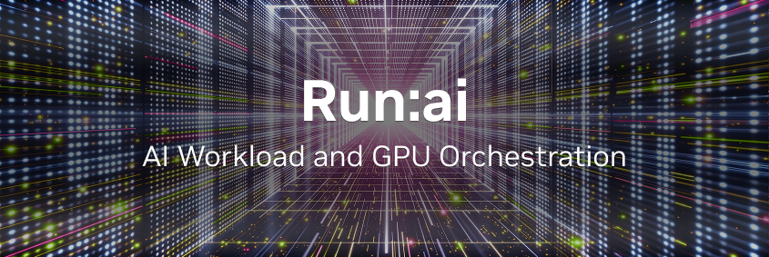
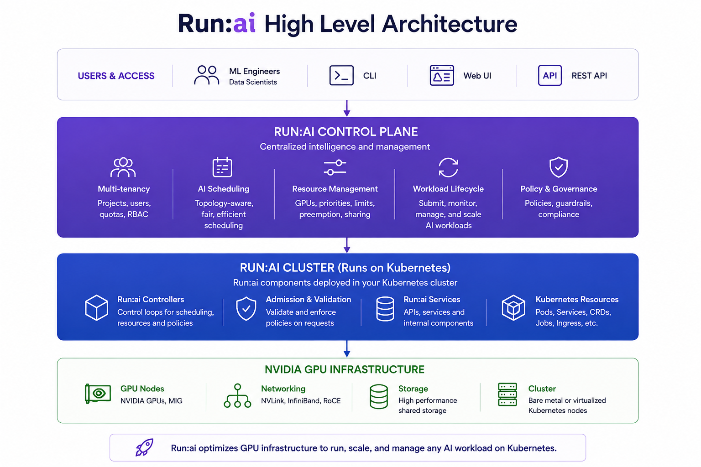

# NVIDIA Run:ai

[](LICENSE)
[](.github/workflows/static-code-analysis.yaml)
[](https://github.com/dsx-ai-factory/run-ai/releases)
[](https://github.com/dsx-ai-factory/run-ai/graphs/contributors)

[Docs](https://docs.nvidia.com/run-ai/) | [Roadmap](#roadmap) | [Installation](#installation) | [API Reference](https://docs.nvidia.com/run-ai/self-hosted/reference/home) | [Contributing](CONTRIBUTING.md) | [License](#license)

**NVIDIA Run:ai is an open-source AI workload and GPU orchestration platform** for managing shared AI infrastructure on Kubernetes.

NVIDIA Run:ai provides a consistent way to run development, training, and inference workloads across Kubernetes environments, whether deployed on-premises, in the cloud, or across hybrid infrastructure. It combines GPU scheduling, resource management, workload orchestration, governance, and observability to help organizations share GPU resources efficiently across teams and clusters.

This monorepo contains the NVIDIA Run:ai control plane and cluster services, installer, CLI, MCP server, documentation, shared client packages, and the local development environment.

## Architecture

<p align="center">
  
</p>

**[Architecture Overview →](https://docs.nvidia.com/run-ai/self-hosted/documentation/getting-started/architecture)**

NVIDIA Run:ai is made up of two components, both installed on a Kubernetes cluster:

- NVIDIA Run:ai control plane - Provides centralized resource management, handles workload submission, and delivers cluster monitoring and analytics. The control plane is the management layer; it connects to one or more NVIDIA Run:ai clusters and gives administrators and users a single place to operate across them.
- NVIDIA Run:ai cluster - Set of cluster services that provide enhanced scheduling and workload management on each Kubernetes cluster where workloads run. The cluster component extends Kubernetes native scheduling with Run:ai’s GPU-aware capabilities.

At a high level:

- Users and external systems interact with NVIDIA Run:ai through the web UI, CLI, or REST API.
- The NVIDIA Run:ai control plane manages workloads, organizational resources, policies, and configuration across connected Kubernetes clusters.
- NVIDIA Run:ai cluster services synchronize configuration and workload requests from the control plane to the appropriate cluster.
- NVIDIA Run:ai applies scheduling and resource policies to determine where and how workloads run on available GPU and compute resources.
- Workload and cluster status is synchronized back to the NVIDIA Run:ai control plane, providing centralized visibility across connected clusters.

### Core Capabilities

| Capability                        | What it does                                                                                                                                |
| --------------------------------- | ------------------------------------------------------------------------------------------------------------------------------------------- |
| **AI-aware GPU scheduling**       | Schedules GPU workloads using fair-share, preemption, bin-packing, priorities, and topology-aware placement.                                |
| **Dynamic GPU allocation**        | Shares GPU resources across workloads with fractional GPU allocation and dynamic use of available capacity.                                 |
| **Resource quotas and policies**  | Allocates GPU resources across departments and projects and enforces organizational resource policies.                                      |
| **Multi-cluster management**      | Centrally manages workloads, resources, and configuration across multiple Kubernetes clusters.                                              |
| **AI workload management**        | Manages workspaces, training, distributed training, and inference, with extensible support for additional Kubernetes workloads.             |
| **Access control and governance** | Controls access to NVIDIA Run:ai resources with role-based permissions and enforces organizational policies across workloads and resources. |
| **Monitoring and observability**  | Provides visibility into clusters, nodes, GPUs, workloads, resource utilization, and platform activity.                                     |
| **Multiple interfaces**           | Supports NVIDIA Run:ai operations through the web UI, CLI, and REST API.                                                                     |

## How NVIDIA Run:ai Relates to Other Tools

NVIDIA Run:ai is a scheduling and orchestration layer on top of Kubernetes: it does not replace Kubernetes, a container runtime, or a CI/CD system.

| Layer | Tools | How NVIDIA Run:ai relates |
|---|---|---|
| Cluster orchestration | Kubernetes, OpenShift | NVIDIA Run:ai runs **on** these. It extends the cluster with GPU-aware scheduling rather than replacing native scheduling. |
| Schedulers | Default `kube-scheduler`, Volcano, Kueue | NVIDIA Run:ai ships the [KAI Scheduler](https://github.com/kai-scheduler/kai-scheduler) and adds fair-share, preemption, fractional GPUs, and quota hierarchies across departments and projects. |
| GPU enablement | NVIDIA GPU Operator, Network Operator | Complementary: these expose and configure GPUs on nodes; NVIDIA Run:ai decides which workloads get them and for how long. |
| ML platforms and pipelines | Kubeflow, Ray, Argo Workflows, Slurm | Complementary for the Kubernetes-based ones: they submit workloads, NVIDIA Run:ai schedules and governs the GPU capacity those workloads consume. Slurm is an alternative for HPC-style batch on bare metal. |
| Workload types | Training Operator, LeaderWorkerSet, Knative, KServe | NVIDIA Run:ai integrates with these to manage workspaces, training, distributed training, and inference as first-class workloads. |

If you need GPU sharing, quota enforcement, and multi-tenant governance across teams sharing one Kubernetes GPU estate, that is the gap NVIDIA Run:ai fills. If you only need to run a single team's jobs on dedicated GPUs, native Kubernetes scheduling may be sufficient.

## Repository Map

| Component                       | Path                                                                                                                                                                                                                                                                                  | Description                                                                                                       |
| -------------------------------- | -------------------------------------------------------------------------------------------------------------------------------------------------------------------------------------------------------------------------------------------------------------------------------------- | ----------------------------------------------------------------------------------------------------------------- |
| **Control Plane**               | [`control-plane/`](control-plane)                                                                                                                                                                                                         | APIs and services that manage workloads, policies, identity, organizational structure, and platform configuration |
| **NVIDIA Run:ai Cluster**       | [`runai-cluster/`](runai-cluster)                                                                                                                                                                                                         | Controllers, admission webhooks, and services deployed into each managed Kubernetes cluster                       |
| **Installer**                   | [`runai-installer/`](runai-installer)                                                                                                                                                                                                     | CLI tool and provisioner service for deploying NVIDIA Run:ai on Kubernetes                                        |
| **MCP Server**                  | [`runai-mcp-server/`](runai-mcp-server)                                                                                                                                                                                                   | Model Context Protocol server that exposes NVIDIA Run:ai operations as tools for AI assistants                    |
| **Clients and shared packages** | [`runai-clients/`](runai-clients), [`runai-common-packages/`](runai-common-packages), [`runai-application-packages/`](runai-application-packages) | Generated API clients and shared Go libraries                                                                     |
| **Scale/Load Testing**          | [`scale-tests/`](scale-tests)                                                                                                                                                                                                                             | Load-testing SDK and unified load-test suite used to validate platform behavior at scale                          |
| **Documentation**               | [`docs/`](docs/), [`fern/`](fern/)                                                                                                                                                                                                                        | Product and developer documentation |
| **Local environment**           | [`local-dev.sh`](local-dev.sh), [`local-dev.md`](local-dev.md)                                                                                                                                | One-command local Kubernetes (Kind) development environment                                                       |

For a detailed breakdown of individual services and components, see the [Service Reference](docs/developer/services.md).

## Usage

### Local Development Environment

The [`local-dev.sh`](local-dev.sh) script builds the NVIDIA Run:ai control plane and cluster services from source and deploys them to a self-contained [Kind](https://kind.sigs.k8s.io/) cluster with a local image registry.

```bash
./local-dev.sh                                  # full build + cluster + deploy
./local-dev.sh --skip-build --skip-cluster      # re-deploy only
./local-dev.sh --teardown                       # tear the environment down
```

See [Local Development Guide](local-dev.md) for prerequisites (Docker/Podman, `make`, `git`, `curl`, `python3`, `openssl`, and minimum CPU/RAM/disk; `kind`, `kubectl`, and `helm` are installed automatically) and all available flags. Go, Node, and Java are not needed on the host: all builds run inside containers.

### Building Individual Services

Each service directory has a Makefile with standard targets (`make build`, `make test`, `make lint`, `make validate`) and a README describing how to build, test, and work with that service. See the [Service Reference](docs/developer/services.md) for a breakdown of individual services and components.

## Installation

NVIDIA Run:ai can be deployed on Kubernetes or OpenShift in connected or air-gapped environments. To understand the full installation lifecycle, see the [Installation and Configuration Overview](https://docs.nvidia.com/run-ai/self-hosted/documentation/installation-and-configuration/overview).

**Before you start:**

- **[Support Matrix](https://docs.nvidia.com/run-ai/self-hosted/documentation/installation-and-configuration/support-matrix)** - Kubernetes/OpenShift versions, operating systems, GPU and network operators, and third-party services NVIDIA Run:ai supports.
- **[System Requirements](https://docs.nvidia.com/run-ai/self-hosted/documentation/installation-and-configuration/system-requirements)** - Infrastructure, networking, and access you need to prepare before installing.

Choose an installation method based on how you want to manage the deployment:

- **[Guided installation](https://docs.nvidia.com/run-ai/self-hosted/documentation/installation-and-configuration/install/guided-installation) (recommended)** - Uses the `runai-installer` CLI with a configuration YAML file. The installer performs preflight checks, installs required dependencies, and deploys the NVIDIA Run:ai control plane and cluster.

- **[Manual installation](https://docs.nvidia.com/run-ai/self-hosted/documentation/installation-and-configuration/install/manual-helm/preparations)** - Deploys the NVIDIA Run:ai Helm charts directly. Use this path if you manage deployments through your own tooling, such as Argo CD, or require granular control over Helm values.

To build and run NVIDIA Run:ai locally for development, see [Usage](#usage).

### Distribution Channels

Released NVIDIA Run:ai container images and Helm charts are published to the NVIDIA NGC container registry under `nvcr.io/nvidia/runai`: this is the registry the installer and Helm charts pull from by default. Source releases and their notes are on the [GitHub Releases page](https://github.com/dsx-ai-factory/run-ai/releases); see [Release Process](RELEASE.md) for how releases are cut and versioned.

## Contributing

Contributions are welcome. Please read [Contributing](CONTRIBUTING.md) for the development workflow, branch and PR policy, and CI expectations, and [Code of Conduct](CODE_OF_CONDUCT.md) for community guidelines.

## Roadmap

NVIDIA Run:ai does not publish a long-range feature roadmap in this repository. What is planned and in progress is tracked in the open:

- **[Open issues](https://github.com/dsx-ai-factory/run-ai/issues)** - Planned work, accepted feature requests, and known gaps. Issues are triaged and labelled by maintainers.
- **[Releases](https://github.com/dsx-ai-factory/run-ai/releases)** - What actually shipped in each version, with notes generated from the merged pull requests on that release branch.
- **[Support](SUPPORT.md)** - Which versions are currently supported and when each moves to end of life.

Release cadence, branch naming, and who cuts a release are documented in [Release Process](RELEASE.md).

**Known limitations:** the root `Makefile` targets are placeholders; real build, test, and lint targets live in each service directory (see [Building Individual Services](#building-individual-services)). The full CI gate runs remotely and is reported back on pull requests as the `Validate Successful Run` check.

## Community

- **[GitHub Issues](https://github.com/dsx-ai-factory/run-ai/issues)** - Bug reports, feature requests, documentation issues, and usage questions. This is the project's primary discussion forum; start here.
- **[Support](SUPPORT.md)** - Supported versions and where to get help, including commercial support.

## Security & Support

- **Reporting a vulnerability:** see [Security](SECURITY.md); do not open public issues for security reports.
- **Supported versions and getting help:** see [Support](SUPPORT.md).

## License

Licensed under the Apache License, Version 2.0; see [`LICENSE`](LICENSE). Third-party attributions are listed in [`NOTICE`](NOTICE) and in the per-component `NOTICE` files.

**Trademark notice:** Apache 2.0 applies to the software code in this repository. It does not grant permission to use NVIDIA or Run:ai trademarks, logos, product names, fonts, artwork, or other brand assets. Please see [Trademarks](TRADEMARKS.md) for details.

### Nested and Third-Party Licenses

Some subdirectories contain vendored third-party code or bundled assets under their own license. Each is listed below with its license and the path to that license file:

| Subdirectory | License | License file |
|--------------|---------|--------------|
| `skills/` | Apache-2.0 AND CC-BY-4.0 | [`skills/LICENSE`](skills/LICENSE) |
| `runai-cluster/cluster/goofys/` | Apache-2.0 | [`runai-cluster/cluster/goofys/LICENSE.md`](runai-cluster/cluster/goofys/LICENSE.md) (attributions in the adjacent `NOTICE`) |
| `control-plane/assets-service/third_party/go_acc/` | Apache-2.0 | [`.../go_acc/LICENSE`](control-plane/assets-service/third_party/go_acc/LICENSE) |
| `control-plane/workloads-and-policies/third_party/kserve/` | Apache-2.0 | [`.../kserve/LICENSE`](control-plane/workloads-and-policies/third_party/kserve/LICENSE) |
| `runai-application-packages/jsonutils/conjungo/` | MIT | [`.../conjungo/LICENSE`](runai-application-packages/jsonutils/conjungo/LICENSE) |
| `runai-application-packages/jsonutils/gojsonq/` | MIT | [`.../gojsonq/LICENSE.md`](runai-application-packages/jsonutils/gojsonq/LICENSE.md) |
| `runai-application-packages/validation/` | MIT | [`.../validation/LICENSE`](runai-application-packages/validation/LICENSE) |
| `runai-cluster/cluster/workload-controller/third_party/validation/` | MIT | [`.../third_party/validation/LICENSE`](runai-cluster/cluster/workload-controller/third_party/validation/LICENSE) |
| `control-plane/frontend/public/static-cli/fonts/` | Apache-2.0 | [`.../fonts/LICENSE.txt`](control-plane/frontend/public/static-cli/fonts/LICENSE.txt) |

The following subdirectories ship an aggregated third-party **dependency** license report (not a license for their own code):

| Subdirectory | Report |
|--------------|--------|
| `runai-cluster/cluster/init-ca/licenses/` | [`THIRD-PARTY-LICENSES.md`](runai-cluster/cluster/init-ca/licenses/THIRD-PARTY-LICENSES.md) (generated by `go-licenses`) |
