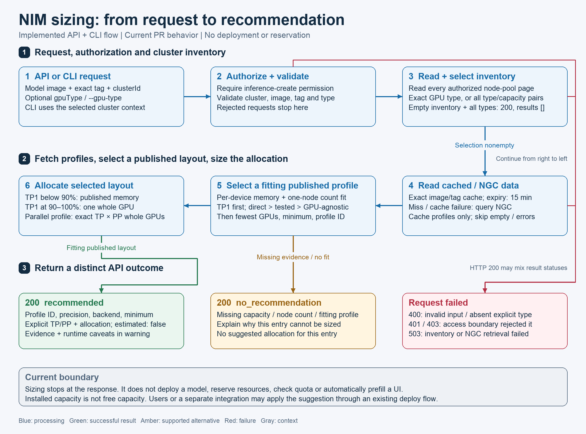
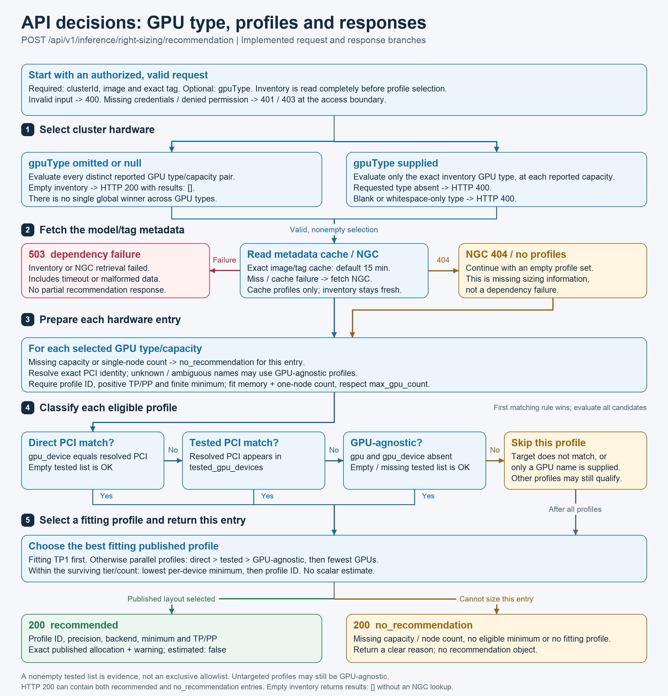
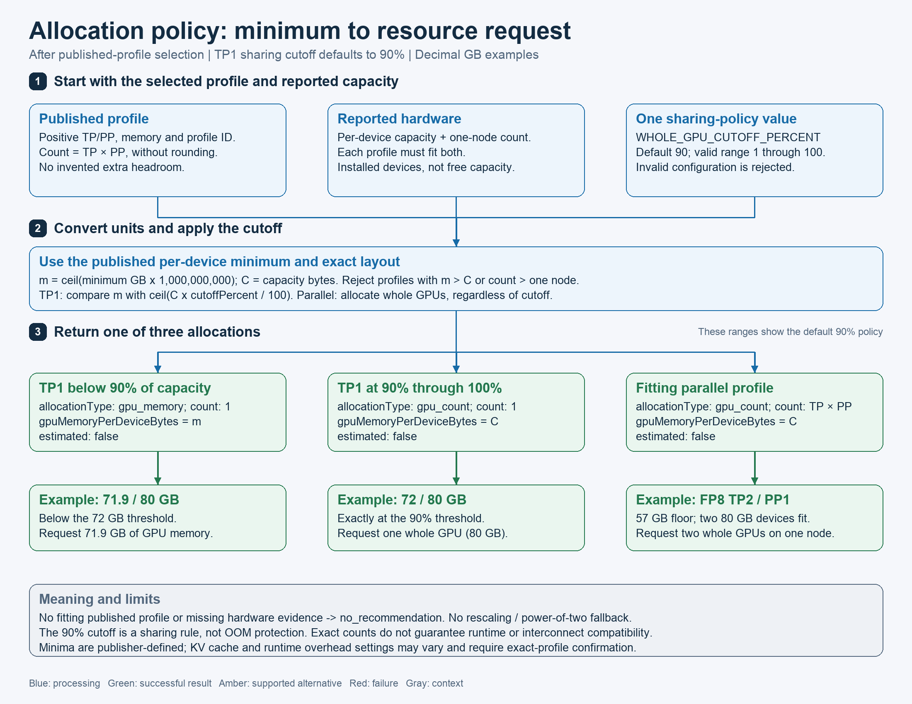

# NIM test/dev sizing flows

These diagrams describe the implemented API and CLI behavior. They document the current flow; they do not validate runtime compatibility or model startup.

Exact image/tag metadata is read through the existing CP cache with a configurable 15-minute default expiry. Cache misses/failures fetch NGC directly; only successful nonempty profile lists are cached. Missing data and errors are not cached. Inventory and allocations remain fresh on every request. See the [service configuration and cache policy](../../README.md#nim-testdev-right-sizing).

## Full feature flow

Request inputs, authorization, paginated inventory, exact-tag metadata, profile selection, allocation and response boundaries.

[Editable SVG](nim-sizing-feature-flow.svg)

## API decisions and responses

Covers omitted/null and explicit `gpuType`, empty inventory, absent types, missing capacity, per-node counts or metadata, direct/tested/GPU-agnostic classification, empty or missing tested-device lists, and mixed result statuses. A missing tested list does not exclude a direct or GPU-agnostic profile. `no_recommendation` is a valid HTTP 200 result with a reason.

[Editable SVG](nim-sizing-api-decisions.svg)

## Allocation policy

Shows the single-device sharing cutoff (default 90%), exact boundary examples and published TP × PP whole-GPU layouts. The TP2 example matches the pinned Llama 3.1 70B 2.0.13 FP8 profile: 57 GB per device on an 80 GB H100 node. Every candidate must fit per-device memory and the matching device count on one node. There is no scalar-memory or power-of-two fallback.

[Editable SVG](nim-sizing-allocation-policy.svg)

## Share and maintain

- [Three-page PDF](feature-flow-diagrams.pdf)
- [Structured diagram layout](layout.json)
- PNG files are suitable for presentations; SVG files preserve editable vector text and connections.

Update the diagrams when the corresponding implementation changes. Source references:

- [API request and outcomes](../../swagger/source/resources/RightSizing.yaml) and [per-hardware response schema](../../swagger/source/schemas/rightSizing/RightSizingResult.yaml)
- [Inventory selection](../../pkg/services/rightsizing/service.go) and [published-profile ranking](../../pkg/services/rightsizing/profiles.go)
- [Allocation calculation](../../pkg/services/rightsizing/allocation.go)
- [PCI identity resolution](../../pkg/clients/gpuinventory/pci.go) and [NVIDIA snapshot provenance](../../pkg/clients/gpuinventory/data/README.md)
- [Exact-tag NGC metadata and dependency handling](../../pkg/clients/ngcmetadata/client.go)
- [Endpoint authorization](../../pkg/router/router.go)

Published minima are publisher-defined; exact KV-cache/runtime overhead settings may vary and require profile/runtime confirmation. The cutoff controls sharing. Published layout/allocation arithmetic (`estimated: false`) does not verify hardware/runtime compatibility, free devices, interconnects or schedulability. Cluster-service must report per-node count evidence; omitted counts return `no_recommendation`.
