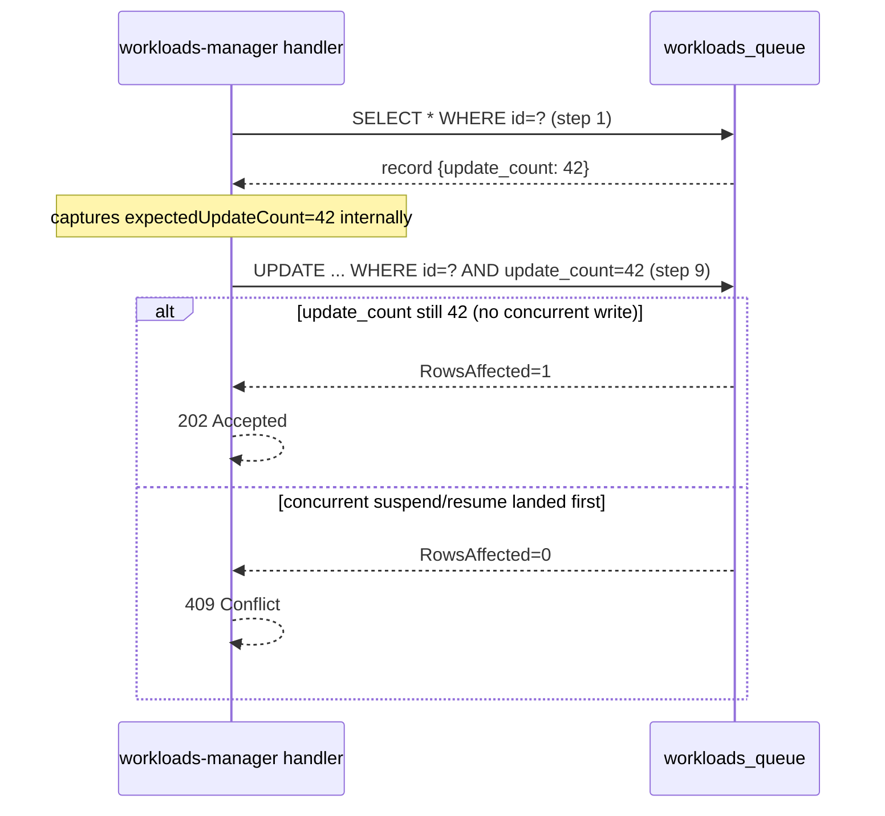

# Any Workload Suspend / Resume — Design Document

## Background

Native workloads (Training, Workspace, Distributed) use a `desired_phase` field (`STOPPED` / `RUNNING`) stored in `crud_workloads` and synced to the cluster via `JobWorkload.Spec.Active`. Karta (WorkloadsV2) has no analogous suspend mechanism today — `change_desired_phase.go` explicitly rejects `STOPPED`/`RUNNING` for `SOURCEAPI_WORKLOADS_V2` workloads.

WorkloadsV2 already supports mutating the manifest through the `PUT /api/v2/workloads/{id}` update endpoint — a client could technically patch `spec.suspend: true` directly. However, a dedicated action endpoint is preferable because:
- The suspend/resume intent is explicit and self-documenting in the API surface.
- It allows the handler to gate on the current phase and reject invalid transitions without the client knowing the Karta JQ expressions.
- The `updateCount` optimistic-lock check prevents silent overwrites when two concurrent suspend/resume requests race inside the handler.

The implementation treats suspend/resume as a **manifest patch**: the Karta resource definition carries JQ expressions that mutate `RawManifest` / `EffectiveManifest` in `workloads_queue` directly, and the updated manifest is synced to the cluster in the normal way.

---

## Scope: Supported Workload Types

**Not all workload types support suspend/resume.** The feature is strictly limited to resource types that have a **native, first-class suspend primitive** built into the framework — meaning the framework itself understands a dedicated field (e.g., `spec.suspend: true`) and handles the suspend lifecycle gracefully (draining pods, preserving state, emitting a `Suspended` condition).

### What "native suspend support" means

A resource type is eligible if it exposes a dedicated suspend toggle that:
- Is **framework-managed** — the framework natively handles pod termination on suspend and re-creation on resume, without the user needing to intervene. Note: pods are deleted during suspend; any ephemeral in-memory state or ephemeral storage is lost. What is preserved is the job definition itself, allowing the framework to reschedule from scratch on resume.
- Is **self-reporting** — the framework emits a recognisable condition or status when suspended/suspending (e.g., `type: Suspended, status: True`).
- Does **not** require a workaround to simulate suspension.

**In scope — examples of native suspend primitives:**

| Resource | Suspend field |
|---|---|
| `batch/v1 Job` | `.spec.suspend: true` (native since k8s 1.21) |
| Kubeflow `PyTorchJob`, `TFJob`, `MPIJob`, etc. | `.spec.runPolicy.suspend: true` (operator ≥ v1.5) |
| `batch/v1 CronJob` | `.spec.suspend: true` |
| Any custom operator with a dedicated suspend field | as defined by the operator |

**Out of scope — workaround-based "suspension":**

Resources that lack a native suspend field must **not** have a `suspendDefinition` authored for them. The canonical example is `apps/v1 Deployment` or `StatefulSet`, where the only way to stop pods is to set `replicas: 0`. This is excluded because:

- **Destructive** — setting `replicas: 0` terminates all running pods immediately with no graceful handoff.
- **Lossy** — in-progress work is lost; no framework-managed checkpoint is created.
- **Misleading status** — there is no `Suspended` condition emitted; the resource looks `Available` with 0 replicas, making phase detection unreliable.
- **Quota side-effects** — scaling to 0 releases resource reservations, which can allow other workloads to consume the quota and block the subsequent resume.

### Enforcement

The `suspendDefinition` check is the single gate — workloads whose Karta resource definition has no `suspendDefinition` receive `400 Bad Request: "workload type does not support suspend/resume"` (see handler step 4 in Section 3).

Run:ai-owned Karta seed migrations will only add `suspendDefinition` for frameworks with confirmed native suspend support. Operators authoring custom Kartas are responsible for ensuring their resource meets the eligibility criteria above before adding `suspendDefinition`.

**API discoverability (nice-to-have, follow-up):** The workloads service already exposes an `actionsSupport` object on every workload response (native and V2) with `{ delete: bool, suspend: bool }`. For V2 workloads, `actionsSupport.Suspend` is currently always `false`. Once the Karta client is available, set `actionsSupport.Suspend = true` in `WorkloadModelToApi` when the GVK's Karta resource definition contains a `suspendDefinition`. No new fields are required; the UI and CLI already consume `actionsSupport.suspend` to grey out/enable the suspend button.

---

## Architecture: Current vs. Proposed

```mermaid
flowchart TD
    subgraph current [Current — Native Workloads]
        A[User: POST /suspend] --> B[change_desired_phase.go]
        B --> C[crud_workloads: desired_phase=STOPPED]
        C --> D[cluster agent: Spec.Active=false]
        D --> E[Workload Controller: Suspending → Suspended]
    end

    subgraph proposed [Proposed — Any Workload]
        F[User: POST /api/v2/workloads/id/action {type: suspend|resume}] --> G[ActionHandler in workloads-manager]
        G --> H[Fetch WorkloadsQueueRecord + update_count]
        H --> I[Fetch RI for GVK]
        I --> J[Validate suspendDefinition exists]
        J --> K[Execute JQ suspendActions array on RawManifest]
        K --> L[DbUpdateWithOptimisticLock WHERE update_count=N]
        L -->|"conflict: 409"| M[Return 409 Conflict]
        L -->|"ok: row saved"| N[workloads_queue updated]
        N --> O[Cluster agent: syncs new manifest]
        O --> P[anyworkload-controller: Suspending → Suspended]
    end
```

---

## Changes Required

### 1. Karta Resource Definition Extension

Location: `karta` library (external) + workloads service Karta resource definition migrations and seed files under [`control-plane/workloads/pkg/database/go_migrations/ri/`](control-plane/workloads/pkg/database/go_migrations/ri/).

**`suspendDefinition`** added to the Karta `specDefinition`:

```yaml
specDefinition:
  podTemplateSpecPath: .spec.pytorchReplicaSpecs.Worker.template
  suspendDefinition:
    suspendActions:            # Array of JQ expressions applied in order on suspend
      - '.spec.suspend = true'
    resumeActions:             # Array of JQ expressions applied in order on resume
      - '.spec.suspend = false'
```

> **Design decision — array of expressions instead of single:**
>
> `suspendActions` and `resumeActions` are arrays (not single strings) to allow multiple atomic mutations in a sequence. Some frameworks require touching more than one field for a clean suspend (e.g. TFJob may require both `spec.suspend` and a label update). An array makes this composable without embedding logic into a single complex expression, and matches the existing Karta pattern where `StatusMatcher` arrays are OR'd together. Expressions are applied in order; later expressions receive the output of the previous one, so they compose cleanly.

> **Design decision — JQ expressions vs. explicit path/value fields:**
>
> Two approaches were considered for encoding the suspend/resume mutation:
>
> | Dimension | JQ expression array (`['.spec.suspend = true']`) | Explicit path/value (`{path: spec.suspend, value: true}`) |
> |---|---|---|
> | **Multi-field patches** | Native — an array of expressions can set `spec.suspend`, remove an annotation, and zero a field atomically | Requires an array of pairs (`suspendActions: [...]`), equally expressive but more verbose |
> | **Conditional logic** | Supported (e.g., only patch if a field is absent) | Not supported — values are static |
> | **Consistency with Karta** | `byExpression` in `statusDefinition` already uses JQ; same authoring conventions | Introduces a second, parallel mutation language into the spec |
> | **Static validation** | Errors surface only at runtime (bad JQ = patch failure at suspend time) | Path and value type can be validated at seed/load time before any workload is touched |
> | **Security surface** | Arbitrary mutations possible if expression is malformed; mitigated by: trusted authorship (only run.ai engineers / cluster operators write RI definitions), timeout, and context cancellation | No code execution; no runtime security surface |
> | **Operational transparency** | JQ is unfamiliar to operators not comfortable with the language | Self-documenting; any engineer can read `{path: spec.suspend, value: true}` immediately |
>
> **Decision: JQ expression arrays.**
> The deciding factor is **consistency with the existing Karta contract**. `statusDefinition` already relies on `byExpression` (JQ) for phase detection, so the evaluator conventions and RI-authoring mental model are already established. The multi-field and conditional-logic flexibility of JQ is not hypothetical: at least one known framework (TFJob) requires touching both `spec.suspend` and a label for a clean suspend. Note that **the karta JQ runtime safety guards for `byExpression` (`validatedParsedJQ`) do NOT apply here** — they are designed for read-only expressions and reject mutation operators. Karta will expose a dedicated `ValidateActionExpression` function for mutation-safe validation of suspend action expressions (see JQ Safety section).

**New status conditions** added to the Karta `statusDefinition`:

> **Prerequisite — karta API extension required:** The current `StatusMappings` struct in karta `v0.0.9` contains only `Initializing`, `Running`, `Completed`, and `Failed` fields. The `Suspended`, `Suspending`, and `Resuming` fields (and their corresponding `ResourceStatus` constants) do not exist yet. Coordinate with karta owners to add them before implementing the controller-side detection.

```yaml
statusDefinition:
  conditionsDefinition:
    # ...existing...
  statusMappings:
    # ...existing initializing/running/completed/failed matchers...

    # New matchers — require karta API update to add these StatusMappings fields:
    suspended:
      - byConditions:
          - type: "Suspended"
            status: "True"
    suspending:
      - byConditions:
          - type: "Suspended"
            status: "False"
            reason: "PodsStillRunning"    # framework emits this while draining
        byExpression:
          expression: '.spec.suspend == true'
          expectedResult: "true"
    resuming:
      - byConditions:
          - type: "Suspended"
            status: "True"
        byExpression:
          expression: '.spec.suspend == false'
          expectedResult: "true"
```

> **How `Resuming` was derived — alignment with native workload logic:**
>
> The native workload controller (`workload_status_calculator.go`) computes `Resuming` as:
> ```go
> case isWorkloadActive(sc.workload) && isConditionTrue(conditions, common.Suspended):
>     newPhaseEnum = common.PhaseResuming
> ```
> Translated: `Spec.Active == true` (control plane issued resume) **AND** the job's `Suspended` condition is still `True` (pods have not yet come back up). It does **not** check running pod count — the transient state begins the moment the resume is issued, even before any pod starts.
>
> The equivalent in Karta terms: `spec.suspend == false` (resume patch applied to manifest) **AND** the framework's `Suspended` condition is still `True`. This is expressed above as a `StatusMatcher` combining both `byConditions` and `byExpression` (karta applies AND logic when both are present on the same matcher).
>
> The previous draft used `.spec.suspend == false and .status.runningPods > 0` which was incorrect — it would miss the initial resuming window before any pod has started.
>
> **Note on `Suspended` condition portability:** Not all frameworks emit a `Suspended` condition with a `PodsStillRunning` reason. The RI author must ensure the matchers match the actual signals the framework emits. If a framework has no such differentiated signal, the `suspending` matcher can fall back to a pure `byExpression` checking `.spec.suspend == true and .status.runningPods > 0`.

**Impact:**
- Karta library must add `Suspended`, `Suspending`, `Resuming` to `StatusMappings` and corresponding `ResourceStatus` constants (team/library boundary — coordinate with karta owners).
- Karta library `ComponentDefinition` (or a new top-level field) gets `SuspendDefinition` (coordinate with karta owners).
- Workload type Karta resource definition seed migrations updated to include `suspendDefinition` for supported frameworks.
- The Karta resource definition is validated at workload-type registration time; workloads without a `suspendDefinition` return a 400 when the action endpoint is called.

---

### 2. New Action API Endpoint

**Service:** `workloads-manager`

**Path:** `POST /api/v2/workloads/{WorkloadV2Id}/action`

**Request body:**

```yaml
WorkloadActionRequest:
  type: object
  required: [type]
  properties:
    type:
      $ref: '#/components/schemas/WorkloadAction'
```

**`WorkloadAction` enum** (standalone schema, reusable):

```yaml
WorkloadAction:
  type: string
  enum:
    - suspend
    - resume
```

> The enum is defined as a standalone schema so it can be extended independently of the URL shape. Additional actions (e.g. `restart`) are added to the enum without any path change.

**Response:**
- `202 Accepted` — `WorkloadV2` object (same shape as GET)
- `400 Bad Request` — RI has no `suspendDefinition`, phase disallows the action, or `type` value is unknown
- `404 Not Found` — workload not found or not in scope
- `409 Conflict` — concurrent suspend/resume request landed at the same time (retry)

**OpenAPI files to update:**
- [`control-plane/workloads-manager/swagger/source/`](control-plane/workloads-manager/swagger/source/) — add `WorkloadAction` enum schema, `WorkloadActionRequest` object schema, and the `POST .../action` path
- [`control-plane/workloads-manager/internal/generated/`](control-plane/workloads-manager/internal/generated/) — regenerate

---

### 3. Suspend/Resume Handler — Step-by-Step Flow

New file: `control-plane/workloads-manager/pkg/services/api_workloads_v2_action_impl.go`

```text
ActionWorkloadV2(ctx, workloadId string, request WorkloadActionRequest):

1. DbGetWorkload(ctx, workloadId, permittedScopes)
     → 404 if not found
     → capture record.UpdateCount internally as expectedUpdateCount

2. Validate phase allows the action (see "Phase Source of Truth" below):
     - request.Type == "suspend" requires DesiredPhase == Running
       (reject if DesiredPhase in {Stopped, Deleted, Failed, Completed} — any terminal/finite state)
       NOTE: DesiredPhase == Running also covers live-cluster Pending workloads — this is
       intentional; native workloads allow suspending Pending workloads (Pending is absent
       from the unstoppablePhases map), so Karta workloads align with the same behaviour.
     - request.Type == "resume" requires DesiredPhase == Stopped

3. Fetch Karta resource definition for record.ResourceGroup/ResourceVersion/ResourceKind
     via workloads-service client (new method on existing client in
     pkg/clients/workloads/ or a new Karta client)

4. Check ri.SuspendDefinition != nil
     → 400 if not found ("workload type does not support suspend/resume")

5. Select JQ expression array:
     jqExprs = suspendDefinition.SuspendActions  (if request.Type == "suspend")
     jqExprs = suspendDefinition.ResumeActions   (if request.Type == "resume")

6. Apply each JQ expression in jqExprs sequentially to record.RawManifest → updatedManifest
     (each expression receives the output of the previous; see "JQ Safety" below)

7. Apply same JQ expression array to record.EffectiveManifest → updatedEffective
     (policy already ran at create/update time; we patch the result
      so the cluster gets the correct effective manifest without a
      full policy re-run)

8. Set record.DesiredPhase = "Stopped" (request.Type == "suspend") or "Running" (request.Type == "resume")
     (mirrors what native workloads do; used by anyworkload-controller
      status rollup and UI display)

9. DbUpdateWorkloadWithLock(ctx, record, expectedUpdateCount)
     → 409 Conflict if update_count on disk != expectedUpdateCount
       (means a concurrent suspend/resume request landed between steps 1 and 9)

10. Return WorkloadV2 (202)
```

#### Phase Source of Truth

**Decision: use `DesiredPhase` from `workloads_queue` as the sole gating source.**

`WorkloadsQueueRecord.DesiredPhase` is the control plane's last-issued intent. It is set synchronously during every action and is immediately consistent — there is no cluster-reporting lag. Using the live cluster phase (from `sync_status` or an external report) would introduce staleness and an additional read dependency.

Concretely:
- `request.Type == "suspend"` requires `DesiredPhase == "Running"`. All terminal/finite states (`Stopped`, `Deleted`, `Failed`, `Completed`) are rejected — suspending a workload that has already ended or been stopped is meaningless or dangerous.
- `request.Type == "resume"` is rejected unless `DesiredPhase == "Stopped"` — resuming anything not previously stopped is a no-op or an error.

**Acknowledged limitation:** The current design gates on `DesiredPhase` only; it cannot detect transient live-cluster states. However, this is intentional — the native workload controller (`change_desired_phase.go`) also allows suspending `Pending` workloads: `PHASE_PENDING` is absent from `unstoppablePhases`. Karta workloads align with the same permissive behaviour by gating solely on `DesiredPhase == Running`.

#### JQ Safety

**Validation and runtime safety for suspend/resume action expressions is delegated entirely to the Karta library. We do not implement any JQ safety guards in workloads-manager.**

Karta's existing `validatedParsedJQ` (used via `jq:"validate"` struct tags) is designed for **read-only** status evaluation expressions only — it explicitly rejects all assignment operators (`=`, `|=`, `+=`, etc.), making it incompatible with the mutating expressions required for `suspendActions`/`resumeActions` (e.g. `.spec.suspend = true`).

**Karta must add a new exported function:**

```go
// ValidateActionExpression validates a mutation-safe JQ expression intended for
// manifest patching (e.g. suspendActions/resumeActions). Unlike validatedParsedJQ,
// assignment operators are permitted. Dangerous recursive/unbounded operations are
// still rejected.
func ValidateActionExpression(expr string) error
```

This function:
- **Allows** assignment operators (`=`, `|=`, `+=`, `-=`, `*=`, `/=`, `%=`, `//=`) — these are the purpose of the expression.
- **Rejects** dangerous recursive/unbounded operations: `del`, `range`, `paths`, `recurse`, `walk`, `repeat`, `..` (recursive descent).
- **Validates** that the expression parses and compiles (syntax check).

`ValidateActionExpression` is called on each entry in `suspendActions` and `resumeActions` at RI load/registration time, ensuring all expressions are safe before any workload is touched. Because the function permits mutation operators, the `SuspendDefinition` struct fields do **not** carry a `jq:"validate"` tag (which would invoke the incompatible read-only check).

Runtime safety (timeout via `context.WithTimeout` + `RunWithContext`, context cancellation) is handled by Karta's existing runner infrastructure when executing action expressions. The handler calls Karta's execution API directly — it does not manage gojq contexts or goroutines itself.

**Error mapping** (returned by Karta's execution API to the handler):
- Timeout or context cancellation → `408 Request Timeout`
- JQ parse/compile error → `400 Bad Request`
- Runtime gojq error (bad expression result type, etc.) → `400 Bad Request` with the gojq error message

---

### 4. Optimistic Concurrency with `update_count`

**Why it matters:** `UpdateWorkloadV2` does a blind `Save()` (GORM upsert). Two concurrent action calls — e.g. two simultaneous suspend requests — can silently overwrite each other. The `update_count` column is already auto-incremented by a PostgreSQL trigger (`workloads_queue_update_count_trigger`) on every `INSERT/UPDATE`, making it a ready-made optimistic lock version.

The lock is **entirely internal** to the handler — `update_count` is captured from the DB at step 1 (alongside the workload record) and used as the `WHERE` guard at step 9. It is not exposed in the request or response.

**New DAO function** in [`control-plane/workloads-manager/pkg/database/dao/workloads_queue.go`](control-plane/workloads-manager/pkg/database/dao/workloads_queue.go):

```go
// DbUpdateWorkloadWithLock returns a non-nil api.Error on conflict or DB failure.
func DbUpdateWorkloadWithLock(ctx context.Context, record *models.WorkloadsQueueRecord, expectedUpdateCount int64) *api.Error {
    // Use Updates() with an explicit field map — NOT Save().
    // GORM v2's Save() falls back to INSERT/upsert when UPDATE affects 0 rows,
    // silently bypassing the WHERE update_count guard and potentially creating a
    // duplicate record. Updates() with a field map issues a strict UPDATE only.
    updates := map[string]any{
        "raw_manifest":       record.RawManifest,
        "effective_manifest": record.EffectiveManifest,
        "desired_phase":      record.DesiredPhase,
        "input_request_path": record.InputRequestPath,
        "input_request_body": record.InputRequestBody,
        "updated_at":         record.UpdatedAt,
        "updated_by":         record.UpdatedBy,
    }
    result := dao_utils.DB().WithContext(ctx).
        Table(models.WorkloadsQueueTableName).
        Where("id = ? AND update_count = ?", record.ID, expectedUpdateCount).
        Updates(updates)

    if result.Error != nil { /* return 503 */ }
    if result.RowsAffected == 0 {
        return api.NewError(http.StatusConflict,
            "workload was modified by a concurrent request; retry", nil)
    }
    return nil
}
```

**Handler flow:**



**Note — existing `UpdateWorkloadV2` must also adopt this guard (in scope):** The existing spec-update path (`PUT /api/v2/workloads/{id}`) also performs a blind `Save()` (GORM upsert). A concurrent suspend/resume action and a spec update can silently overwrite each other. The `DbUpdateWorkloadWithLock` DAO function will be used for both the action handler and the spec-update handler. The spec-update handler already fetches the record via `DbGetWorkload` at step 1, so `expectedUpdateCount` is available without an additional DB call.

---

### 5. Any Workload Controller — New Phase Statuses

Location: [`runai-cluster/cluster/anyworkload-controller/`](runai-cluster/cluster/anyworkload-controller/)

The PDF explicitly states: "Any workload will not have any behaviour change, just adding the support of the new runner statuses."

No new reconcile loop behaviour is needed — the underlying resource handles its own suspend via its native mechanism (driven by the JQ-patched manifest). The controller only needs to **detect** and **report** the correct phase.

#### How Suspending / Suspended / Resuming Are Determined

Phase detection relies **entirely on Karta resource definition conditions** evaluated against the live cluster resource. No Run:ai-specific annotations are introduced — anyworkload-controller must remain a vendor-neutral OSS project.

**Karta `statusDefinition` new `StatusMappings` fields** (defined in Section 1):

- `suspended` — matches when the resource is fully stopped (e.g., framework emits `type: Suspended, status: True`).
- `suspending` — matches when the resource is draining (e.g., `Suspended condition == False` with `reason: PodsStillRunning` AND `.spec.suspend == true`).
- `resuming` — matches when a resume has been issued but the resource has not yet left the suspended state.

**`Resuming` derivation — aligned with native workload controller:**

The native workload controller (`workload_status_calculator.go`, `handleWorkloadPhase`) computes `Resuming` as:

```go
case isWorkloadActive(sc.workload) && isConditionTrue(conditions, common.Suspended):
    newPhaseEnum = common.PhaseResuming
```

Direct translation to Karta: `spec.suspend == false` (resume manifest applied → workload is "active") **AND** the framework's `Suspended` condition is still `True` (pods have not yet recovered). The matching `StatusMatcher` combines both `byExpression` and `byConditions` in a single entry (karta ANDs them when both are present on the same matcher). This is expressed in Section 1 and is the canonical signal.

**Phase priority table** — `mapResourceStatusToWorkloadRunnerPhase` extended (first match wins):

| Priority | Karta `resuming` match | Karta `suspending` match | Karta `suspended` match | Resulting phase |
|---|---|---|---|---|
| 1 | ✅ | — | — | `Resuming` |
| 2 | — | ✅ | — | `Suspending` |
| 3 | — | — | ✅ | `Suspended` |
| 4 | — | — | — | Normal Karta phase (Failed / Completed / Running / Initializing / Unknown) |

**Implementation changes:**

- [`internal/utils/ri/resource.go`](runai-cluster/cluster/anyworkload-controller/internal/utils/ri/resource.go) — extend `GetResourcePhase` to:
  1. Evaluate the new `Suspended`, `Suspending`, `Resuming` status matchers from `StatusMappings` via `riresource.GetRootComponent().GetStatus(ctx)`.
  2. Apply the priority table above before falling through to the existing status mapping.
- Register `SuspendedStatus`, `SuspendingStatus`, `ResumingStatus` as new `riv1alpha1.ResourceStatus` constants in karta (coordinate with karta owners — the current `ResourceStatus` enum only contains `Initializing`, `Running`, `Completed`, `Failed`, `Undefined`).
- **No changes needed** in [`workloads_v2_handler.go`](runai-cluster/cluster/agent/pkg/handlers/workloads_v2_handler.go) — the `run.ai/desired-phase` annotation approach has been dropped in favour of Karta-native condition evaluation.

The full `mapResourceStatusToWorkloadRunnerPhase` priority order becomes:

```text
Resuming > Suspending > Suspended > Failed > Completed > Running > Initializing > Unknown
```

---

## Changes to Existing Update API

### 6. Optimistic Locking on `UpdateWorkloadV2`

**Context (review feedback):** The existing `PUT /api/v2/workloads/{id}` handler calls `DbUpsertWorkload` which executes a blind GORM `Save()`. A concurrent suspend/resume action and a spec update can silently overwrite each other.

**Change:** Replace the final `DbUpsertWorkload` call in `UpdateWorkloadV2` with `DbUpdateWorkloadWithLock`, using the `UpdateCount` captured from the `DbGetWorkload` call that already happens at the start of the handler. No additional DB read is needed — the record is already in hand. Return `409 Conflict` when the optimistic lock fails.

### 7. Clear `InputRequestBody` on Update

**Context (review feedback):** The `InputRequestBody` column stores the original submission request body, which acts as the "desired state" baseline for certain scenarios (e.g. re-submission, drift detection). When a user issues a `PUT /api/v2/workloads/{id}` update with an arbitrary manifest diff, we cannot know what the user's new intended desired state is — the old body is no longer valid, but the new body may not fully represent intent either.

**Change:** In `UpdateWorkloadV2`, set `qRecord.InputRequestBody = nil` before calling `DbUpdateWorkloadWithLock`. This clears the stale desired-state snapshot. Any consumer that relied on `InputRequestBody` for this workload will receive an empty value and must re-derive state from the current effective manifest.

---

## Database Changes

| Table | Change |
|---|---|
| `workloads_queue` | No schema change — `update_count` already exists and is auto-incremented by trigger |
| OpenAPI schema | New `WorkloadAction` enum (`suspend` \| `resume`) and `WorkloadActionRequest` object (`type: WorkloadAction`) as request body |

No migration needed for the DB itself. The `update_count` column and its trigger were introduced in `02230002_crud_and_sync.up.sql`. The `DbUpdateWorkloadWithLock` DAO function added in Section 4 is shared by both the new action endpoint and the existing `UpdateWorkloadV2` handler.

---

## File-by-File Summary

| File | Change |
|---|---|
| [`control-plane/workloads-manager/swagger/source/`](control-plane/workloads-manager/swagger/source/) | Add `WorkloadAction` enum schema (`suspend` \| `resume`) and `WorkloadActionRequest` body schema; add `POST .../action` path |
| [`control-plane/workloads-manager/pkg/services/api_workloads_v2_action_impl.go`](control-plane/workloads-manager/pkg/services/api_workloads_v2_action_impl.go) | **New file** — `ActionWorkloadV2` handler |
| [`control-plane/workloads-manager/pkg/services/api_workloads_v2_impl.go`](control-plane/workloads-manager/pkg/services/api_workloads_v2_impl.go) | Wire new action handler; replace `DbUpsertWorkload` with `DbUpdateWorkloadWithLock`; clear `InputRequestBody` on update |
| [`control-plane/workloads-manager/pkg/database/dao/workloads_queue.go`](control-plane/workloads-manager/pkg/database/dao/workloads_queue.go) | Add `DbUpdateWorkloadWithLock` (shared by action handler and update handler) |
| [`control-plane/workloads-manager/pkg/clients/`](control-plane/workloads-manager/pkg/clients/) | Add (or extend) Karta client to fetch `suspendDefinition` from the workloads service |
| [`control-plane/workloads/pkg/services/workload_properties_service.go`](control-plane/workloads/pkg/services/workload_properties_service.go) | Expose Karta `suspendDefinition` via existing API (if not already present) |
| [`runai-cluster/cluster/anyworkload-controller/internal/utils/ri/resource.go`](runai-cluster/cluster/anyworkload-controller/internal/utils/ri/resource.go) | Extend `GetResourcePhase` with Karta-condition-based suspend priority table; register `Suspended`/`Suspending`/`Resuming` status constants |
| Karta resource definition seed migrations in [`control-plane/workloads/pkg/database/go_migrations/ri/`](control-plane/workloads/pkg/database/go_migrations/ri/) | Add `suspendDefinition` (with `suspended`/`suspending`/`resuming` StatusMappings) for each supported framework |
| karta library | Add `SuspendDefinition` to `ComponentDefinition`; add `Suspended`/`Suspending`/`Resuming` fields to `StatusMappings` and corresponding `ResourceStatus` constants; add `ValidateActionExpression(expr string) error` for mutation-safe JQ validation; expose execution API for running mutation expressions with runtime safety guards (external dependency — coordinate separately) |

---

## Open Questions / Risks

- **Karta library ownership:** `suspendDefinition`, the new `StatusMappings` fields (`Suspended`/`Suspending`/`Resuming`), and the corresponding `ResourceStatus` constants must land in karta before this feature can be completed. Coordinate timeline with karta owners.
- **Karta JQ validation for suspend action expressions:** ~~Open~~ **Decided** — Karta will add a new `ValidateActionExpression` function (mutation-safe; allows assignment, rejects recursive/dangerous patterns). All JQ validation and runtime safety for `suspendActions`/`resumeActions` is owned by Karta; workloads-manager calls Karta's API and does not implement its own JQ guards. `SuspendDefinition` fields do not carry `jq:"validate"` tags. (See Section 3 JQ Safety.)
- **Karta definition fetch in workloads-manager:** An HTTP call to the workloads service on every suspend/resume is a latency/availability dependency. Consider caching the Karta resource definition in workloads-manager (keyed by GVK) with a short TTL, or reading it from a shared table.
- **Phase validation — live cluster state:** The current design gates on `DesiredPhase` only, which cannot detect transient live-cluster states. This is intentional — native workloads also allow suspending `Pending` workloads (`PHASE_PENDING` is absent from `unstoppablePhases`). A `Phase` column on `workloads_queue` could allow tighter gating in a future follow-up if desired.
- **Direct manifest manipulation via the update API:** A client can bypass the action endpoint entirely by calling `PUT /api/v2/workloads/{id}` and manually setting the suspend field (e.g. `.spec.suspend: true`). This leaves `DesiredPhase` stale and breaks subsequent action calls. **Suggested fix (out of scope, follow-up):** In `UpdateWorkloadV2`, after applying the manifest diff, inspect whether the suspension-related field changed by evaluating the RI's `suspendDefinition` (if present). If toggled, update `DesiredPhase` accordingly. Alternatively, reject direct suspension-field edits with `400 Bad Request` directing the caller to use the action endpoint.
