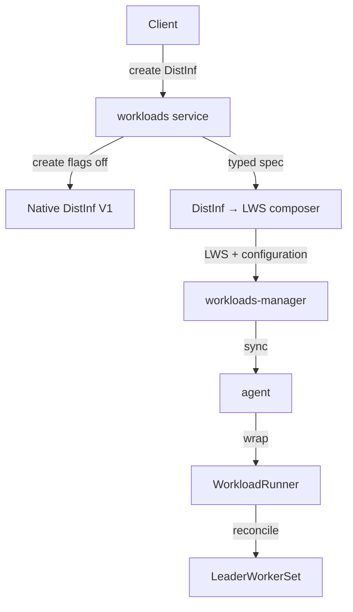

# Distributed Inference through Workload-V2

Status: Draft · Owner: Nael Asbi

Review companions: [complete field mapping] · [LWS test inventory]

## TL;DR

- Implement DistInf like inference: typed spec → composer → workloads-manager → WorkloadRunner.
- Compose a `LeaderWorkerSet`; do not create the native DistInf CR on the successful V2 path.
- Feature flags select V1 or V2 for new creates. Existing V2 updates remain V2.

## Proposed design



### V1/V2 routing

V2 create requires all three gates:

1. Cluster supports AnyWorkload for V1 workloads (`>= 2.26`).
2. `any_workload_submission` or `any_workload_dinf_submission` is enabled.
3. Tenant setting `anyWorkloadSubmissionEnabled` is enabled.

`CanCreate=false` routes a new create to native V1. Once V2 is selected, validation or composition errors fail the request. Updates select the path by existing workload ownership, not create flags.

### Composer

```go
Compose(
    ctx context.Context,
    src *workloadsApi.DistributedInferenceSpecSpec,
    target *LeaderWorkerSetTarget,
) func() *workloadsApi.Error
```

`LeaderWorkerSetTarget` contains the LWS manifest and `WorkloadV2Configuration`. `SupersetSpec` is used only for policy/snapshot/merge and is projected to the typed DistInf spec before composition.

### Required mapping

The complete field-by-field contract is in the [DistInf V2 field mapping].

Critical rules:

- LWS group size is `workers + 1`; replicas map directly.
- Compose leader and worker independently: different values remain different in their templates. Copy leader only when the entire worker spec is absent; do not inherit individual missing worker fields.
- Networking uses the Swagger `x-internal` V2 configuration to create a leader-only Service, auth proxy and external access through the WorkloadRunner plugin.
- Existing PVCs map into the LWS; new PVCs also emit internal V2 PVC configuration for the storage plugin.
- MNNVL `Required` emits `Required`; `None`, missing and `Preferred` emit `None`, matching current native DistInf behavior. WorkloadRunner plugins own cluster mutations.

Use the native unique LWS-name behavior. Reuse inference field composers. The anyworkload-controller remains responsible for networking and MNNVL mutations.

### Implementation and tests

- Add the typed DistInf → LWS composer and golden tests.
- Project `DistributedInferenceSpecSpec` in create and update.
- Implement `AnyWorkloadSubmitterDinf` create/update; remove its hardcoded `return false`.
- Test gates, LWS mapping, internal networking/PVC configuration, MNNVL and V2 update ownership.
- Do not copy the inference update bug: query workloads-manager before capability validation when the cluster ID is not yet known.

Existing test baseline:

- Port or adapt the [80 unique native LWS builder cases]: 62 successful goldens and 18 negative cases.
- Reuse the 54 current native control-plane composer cases for typed-input and validation coverage.
- Keep controller, status and installer cases in their existing suites; they are not composer tests.

Code references: [`any_workload_submitter_inference.go`](../../control-plane/workloads/pkg/services_crud/any_workload_submitter_inference.go), [`any_workload_submitter_dinf.go`](../../control-plane/workloads/pkg/services_crud/any_workload_submitter_dinf.go), [`create.go`](../../control-plane/workloads/pkg/services_crud/create.go), [`lws_build.go`](../../runai-cluster/cluster/inference-workload-controller/internal/builders/lws_build.go).

## 🔧 If you only do one thing

Implement one typed `DistributedInferenceSpecSpec → LeaderWorkerSetTarget` composer and use it for create and update.

## 🧠 Remember it as

**Same V2 flow as inference; LWS is the target.**
