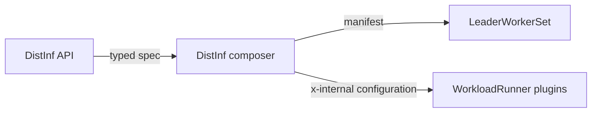

# Distributed Inference V2 field mapping

Target: `DistributedInferenceSpecSpec → LeaderWorkerSetTarget`

## TL;DR

- This is the complete reviewable mapping for the new typed DistInf composer.
- The composer creates a `LeaderWorkerSet` plus `WorkloadV2Configuration`.
- Production code is the source of truth; the removed mapping page was used only as a field inventory.

## Legend

| Behavior | Meaning |
|---|---|
| **Direct** | Same value and meaning in the target |
| **Transform** | Composer translates or synthesizes the target |
| **Plugin-owned** | Composer emits configuration; WorkloadRunner plugin performs the mutation |
| **Decision** | Explicit routing or ownership rule |

## DistInf / LWS-specific mappings — review first

These are the fields and decisions that differ from the existing inference V2 flow.

### Leader and worker values

| Input | Result |
|---|---|
| Leader and worker set the same field to different values | Keep both values: leader value → `leaderTemplate`; worker value → `workerTemplate`. |
| Worker spec is completely absent | Copy the leader spec into `workerTemplate`, because LWS requires a worker template. |
| Worker spec exists but one worker field is absent | Do not inherit that field from leader; use the worker field's normal empty/default behavior. |
| Top-level field such as `nodePools`, `priorityClass` or `preemptibility` | Apply the shared value to both templates. |

There is no leader-over-worker precedence and no field-level merge between the two entity specs.

| Area | DistInf source / condition | V2 destination | Behavior | Owner | Review note |
|---|---|---|---|---|---|
| Topology | `workers` | LWS `spec.leaderWorkerTemplate.size` | Transform | Composer | Set `size = workers + 1`. |
| Topology | `replicas` | LWS `spec.replicas` | Direct | Composer | One replica is one leader-worker group. |
| Topology | `startupPolicy` | LWS `spec.startupPolicy` | Direct | Composer | Use the matching LWS enum. |
| Topology | `restartPolicy` | LWS `leaderWorkerTemplate.restartPolicy` | Direct | Composer | Use the matching LWS enum. |
| Topology | `leader` | LWS `leaderTemplate` | Transform | Composer | Compose from the typed leader entity. |
| Topology | `worker` | LWS `workerTemplate` | Transform | Composer | When absent, copy the leader template because LWS requires a worker template. |
| Networking | `servingPort.port` | leader container port + networking Service | Transform | Composer + plugin | Create a Service because LWS does not create one. |
| Networking | `servingPort.exposeExternally / exposedUrl` | networking external access | Transform | Networking plugin | Internal Service always; external route only when requested. |
| Networking | `servingPort.authorizationType` + allowlists | internal networking Service authorization | Transform | Composer + networking plugin | The config is `x-internal`; the plugin creates the auth-proxy Deployment and Service. |
| Networking | Service selector | LWS name + `worker-index=0` | Decision | Composer | Send serving traffic to leader pods only. |
| MNNVL | leader label `run.ai/MNNVL=Required\|None` | `configuration.mnnvl` | Transform | Composer + workloads-manager | Leader label is canonical, matching the native agent. |
| MNNVL | missing or `Preferred` | `configuration.mnnvl=None` | Transform | Composer + workloads-manager | Native DistInf only enables MNNVL for `Required`, so this preserves current behavior. |
| MNNVL | WorkloadRunner mutation | claims + affinity + ComputeDomain | Plugin-owned | MNNVL plugin | The composer emits configuration; the plugin mutates cluster resources. |
| Routing | Create flags disabled | native `DistributedInferenceWorkload` | Decision | Workloads service | V1/V2 selection happens before composition. |
| Routing | Existing workloads-manager-owned update | WorkloadV2 update | Decision | Workloads service | Ownership selects the update path; create flags must not move it back to V1. |

## Shared mappings — same pattern as inference

| Area | DistInf source | V2 destination | Behavior | Owner | Review note |
|---|---|---|---|---|---|
| Metadata | `category` | WorkloadV2 metadata / labels | Direct | Shared composer | Reuse the inference/shared field composer. |
| Scheduling | `nodePools[]` | leader + worker node affinity | Transform | Shared composer | Apply workload-level placement to both templates. |
| Scheduling | `priorityClass` | leader + worker `priorityClassName` | Transform | Shared composer | Apply to both templates. |
| Scheduling | `preemptibility` | leader + worker scheduling metadata | Transform | Shared composer | Reuse current inference behavior. |
| Entity | `leader\|worker.image` | `containers[0].image` | Direct | Composer | Compose each entity independently. |
| Entity | `leader\|worker.command / args` | `containers[0].command / args` | Transform | Shared composer | Reuse the existing command-line parser. |
| Entity | `leader\|worker.imagePullPolicy` | `containers[0].imagePullPolicy` | Direct | Composer | Per entity. |
| Entity | `leader\|worker.workingDir` | `containers[0].workingDir` | Direct | Composer | Per entity. |
| Entity | `leader\|worker.environmentVariables[]` | `containers[0].env[]` | Transform | Shared composer | Keep template substitution and `valueFrom` behavior. |
| Entity | `leader\|worker.annotations[] / labels[]` | pod-template metadata maps | Transform | Shared composer | Convert name/value arrays to maps. |
| Entity | `leader\|worker.probes` | `containers[0]` probes | Transform | Shared composer | Map readiness and liveness probes. |
| Entity | `leader\|worker.createHomeDir` | `emptyDir` + volume mount + `HOME` | Transform | Shared composer | Apply independently to leader and worker. |
| Compute | `leader\|worker.compute.cpu*` | container CPU requests / limits | Transform | Shared composer | Reuse inference compute composition. |
| Compute | `leader\|worker.compute.cpuMemory*` | container memory requests / limits | Transform | Shared composer | Reuse inference compute composition. |
| Compute | `leader\|worker.compute.gpu*` | GPU resources + Run:ai metadata | Transform | Shared composer | Reuse existing GPU fraction, memory and device rules. |
| Compute | `leader\|worker.compute.extendedResources[]` | container resource requests / limits | Transform | Shared composer | Reuse inference validation and composition. |
| Compute | `leader\|worker.compute.largeShmRequest` | `/dev/shm` `emptyDir` + mount | Transform | Shared composer | Per entity. |
| Security | `leader\|worker.security.*` | pod/container `securityContext` | Transform | Shared composer | UID/GID, capabilities, seccomp, host IPC/network and privileged settings. |
| Placement | `leader\|worker.nodeType` | pod `nodeSelector` | Transform | Shared composer | Per entity. |
| Placement | `leader\|worker.nodeAffinityRequired` | required node affinity | Transform | Shared composer | Per entity. |
| Placement | `leader\|worker.podAffinity` | pod affinity | Transform | Shared composer | Per entity. |
| Placement | `leader\|worker.tolerations[]` | pod tolerations | Direct | Shared composer | Per entity. |
| Storage | `*.storage.configMapVolume[]` | pod volumes + mounts | Transform | Shared composer | Supported existing-volume mapping. |
| Storage | `*.storage.emptyDirVolume[]` | pod volumes + mounts | Transform | Shared composer | Supported existing-volume mapping. |
| Storage | `*.storage.secretVolume[]` | pod volumes + mounts | Transform | Shared composer | Supported existing-volume mapping. |
| Storage | `*.storage.pvc[]` | pod volumes/mounts + internal `configuration.pvcs` for new claims | Transform | Shared composer + storage plugin | Existing claims map directly; the plugin creates and reconciles new claims. |
| Credentials | `leader\|worker.imagePullSecrets[]` | pod `imagePullSecrets` | Plugin-owned | Credentials plugin | Do not synthesize credential resources in the DistInf composer. |

## Code references

- Typed DistInf model: [`model_distributed_inference_spec_spec.go`](../../runai-clients/workloads-client/generated/model_distributed_inference_spec_spec.go)
- Current inference V2 composer: [`inference_workloads`](../../control-plane/workloads-and-policies/composer_v2/inference_workloads)
- Current native DistInf composer: [`to_dinf_workload.go`](../../control-plane/workloads-and-policies/composer_v2/runai_workloads/to_dinf_workload.go)
- Native LWS behavior: [`lws_build.go`](../../runai-cluster/cluster/inference-workload-controller/internal/builders/lws_build.go)
- Internal networking/PVC contract: [`WorkloadV2Configuration.yaml`](../../control-plane/workloads-manager/swagger/source/schemas/WorkloadsV2/WorkloadV2Configuration.yaml)
- Networking auth-proxy ownership: [`additional_resources_endpoints.go`](../../runai-cluster/cluster/anyworkload-controller/plugins/networking/additional_resources_endpoints.go)
- Shared PVC mapping: [`setters_impl_runner.go`](../../control-plane/workloads-and-policies/composer_v2/setters_impl_runner.go)
- V1/V2 routing: [`any_workload_submitter.go`](../../control-plane/workloads/pkg/services_crud/any_workload_submitter.go)
