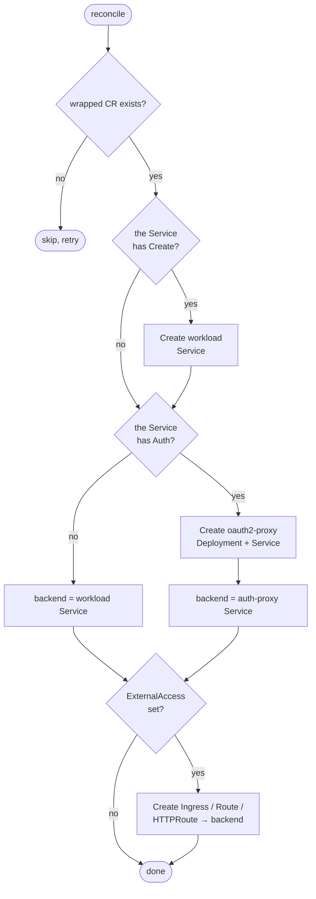
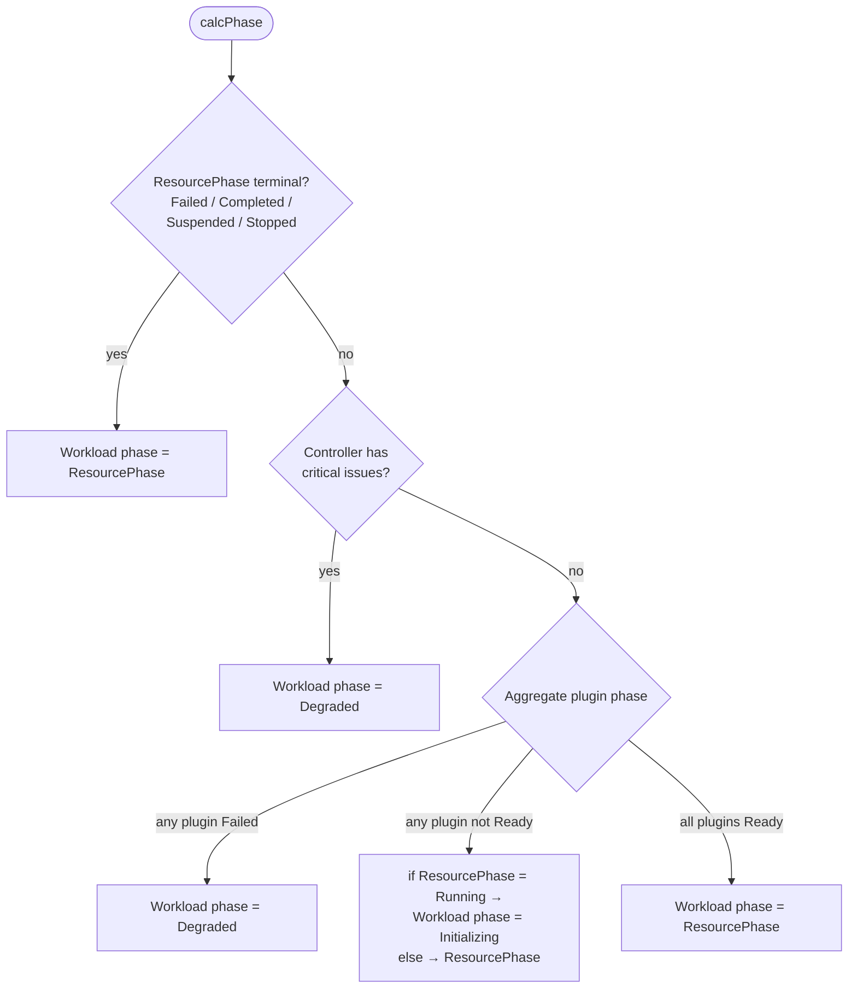
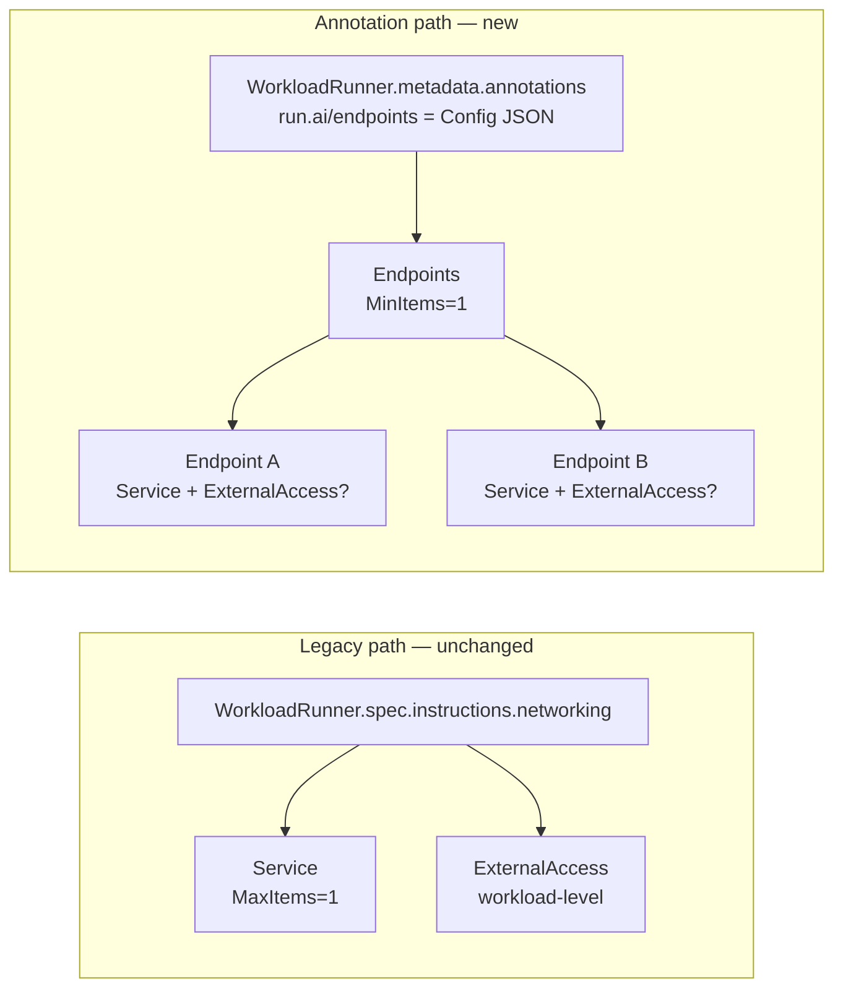
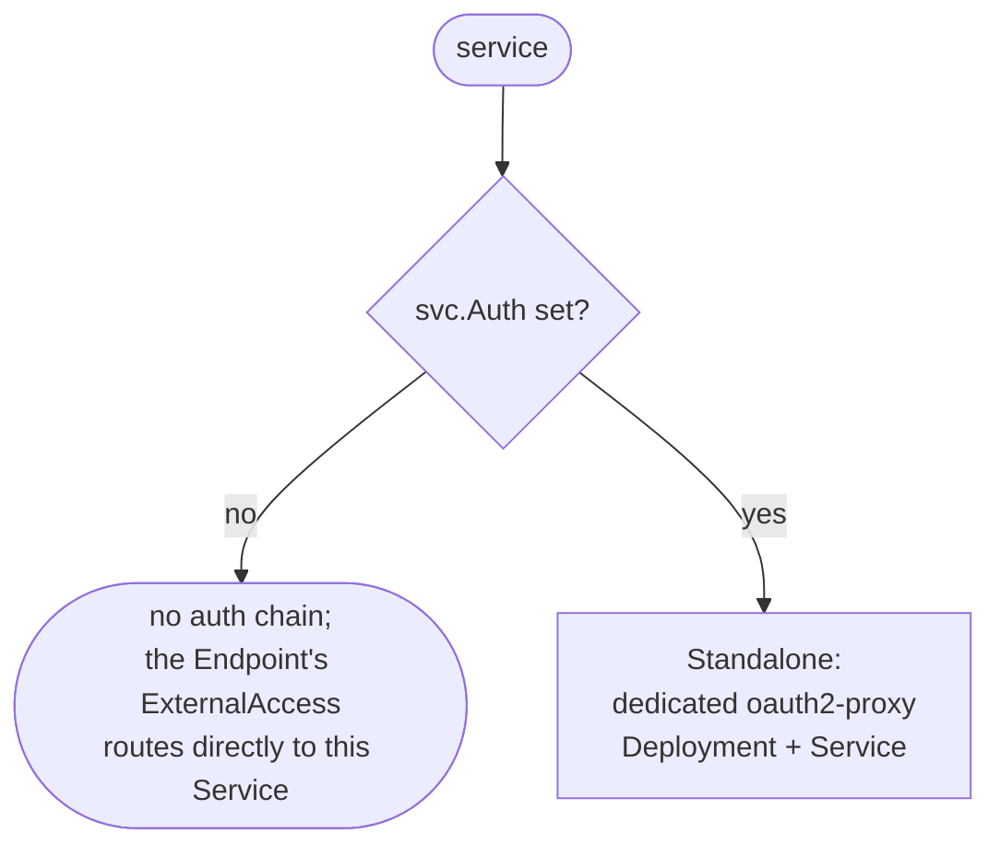
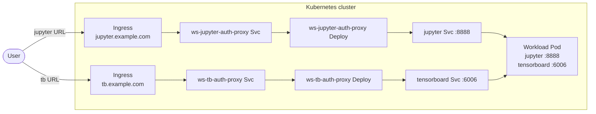

# Networking Plugin — Multi-Endpoint Workloads — HLD

## Table of Contents
1. [Problem](#1-problem)
2. [Current state](#2-current-state)
3. [Proposed change](#3-proposed-change)
4. [Key design decisions](#4-key-design-decisions)
5. [Phasing & rollout](#5-phasing--rollout)

---

## 1. Problem

The `anyworkload-controller`'s networking plugin today exposes **at most one** externally-reachable surface per `WorkloadRunner` (`MaxItems=1` on `Services`), with **exactly one** auth topology — a dedicated `oauth2-proxy` Deployment in front of the workload's K8s Service — and **exactly one** workload-level `ExternalAccess` (Ingress / Route / HTTPRoute) bound 1:1 to that single Service. The validator further enforces the 1:1 by rejecting any Ingress backend that doesn't point at the singleton Service.

Capabilities we need to support but cannot model in the current shape:

1. **Multiple distinct surfaces per workload.** Jupyter + TensorBoard, a model server with separate gRPC and REST hosts, an inference workload with a user-facing path and a metrics path that need different auth scopes. The native `workload-controller` and `inference-workload-controller` already cover the simplest version of this via `exposedUrls`.
2. **Per-Service auth.** Each externally-exposed Service may need its own auth chain — different scopes per URL, mixed authenticated / unauthenticated surfaces, distinct cookies per tool. Today's plumbing already supports auth per Service in shape; what's missing is the multi-Service container in the spec to attach it to.
3. **Per-Service status with K8s detail.** Consumers need to know each Service's resolved URL, `Type`, ports/protocols, and load-balancer ingress — without parsing freeform condition messages.

**Strategic context.** `anyworkload-controller` is the planned consolidation target for cluster-side workload controllers; the native `workload-controller` and `inference-workload-controller` are slated for retirement. The aim of this redesign is to make sure `anyworkload-controller` can match the externally-visible capabilities the native controllers ship today — multi-URL workloads with per-URL auth — and to leave room to extend them where the native shape proved unnecessarily restrictive (e.g., the 1:1 Service-to-Ingress coupling). The legacy `spec.instructions.networking` field stays on the CRD: NIM and similar workloads consume it today, and replacing it is a strictly larger coordinated change than introducing a multi-Endpoint path beside it.

---

## 2. Current state

### 2.1 CRD shape

```go
type NetworkingConfig struct {
    // +kubebuilder:validation:MaxItems=1
    Services       []NetworkingServiceItem
    ExternalAccess *NetworkingExternalAccessConfig
}

type NetworkingServiceItem struct {
    Create *corev1.Service
    Ref    *NetworkingServiceRef
    Auth   *NetworkingAuthConfig          // auth lives on the Service item
}

type NetworkingExternalAccessConfig struct {
    Ingress   *networkingv1.Ingress       // pick one
    Route     *openshiftv1.Route
    HTTPRoute *gatewayv1.HTTPRoute
}
```

Constraints baked into the shape:
- At most one Service per workload (`MaxItems=1`) ⇒ at most one auth scope.
- At most one workload-level `externalAccess` (optional) ⇒ at most one host / path.
- When both are set, the validator rejects Ingress backends that don't all point at the singleton Service.
- No way to express "this URL is authenticated, that one isn't" or "these N URLs route to different Services behind one Ingress".

### 2.2 Reconcile flow



### 2.3 Status surface

Today's networking-plugin status fits one block on `Status.Plugins["networking-plugin"]` — a phase, two conditions, and message strings:

```yaml
status:
  plugins:
    networking-plugin:
      phase: Ready
      conditions:
        - type: AuthProxyReady
          status: "True"
          message: "Auth proxy deployment ws-jupyter-auth-proxy is ready"
        - type: ExternalAccessReady
          status: "True"
          message: "Ingress ws-jupyter exists, url: https://jupyter.runai.com/"
```

**Conditions.** `AuthProxyReady` + `ExternalAccessReady` are workload-aggregate booleans (there is only one Service today, so "aggregate" and "per-Service" coincide).

**External URL.** No structured field — the URL is substring-embedded in the `ExternalAccessReady` condition's `Message` (`"Ingress <name> exists, url: <url>"`; same pattern for `Route` and `HTTPRoute`).

**Consumers.** `cluster-sync` substring-greps that message to (a) surface the URL in the UI and (b) trigger re-syncs to the control plane when the message changes. A typed read replacing the substring-grep is out of v1 scope; see §3.6 and §4's structured-status row.

**Not surfaced today.** The K8s Service object itself isn't observed by `Status()` at all (no `Get` on the Service is performed) — so its `Type`, port list, protocol, and `LoadBalancer.Ingress` are all opaque to consumers, who must `kubectl get svc` directly to see any of them.

### 2.4 Phase calculation today

There are three layers of phase, and consumers of `WorkloadRunner` see all three. Understanding how they fold into each other is a prerequisite for §3.5 — the design adds detail inside Layers A and B (per-Endpoint fan-out), but the layers themselves and the way they roll up are unchanged.

**Layer A — Per-resource check (inside the plugin).** `Plugin.Status()` performs two K8s GETs: the auth-proxy `Deployment` (if `Auth` is set) and the external resource (`Ingress` / `Route` / `HTTPRoute`, if `ExternalAccess` is set). Each check produces **two outputs**: a `metav1.Condition` (`Type` / `Status` / `Message`) that is written to `Status.Plugins["networking-plugin"].Conditions[]` (this is the surface visible in §2.3), and a `PluginPhase` enum *returned to the caller* for folding in Layer B. The `PluginPhase` value itself is not surfaced per check today — only the condition is.

| Check writes this condition | Possible phases the check returns | What drives the phase |
|---|---|---|
| `AuthProxyReady` | `Disabled` (no `Auth`) · `Creating` (Deployment not found yet) · `Initializing` (replicas not yet ready) · `Ready` (replicas available) · `Failed` (K8s API error) | replica counts on the auth-proxy Deployment |
| `ExternalAccessReady` | `Creating` · `Ready` · `Failed`, plus `Initializing` for HTTPRoute when the gateway has not yet `Accepted` it | existence of the Ingress / Route / HTTPRoute, and (for HTTPRoute) the gateway's `Accepted` condition |

**Layer B — Plugin-level fold (inside the plugin).** `Plugin.Status()` folds the two per-check phases with `worstPhase()`:

```
Disabled  <  Ready  <  Creating  <  Initializing  <  Failed
                              ↑
                        "worst wins"
```

The result is written to `Status.Plugins["networking-plugin"].Phase` — a single `PluginPhase` per plugin.

**Layer C — `WorkloadRunner`-level fold (in `anyworkload-controller`, not in any plugin).** Inside `anyworkload-controller` itself, the `WorkloadRunnerController` reconciler runs `calcPhase()` (in `pkg/controller/reconcile_status.go`) after every plugin's `Status()` has finished. This is the place that computes `WorkloadRunner.Status.Phase`. It consumes the per-plugin phase plus the wrapped resource's own phase (`ResourcePhase`, from karta) plus controller-level issues — but **not** per-plugin detail:



So the networking plugin can influence `WorkloadRunner.Status.Phase` in only three ways:

- **Demote `Running` → `Initializing`** when the auth proxy or the external resource is still coming up though the workload pods are running.
- **Push the workload to `Degraded`** by reporting `PluginPhaseFailed` itself (today, that's restricted to non-recoverable K8s API errors during the GETs).
- Otherwise be **transparent** — the wrapped resource's own phase wins.

The wrapped resource's phase is the primary driver. A workload whose underlying `Deployment` / `Job` / `PyTorchJob` reports `Failed` is `Failed` on the `WorkloadRunner` regardless of what the networking plugin says.

> **Note on naming.** The "workload-level fold" here is the `WorkloadRunner` workload, which `anyworkload-controller` reconciles via its own `WorkloadRunnerController`. It is *not* the standalone native `workload-controller` repo — that's a separate component, on a different consolidation path (see §1 strategic context).

### 2.5 CP ↔ Agent ↔ Cluster wire format (baseline)

The wire format that carries the networking payload from the control plane to the cluster runs through the OpenAPI-defined `WorkloadV2*` shape (`control-plane/infra/openapi/specs/workloads-manager.yaml`) into the codegen'd `workloads-manager-client`, which the agent consumes and translates into `v1alpha1.WorkloadRunner.Spec.Instructions.Networking`. The shape carries a single-Service, single-ExternalAccess networking block today — the same shape `spec.instructions.networking` carries. Redesigning this wire format to natively carry multiple Endpoints is a follow-up tracked in §5 phase 3; v1's cluster-side path uses the annotation as its multi-Endpoint surface so the wire format can evolve independently of the CRD.

---

## 3. Proposed change

### 3.1 Payload — `run.ai/endpoints` annotation on the WorkloadRunner

The plugin gains a second input shape: the `run.ai/endpoints` annotation on `WorkloadRunner.metadata.annotations`, carrying a JSON-encoded `Config` whose schema is defined in a shared Go library (`cluster/common/endpoints`, vendored by both the plugin and the agent). The CRD itself is **not changed**: no new fields under `spec.instructions.networking`, no new fields under `status.plugins["networking-plugin"]`. The annotation payload is a sibling input, not a replacement for the legacy field.

```go
package endpoints // cluster/common/endpoints

const (
    Annotation      = "run.ai/endpoints"
    SchemaVersionV1 = "v1"
)

type Config struct {
    SchemaVersion string     `json:"schemaVersion"`
    Endpoints     []Endpoint `json:"endpoints"`
}

type Endpoint struct {
    Services       []Service       `json:"services"`
    ExternalAccess *ExternalAccess `json:"externalAccess,omitempty"`
}

type Service struct {
    // exactly one of:
    Create *corev1.Service `json:"create,omitempty"`
    Ref    *ServiceRef     `json:"ref,omitempty"`

    // optional auth chain in front of this Service.
    Auth     *AuthConfig `json:"auth,omitempty"`
    // AuthMode is enum-shaped; v1 accepts only "Standalone".
    AuthMode AuthMode    `json:"authMode,omitempty"`
}

type ExternalAccess struct {
    // exactly one of:
    Ingress   *networkingv1.Ingress `json:"ingress,omitempty"`
    Route     *openshiftv1.Route    `json:"route,omitempty"`
    HTTPRoute *gatewayv1.HTTPRoute  `json:"httpRoute,omitempty"`
}
```

The library exposes three primitives — `endpoints.Get(obj)`, `endpoints.Set(obj, cfg)`, `endpoints.Has(obj)` — plus sentinel errors (`ErrEmptyAnnotation`, `ErrNoEndpoints`, `ErrUnsupportedSchemaVersion`). The agent calls `Set`; the admission webhook and the plugin call `Get`. `SchemaVersion` is checked against `SchemaVersionV1` and unknown values are a parse error — that's the seam future-proofing the payload without revisiting the CRD.



### 3.2 Coexistence — `classifyInput` is the only entry point

The plugin gains a single dispatch helper, `classifyInput(runner)`, that resolves which shape drives this reconcile. It is called from every entry point — admission (`WebhookValidate`), reconcile (`HandleAdditionalResources`), and status (`Status`) — and returns one of:

| Shape | Triggered when | Handler |
|---|---|---|
| `inputLegacy` | `spec.instructions.networking` is set (annotation absent) | `handleLegacyAdditionalResources` / `statusLegacy` — the original code paths, behaviour unchanged. |
| `inputAnnotation` | `run.ai/endpoints` annotation is set (legacy field absent) | `handleEndpointsAdditionalResources` / `statusEndpoints` — per-Endpoint reconcile, folded conditions. |
| `inputNone` | neither set | `Status` reports `PluginPhaseDisabled`; reconcile is a no-op. |

**Setting both is rejected.** The webhook returns `field.Forbidden` on the annotation key. If a CR somehow reaches runtime with both set (admission disabled, or a pre-existing CR), `Status` runs `classifyInput` independently and marks the plugin `PluginPhaseFailed` with an `InvalidNetworkingInput` condition. The two-path coexistence is the deliberate strategy — see §4's coexistence row — and the mutual-exclusion is the safety rail that keeps it from becoming a "both at once, behaviour undefined" puzzle.

**Builder reuse.** The annotation path's per-Endpoint builders (`buildEndpointWorkloadService`, `buildEndpointAuthProxyDeployment`, `buildEndpointAuthProxyService`, `buildEndpointExternalAccess`) compose the same lower-level primitives the legacy path uses (`composeAuthProxyDeployment`, `buildOAuth2ProxyContainerFromAuth`, `buildAuthProxyService`, `applyExternalAccess`). The two paths share the runtime topology and resource defaults — only the per-Endpoint fan-out and naming convention differ.

### 3.3 Examples

**Common case** — one Endpoint with one Service and one Ingress:

```yaml
apiVersion: run.ai/v1alpha1
kind: WorkloadRunner
metadata:
  name: ws-jupyter
  annotations:
    run.ai/endpoints: |
      {
        "schemaVersion": "v1",
        "endpoints": [
          {
            "services": [{
              "create": {
                "metadata": { "name": "ws-jupyter" },
                "spec": {
                  "selector": { "app": "ws-jupyter" },
                  "ports": [{ "port": 8000, "targetPort": 8000 }]
                }
              },
              "auth": { "authorizationType": "authenticatedUsers" }
            }],
            "externalAccess": {
              "ingress": {
                "metadata": { "name": "ws-jupyter" },
                "spec": {
                  "ingressClassName": "nginx",
                  "rules": [{
                    "host": "jupyter.runai.com",
                    "http": { "paths": [{
                      "path": "/",
                      "pathType": "Prefix",
                      "backend": { "service": { "name": "ws-jupyter", "port": { "number": 8000 } } }
                    }] }
                  }]
                }
              }
            }
          }
        ]
      }
```

**Two distinct Endpoints** — Jupyter on its own host, TensorBoard on its own host, each self-contained. Only the `endpoints` array is shown:

```json
"endpoints": [
  {
    "services": [{
      "create": { "metadata": { "name": "ws-jupyter" }, "spec": { "ports": [{ "port": 8888 }] } },
      "auth":   { "authorizationType": "authenticatedUsers" }
    }],
    "externalAccess": { "ingress": { /* rules for jupyter.runai.com */ } }
  },
  {
    "services": [{
      "create": { "metadata": { "name": "ws-tensorboard" }, "spec": { "ports": [{ "port": 6006 }] } },
      "auth":   { "authorizationType": "authenticatedUsers" }
    }],
    "externalAccess": { "ingress": { /* rules for tensorboard.runai.com */ } }
  }
]
```

**Internal-only Endpoint mixed with an exposed one** — Ray-style: dashboard exposed externally, headless peer-DNS Service declared in the same payload but not externally surfaced:

```json
"endpoints": [
  {
    "services": [{
      "create": { "metadata": { "name": "ray-dashboard" }, "spec": { "ports": [{ "port": 8265 }] } },
      "auth":   { "authorizationType": "authenticatedUsers" }
    }],
    "externalAccess": { "ingress": { /* rules for ray.runai.com */ } }
  },
  {
    "services": [{
      "create": {
        "metadata": { "name": "ray-headless" },
        "spec":     { "clusterIP": "None", "ports": [{ "port": 10001 }] }
      }
    }]
    // no externalAccess — internal-only Endpoint
  }
]
```

### 3.4 Auth topology — per Service

Each Service decides independently whether it has an auth chain in front of it via the optional `Auth` field. When `Auth` is set, the plugin reconciles a dedicated `oauth2-proxy` Deployment + Service in front of that Service's traffic — the Standalone topology, identical to today's behaviour, replicated per Service that opts in. When `Auth` is unset, the Endpoint's ExternalAccess routes directly to the Service.



When an Endpoint's ExternalAccess references the Endpoint's Service and that Service has `Auth` set, the plugin rewrites the corresponding backend (Ingress path, Route target, HTTPRoute backendRef) to point at the auth-proxy Service instead of at the workload Service. When the Service has no `Auth`, the backend is left pointing at the Service itself. This is the same backend-rewrite step the legacy path performs today, scoped per-Endpoint.

**On `AuthMode`.** `Service.AuthMode` is declared in the schema with a single valid value, `Standalone`, in v1. The field is shaped as an enum so additional topologies can be added in a follow-up without a schema-shape change. The most obvious candidate is `InPod` — running `oauth2-proxy` as a K8s 1.28+ native sidecar in the workload's own Pod, removing the auth-proxy Deployment + Service + a network hop. We're deferring `InPod` because:

- **Opaque CRDs.** NIMService and similar CRDs don't expose a PodSpec the plugin can mutate, so InPod would never apply to them — the most operationally important class of workloads is excluded by construction.
- **Multi-template workloads.** LeaderWorkerSet, KubeRay, MPI, PyTorch and similar wrappers expose several Pod templates per workload. "Inject the sidecar" stops being a single decision; it needs a per-template targeting vocabulary in the API (e.g., "inject into the leader, not the workers") that we don't have today and don't want to invent inside this design.

Tackling either of those is a design-and-implementation pass on its own. Restricting v1 to `Standalone` ships the multi-Endpoint capability without that scope; lifting the enum constraint later is non-breaking.

### 3.5 Runtime topology

**Standalone, two single-Service Endpoints** — each Endpoint has its own ExternalAccess and (if `Auth` is set) its own dedicated `oauth2-proxy` Deployment + Service:



The plugin reconciles each Endpoint independently — adding, removing, or changing one Endpoint's Service or `Auth` doesn't touch the others. Per-Endpoint apply errors are accumulated (`errors.Join`) and returned to controller-runtime so a failed sibling triggers a requeue without blocking siblings that succeeded in the same pass; per-Endpoint user-misconfiguration errors are surfaced as plugin issues (`issue.Network`, scoped to `endpoint[<idx>]`) and contribute to the folded `AuthProxyReady` / `ExternalAccessReady` conditions.

### 3.6 Status

**Surface (v1).** Workload-aggregate `AuthProxyReady` + `ExternalAccessReady` conditions, folded across all Endpoints in the payload. The plugin-level `phase` (`Status.Plugins["networking-plugin"].Phase`) mirrors the least-ready Endpoint (`Failed` if any Endpoint failed; otherwise `Initializing` / `Creating` if any is still progressing; otherwise `Ready`) — the same folding rule the plugin uses today, scaled to N Endpoints. The exact `"Ingress X exists, url: <u>"` message format is preserved bit-for-bit in the single-Endpoint case so today's downstream consumer (`cluster-sync`'s substring grep) keeps working without coordination during the rollout. In the multi-Endpoint case the consumer sees the first Endpoint's URL via the legacy substring; richer cross-Endpoint readout is the deferred structured slice.

**Layer fold.** §2.4 describes today's three-layer fold (per-resource check → plugin → workload). The annotation path preserves that chain end-to-end. What changes is internal to Layers A and B:

| Layer (§2.4) | Legacy path (unchanged) | Annotation path |
|---|---|---|
| **A — Per-resource check** | One auth-proxy check + one external-access check per workload | Same checks, run **once per Endpoint** (loop over `Config.Endpoints`); each call returns the same `PluginPhase` enum it does today. |
| **B — Plugin-level fold** | `worstPhase(authProxyPhase, externalAccessPhase)` | `worstPhase` over *all* per-Endpoint phases. Each per-Endpoint phase is itself `worstPhase(authProxy phase, externalAccessPhase, any Endpoint-scoped Issue → Failed)`. Same enum, same operator, just one extra level of nesting. The plugin still writes a single `PluginPhase` to `Status.Plugins["networking-plugin"].Phase`. |
| **C — Workload-level fold (`calcPhase`)** | Consumes the per-plugin `PluginPhase` (see §2.4 diagram) | **Unchanged.** The plugin's contract toward `calcPhase` — one `PluginPhase` value — is identical. |

**Structured per-Endpoint slice — deferred.** A structured `Status.Networking.Endpoints []NetworkingEndpointStatus` with per-Service `URLs`, `AuthProxyReady` tri-state, and a curated K8s Service mirror is deferred. Three considerations land us there: (a) adding an untyped Go field (`runtime.RawExtension` on `PluginStatus.Details`) to the CRD struct is too permissive at the API surface; (b) the controller and its CRDs are under an active change-minimisation period while broader plugin-extensibility redesign work is in progress, and how plugins expose flexible details/data is in-scope for that redesign — committing to an interim mechanism now would commit us to a contract the redesign will revisit; (c) there is no consumer yet — the multi-Endpoint case doesn't exist on the wire until §5 phase 3, so shipping multi-Endpoint without structured status is a no-op for cluster-sync until then. The folded-conditions surface above is bit-for-bit compatible with today's single-Endpoint consumers; the multi-Endpoint case has no consumer to disappoint. See §4's structured-status row for the contingency tree if pressure changes.

**Deferred shape.** Only the wire format is deferred — the data we want consumers to see is a stable design decision and is collected per-Endpoint inside the plugin regardless of how it eventually leaves the controller. The shape:

```go
type NetworkingStatus struct {
    Endpoints []NetworkingEndpointStatus `json:"endpoints"`
}

type NetworkingEndpointStatus struct {
    Phase          PluginPhase                     `json:"phase"`
    Services       []NetworkingServiceStatus       `json:"services,omitempty"`
    ExternalAccess *NetworkingExternalAccessStatus `json:"externalAccess,omitempty"`
    Issues         []NetworkingIssue               `json:"issues,omitempty"`
}

type NetworkingServiceStatus struct {
    Name           string                   `json:"name"`
    AuthProxyReady *bool                    `json:"authProxyReady,omitempty"` // tri-state: nil = N/A, false = pending, true = ready
    URLs           []string                 `json:"urls,omitempty"`
    Mirror         *NetworkingServiceMirror `json:"mirror,omitempty"`
}

type NetworkingServiceMirror struct {
    Type         corev1.ServiceType         `json:"type"`
    ClusterIP    string                     `json:"clusterIP,omitempty"`
    Ports        []corev1.ServicePort       `json:"ports,omitempty"`
    LoadBalancer *corev1.LoadBalancerStatus `json:"loadBalancer,omitempty"`
}

type NetworkingExternalAccessStatus struct {
    Hosts []string    `json:"hosts,omitempty"`
    Phase PluginPhase `json:"phase"`
}

type NetworkingIssue struct {
    Type    string `json:"type"`
    Message string `json:"message,omitempty"`
}
```

What each field carries:

- `NetworkingServiceStatus.Mirror` — a curated subset of the K8s Service object (`Type`, `ClusterIP`, `Ports`, `LoadBalancer.Ingress`) so consumers don't have to `kubectl get svc` to see basics. The plugin already does one cached `Get` per Endpoint for URL resolution; the mirror is a no-extra-budget output.
- `AuthProxyReady` is **tri-state** (`nil` / `false` / `true`): `nil` when the Service has no `Auth` set (the proxy is N/A), `false` when the auth-proxy Deployment exists but isn't yet `replicas == readyReplicas`, `true` when ready.
- `URLs` is per-Service rather than per-Endpoint because a single Endpoint may expose multiple host rules in its Ingress (multi-rule Ingress, multiple paths) that all land on the same Service.
- `Issues` is per-Endpoint, scoped to user-visible misconfigurations (`endpoint[<idx>]: <message>`). Controller-level errors continue to flow through controller-level issues, not here.

### 3.7 Validation

The webhook (`WebhookValidate`) parses the annotation via `endpoints.Get` and runs the per-Endpoint validator. The rules largely mirror the legacy validator, applied per Endpoint, with two annotation-specific additions:

- **`services` cap.** `len(Endpoint.Services) <= 1` in v1 (`field.TooMany` when exceeded). The slice is kept plural in the schema so multi-Service-per-Endpoint (shared Ingress) can be added without a shape change.
- **Cross-Endpoint name uniqueness.** Admission tracks the K8s names that *will be applied* — declared Service names (`Create.metadata.name`), generated auth-proxy names (`<svcName>-auth-proxy`), generated ExternalAccess names (defaulting to `runner.Name` when not declared) — across all Endpoints, per K8s kind. Collisions are rejected at admission with `field.Duplicate`. This prevents two Endpoints from producing the same Service / Deployment / Ingress under server-side apply, which would otherwise overwrite each other silently.
- **`Create.metadata.name` is required.** Annotation-mode does not default Service names. The producer (agent in v1; CP eventually) sets the name explicitly; the webhook rejects `Service.Create` without a `metadata.name`. The rationale is in §4 row 4.

Backend resolution inside each Endpoint's ExternalAccess is scoped per Endpoint: an Ingress/Route/HTTPRoute backend in Endpoint A must resolve to a Service in Endpoint A (or be left for the cluster-defaults path if no Service is declared in that Endpoint). This is the same "all backends point at the one Service" rule the legacy validator applies, narrowed to per-Endpoint scope.

---

## 4. Key design decisions

The shortlist of decisions where we picked one option over a reasonable alternative.

| Decision | Chosen | Also looked at |
|---|---|---|
| **Configuration payload** | `run.ai/endpoints` annotation carrying a JSON `Config` whose schema lives in a shared Go library, validated at admission | (a) Extend the CRD with `spec.instructions.networking.endpoints []`. *Rejected:* the CRD is a bound contract, the structured-status surface in particular wasn't far enough along to commit to a shape, and a CRD change would force a coordinated rollout of CRD + CP authoring + agent translation + cluster-sync before anything ships. (b) Reuse `spec.instructions.networking` and overload its meaning. *Rejected:* the field is single-Endpoint by shape, and re-shaping it would break consumers (NIM, native controllers' migration path). |
| **Coexist with legacy, do not deprecate `spec.instructions.networking`** | Both inputs supported indefinitely; `classifyInput` is the only entry point that decides which path runs | (a) Deprecate the legacy field on a timeline. *Rejected:* NIMService and similar opaque CRDs flow through legacy today, cluster-sync greps the legacy status format, and deprecation requires synchronised CP + agent + cluster + consumer changes that aren't on any near-term roadmap. (b) Translate legacy → annotation in the agent and run only the annotation path in the plugin. *Rejected:* it adds a hidden translation layer the agent has to maintain and re-tests the legacy capability through the annotation code path — net more risk, no capability win. |
| **Structured per-Endpoint status deferred** | v1 ships the folded-conditions status only; structured slice deferred until the broader plugin-extensibility redesign lands | (a) Ship `Status.Networking.Endpoints []` on the CRD in v1. *Rejected:* CRD-as-bound-contract concern + the active CRD-change-minimisation period during plugin-extensibility redesign work. (b) Use `PluginStatus.Details` (`runtime.RawExtension`) as a per-plugin extension point. *Rejected for now:* same constraint (adds a new untyped Go field to the CRD struct), and the broader question of "how plugins expose flexible details/data" is itself in scope for that redesign — committing to an interim contract now would obligate us to deprecate it later. (c) Sibling status annotation (`run.ai/endpoints-status`) or condition with JSON `Message`. *Rejected for now:* both bend a K8s convention (annotations are not for controller-written status; `Condition.Message` is for humans) and both would need deprecation once the redesign lands. **Contingency if pressure mounts before the redesign:** if a real consumer of multi-Endpoint status materialises and an interim has to ship, preferred order is `PluginStatus.Details` `RawExtension` (technically cleanest, currently blocked by the change-minimisation period) > sibling status annotation `run.ai/endpoints-status` (no CRD struct change but splits status across `.status` and `.metadata` and requires SSA discipline) > condition with JSON `Message` (no new convention to defend but smuggles structured data through a field documented as human-readable). |
| **`Create.metadata.name` required, no defaulting** | Webhook rejects annotation-mode `Service.Create` without `metadata.name`; the producer (agent / CP) sets it explicitly | (a) Default the name from `runner.Name` like the legacy path does. *Rejected:* legacy defaulting was unambiguous because there was only ever one Service; with N Endpoints in one payload, defaulting collides and the producer is the only party that knows the intended-per-Endpoint name. (b) Auto-generate `runner-name-endpoint-<idx>`. *Rejected:* names become opaque, cross-references between Endpoints' Ingress backends and Services break, and renaming Endpoints in the spec re-numbers and re-creates resources. |
| **Cross-Endpoint name collision detection at admission** | The webhook tracks declared + generated names per K8s kind across all Endpoints and rejects collisions before SSA can overwrite anything | (a) Detect at reconcile and surface as plugin issues. *Rejected:* SSA would have already overwritten the colliding resource by the time the issue is observed; the producer needs a hard-fail at the API server. (b) Make the producer compute unique names. *Rejected:* offloads what is fundamentally a validator's responsibility. |
| **Auth placement** | `Service.Auth` (alongside `AuthMode`) | Carried as a child of a Service-spec wrapper (today's legacy spot). *Rejected:* with future `AuthMode=InPod` no auth-proxy Service exists at all — auth is logically a property of the Service we protect, hoisted next to it rather than buried under the spec wrapper. |
| **Auth topology choice** | Per-Service `AuthMode` enum, single valid value `Standalone` in v1; field shaped to admit additional topologies (`InPod`) without a schema-shape change | (a) Drop the field entirely. *Rejected:* re-introducing it later is a schema-shape change. (b) Ship `InPod` in v1. *Rejected:* opaque CRDs (NIM and similar) have no PodSpec to mutate, and multi-template workloads (LeaderWorkerSet, KubeRay, MPI, PyTorch) need a per-template targeting vocabulary we don't have today — see §3.4. |
| **Multi-Service per Endpoint deferred** | v1 caps `Endpoint.Services` at one entry; type stays plural so the cap can be lifted non-breakingly later | Ship multi-Service from v1 (shared-Ingress: one TLS cert, one Ingress, multiple paths). *Deferred:* opens per-backend auth-proxy rewriting in a multi-backend Ingress, validator complexity, status fan-out semantics — none of which are required for the v1 capabilities (multi-Endpoint, per-Endpoint auth, internal-only Endpoints). Lifting later is a non-breaking spec relaxation. |
| **Per-Service auth chains, N proxies** | One `oauth2-proxy` per Service with `Auth`, distinct cookie name + path per chain | Shared sessions across the workload, or a single proxy with multiple upstreams. *Rejected:* matches the native controllers' existing per-`exposedUrls` behaviour exactly; diverging would be net-new behaviour with no driver. |
| **Endpoint identity** | No separate `Name` field on Endpoint or Service; identity derived from the embedded K8s resource's `metadata.name` | Add a literal `Name` field per Endpoint, set by the producer. *Rejected:* would either duplicate the embedded `metadata.name` (two sources of truth for the same identity, drift inevitable) or require the producer to set it consistently with the embedded name. Identity from the embedded K8s name is what the producer already wrote. |

---

## 5. Phasing & rollout

Each phase ends in a consistent, shippable state. The annotation library, the plugin's annotation-mode path, and the admission webhook ship together as one atomic change (phase 1) — partial states (library without webhook, webhook without plugin support) would either accept payloads the plugin can't honour or refuse payloads the plugin can.

1. **Annotation library + plugin annotation-mode + admission validation.** Single atomic PR. Land `cluster/common/endpoints` (shared Go module: types, `Has`/`Get`/`Set`/`Remove`, sentinel errors, schema version). Add `classifyInput` to the plugin and the per-Endpoint reconcile (`handleEndpointsAdditionalResources`) + status (`statusEndpoints`) paths beside the legacy ones. Add `webhookValidateEndpoints` (per-Endpoint structural validation, cross-Endpoint name collision detection, `Create.metadata.name` requirement, mutual exclusion with the legacy field). Legacy path unchanged.

2. **Agent cutover — emit the annotation.** The agent stops calling `setNetworkingConfig` on `WorkloadRunner.Spec.Instructions` and starts calling `endpoints.Set` on `WorkloadRunner.metadata.annotations`, populating `Create.metadata.name` explicitly (phase 1's admission rule). The translation is currently one-Endpoint-per-payload because the upstream CP wire format (§2.5) is still single-Endpoint; the upgrade to multi-Endpoint emission happens in phase 3 once the wire format is multi-Endpoint capable.

3. **CP ↔ Agent wire format for multi-Endpoint.** Redesign the OpenAPI `WorkloadV2*` networking shape to natively carry multiple Endpoints (additive — keep the legacy single-Endpoint shape alongside). Regenerate `workloads-manager-client` on both sides. Agent translates the new multi-Endpoint wire payload directly into the annotation `Config` — no synthesis.

4. **(Deferred) Structured per-Endpoint status.** Revisit as part of the broader plugin-extensibility redesign on `anyworkload-controller`. The candidate wires (typed CRD field on `PluginStatus.Details`, sibling status annotation, condition with JSON `Message`) are catalogued in §4's structured-status row as a contingency tree; the redesign is expected to obsolete that tree by producing a proper extension surface. Cluster-sync consumer for per-Endpoint URLs and deprecation of the substring-grep path on the CP side follow whichever wire the redesign settles on.

**Out of v1 (follow-ups):** lifting `Endpoint.Services` `len <= 1` cap (multi-Service per Endpoint, shared-Ingress patterns); adding `InPod` as a second valid `AuthMode` value once the multi-template targeting story is designed.
