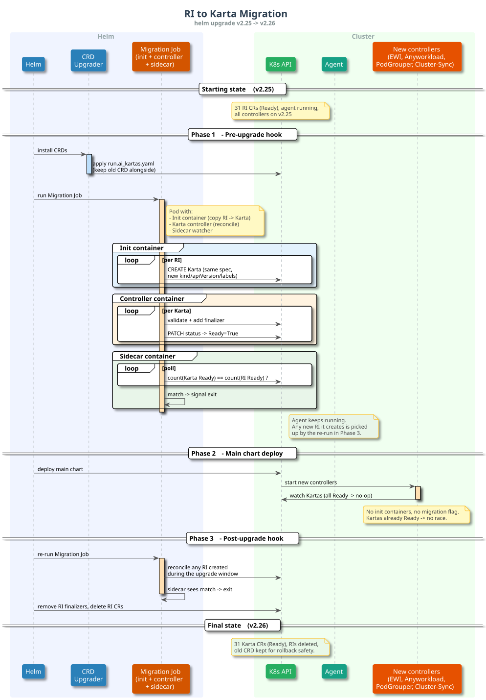

# RI to Karta CRD Migration - v2.26

## Table of Contents
1. [Introduction](#1-introduction)
2. [Migration Strategy](#2-migration-strategy)
3. [Change Inventory](#3-change-inventory)
4. [Backend Changes](#4-backend-changes)
5. [Backward & Forward Compatibility](#5-backward--forward-compatibility)
6. [Implementation Tasks](#6-implementation-tasks)

---

## 1. Introduction

The **ResourceInterface (RI)** CRD describes how external workload types (PyTorchJob, RayJob, etc.) map to Kubernetes primitives - pod spec paths, replica paths, gang scheduling rules, status extraction. In v2.26, the CRD is renamed to **Karta** and the API group moves from `optimization.nvidia.com` to `run.ai`. The spec content is identical.


Today:
- **CRD**: `optimization.nvidia.com/v1alpha1`, kind `ResourceInterface`, short name `ri`
- **31 built-in RIs** stored in PostgreSQL as JSONB (spec only)
- **Agent** polls CP every ~10s and reconciles RI CRs on the cluster against the workload types returned by CP
- **RI controller** (embedded in the EWI binary, not EWI itself) reconciles each RI: validates the spec, creates RBAC, adds the finalizer, sets conditions
- **Cluster-Sync** watches RI events and reports status to CP via `POST /api/v1/workload-types/sync`
- **Anyworkload** looks up RI by GVK labels, checks `RBACReady`, and builds the workload structure from the spec
- **PodGrouper** (in `runai-engine`, managed by engine-operator) looks up RI by GVK labels for gang scheduling. It uses `spec` and `DeletionTimestamp` only and does not read status

---

## 2. Migration Strategy

A migration Job runs before the main chart. It copies every RI to a Karta and reconciles it, so the new controllers find all Kartas already Ready. The agent keeps running; the same Job runs again post-upgrade to catch anything created in the meantime.



### Phase 1 - Pre-upgrade hook

1. **CRD upgrader** installs `run.ai_kartas.yaml` alongside the old CRD. The YAML is generated in the karta repo and baked into the `runai-crd-upgrader` image (airgap-compatible, no runtime download).
2. **Migration Job** - one pod with three containers:
   - **Init container**: creates a Karta CR for each RI (same spec, new name/apiVersion/kind/labels).
   - **Main container**: a reconciler that validates the Kartas, adds the finalizer, and sets conditions. The exact binary is TBD - options are:
     - EWI with a flag that scopes it to RI->Karta reconciliation only
     - A standalone Karta controller
     - Karta controller (as a container) plus a Run:ai component that handles the RBAC
   - **Sidecar**: for each RI, checks that a matching Karta exists with the same status. The pod sets `shareProcessNamespace: true`; the sidecar `pkill -TERM`s the reconciler, which graceful-shuts via the standard controller-runtime SIGTERM handler. Three outcomes:
     - **Verified** → sidecar exits 0 → Pod Succeeded → Helm proceeds.
     - **Sidecar verification timeout** → sidecar exits non-zero → Pod Failed → Helm aborts.
     - **Sidecar itself hangs** → Job's `activeDeadlineSeconds` kills the pod → Helm aborts.

     K8s native sidecars (init container with `restartPolicy: Always`) would be cleaner but are alpha on K8s 1.28 and unavailable on OpenShift 4.12-4.15, both of which v2.26 must support.

### Phase 2 - Main chart deploy

Standard go-operator deploy. New controllers start, find every Karta already Ready, and operate on them immediately. Cluster-sync begins watching Kartas.

### Phase 3 - Post-upgrade hook

1. Re-run the migration Job and wait for it to finish. This covers any RI the agent created during the upgrade.
2. Remove finalizers from old RI CRs and delete them.

The old CRD is kept for one release for rollback safety and removed in v2.27.

### Failure summary

| Step fails | Result |
|---|---|
| CRD upgrader | Helm aborts, the cluster is unchanged |
| Migration Job (pre) | Helm aborts. Any Karta CRs created so far do not affect the running cluster. The Job is idempotent, so a rerun is safe |
| Main deploy | `helm rollback`. Old controllers and RI CRs continue to operate |
| Post-upgrade | New controllers operate normally. Leftover RI CRs can be cleaned up on retry |

---

## 3. Change Inventory

### Kubernetes

| Surface | Before | After |
|---------|--------|-------|
| CRD | `resourceinterfaces.optimization.nvidia.com` | `kartas.run.ai` |
| API group | `optimization.nvidia.com/v1alpha1` | `run.ai/v1alpha1` |
| Kind | `ResourceInterface` | `Karta` |
| Short name | `ri` | `krt` |
| CR name pattern | `ri-{ver}-{group}-{kind}` | `krt-{ver}-{group}-{kind}` |
| Finalizer | `rid.kai.bolt/finalize` | `karta.run.ai/finalize` |
| Labels | `run.ai/resource-interface-{group,version,kind,updated-at}` | `run.ai/karta-{group,version,kind,updated-at}` |
| Conditions (Karta CR) | `RIValidated`, `NoWorkloadsUseRID` | `KartaValidated`, `NoWorkloadsUseKarta` |
| Conditions (WorkloadRunner) | `ResourceInterfaceNotFound`, `ResourceInterfaceNotReady` | `KartaNotFound`, `KartaNotReady` |

### Helm / RBAC

| Surface | Before | After |
|---------|--------|-------|
| CRD file | `optimization.nvidia.com_resourceinterfaces.yaml` | Add `run.ai_kartas.yaml` (keep old) |
| Base ClusterRole (2 rules) | `resourceinterfaces` under `optimization.nvidia.com` | Add `kartas` under `run.ai` alongside |
| Anyworkload ClusterRole | `resourceinterfaces`, `resourceinterfaces/status` | Add `kartas`, `kartas/status` |
| EWI ClusterRole | `resourceinterfaces`, `resourceinterfaces/status`, `resourceinterfaces/finalizers` | Add `kartas`, `kartas/status`, `kartas/finalizers` |

### Cluster Services

- **SDK**: new label/condition/reason constants alongside old
- **Agent**: karta types, name prefix, dual labels, read `kartas` (fallback to `resourceInterfaces`)
- **EWI**: new finalizer, controller renames, condition strings
- **Cluster-Sync**: watch Karta instead of RI, update constants
- **Anyworkload**: new label selectors, karta type refs in plugins

### Karta Repo

- New types under `run.ai/v1alpha1` (Karta, KartaList, KartaSpec, KartaStatus)
- Shared spec types moved to common package
- Generate new CRD, publish to GitHub registry
- Keep old `optimization/v1alpha1` types for v2.25 compat

### PodGrouper (runai-engine repo)

Pod-grouper imports RI types from `kai-bolt`. Changes: rename across the `genericgvk` plugin + tests, add `kartas` RBAC rule. Blocked on `kai-bolt` publishing the Karta types - critical path for the release.

### CLI & E2E

- **CLI**: `runai-cli/.../describe/display.go` needs the same dual-field fallback as workloads-manager. Display label: "Resource Interfaces" -> "Kartas".
- **E2E**: update hardcoded strings, regenerate client

---

## 4. Backend Changes

### Database schema

| Surface | Before | After |
|---------|--------|-------|
| Table | `workload_type_resource_interfaces` | `workload_type_kartas` |
| Column | `resource_interface` (jsonb) | `karta` |
| View alias | `resource_interfaces` | `kartas` |
| Indexes | `workload_type_resource_interfaces_version_*` | `workload_type_kartas_version_*` |

Same pattern as the v2.23 `resource_definitions` -> `resource_interfaces` migration: `ALTER TABLE RENAME`, column rename, recreate indexes and view. JSONB content is untouched (stores `spec` only, no `kind`/`apiVersion`, `status` always `{}`). Reversible via a down migration.

### Status data cleanup

`workload_type_statuses` holds conditions pushed by cluster-sync. Two types are RI-era: `RIValidated` and `NoWorkloadsUseRID`. Renaming them in place is unsafe - the Karta may not actually be validated yet. The migration deletes affected rows; new cluster-sync repopulates them with the new names after it comes up.

Example row before migration:

```json
{
    "workload_type_id": "ca60fb32-f7bf-43e4-b9f8-5e6c2028ed37",
    "phase": "Ready",
    "conditions": [
        { "type": "Ready",       "status": "True" },
        { "type": "RBACReady",   "status": "True" },
        { "type": "RIValidated", "status": "True" }
    ]
}
```

```sql
DELETE FROM workloads.workload_type_statuses
WHERE conditions @? '$[*] ? (@.type == "RIValidated" || @.type == "NoWorkloadsUseRID")';
```

After cluster-sync re-pushes, `RIValidated` becomes `KartaValidated`.

### API (Dual-Field Strategy)

Every `/workload-types` response returns both `resourceInterfaces` and `kartas` with identical data. Requests accept either field; when both are present, `kartas` takes precedence. `resourceInterfaces` and `resourceInterface` are marked `deprecated: true` in OpenAPI. `/workload-types/sync` is unchanged - its payload uses UUID + phase + conditions and contains no RI naming.

**GET response (v2.26 CP):**
```json
{
  "types": [{
    "id": "<uuid>",
    "name": "PyTorchJob",
    "group": "kubeflow.org",
    "resourceInterfaces": [{ "version": "v1", "resourceInterface": { "spec": { "...": "..." } } }],
    "kartas":             [{ "version": "v1", "karta":             { "spec": { "...": "..." } } }]
  }]
}
```

### Control Plane Services

- **Workloads service** - DB models, migrations, DAO, serializers, swagger schemas (bulk of the work)
- **Workloads-manager** - MNNVL validation needs the dual-field fallback
- **OpenAPI** - `workloads.yaml`, `runai-public.yaml`, redoc outputs
- Regenerate Go and TypeScript clients (frontend has no hand-written RI code)

---

## 5. Backward & Forward Compatibility

Every API response carries both `resourceInterfaces` and `kartas`, so old and new clients each read the field they know.

| Scenario | How it works |
|----------|--------------|
| **CP v2.26 + Cluster v2.26** | Agent reads `kartas`, creates Karta CRs |
| **CP v2.26 + Cluster v2.25** | v2.25 agent reads `resourceInterfaces`, ignores `kartas` |
| **CP v2.25 + Cluster v2.26** | v2.25 CP returns only `resourceInterfaces`; v2.26 agent falls back |
| **Rollback v2.26 -> v2.25** | DB down migration reverses the rename. Agent recreates RI CRs within ~10s. Orphan Karta CRs remain with no controller watching them |

---

## 6. Implementation Tasks

| # | Task | Est. |
|---|------|------|
| **1** | Karta repo: new types + CRD + chart | 0.5d |
| **2** | Control plane: DB migration + API dual-field + OpenAPI schemas | 2d |
| **3** | Cluster services: SDK, Agent, EWI, Cluster-Sync, Anyworkload, PodGrouper (runai-engine + kai-bolt), Helm/RBAC | 2d |
| **4** | Migration: pre-upgrade Job (init + controller + sidecar), post-upgrade re-run + cleanup | 2d |
| **5** | CLI: describe output + generated client regeneration | 0.5d |
| **6** | E2E + integration tests (upgrade, mixed version, rollback) | 1d |

