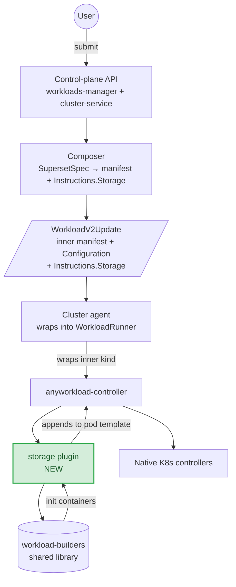

# Init Container Injection — Alternative Considered: Cluster-Side Plugin

> **Status:** Alternative considered. Not the chosen design.
> **Companion to:** — read that first; this document only justifies why the cluster-side plugin path was not chosen.

---

## Metadata

| Field | Value |
|---|---|
| **Status** | Alternative — not in scope |
| **Author(s)** | Liran (Lee) Elisha |
| **Reviewers** | Chen Amiel, Nael Asbi |
| **Created** | 2026-04-29 |
| **Last updated** | 2026-05-25 |
| **Companion doc** | (the chosen design) |

---

## 1. Context

The companion design doc proposes injecting the four user-driven init containers (`git-sync`, `s3-fs`, `runai-oauth2-proxy`, `runai-auth-user-loader`) on the **control plane**, via new common code for all init containers inside the [composer](../control-plane/workloads-and-policies/composer_v2/) that calls four new CP-side init container constructors. This document captures the alternative we considered: doing the same injection on the **cluster side**, as a new plugin in the `anyworkload-controller`. We document it here so the trade-offs are auditable and so the option remains on the table if the chosen approach hits unexpected friction.

Today the `anyworkload-controller` runs exactly two plugins — [`mnnvl`](../runai-cluster/cluster/anyworkload-controller/internal/plugin/mnnvl/) (compute-domain placement) and [`networking`](../runai-cluster/cluster/anyworkload-controller/internal/plugin/networking/) (separate auth Deployment alongside the workload). Neither reads Git, S3, or exposed-URL state. This alternative would add a third sibling plugin (`storage`) that owns exactly those four containers.

---

## 2. Architecture

A new plugin in the `anyworkload-controller`, mirroring the existing [`mnnvl`](../runai-cluster/cluster/anyworkload-controller/internal/plugin/mnnvl/) and [`networking`](../runai-cluster/cluster/anyworkload-controller/internal/plugin/networking/) plugins. The control plane stamps a typed `Storage` field onto `WorkloadRunner.Spec.Instructions` carrying the user's Git/S3/auth references; the plugin reads `Instructions.Storage` on every reconcile, calls into the existing cluster builders (`runai-cluster/cluster/workload-common/builders/`, unchanged), and appends `initContainers` to the embedded pod template before it is server-side-applied.

The cluster controller grows a new typed dependency (`Instructions.Storage`); the CRD wire format gains a small typed payload; cluster-side configuration (the four image env vars + the cluster-topology env vars) keeps living in `os.Getenv` on the workload-controller Deployment, exactly as today.

---

## 3. Pros

- **Stays consistent with the anyworkload-controller plugin pattern.** Mirrors `mnnvl` and `networking` — extending an established mechanism rather than introducing parallel CP-side common code for all init containers. New engineers find the storage plugin in the same place they find the others.
- **Cluster-config stays on the cluster.** No need to surface the ~7 `runai-public` container values up to the control plane (`oauth2ProxyRedisFqdn`, `customCAS3Enabled`, etc.). The plugin reads them via `os.Getenv` exactly as the existing cluster builders do today.
- **Image policy stays on the cluster's Helm chart.** Customers who already manage image overrides via per-cluster `values.yaml` continue doing exactly that. (The chosen design's short-term scope leaves images on the cluster too — see the companion doc §11.2 — so this is not a differentiator until the deferred B2 admin layer ships.)
- **Smaller blast radius from the CP perspective.** A bug in the plugin affects the cluster's reconcile loop only; the control plane keeps shipping the same manifest shape it ships today.
- **Faster to ship.** Smaller estimated scope (see §6).

---

## 4. Cons

- **Cluster controller grows domain knowledge.** The `anyworkload-controller` becomes aware of asset shapes (Git, S3, exposed URLs), container shapes, and init container policy. Each new asset type requires touching both the CP composer (to populate `Instructions.Storage`) and the cluster plugin (to interpret it).
- **Two pod-construction sites.** The CP composes the bulk of the manifest; the cluster plugin appends the four containers. Debugging a "why isn't my init container there?" ticket spans two services and two repos.
- **Dry-run is partial.** The control plane only sees the `Instructions.Storage` payload, not the final pod spec. Previewing the actual containers (e.g. for the workload-submission UI's "show me the resulting pod") requires either a control-plane simulator that re-implements the cluster plugin's logic, or waiting for the cluster to materialise the pod and reading it back.
- **Wrap-layer dependent.** The plugin lives inside the `anyworkload-controller` and only fires when the agent wraps the inner manifest into a `WorkloadRunner`. When `EnableWorkloadRunner=false` (legacy direct-apply mode, still supported per the in-tree `// TODO` at [`workloads_v2_handler.go:397`](../runai-cluster/cluster/agent/pkg/handlers/workloads_v2_handler.go)), the inner manifest goes straight to its native controller and the plugin never runs. Two ways out, both real costs:
  - Declare flag-off as unsupported for anyworkload-path init-container injection — narrows the anyworkload surface and ties the four containers to whether the agent decided to wrap. The chosen design avoids this entirely: pod construction happens in the composer before the wire crosses, regardless of whether the agent later wraps into `WorkloadRunner`.
  - Replicate the plugin chain via a cluster-wide mutating admission webhook scoped to the anyworkload kind set — extra moving piece on the cluster, ordering concerns with other webhooks, and the webhook needs the same configuration the plugin needs.
- **CRD wire-format change.** Adding `Storage` to `WorkloadRunner.Spec.Instructions` is additive, but it does add a new typed field to a published CRD; CRD changes always carry compatibility risk.
- **Cluster-side image policy stays per-cluster Helm.** Air-gapped customers continue to configure mirrors per cluster. Fleet-wide image pinning still requires editing every cluster's `values.yaml`. The chosen design carries the same short-term constraint (companion doc §11.2); the difference shows up only when the deferred B2 admin layer (companion doc §11.3) ships — the chosen design layers B2 on top of an unchanged composer-side boundary, whereas this plugin path would need to add the admin layer alongside the cluster-side plugin and reconcile the two image sources.

---

## 5. When this alternative would become attractive

This alternative would be the right choice — and we should revisit it — if any of the following turns out true during execution of the chosen design:

1. **The fresh-CP-constructors effort balloons.** The chosen design writes four new CP init container constructors that mirror the cluster builders' behavior, fed by a CP-only `WorkloadConfig` interface. If implementation reveals the rewrite is materially heavier than estimated (e.g. the historical-PR audit surfaces many more non-trivial fixes than scoped, or the `WorkloadConfig` interface keeps growing as edge cases accumulate), the plugin path lets the cluster keep calling the existing builders in-place via `os.Getenv` and skips the rewrite entirely.
2. **Container-values surfacing balloons.** The chosen design surfaces ~7 `runai-public` container values. If implementation reveals a meaningfully larger set (e.g. dozens of cluster-internal Service names that the OAuth2 proxy or future containers need), the cost of keeping them on the control plane begins to outweigh the architectural benefit.
3. **A cluster-side mutator already exists for some other reason.** If a separate effort introduces a webhook or plugin that already handles part of the per-asset flow, dropping our four containers into it is cheaper than building the CP-side common code for all init containers.

None of these is the case as of writing. The chosen design proceeds.

---

## 6. Time estimate

Roughly **~17.5 days** end-to-end, broken down as:

| PR | Scope | Estimate |
|---|---|---|
| **PR 1 — groundwork (cluster only)** | Drop the K8s 1.28- feature-gate read from the existing builders (1.29 minimum makes it always-true). Make `runai-cluster/cluster/workload-common/builders/` callable from the new plugin path (small import-readiness changes, no relocation, no `WorkloadConfig` interface — the cluster builders keep their `os.Getenv` plumbing as today). | ~2 days |
| **PR 2 — `Storage` Instructions field** | Add the typed `Storage` field to `WorkloadRunner.Spec.Instructions` SDK; CP composer populates it from `*jobs.JobSpec`; CRD bump + sample manifests. | ~5 days |
| **PR 3 — storage plugin** | New plugin under `runai-cluster/cluster/anyworkload-controller/internal/plugin/storage/`; reconciler hook; calls into the existing builders for all four containers (git-sync, s3-fs, oauth2-proxy, user-loader); appends `InitContainers` to the embedded pod template. Unit tests + parity test. | ~8.5 days |
| **PR 4 — flag-off carve-out** | Either explicit "flag-off = no anyworkload init injection" docs + telemetry, or a webhook fallback if we decide flag-off must be supported. | ~2 days |

For comparison, the chosen design (the companion doc, §14) is ~18.5 days in its short-term scope (PR 1 + PR 2), plus a deferred ~10-day B2 follow-up (companion doc §14.1) after native-path removal. The plugin path is roughly the same headline size — slightly smaller short-term because it skips the four fresh CP init container constructors + `WorkloadConfig` interface, slightly larger long-term because layering the B2 admin layer on top of the plugin requires reconciling the two image sources. The trade-off is the architectural drawbacks in §4 — most importantly, the cluster controller growing domain knowledge of asset shapes, and dry-run becoming partial.

---

## 7. References

- the chosen design (Design B1 short-term scope, with B2 as a deferred follow-up).
- [`runai-cluster/cluster/sdk/apis/run/v1alpha1/workloadrunner_types.go`](../runai-cluster/cluster/sdk/apis/run/v1alpha1/workloadrunner_types.go) — `Instructions` is the documented contract for cluster-side plugins; the alternative would extend it.
- [`runai-cluster/cluster/anyworkload-controller/internal/plugin/networking/`](../runai-cluster/cluster/anyworkload-controller/internal/plugin/networking/) — reference plugin pattern; auth-proxy init container precedent that proves init-container survival on the cluster side.
