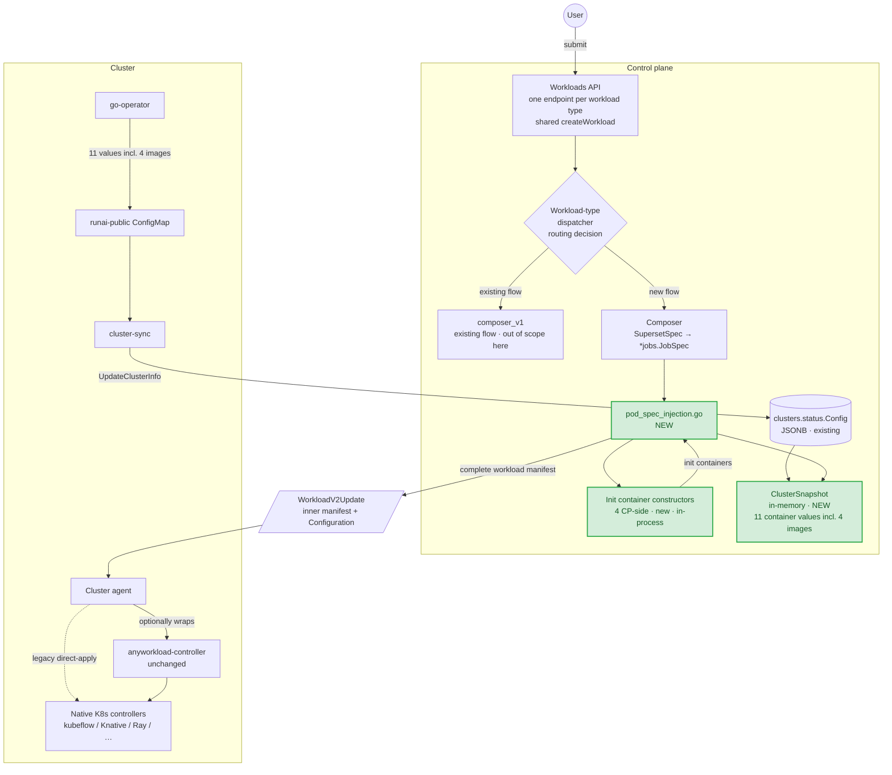

# Init Container Injection on the Anyworkload Path — Design Doc

## Metadata

| Field | Value |
|---|---|
| **Status** | Ready for development |
| **Author(s)** | Liran (Lee) Elisha |
| **Reviewers** | Chen Amiel, Nael Asbi |
| **Created** | 2026-04-29 |
| **Last updated** | 2026-05-25 |
| **Target release / milestone** | 2.26 |

---

## 1. Summary

As of today, the Workloads API ships submissions from the control plane to the cluster. The API exposes one REST endpoint per workload type (workspace, training, distributed training, inference, distributed inference); all handlers share a single internal `createWorkload` function on the control plane. That function persists the submission to a database, and the agent in the cluster periodically reconciles those records into Kubernetes objects.

While building a workload, we have four optional init containers that we attach to the workload's pod template: `git-sync`, `s3-fs`, `runai-auth-user-loader`, and `runai-oauth2-proxy`. On the **native path** (the existing pipeline: `composeNative` preserves the typed `SupersetWorkload` (`*jobs.JobSpec`) → the cluster agent picks it up and creates the per-workload-type CRD → per-type cluster controllers like `RunaiJob`/`DistributedRunaiJob`/`InferenceWorkload`/…), these containers are built by builders that live on the cluster side — the code that takes the workload submission and converts it into a workload manifest with the four containers attached to the pod template all runs on the cluster.

This design adds **functional parity** for the same four containers on the **anyworkload path** (the newer pipeline: `AnyWorkloadSubmitter.Create` → workloads-manager (intra-CP) → cluster agent poll → `WorkloadRunner` → `anyworkload-controller`). An anyworkload submission should produce a workload manifest with the same containers attached, under the same conditions, as a native submission would. We decided to do that work on the **control plane**, not the cluster — the control plane builds the complete workload manifest (with the pod-template region populated) and the cluster just applies it. Building the containers on the control plane keeps the cluster controller generic and, on the anyworkload path, lets GVK policy and the persisted/shipped manifest see the containers that will actually run (see §7 "Why this approach").

The Workloads API exposes one REST endpoint per workload type, but all five handlers share a single internal `createWorkload` function. Inside it, a per-workload-type dispatcher picks the native or anyworkload path based on whether an `AnyWorkloadSubmitter` is registered for the type and accepts the spec (see §5 Glossary). This document is about closing the parity gap on the anyworkload path; the native path keeps building the four containers exactly as it does today.

Concretely, we **write four fresh CP-side init container constructors** (one per container) that mirror the cluster builders' behavior, and call them from the composer. The existing cluster builders **stay where they are, untouched**, for the duration of the native-path sunset; they remain the native-path runtime **and** the test source of truth that the new CP init container constructors' tests compare against, so the two implementations cannot silently drift. (We use the new name "init container constructors" on the control-plane side to avoid colliding with the existing cluster "builders" — see §8.5.)

To give the new init container constructors the inputs they need, we extend `cluster-sync` to surface the cluster-side container values they require (Redis address, custom CA, OpenShift detection, etc.) **plus the four user-facing image references** (`s3-fs`, `git-sync`, `oauth2-proxy`, `oauth2-proxy-username-loader`). The cluster keeps owning the four images in the short term — they ride the same `runai-public` channel as the other container values, and the composer reads everything off the same in-memory `ClusterSnapshot` at workload-composition time. CP-side image management (admin API + per-cluster overrides) is deferred to a follow-up after the native path is retired — see §11.

---

## 2. Context and background

The migration from per-workload-type controllers to the anyworkload-controller reduces a per-workload-type controller fleet (RunaiJob, DistributedRunaiJob, InferenceWorkload, …) to a single generic `anyworkload-controller` that reconciles a `WorkloadRunner` CR. Most domain logic that those per-type controllers carried — pod-template synthesis, scheduling annotations, owner references — has either moved to the control-plane composer or to small per-concern plugins on the cluster (`mnnvl`, `networking`).

The four user-driven init container injections did not move. Today they live in `runai-cluster/cluster/workload-common/builders/{gitsync,s3,oauth2_proxy,username_loader}.go` and are stitched in by `runai-cluster/cluster/workload-controller/pkg/builders/jobs/runaijob/pods.go` — both invoked only from the native path. On the anyworkload path nothing reads the user's Git/S3/exposedURL fields at injection time. A workload that references a Git asset starts with no `git-sync` init container; a workload that exposes an authenticated URL starts with no OAuth2 proxy and, when an allowlist is supplied, no `runai-auth-user-loader` either.

Run:AI is also fixing a lower bound: **Kubernetes 1.29+** is the minimum supported version. With that fixed, the two long-lived containers (`s3-fs` mount, `runai-oauth2-proxy`) always go into `pod.spec.initContainers` with `restartPolicy: Always`, and the `feature-gate/feature_gate_util.go` runtime check that today distinguishes 1.28-and-below from 1.29-and-above can be retired during the native-path sunset. No version-conditional logic ships with this change.

---

## 3. Goals

In priority order:

1. **Behavioral parity with the existing cluster builders** for the four in-scope user-driven injections, on the anyworkload submission path, for every anyworkload-supported kind whose pod-template layout the composer is wired to handle. Kinds with non-standard layouts (KServe `InferenceService`, NIMService, Dynamo) are deferred and continue to flow through their native controllers in the meantime — see §12 Risks. Behavioral parity means the new CP init container constructors produce structurally equivalent pod-template output to the existing cluster builders for the same input — enforced by golden-file unit tests against the cluster builders' own fixtures and a composer-level parity test (§9), not by code sharing.
2. **Generic cluster controller.** The `anyworkload-controller` must not grow domain knowledge of asset shapes, container shapes, or init container policy.
3. **The composer has the four user-facing images at composition time.** The cluster keeps owning `s3-fs`, `git-sync`, `oauth2-proxy`, and `oauth2-proxy-username-loader` (set from cluster Helm into the workload-controller `*_IMAGE` env vars today). The operator surfaces them up through the existing `runai-public` channel alongside the other container values, and the composer reads them off the same `ClusterSnapshot` that already carries the other container values. CP-side image management (admin API + per-cluster overrides) is deferred to a follow-up after the native path is retired — see §11.
4. **No CRD wire-format change.** The `WorkloadRunner` CRD `Spec.Template` already accepts a complete inner kind manifest; no new field added to `Instructions`, to the workloads-manager V2 write wire (`WorkloadV2CreateRequest` / `WorkloadV2UpdateRequest`), or to the agent's read wire (`WorkloadV2Update`).
5. **Verifiable parity.** A composer-level parity test asserts the anyworkload-produced workload manifest is structurally equivalent to the native-produced one for each in-scope asset shape (Git, S3, Auth — including the Auth variant with a per-URL `AuthorizedUsers` allowlist that triggers `runai-auth-user-loader`), compared region-by-region inside the pod template.

---

## 4. Non-Goals

- **End-user visibility for the four platform-injected init containers** in workload Logs, Terminal, container picker, etc. Tracked separately; not in any estimate in this doc.
- **Per-workload-type controller deprecation.** The existing cluster builders continue to read their values from `os.Getenv` for the duration of the native-path sunset. The four in-scope `*_IMAGE` env vars on the workload-controller Deployment can be retired *after* the native path is fully removed, not as part of this work.
- **Kubernetes 1.28-and-below support.** The 1.29 minimum is a precondition enforced at install/upgrade time by the installer team; no runtime version branching ships with this change.
- **The dispatcher's routing decision** (whether an incoming submission to the Workloads API is routed to the anyworkload path or kept on the native, per-workload-type controller path). That branching logic is owned by a separate design and a separate ticket. This document assumes the dispatcher has already routed the submission to the anyworkload path; it does not specify where or how that decision is made.
- **Modifying or relocating the cluster builder package** (`runai-cluster/cluster/workload-common/builders/`). It stays where it is, unchanged, for the duration of the native-path sunset — both as the runtime path for native submissions and as the reference (test source of truth) the new CP init container constructors are tested against. Removal happens after the native path is fully retired, in a separate cleanup ticket.
- **CP-side image management.** The admin API (`GET`/`PATCH /api/v1/clusters/{id}/workload-images`), the per-cluster `workload_image_overrides` JSONB column, the CP-wide Helm image defaults, and the one-shot migration tool that seeds CP-side overrides from cluster Helm values are all deferred to a follow-up after the native path is retired. The short-term scope has the cluster keep owning the four image references; they flow up via the same `runai-public` channel as the other container values (see §8.2.3) and the composer reads them off `ClusterSnapshot`. The deferred admin layer's contract is captured in §8.1 / §8.2.1–§8.2.2 / §8.3.1 / §11 so the API shape is reviewed once.

---

## 5. Glossary

| Term | Definition |
|---|---|
| **Workloads API** | The user-facing workload-submission surface on the control plane. It exposes one REST endpoint per workload type — workspaces, trainings, distributed, inferences, distributed-inferences — defined in [`control-plane/workloads/swagger/source/openapi.yaml`](../control-plane/workloads/swagger/source/openapi.yaml). All five handlers share a single internal `createWorkload` function ([`control-plane/workloads/pkg/services_crud/create.go`](../control-plane/workloads/pkg/services_crud/create.go)), which runs the per-workload-type dispatcher. There is no separate "V1" or "V2" submission API. |
| **Dispatcher** | The per-workload-type routing inside `createWorkload`. For each submission it looks up an `AnyWorkloadSubmitter` for the workload type ([`any_workload_submitter.go`](../control-plane/workloads/pkg/services_crud/any_workload_submitter.go) — production-ready today for Workspace and Training; Inference and DistributedInference submitters are work in progress and frequently return `(nil, nil)` for specs they don't yet support); if one exists, `CanCreate` is true, and `Create` returns a non-nil `Submission`, the request goes to the **anyworkload path**; otherwise it falls through to the **native path**. The decision is per-workload and capability-driven, not API-version-based. |
| **Native path** (a.k.a. existing / per-workload-type controller path) | The pre-existing submission pipeline. `composeNative` preserves the typed `SupersetWorkload` (`*jobs.JobSpec`, built by `composer_v1`); the cluster agent picks it up and creates the per-workload-type CRD; the per-workload-type cluster controllers (`RunaiJob`, `DistributedRunaiJob`, `InferenceWorkload`, …) reconcile it; the existing cluster builders in `runai-cluster/cluster/workload-common/builders/` produce the four containers. Today this is the only path that injects the four in-scope containers. |
| **Anyworkload path** (a.k.a. new path) | The new submission pipeline. `AnyWorkloadSubmitter.Create` produces a `WorkloadV2CreateRequest` and POSTs it intra-CP to workloads-manager (`sendSubmissionToWorkloadMgr` → `CreateWorkloadV2`). workloads-manager persists the manifest. The cluster agent then **polls** workloads-manager (`GetWorkloadV2Updates`), receives the persisted record as a `WorkloadV2Update`, wraps the inner manifest in a `WorkloadRunner` CR (`wrapWithWorkloadRunner`), and applies it. The `anyworkload-controller` reconciles the `WorkloadRunner`. This is the path that this design adds the four containers to. |
| **Anyworkload-controller** | The single cluster controller for the anyworkload path. Reconciles `WorkloadRunner` resources via a small plugin framework (`mnnvl`, `networking` today). |
| **Composer** | Control-plane package that turns the user submission into either a Run:AI typed `*jobs.JobSpec` (existing flow, served by `composer_v1` — used by the native path) or a complete kind manifest (new flow — used by the anyworkload path). The new flow lives in [`control-plane/workloads-and-policies/composer_v2/`](../control-plane/workloads-and-policies/composer_v2/) — the `_v2` suffix is a package-generation marker that predates this design and is unrelated to anyworkload terminology. Throughout this doc, "the composer" refers to this new-flow package; `composer_v1` is named explicitly only when contrasting the two. |
| **Cluster-sync** | Cluster-side service that surfaces cluster-topology configuration sourced from `RunaiConfig.Spec.*` — ingress class, gateway, subdomain support, oauth2-proxy settings, custom CA bundles for `git-sync`/`s3-fs`/`oauth2-proxy`, etc. — up to the control plane via `cluster-service`'s `UpdateClusterInfo`. The values land on `clusters.status` (JSONB) and feed `ClusterSnapshot` for the composer at workload-composition time. |
| **`RunaiConfig` CR** | Cluster-wide install-time admin input ([runaiconfig_types.go](../../runai-cluster/cluster/sdk/apis/run/v1/runaiconfig_types.go)), one CR per cluster, written from Helm values. Source of truth for several container values this design surfaces to the control plane. |
| **`*jobs.JobSpec`** | Central typed struct used by the composer to carry workload fields (Git, S3, exposed URLs, container fields, storage fields). Defined in `runai-cluster/cluster/workload-controller/pkg/api/jobs/types.go`. |
| **`WorkloadConfig` interface** | New small Go interface introduced by this work; abstracts image names, OpenShift detection, ingress class, etc., away from `os.Getenv`. Cluster-side and control-plane-side each provide an implementation. |
| **`WorkloadRunner`** | Cluster-internal CR (`run.ai/v1alpha1`, shortName `wlr`). Wraps the inner manifest in `Spec.Template runtime.RawExtension`. Reconciled by the anyworkload-controller. |
| **`WorkloadV2CreateRequest`** / **`WorkloadV2UpdateRequest`** | Intra-CP write wires from CP-workloads (the Workloads API service) to CP-workloads-manager (`control-plane/workloads-manager`). Produced by `AnyWorkloadSubmitter.Create` / `.Update` and sent via `sendSubmissionToWorkloadMgr` / `sendUpdateToWorkloadMgr`. Carry the inner workload manifest + a typed `Configuration`. Defined under `runai-clients/workloads-manager-client/generated/` and consumed by workloads-manager's `CreateWorkloadV2` / `UpdateWorkloadV2`. |
| **`WorkloadV2Update`** | Read-side wire: the persisted-form payload the cluster agent **pulls** from CP-workloads-manager via `GetWorkloadV2Updates` (`runai-clients/workloads-manager-client/generated/model_workload_v2_update.go`). Carries the inner manifest + a typed `Configuration`. The agent wraps the inner manifest into a `WorkloadRunner` via `wrapWithWorkloadRunner` before applying. Not itself a `WorkloadRunner`. |

---

## 6. Current state

Every submission enters through one of the Workloads API REST endpoints (one per workload type — see §5 Glossary). All endpoints share the same internal `createWorkload` function, which runs the per-workload-type dispatcher. The two downstream paths the dispatcher picks between are described below.

### Native path (today, working)

1. User submits a workspace / training / inference asset on the control plane. The dispatcher routes the request to `composeNative` because no anyworkload submitter accepts the spec.
2. `composeNative` does **not** produce a manifest — it preserves the typed `SupersetWorkload` (`*jobs.JobSpec`) with `WorkloadFields.GitSync`, `WorkloadFields.S3buckets`, `WorkloadFields.ExposedUrls` populated, ready for the cluster to pick up.
3. The cluster agent picks up the `SupersetWorkload` and creates the corresponding per-workload-type CRD (`RunaiJob`, `DistributedRunaiJob`, `InferenceWorkload`, …) on the cluster.
4. The per-workload-type controller reconciles the CRD and calls `BuildPodSpecInitContainers` / `BuildPodSpecContainers` in [`pods.go`](../runai-cluster/cluster/workload-controller/pkg/builders/jobs/runaijob/pods.go), which calls into the shared builders at [`runai-cluster/cluster/workload-common/builders/`](../runai-cluster/cluster/workload-common/builders/).
5. The shared builders read images and container values from `os.Getenv` on the cluster (12 env vars; see §8.2) and produce the four containers.

A K8s-version feature gate at `feature_gate_util.go` flips the container shape between the pre-1.29 layout and the 1.29+ init-container-with-`restartPolicy: Always` layout. With the 1.29 minimum the gate is now always-true and is removed in PR 1 (§14).

### Anyworkload path (today, not implemented for the four containers)

1. User submits a workload manifest (raw or asset-derived). The dispatcher picks an `AnyWorkloadSubmitter` for the workload type (Workspace and Training are production-ready; Inference and DistributedInference are still work in progress) and that submitter accepts the spec, so the request goes here instead of `composeNative`.
2. The composer produces the inner kind manifest (`Pod`, `Job`, `PyTorchJob`, …).
3. CP-workloads sends the inner manifest plus a typed `Configuration` (Mnnvl, Networking) intra-CP to workloads-manager as a `WorkloadV2CreateRequest` (`sendSubmissionToWorkloadMgr` → `CreateWorkloadV2`). workloads-manager persists it.
4. The cluster agent ([`workloads_v2_handler.go`](../runai-cluster/cluster/agent/pkg/handlers/workloads_v2_handler.go)) polls workloads-manager via `GetWorkloadV2Updates`, receives a `WorkloadV2Update`, optionally wraps the inner manifest into a `WorkloadRunner` (`wrapWithWorkloadRunner`), and applies it.
5. The anyworkload-controller reconciles the manifest and server-side-applies it to the API server.

**Nothing on the anyworkload path — neither the composer nor the cluster controller — reads Git, S3, or exposedURL state, so the four containers are never produced.** The native flow is the parity safety net; the anyworkload flow is what we are filling in.

#### `WorkloadV2Update` payload shape (what the cluster agent receives)

```go
type WorkloadV2Update struct {
    Id, Name, ProjectId   string
    Gvk                   GVK
    UpdateCount           int64
    DesiredPhase          DesiredPhase
    Configuration         *WorkloadV2UpdateConfiguration
    WorkloadManifest      map[string]interface{} // the inner kind
}
```

This is the agent's polled view of what CP-workloads persisted to workloads-manager via `WorkloadV2CreateRequest` / `WorkloadV2UpdateRequest`. One workload carries one inner kind. `WorkloadRunner` is a cluster-internal abstraction; the agent optionally wraps the inner manifest into one based on its `EnableWorkloadRunner` flag (default `true`). This design is wrap-layer agnostic — the four containers are written into the inner manifest **inside the composer** (step 3 above), so they're already in place by the time workloads-manager persists the record and the agent pulls it.

### Cluster → control-plane configuration sync (today)

Cluster-side configuration reaches the control plane through a single existing channel:

1. **`RunaiConfig` CR** — the admin contract (`Spec.*` written by Helm/admin; `Status` written by the operator).
2. **`runai-public` ConfigMap** — a curated projection maintained by the operator. It republishes a subset of `Spec.*`, the CR's `Status`, and live cluster probes (Prometheus version, GPU stack, Knative, etc.). This is the stable public surface that downstream consumers depend on, including `cluster-sync`.
3. **`cluster-sync`** — watches the ConfigMap, parses it, and ships the result to `cluster-service.UpdateClusterInfo`. Values land on `clusters.status` (JSONB).

Both surfaces are mutable at runtime. PR 2 extends them additively: new fields on the existing `PublicConfiguration` schema, new wire fields on `ClusterReportedConfig`. No CR changes, no new sync channel.

---

## 7. Proposed design — high level

We extend the composer with a **common code for all init containers** that takes the existing `*jobs.JobSpec` produced by today's composer and writes the four init containers into the pod-template region of the workload manifest. The composer is wired to know each supported workload kind's pod-template layout up front and writes into the right place per kind. CP-workloads then hands the completed manifest off to workloads-manager (as a `WorkloadV2CreateRequest`); workloads-manager persists it; the cluster agent later polls and applies it. The four image references and the other container values both flow up from the cluster through the existing `runai-public` channel; the composer reads them off the same in-memory `ClusterSnapshot` at composition time. CP-side image management (admin API + per-cluster overrides) is deferred — see §11. The cluster receives the complete workload manifest and applies it; the anyworkload-controller is unchanged.

Two alternatives — Design A (cluster-side plugin) and Design B1 (cluster reports image values too) — were considered and are summarised in §11.

### Why this approach

- **GVK manifest policy can finally see the four init containers (anyworkload path).** Run:AI's GVK policy engine runs on the manifest persisted to `workloads_queue.EffectiveManifest` ([`workloads-manager/pkg/services/api_workloads_v2_impl.go`](../control-plane/workloads-manager/pkg/services/api_workloads_v2_impl.go), `ApplyPolicy` call site) and supports init-container selectors (`allInitContainers` in [`policy-service/pkg/system_mapping/pod.go`](../control-plane/policy-service/pkg/system_mapping/pod.go); test fixtures query `.spec.template.spec.initContainers[]?`). Today the anyworkload composer ships manifests without the four containers, so policies that target injected init containers can't be enforced. Doing injection on the CP closes that gap on the anyworkload path. (Legacy typed-spec policy in `policy_compliance` runs before composition and is unaffected; native-path cluster-side webhook policy is also unaffected.)
- **The persisted/shipped manifest matches the pod the cluster applies (anyworkload path).** `workloads_queue.EffectiveManifest` is what `GET /api/v2/workloads/{id}` returns and what `WorkloadV2Update.WorkloadManifest` ships on the wire. Today that record omits the four containers; the cluster adds them later only on the native path. With CP-side injection, the CP record and the wire payload are identical to what the cluster receives — easier debugging of "what did we ship", and any future audit/inspection feature gets the complete pod for free.
- **Wrap-layer agnostic.** The init containers are written into the inner manifest *before* the wire. Whether the agent later wraps into a `WorkloadRunner` (`EnableWorkloadRunner=true`) or applies the inner kind directly to its upstream K8s controller (legacy mode), the containers are already in place.
- **Forward-compatible with CP-side image management.** Short-term, the four user-facing images (`s3-fs`, `git-sync`, `oauth2-proxy`, `oauth2-proxy-username-loader`) flow up from the cluster via the same `runai-public` channel as the other container values (§8.2.3). The composer reads them off `ClusterSnapshot` / `WorkloadConfig`. Adding the deferred CP-side image admin layer later (admin API + per-cluster overrides + CP-wide defaults) only changes how `ClusterSnapshot` is populated; nothing downstream in the composer or wire changes — see §11.
- **No CRD wire-format change.** `WorkloadRunner.Spec.Template` is `runtime.RawExtension` and already accepts a complete inner kind manifest. `Instructions` stays reserved for cluster-side plugins (that's the contract documented in [`workloadrunner_types.go:41-49`](../runai-cluster/cluster/sdk/apis/run/v1alpha1/workloadrunner_types.go)) and we add nothing to it.

### 7.1 Architecture diagram



Every submission lands on the **Workloads API** — one REST endpoint per workload type — and is funneled into the shared `createWorkload` function on the control plane. There is no separate "V2" entrypoint. Inside `createWorkload` the **dispatcher** decides per workload whether to run the existing native flow (`composer_v1`, drawn as a terminal node — its downstream cluster-side path is unchanged and out of scope here) or the new anyworkload flow (composer → common code for all init containers → workloads-manager via `WorkloadV2CreateRequest` → agent poll (`GetWorkloadV2Updates`) → `WorkloadRunner` → anyworkload-controller). The "Wire" node in the diagram is the agent's polled `WorkloadV2Update` payload. The dispatcher and its decision logic are out of scope for this design (see §4 Non-Goals); this document describes the new flow as it runs after the dispatcher has chosen it.

The pieces highlighted in green are the only things this design actually adds: the common code for all init containers inside the composer, the four init container constructors, and the in-memory `ClusterSnapshot` abstraction the composer reads at composition time. Everything cluster-side is untouched except for the operator additively copying the four `*_IMAGE` Helm values plus ~7 existing `RunaiConfig.Spec.*` container values into `runai-public` — see §8.2.3. The CP-side image admin layer (admin API + per-cluster `workload_image_overrides` JSONB column + CP-wide Helm defaults) is deferred to a follow-up after the native path is retired; see §11.

### 7.2 Injection trigger logic

The common code for all init containers does **not invent new triggers**. It uses the same predicates the native path uses today in [`runai-cluster/cluster/workload-controller/pkg/builders/jobs/runaijob/pods.go`](../runai-cluster/cluster/workload-controller/pkg/builders/jobs/runaijob/pods.go) — `BuildPodSpecInitContainers` and `BuildPodSpecContainers`. The four containers are gated, per workload, on typed fields the existing `JobSpecComposer` already populates on `*jobs.JobSpec`:

| Container | Trigger predicate on `*jobs.JobSpec` |
|---|---|
| `git-sync` | `WorkloadFields.GitSync != nil` |
| `s3-fs` (goofys) | `len(WorkloadFields.S3buckets) > 0` |
| `runai-oauth2-proxy` | any `WorkloadFields.ExposedUrls[i]` with `auth.required == true` |
| `runai-auth-user-loader` | external-auth feature is enabled (`WorkloadConfig.ExternalAuthUrlEnabled()`) AND any `ExposedUrls[i]` carries a non-empty `AuthorizedUsers` (or the serving-port `AuthorizedUsers` is non-empty). Always paired with `runai-oauth2-proxy` — the proxy reads what the loader writes. |

Same data, same gates. The change is *where* the gating runs (control-plane common code for all init containers vs. cluster-side per-workload-type controller) — the predicates themselves are unchanged. This is what makes the parity test in §9.2 tractable: it asserts container-by-container equivalence between the native and anyworkload outputs for each in-scope asset shape (Git, S3, Auth, and the Auth-with-allowlist variant that exercises the user-loader).

---

## 8. Detailed design

The bulk of the design. Sub-sections cover the API surface, data model, system flow, and the control-plane / cluster-plane responsibility split. The new code is grouped into three PRs (timeline in §14); this section describes them as one coherent design.

### 8.1 API design

> **Status: deferred to a follow-up after native-path removal.** Short-term scope (this design) has the four image references flow up from the cluster via `runai-public` (§8.2.3), with no CP-side image store and no admin endpoints. The admin API below is documented so the contract is reviewed once and the follow-up doesn't redesign it from scratch.

Two new admin endpoints on the control-plane Clusters service. Follow the [Run:AI API Design Guidelines](https://runai.atlassian.net/wiki/spaces/EN/pages/) for naming, error shape, and versioning.

| Method | Path | Purpose |
|---|---|---|
| `GET` | `/api/v1/clusters/{id}/workload-images` | Returns `{ effective, overrides, defaults }` — `effective` is what the composer will use, `overrides` is the per-cluster admin choice (each field nullable), `defaults` is the CP-wide setting. |
| `PATCH` | `/api/v1/clusters/{id}/workload-images` | Sets or clears each per-cluster override. A field set to `null` resets that image to the CP-wide default. Atomic across all four fields. |

Response shape (illustrative):

```json
{
  "effective": {
    "s3FileSystem":             "registry.run.ai/goofys:1.2.3",
    "gitSync":                  "registry.k8s.io/git-sync/git-sync:v4.2.1",
    "oauth2Proxy":              "registry.run.ai/oauth2-proxy:7.6.0",
    "oauth2ProxyUsernameLoader":"registry.run.ai/oauth2-proxy-username-loader:7.6.0"
  },
  "overrides": {
    "s3FileSystem":             "mirror.customer.example/goofys:1.2.3",
    "gitSync":                  null,
    "oauth2Proxy":              null,
    "oauth2ProxyUsernameLoader":null
  },
  "defaults": { "...same shape, populated from CP Helm..." }
}
```

The OpenAPI spec lives under `control-plane/cluster-service/swagger/source/`. Once published, the swagger is consumed by any client (CLI, scripts, generated SDKs).

No changes to the Workloads API. The new admin endpoints live on `cluster-service` and are separate from workload submission.

### 8.2 Data model and schema

#### 8.2.1 New control-plane DB column

> **Status: deferred to a follow-up after native-path removal.** The JSONB column documented below ships with the deferred admin API (§8.1). Short-term scope has the four image references land on the existing `clusters.status.Config.*` JSONB alongside the other cluster-reported container values (§8.2.3); no new column is added in this design.

Liquibase migration adds one column to the `clusters` table:

| Column | Type | Notes |
|---|---|---|
| `workload_image_overrides` | `JSONB` | Nullable. `NULL` or absent keys mean "use the CP-wide default". One JSON object with up to four keys: `s3FileSystem`, `gitSync`, `oauth2Proxy`, `oauth2ProxyUsernameLoader`. |

Index: none — the column is read inline per workload composition; access pattern is point-lookup on the existing `clusters.id` PK.

Validation (in `cluster-service`): each override must be a non-empty string parseable as a Docker image reference (`registry/path:tag` or `registry/path@sha256:…`). Bad values rejected at the `PATCH` boundary, not at composition time.

#### 8.2.2 CP-wide defaults

> **Status: deferred to a follow-up after native-path removal.** Short-term scope has the cluster keep owning the four images — they flow up via `runai-public` (§8.2.3). The CP-wide Helm defaults stanza below is the fallback layer that ships with the deferred admin API (§8.1) once the CP becomes the image source of truth.

A new stanza in the control-plane Helm chart populates four env vars on the `workloads-manager` Deployment (or a dedicated `workload-defaults` ConfigMap, mounted by services that need them):

```yaml
workloads:
  images:
    s3FileSystem:              "registry.run.ai/goofys:..."
    gitSync:                   "registry.k8s.io/git-sync/git-sync:..."
    oauth2Proxy:               "registry.run.ai/oauth2-proxy:..."
    oauth2ProxyUsernameLoader: "registry.run.ai/oauth2-proxy-username-loader:..."
```

These ship with the CP release and are the floor: per-cluster overrides take precedence when set.

#### 8.2.3 Surfacing container values and image references to the control plane

Every value the common code for all init containers needs at injection time exists on the cluster today — either on `RunaiConfig.Spec.*` (the seven container values) or as one of the `*_IMAGE` env vars on the workload-controller Deployment, populated from cluster Helm values (the four image references). See [`runai-cluster/cluster/sdk/apis/run/v1/`](../runai-cluster/cluster/sdk/apis/run/v1/). **No new CR fields are introduced by this design.** What this section addresses is which of those values the control plane already knows, which need to flow up from the cluster, and how.

"CP today" answers whether the value already reaches the control plane through some existing channel. Rows marked **No** are exactly the ones this design has to surface.

| Value (semantic) | CP today | Default | Cluster source |
|---|:---:|---|---|
| `s3-fs` image reference | No | shipped via cluster Helm | `*_IMAGE` env on workload-controller Deployment (operator-managed) |
| `git-sync` image reference | No | shipped via cluster Helm | `*_IMAGE` env on workload-controller Deployment (operator-managed) |
| `oauth2-proxy` image reference | No | shipped via cluster Helm | `*_IMAGE` env on workload-controller Deployment (operator-managed) |
| `oauth2-proxy-username-loader` image reference | No | shipped via cluster Helm | `*_IMAGE` env on workload-controller Deployment (operator-managed) |
| oauth2-proxy Redis FQDN | No | `cluster-redis.runai.svc.cluster.local:6379` | `RunaiOauth2ProxyRedisFQDN` on `Spec.WorkloadController`, `Spec.InferenceWorkloadController`, `Spec.AnyworkloadController` |
| oauth2-proxy auth secret name | No | `workloads-auth` | `RunaiOauth2ProxyWorkloadAuthSecretName` on the same three substanzas |
| oauth2-proxy session store type | No | `redis` | `RunaiOauth2ProxySessionStoreType` on the same three substanzas |
| Custom CA bundle for `git-sync` | No | `Enabled=false`; secret `runai-ca` / `runai-ca.pem` | `Spec.Global.CustomCAGit` (`*common.CustomCA` — `Enabled`, `Secret.{Name, Key, Optional}`) |
| Custom CA bundle for `s3-fs` | No | same | `Spec.Global.CustomCAS3` (same shape) |
| Custom CA bundle for `oauth2-proxy` trust store | No | same | `Spec.Internal.Global.CustomCA` (same shape) |
| External-auth URL toggle | No | `true` | `Spec.WorkloadController.ExternalAuthUrlEnabled` (also on `Spec.InferenceWorkloadController`) |
| Subdomain support | Yes | `true` (operator default) | `Spec.Global.SubdomainSupport` |
| Kubernetes flavor (OpenShift?) | Yes | derived at install | `Spec.Internal.Global.Platform.KubernetesFlavor` |
| OIDC issuer URL | Yes | n/a | `Spec.Internal.Global.ControlPlane.Config` (researcher-service oauth-proxy issuer) |
| Control-plane URL | Yes | n/a | `Spec.Internal.Global.ControlPlane.URL` |

**Already on the control plane today** (the four **Yes** rows — flagged for review since this design relies on each one being correct without further work):

- **Subdomain support** — synced from the cluster, persisted on `clusters.status.Config.SubdomainEnabled` (the existing JSONB column on the `clusters` table).
- **Kubernetes flavor** — synced from the cluster, persisted on `clusters.status.Platform.Type`.
- **OIDC issuer URL** — known to the CP from its own configuration; never needs to come from the cluster (the existing cluster builders only read it on the cluster because they themselves run cluster-side).
- **Control-plane URL** — same as above; CP-self-known.

**To be surfaced** (the eleven **No** rows — seven container values plus the four image references): the CP doesn't see any of these today. This design surfaces them from the cluster to the control plane and persists them on the existing `clusters.status.Config.*` JSONB (the same place `IngressClass`, `GatewayName`, `GatewayNamespace`, `WorkloadOwnershipProtection`, and `SubdomainEnabled` already live). The composer reads them off `ClusterSnapshot` at workload-composition time — the four image references and the seven container values come out of the same struct.

The image references take the same wire as the container values: the go-operator additively publishes the four `*_IMAGE` values into `runai-public` alongside the seven `RunaiConfig.Spec.*` container values, `cluster-sync` ships the full ConfigMap to `cluster-service.UpdateClusterInfo`, and the values land additively on `clusters.status.Config.*`. Whenever an admin re-rolls the cluster Helm chart with a new image tag, the next cluster-sync tick republishes the new value and the composer picks it up for subsequent submissions. The exact operator and wire diffs are implementation details for PR 2.

For native-path callers nothing changes during the sunset: the cluster keeps populating the same env vars on the workload-controller Deployment from cluster Helm and `RunaiConfig.Spec.*`, and the existing cluster builders keep reading them via `os.Getenv`. The four `*_IMAGE` env vars on the workload-controller Deployment stay until the native path is removed.

### 8.3 System flow

#### 8.3.1 Admin updates a per-cluster image override

> **Status: deferred to a follow-up after native-path removal.** Documented here so the flow is reviewed once. Short-term scope has the four image references flow up from the cluster via `runai-public` (§8.2.3); an admin who needs to change an image still does so by re-rolling the cluster Helm chart, and the next cluster-sync tick republishes the new value to the CP.

A `PATCH` against the admin endpoint validates the image references, persists them to `clusters.workload_image_overrides`, and returns the new `{effective, overrides, defaults}` triple. The override applies to **subsequent** workload submissions only — existing running workloads keep their pod spec (Pod specs are immutable). This matches today's behavior on the native path: env-var changes on the workload-controller Deployment only affect new workloads.

### 8.4 Control-plane / data-plane split

The split is the central architectural commitment of this design:

| Responsibility | Where it lives | Why |
|---|---|---|
| Workload-component **image references** (the four user-facing images) | Cluster (cluster Helm value → `*_IMAGE` env on workload-controller Deployment → `go-operator` → `runai-public` → cluster-sync → CP snapshot) | Short-term scope: the cluster keeps owning the image source of truth and ships it up additively over the same channel as the other container values, so the operator surface stays uniform and `ClusterSnapshot` is the single read-point for the composer. CP-side image management (admin API + per-cluster overrides + CP-wide Helm defaults) is deferred — see §11 — and only changes how `ClusterSnapshot` is populated. |
| **Container values** (Redis FQDN, Secret names, ingress class, OpenShift, custom CA — the configuration each of the four containers needs) | Cluster (`RunaiConfig.Spec.*` → `go-operator` → `runai-public` → cluster-sync → CP snapshot) | Reference cluster-side objects by name or report runtime facts. `RunaiConfig` is the source of truth; `runai-public` is the operator's republishing surface that `cluster-sync` reads. Same channel as the four image references above. |
| **Workload-manifest construction** (pulls images + container values together, calls the init container constructors, writes containers into the manifest's pod-template region) | Control plane (composer + `pod_spec_injection.go`) | Anyworkload-path GVK policy can enforce against the four containers (today it can't — they're invisible at policy-evaluation time); the CP record (`workloads_queue.EffectiveManifest`) matches the pod the cluster receives; cluster controller stays generic. |
| **Container-shape library** (the four container shapes — git-sync, s3-fs, oauth2-proxy, runai-auth-user-loader) | Two parallel implementations during the native-path sunset: the native path keeps using the **cluster builders** at `runai-cluster/cluster/workload-common/builders/` unchanged; the anyworkload path uses new **CP init container constructors** under `control-plane/workloads-and-policies/composer_v2/`. The cluster builders are the test source of truth for the new ones (golden tests + composer-level parity test). After the native path is retired, the cluster builders are removed in a separate cleanup. | Avoids reshaping cluster code under a deadline; new code is sized to the anyworkload path's actual needs (a `WorkloadConfig` source, no `os.Getenv`); historical bug fixes are caught by an explicit PR audit (§14 PR 1) rather than relied on implicitly via shared code. |
| **Pod-template region per supported workload kind** | Hardcoded in the composer (`composer_v2`) — the common code for all init containers dispatches on the workload kind and writes into the right pod-template region directly. | Composers already produce per-kind manifests, so they already know each kind's layout; folding the init-container write into that same knowledge keeps the new code self-contained and removes a runtime dependency on a generic discovery library. Kinds with non-standard layouts (KServe `InferenceService`, NIMService, Dynamo) are deferred to a follow-up (§12 Risks). |
| **Reconciliation, status, lifecycle** | Cluster (`anyworkload-controller`, native K8s controllers) | Unchanged. |

---

### 8.5 CP init container constructors rewrite

This section makes the "two parallel implementations" row above concrete: where the original code lives and where the new code goes. The new CP-side code is called **init container constructors** to avoid the name collision with the existing cluster `builders/` package (which we leave untouched for the native-path sunset). PR slicing and effort sizing live in §14.

| Init container constructor | Existing cluster file (test source of truth, untouched) | New CP file | PRs to audit |
|---|---|---|---:|
| Git-sync init container | [`runai-cluster/cluster/workload-common/builders/gitsync.go`](../runai-cluster/cluster/workload-common/builders/gitsync.go) | `control-plane/workloads-and-policies/composer_v2/gitsync.go` | 2 |
| S3-fs init container | [`runai-cluster/cluster/workload-common/builders/s3.go`](../runai-cluster/cluster/workload-common/builders/s3.go) | `control-plane/workloads-and-policies/composer_v2/s3.go` | 2 |
| OAuth2 proxy init container | [`runai-cluster/cluster/workload-common/builders/oauth2_proxy.go`](../runai-cluster/cluster/workload-common/builders/oauth2_proxy.go) | `control-plane/workloads-and-policies/composer_v2/oauth2_proxy.go` | 7 |
| Username loader init container | [`runai-cluster/cluster/workload-common/builders/username_loader.go`](../runai-cluster/cluster/workload-common/builders/username_loader.go) | `control-plane/workloads-and-policies/composer_v2/username_loader.go` | 1 |

Each new CP init container constructor mirrors the entrypoint exported by its corresponding cluster file — the exact function name, signature, and inputs are derived from that file at implementation time. The cluster files stay unmodified for the native-path sunset; they remain the native-path runtime **and** the test source of truth for the new CP init container constructors' golden tests (§9.1) plus the composer-level parity test (§9.2).

The "PRs to audit" column counts non-baseline PRs that touched each file since the May 2025 refactor that established the current shape ([#9312](https://github.com/run-ai/runai/pull/9312)). It is the per-constructor measure of how much historical-fix territory the rewrite has to cover; `oauth2_proxy.go` is the heaviest by a wide margin and is the main reason PR 1c is sized at ~3.5 days. The audit deliverable in §13 enumerates each PR by ID and disposition.

The one architectural change versus the originals is the input boundary: every value the cluster builders read from `os.Getenv` — wired today through [`runai-cluster/cluster/workload-common/config/config.go`](../runai-cluster/cluster/workload-common/config/config.go) and (for `s3.go` and `oauth2_proxy.go`) [`runai-cluster/cluster/workload-common/feature-gate/`](../runai-cluster/cluster/workload-common/feature-gate/) — becomes a method on a CP-only `WorkloadConfig` interface, populated from the in-memory `ClusterSnapshot`. Short-term scope: container values and the four image references both come up via `runai-public` (§8.2.3); the deferred admin layer (§8.1) replaces the image source with a CP-side store later without changing the constructor-side boundary.

---

## 9. Testing strategy

The three PRs share a parity-first testing philosophy: at every step, the anyworkload-produced pod template must be structurally equivalent to the native one's, container-by-container.

### 9.1 Unit tests (per-component)

| Suite | What it asserts |
|---|---|
| `control-plane/workloads-and-policies/composer_v2/*_test.go` (new) | Each new CP init container constructor produces structurally equivalent `corev1.Container` / `corev1.Volume` / `corev1.VolumeMount` output to the cluster builder it mirrors, for fixtures imported from the cluster builders' own Ginkgo suites. Acts as the per-constructor parity gate. |
| `control-plane/workloads-and-policies/composer_v2/workload_config_test.go` (new) | The `WorkloadConfig` interface returns each container value and each of the four image references from `ClusterSnapshot` (cluster-reported), and returns a typed error if a required field is missing. |
| `control-plane/workloads-and-policies/composer_v2/runai_workloads/pod_spec_injection_test.go` (new) | Given a populated `*jobs.JobSpec` + `WorkloadConfig`, the common code for all init containers writes the right containers at every declared `PodTemplateSpecPath`. Table-driven across each of the anyworkload-supported kinds. |
| `control-plane/cluster-service/pkg/services/cluster_snapshot_test.go` (new) | `ClusterSnapshot` correctly composes the 11 cluster-reported values (7 container values + 4 image references) read from `clusters.status.Config.*` into a single `WorkloadConfig`. |

Naming follows the Run:AI Ginkgo conventions — no regex-special characters in `It`/`Describe`/`Context` strings.

### 9.2 Integration tests

| Suite | What it asserts |
|---|---|
| `control-plane/workloads-and-policies/composer_v2/integration/parity_native_anyworkload_test.go` (new — the **safety net**) | For each in-scope asset shape (Git-only, S3-only, Auth-only, Auth-with-AuthorizedUsers) plus an "all combined" variant, assert the anyworkload-produced pod template matches the pod produced by the native path's cluster builders, container-by-container. The Auth-with-AuthorizedUsers variant is what locks `runai-auth-user-loader` parity in. |

The parity test runs the cluster builder for each variant with the same image references and container values the composer reads off `ClusterSnapshot` — short-term scope both sides see identical inputs because the four images come from the same cluster Helm values the native path reads via `os.Getenv`.

### 9.3 End-to-end tests

Extend the playwright e2e suite under [`e2e/src/test/suites/playwright/`](../e2e/src/test/suites/playwright/) with anyworkload-side scenarios for each asset shape (Git-only, S3-only, Auth-only) plus an Auth-with-AuthorizedUsers variant that exercises `runai-auth-user-loader` end-to-end, modeled on the existing [`gitDataSource.test.ts`](../e2e/src/test/suites/playwright/parallel/nv/dataSource/gitDataSource.test.ts) pattern. Each test submits a workload whose spec is routed through the anyworkload path, triggers the container, polls the resulting pod, and asserts the init container ran (logs / status, plus auth-volume contents for the user-loader case). Knative `Service` is included as an explicit verification target — see the Knative carve-out note in §12 Risks.

### 9.4 Optional cross-flow comparison script

A standalone, opt-in script (not wired into CI) that an engineer can run against a real cluster to diff the *fully-materialised* pod spec produced by the native flow against the one produced by the anyworkload flow, for the same submission. The intent is a high-confidence sanity check before promoting the anyworkload path on a customer cluster, complementary to the in-process parity test in §9.2.

Steps the script performs, given one workload submission as input:

1. **Capture the native-flow output.** Submit through the Workloads API with a spec the dispatcher routes to `composeNative`, let the native path run, fetch the resulting pod from the cluster, and snapshot its `spec` (containers, init containers, volumes, mounts, env, security context).
2. **Capture the anyworkload-flow output.** Submit the same payload with a spec the dispatcher routes through an `AnyWorkloadSubmitter`, fetch the resulting pod the anyworkload path materialises, and snapshot its `spec` the same way.
3. **Diff the two specs.** Container-by-container, field-by-field. Anything other than expected differences is a parity violation; the script exits non-zero and prints the diff.

Lives under `tools/anyworkload-parity/` (or wherever cross-cutting ops scripts live). Optional dependencies: `kubectl`, the workloads CLI, `dyff` (or equivalent semantic YAML diff). Used by engineers / SREs during anyworkload-path rollout per cluster — not a CI gate.

---

## 10. Rollout and backwards compatibility

### 10.1 Feature enablement

One feature flag gates the short-term rollout:

| Flag | Defaults | Effect |
|---|---|---|
| `composer.init_container_injection.enabled` | `false` initially → `true` per cluster, then fleet | Composer runs the common code for all init containers; off means anyworkload submissions ship without the four containers (the not-yet-implemented state today, but explicit). |

Rollout stages: internal cluster → 1 friendly customer cluster → all customers. Kill switch: flip `composer.init_container_injection.enabled` to `false`; the anyworkload path returns to the current state (no injections), no other regression.

The deferred CP-side image admin layer (§11) adds its own `cluster_service.workload_image_overrides.enabled` flag when it ships.

### 10.2 Backwards compatibility

| Surface | Compatibility |
|---|---|
| **Workloads API** | Unchanged. The endpoints (one per workload type) and the shared `createWorkload` function continue to behave as they do today; the per-workload dispatcher inside `createWorkload` already exists. |
| **Native submission path** (`composeNative` → per-type controllers) | Unchanged. The existing cluster builders continue to read `os.Getenv` on the cluster. |
| **Anyworkload submission path** (`AnyWorkloadSubmitter.Create` → workloads-manager → agent poll → anyworkload-controller) | Unchanged at the wire level. The added work is internal to the composer. |
| **`WorkloadRunner` CRD + workloads-manager V2 wires** (`WorkloadV2CreateRequest` / `WorkloadV2UpdateRequest` write, `WorkloadV2Update` read) | No change. `Spec.Template runtime.RawExtension` and `WorkloadManifest map[string]interface{}` already accept a complete inner kind manifest, with whatever pod-template region the kind defines. |
| **`runai-public` ConfigMap shape** | Additive — the operator copies ~7 existing `RunaiConfig.Spec.*` container values plus the four `*_IMAGE` Helm values into `runai-public` (11 new keys). Older `cluster-sync` parsers ignore unknown fields. No CRD shape change; no Helm change required. |
| **Cluster Helm chart** | Additive. The four `*_IMAGE` env vars on the workload-controller Deployment **stay** for the native-path sunset (and beyond, since they remain the source of truth for the four images in the short-term scope); the operator additionally publishes them into `runai-public` for the CP to read. |
| **Control-plane Helm chart** | No change in the short term. The CP-wide image-defaults stanza ships with the deferred admin layer (§11) — not this design. |
| **Existing per-cluster Helm overrides for the four images** | Unchanged. Admins continue to customise the four images by re-rolling cluster Helm; the next cluster-sync tick republishes the new values to the CP. The one-shot CP-side migration tool ships with the deferred admin layer (§11). |

---

## 11. Alternatives considered

### 11.1 Design A — cluster-side plugin

A new plugin in the `anyworkload-controller` (mirroring `mnnvl` and `networking`) that reads a typed `Storage` field from `WorkloadRunner.Spec.Instructions` and appends the four init containers to the embedded pod template.

The full architecture, pros, cons, and time estimate (~21.5 days) are documented in the companion alternative-consideration doc: The headline reason it was not chosen is wrap-layer dependence — the plugin only fires when the agent wraps the inner manifest into a `WorkloadRunner`, leaving the `EnableWorkloadRunner=false` legacy direct-apply path uncovered.

### 11.2 Design B1 — adopted (short term)

This is the design this document specifies. The composer-side common code for all init containers reads everything it needs off `ClusterSnapshot`/`WorkloadConfig`. The four user-facing images keep flowing up from the cluster: the go-operator additively publishes them into `runai-public` alongside the seven container values (§8.2.3), `cluster-sync` ships the ConfigMap to `cluster-service.UpdateClusterInfo`, and they land on `clusters.status.Config.*`. There is no CP-side image store and no admin API in the short-term scope.

**Why short-term:**
- The cluster already owns the four images today (set from cluster Helm into the workload-controller `*_IMAGE` env vars). Surfacing them up via the existing `runai-public` channel is purely additive — same operator code path as the other container values.
- The `ClusterSnapshot` / `WorkloadConfig` boundary is forward-compatible: the deferred B2 layer (§11.3) only changes how `ClusterSnapshot` is populated, not the rest of the composer pipeline.
- Decouples the design from CP-side image-policy decisions that depend on the native path being retired and the four cluster-side `*_IMAGE` env vars being removable.

### 11.3 Design B2 — CP-side image management (deferred follow-up)

After the native path is retired, the four images move to a CP-managed admin setting: CP-wide defaults shipped via control-plane Helm, with per-cluster overrides via a new admin API (`GET`/`PATCH /api/v1/clusters/{id}/workload-images`, persisted on a new `workload_image_overrides` JSONB column on the `clusters` table). `ClusterSnapshot` rewires to compose per-cluster overrides ⊕ CP-wide defaults ⊕ cluster-reported container values into a single `WorkloadConfig`. A one-shot migration tool seeds CP-side overrides from each cluster's reported image where it differs from the CP default.

**Why B2 over B1 as the end state:**
- Single pane of glass for image admin instead of per-cluster Helm. Air-gapped customers configure mirrors once on the CP.
- Image upgrades align with CP releases instead of requiring per-cluster Helm rolls.
- A `goofys` image tag is an administrative choice, not a fact about a cluster's environment — keeping the source of truth on the cluster blurs that line.

The contract for this layer (admin API surface, JSONB column shape, system flow, one-shot migration) is captured in §8.1, §8.2.1, §8.2.2, §8.3.1, and §14 "Deferred follow-up" so the API shape is reviewed once and the follow-up does not redesign it from scratch.

---

## 12. Risks and mitigations

| Risk | Likelihood | Impact | Mitigation | Owner |
|---|---|---|---|---|
| Container-values surface misses a `RunaiConfig.Spec.*` value the existing cluster builders read via `os.Getenv` today, causing a runtime failure on the anyworkload path only | Med | Med | Read `oauth2_proxy.go` end-to-end in PR 1 and enumerate every external value into `WorkloadConfig` up front, cross-checked against the §8.2.3 CR-surface table. The parity test (§9.2) catches divergence. | `<TBD>` |
| `clusters.status.Config.*` is empty (cluster not yet synced after upgrade, or `cluster-sync` is failing) when the composer needs an image reference for a submission | Low | High | The composer fails the submission with a typed `errClusterValueMissing` naming the missing field. Healthy clusters tick `cluster-sync` every ~30s; the failure surfaces in `cluster-service` metrics well before workload composition. | `<TBD>` |
| **Parity drift over the native-path sunset** — a fix lands on a cluster builder (`runai-cluster/cluster/workload-common/builders/*.go`) and is not replicated CP-side, causing the anyworkload path to silently diverge from the native path | Med | High | (1) Codeowners on the cluster builder directory require a CP reviewer who confirms the corresponding CP init container constructor is updated. (2) The composer-level parity test (§9.2) runs on every CP **and** cluster PR via existing CI cross-triggering; a divergence breaks the build. (3) A short doc note in `runai-cluster/cluster/workload-common/builders/README.md` (added by PR 1a) points contributors at the CP twin. | `<TBD>` |
| **Missed historical fix during the rewrite** — a non-trivial fix in one of the audited PRs (§14 PR 1) is overlooked and the new CP init container constructor reintroduces the original bug | Med | Med | The PR audit produces a per-constructor checklist of behaviors derived from each non-trivial historical PR; reviewers tick items off against the new constructor's diff. The composer-level parity test catches any divergence from the current cluster builder output (which embeds the fixes by definition). | `<TBD>` |
| Knative `Service` upstream pod-template rules drop the injected init container (single-port / restricted-spec validation) | Low | Med | §9.3 anyworkload e2e includes Knative as an explicit verification target. If injection does not materialise, document a kind-set carve-out and add a Knative-specific shape. | `<TBD>` |
| Inference kinds (KServe `InferenceService`, Dynamo, NIMService) have non-standard pod-template layouts the composer is not wired to write into. Anyworkload submissions for these kinds would ship without the four init containers. | High (already true) | Med (anyworkload inference submissions ship without the four init containers) | Short term: the common code for all init containers returns a typed `errKindNotSupported` for these kinds, and the native `InferenceWorkload` controller continues to handle them until the composer learns each layout. Tracked as a follow-up alongside the broader anyworkload inference rollout. | `<TBD>` |

---

## 13. Open questions

- [ ] `<TBD>` **Historical PR audit deliverable.** Audit the 9 distinct PRs that have touched `runai-cluster/cluster/workload-common/builders/{gitsync.go, s3.go, oauth2_proxy.go, username_loader.go}` since May 2025 (~4–5 hours of focused work, categorised tiny / small / medium). Output: per-constructor checklist of non-trivial behaviors the new CP init container constructors must reproduce, attached to the PR 1a/1b/1c descriptions. Owner / window: TBD before PR 1a opens. The audit is tracked separately so PR 1a is not blocked on it; the parity test (§9.2) is the safety net if a checklist item is missed.

The admin-API path question (`/api/v1/clusters/{id}/workload-images` vs. a generic `/cluster-settings` surface) is deferred along with the rest of the CP-side image admin layer (§11.3); it will be re-opened with that follow-up.

---

## 14. Timeline and work breakdown

PR 1 is sliced into three independently-mergeable sub-PRs (1a / 1b / 1c) that share the same composer + common code for all init containers + `WorkloadConfig` skeleton from 1a. The slicing optimises for an end-to-end anyworkload path on a real cluster as fast as possible: ship one init container constructor all the way through (composer + common code for all init containers + `WorkloadConfig` + golden tests + parity test for that one shape), then add the rest behind it.

| PR | Scope | Estimate |
|---|---|---|
| **PR 1a — tracer bullet (gitsync)** | `WorkloadConfig` interface (covers all four images plus container values + `ExternalAuthUrlEnabled`) under `composer_v2/`. Composer + common code for all init containers (`pod_spec_injection.go`) skeleton with the per-kind pod-template-region dispatch. Parity-test framework. **gitsync** CP init container constructor rewritten from scratch + golden tests against the cluster builder's own Ginkgo fixtures + composer-level parity test for the Git-only shape. Short README in `runai-cluster/cluster/workload-common/builders/` pointing contributors at the CP twin. | ~3.5 days |
| **PR 1b — s3 constructor** | **s3** CP init container constructor rewritten from scratch + golden tests + extends the parity test with the S3-only shape. Drops the K8s 1.28- feature-gate read from the new constructor (1.29 minimum makes it always-true). | ~1.5 days |
| **PR 1c — oauth2_proxy + username_loader** | **oauth2_proxy** + **username_loader** CP init container constructors rewritten from scratch + golden tests + extends the parity test with the Auth-only and Auth-with-AuthorizedUsers shapes. Adds remaining `WorkloadConfig` container-value fields (Redis FQDN, secret names, custom-CA, OpenShift, ingress class, external-auth-URL toggle). | ~3.5 days |
| **PR 1 subtotal** | | **~8.5 days** |
| **PR 2 — Operator surface + end-to-end wiring** | Operator additive copy of ~7 existing `RunaiConfig.Spec.*` container values **plus the four `*_IMAGE` Helm values** into `runai-public` (the values 1c needs — see §8.2.3). All four init container constructors wired into the common code end-to-end (1a–1c added them one at a time; this PR makes the wiring exhaustive across every anyworkload-supported kind). Composer reads all 11 values off `ClusterSnapshot` via `WorkloadConfig`. Per-kind smoke tests. | ~10 days |
| **Total (backend, short-term scope)** | | **~18.5 days (≈3.7 weeks)** |

PR 1a is the earliest landable end-to-end anyworkload-path cluster validation point. PR 2 is mergeable behind the `composer.init_container_injection.enabled` flag (§10.1).

### 14.1 Deferred follow-up — Design B2 layer (after native-path removal)

The CP-side image admin layer (§11.3) ships in a separate, post-native-path-removal ticket. The scope is captured here (and in §8.1, §8.2.1, §8.2.2, §8.3.1) so the contract is reviewed once but the work is not part of this design's PR count.

| Sub-PR | Scope | Rough estimate |
|---|---|---:|
| DB migration | `clusters.workload_image_overrides` JSONB column with four keys. | ~1 day |
| Admin API | `GET`/`PATCH /api/v1/clusters/{id}/workload-images`. Validation, permissions, OpenAPI. | ~3 days |
| `ClusterSnapshot` rewire | Image fields read from CP store + CP-Helm defaults instead of `clusters.status.Config.*`. Operator stops publishing the four `*_IMAGE` values into `runai-public`. | ~3 days |
| One-shot migration tool | Per-cluster reader that seeds CP-side overrides where the cluster's reported image differs from the CP default. | ~3 days |
| **Deferred subtotal** | | **~10 days** |

---

## 15. References

- alternative design considered (cluster-side plugin), with full pros/cons and time estimate.
- [`plugins/anyworkload-runai/skills/anyworkload-runai/SKILL.md`](../plugins/anyworkload-runai/skills/anyworkload-runai/SKILL.md) — internal end-to-end reference for the anyworkload system.
- Run:AI API Design Guidelines, Run:AI DB Migration Guidelines, Run:AI E2E Guidelines (Confluence canonical pages).
