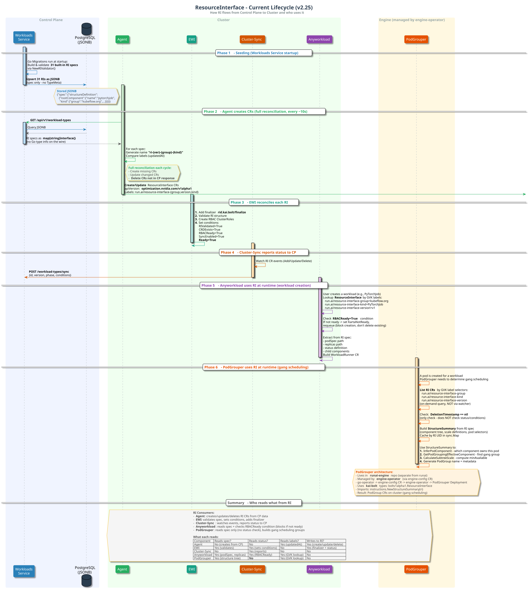
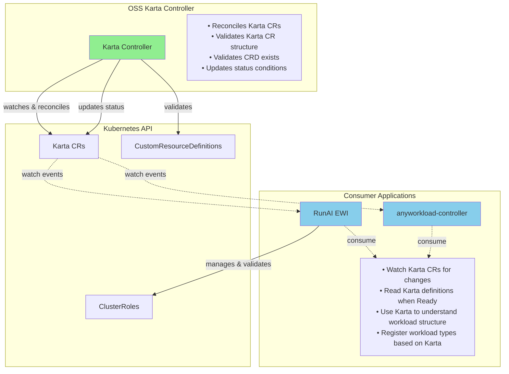
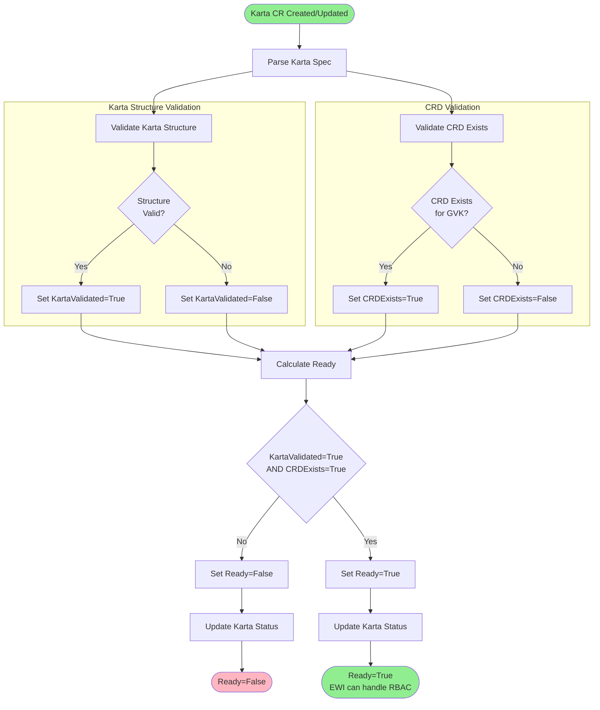

# Karta Controller - High-Level Design

## Background

### Current State


The EWI contains two major components:
1. **Workload Reconciliation** - Discovers and tracks external workloads (Kubeflow, Ray, etc.)
2. **Karta Controller** - Reconciles Karta CRs that describe workload types

Meanwhile, the **Karta API types** (CRDs and Go packages) already exist in the OSS Karta repo at `github.com/run-ai/karta`, but the controller to reconcile is in EWI.
### Current Karta Controller 
- Validate applied CR struct
- Validates referenced CRD exists
- Validates RBAC exists
- Creates/manages RBAC for workload types
- Registers GVKs with EWI controller

#### Current run:ai flow

### Today issues

**The Karta Controller is embedded in RunAI's External Workload Integrator (EWI).**

This creates problems:

- Cannot use Karta standalone - controller is buried in RunAI service
- Tight coupling prevents adoption by other projects

**For RunAI:**
- Architectural coupling - controller should live with the CRD it manages
- anyworkload-controller wants to consume Karta but depends on EWI's embedded controller
- Harder to maintain - controller logic mixed with EWI workload discovery logic

### The Solution

**Move Karta Controller from EWI to the OSS Karta repository** where it belongs:
- Controller lives with the API types it manages
- OSS community can use Karta standalone
- Clear architectural boundaries
- Enables wider adoption and community contributions


---

## OSS Karta Controller Design

### Architecture




### Core Concepts

**Karta CR:**
- Declarative definition of a workload type
- Contains structure, optimization, and status information
- Managed by OSS Karta Controller
- Validated the applied CR

**Karta condition status (OSS Controller):**
- `KartaValidated`: Karta CR structure is valid (renamed from `riValidated`)
- `CRDExists`: Referenced CRD is present in cluster
- `Ready`: Karta is valid and can be used (KartaValidated=True and CRDExists=True)

**Karta condition status (EWI-specific):**
- `RBACReady`: ClusterRoles exist with rules for all GVKs and proper verbs
- `syncEnabled`: EWI calculates and sets this condition
- `runaiReady`: RunAI-specific ready state (RBACReady=True and Ready=True)


### OSS Karta Controller Reconciliation Flow




---

## Key Differences: Embedded vs OSS

| Aspect | Current (Embedded in EWI) | OSS (Standalone) |
|--------|---------------------------|------------------|
| **Deployment** | Part of EWI | Separate controller |
| **Karta Validation** | Validates Karta CR structure | Validates Karta CR structure |
| **CRD Validation** | Validates CRD exists | Validates CRD exists |
| **GVK Registration** | Directly registers with EWI | Consumers decide |
| **Scope** | RunAI workload tracking | Generic workload description |
| **Dependencies** | Depends on RunAI types | No external dependencies |


### What Gets Extracted to OSS

**Included:**
- Controller reconciliation logic
- Karta CR structure validation (moved from `riValidated`, renamed to `KartaValidated`)
- CRD validation
- Status condition management (KartaValidated, CRDExists, Ready)

**Excluded (stays in EWI):**
- **All RBAC handling** (validation, creation, deletion)
- RBACReady condition
- syncEnabled status (calculated and set by EWI)
- Workload parsing (using Karta to parse PyTorchJob, RayCluster, etc.)
- Structure calculation (using Karta Go packages)
- GVK registration with specific controllers
- RunAI-specific integration logic


---

## How RunAI Will Use OSS Karta Controller

1. **OSS Karta Controller** (manages Karta CRs)
   - Standalone deployment
   - Validates Karta definitions
   - Updates Karta status

2. **RunAI External Workload Integrator** (consumes Karta)
   - Watches Karta CRs managed by OSS controller
   - Validates and manages RBAC for Karta CRs (sets `RBACReady` condition)
   - Calculates and sets `runaiReady` condition (when both `Ready` and `RBACReady` are true)
   - Registers GVKs when `runaiReady` is True
   - Uses Karta definitions to parse workloads

    
---
## Migration Plan

### Phase 1: Extract to OSS 

**Deliverables:**
- Extract controller code from EWI to Karta repo, under operator folder (will be created)
- Create image for the controller and deploy it to the registry
- Add the controller deployment to the Helm chart
- Write documentation
- Add example Karta definitions

### Phase 2: RunAI Integration 

**Deliverables:**
- Add Karta Controller as dependency
- Create Helm templates for RBAC, Controller should be able to watch/list the consumer CRDs
- Create new condition status, runaiReady
- Test end-to-end
- Remove CRD and ri validation code from EWI controller

### Phase 1: Extract to OSS### Status Transition Timing Risk (Detailed)

**The Problem:**

Currently, RunAI consumers (e.g., anyworkload-controller) check `Ready=True` to determine if a Karta is usable. After migration:
- OSS Controller sets: `Ready=True` (when KartaValidated AND CRDExists)
- EWI Controller sets: `runaiReady=True` (when Ready AND RBACReady)
- Consumers must switch from checking `Ready` → `runaiReady`

**Race Condition Scenario:**
```
1. OSS Controller reconciles Karta → sets Ready=True
2. [GAP] EWI hasn't reconciled yet → runaiReady doesn't exist or is False
3. Consumer (anyworkload-controller) checks runaiReady → False/Missing
4. WorkloadRunner goes into unknown phase
5. EWI reconciles → sets runaiReady=True (but damage done)
```

**Potential Mitigations:**

1. **Fallback Logic in Consumers:**
   - If `runaiReady` condition doesn't exist, fall back to checking `Ready`
   - Transitional period until all Kartas have `runaiReady` set

2. **Initialize runaiReady on Upgrade:**
   - Migration job that initializes `runaiReady` based on existing `Ready` status
   - Run before consumers start checking `runaiReady`

3. **Consumer Waits for runaiReady:**
   - Consumer requeues if `runaiReady` condition is missing (not just False)
   - Adds latency but prevents unknown phase


---
