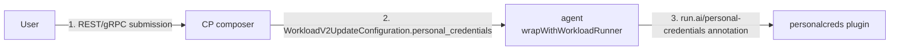

# Personal Credentials Plugin

## Background

We support user-scoped credentials ("personal credentials") today, but only on the typed APIs (workspace, training, inference). For those, the CP composer rewrites the friendly cred name into a canonical, asset-id-disambiguated reference, and the legacy `workload-controller` copies the source Secret out of `runai` namespace into the workload namespace with an ownerRef on the workload.

YAML / NIM-API submissions don't have any of that. Users have to pre-create their own Secrets in the project namespace and reference them by hand. That:

- breaks parity with the typed-API UX,
- forces users around our credential management,
- and is a name-collision foot-gun: two users can both call a cred `my-hf-token`, and one will overwrite the other if they end up in the same namespace.

### Acceptance criteria

1. A `WorkloadRunner` submitted with personal-credential references gets the underlying Secrets injected automatically.
2. Injected Secrets live in the workload namespace and are cleaned up on workload deletion.
3. Invalid or missing credential references surface as validation errors.

### Constraint

The `WorkloadRunner` CRD is going to be open-sourced, so Run:AI-specific concepts can't appear in the CRD schema. We carry the Run:AI-specific data in a single annotation on the runner; the CRD itself doesn't change.

---

## Where each piece lives

Three contracts cross repo boundaries, and they're easy to mix up. Worth naming them once:



| # | Contract | Between | Format |
|---|---|---|---|
| 1 | Submission | user, CP API | REST / gRPC |
| 2 | Workload configuration | CP, agent | typed gRPC field on `WorkloadV2UpdateConfiguration` (same as `mnnvl` and `networking`) |
| 3 | Annotation on the runner | agent, plugin | YAML in `run.ai/personal-credentials` |

The annotation is *not* the CP↔cluster contract. CP and agent talk over typed gRPC; the agent translates that into the annotation when it builds the runner CR. The plugin only ever sees the annotation.

The fourth thing that has to line up across repos is the destination Secret name. CP writes it into `secretKeyRef.name` / `imagePullSecrets[].name` inside the manifest, and the plugin creates a Secret with that name. Both sides compute it independently from inputs they both have:

```
destName = pc-{runner}-{sourceSecret}
```

No runtime coordination, no callback, no annotation field for destName. Pure function on both sides.

### Who does what

| Concern | Owner |
|---|---|
| Resolve friendly→canonical cred names | CP composer |
| Write `secretKeyRef.name` / `imagePullSecrets[].name` into the manifest at the right pod-spec path | CP composer |
| Build the `WorkloadRunner` CR, stamp the annotation, call k8s `Create` | agent (`wrapWithWorkloadRunner`) |
| Validate the annotation and materialize the destination Secrets | this plugin |

---

## Lifecycle

Steps 1 and 2 already exist today. 3 and 4 are the new work.

### 1. User creates the credential in the control plane

`runai CLI / UI → assets-service`. The row gets stored with `CreatedBy=user_id`, `Private=true`, an `AssetId`, and an encrypted payload. State after: a row in `assets_metadata` and one in the per-type table (`assets_generic_secret`, `assets_ngc_api_key`, `assets_docker_registry`, ...).

### 2. Agent materializes it as a k8s Secret

The agent's asset-sync loop creates a Secret in the cluster's `runai` namespace. For private creds it names it `{assetName}-{first-10-of-assetId}` (see `agent/pkg/handlers/assets_builders.go:getSecretResourceName`), which is the same encoding `BuildUserCredentialName` produces. That way two users can both have a cred called `my-hf-token` without colliding:

```yaml
apiVersion: v1
kind: Secret
metadata:
  name: my-hf-token-abc1234567
  namespace: runai
  labels:
    run.ai/asset: generic-secret
    run.ai/asset-id: abc1234567...
    run.ai/user-credentials: "true"
  annotations:
    run.ai/asset-name: my-hf-token
data:
  token: <encrypted>
```

The payload is encrypted at rest and only decrypted at workload-copy time by the cluster plugin, using the existing `workload-common` crypto helper.

**Note on docker-registry credentials.** The agent's asset builder has a `&& !private` guard at `agent/pkg/handlers/assets_builders.go:327` that suppresses `Type` for personal docker-registry secrets, so the source Secret is created with type `Opaque` and a `.dockerconfigjson` data key. The credential kind is recoverable from the `run.ai/asset=docker-registry` label. The plugin restores the proper type during materialization (see [Plugin behavior](#plugin-behavior)) so the kubelet honors it as an `imagePullSecret`. This mirrors how the legacy `workload-controller` copy path handles the same source secret (`workload-common/builders/credentials.go:173`).

### 3. CP composer + agent build the runner

For each personal-cred reference in the user's submission, the CP:

1. Looks the cred up in `assets-service` filtered by `(Name, CreatedBy=user_id, Private=true)`. That gives the canonical Secret name in the cluster's `runai` namespace, e.g. `my-hf-token-abc1234567`.
2. Computes the destination Secret name: `pc-{runner}-{sourceSecret}`.
3. Writes that destination name straight into the manifest at the right pod-spec path. The composer queries karta's RI to find the path for the target GVK (e.g. `spec.template.spec` for `Job`, `spec.pytorchReplicaSpecs.*.template.spec` for `PyTorchJob`). The write goes into `env[].valueFrom.secretKeyRef.name` or `imagePullSecrets[].name`.
4. Sends the list of source secret names to the agent over the wire, as a typed field on `WorkloadV2UpdateConfiguration.personal_credentials`.

The agent wraps the manifest into a `WorkloadRunner`, calls `personalcreds.Set(runner, sources)` (shared `cluster/common/personalcreds` Go module) to stamp the annotation, and calls `Create`.

If a cred doesn't resolve for the submitting user, the CP fails the submission with a 4xx. Nothing reaches the cluster.

v1 scope is env vars and imagePullSecrets only, matching what the typed-API surface supports today. `envFrom`, volume mounts, and operator-specific Secret-name fields like `nimservice.spec.ngcAuthSecret` are follow-ups.

### 4. Plugin validates and materializes

**Admission** (`ValidatorPlugin.WebhookValidate`): parse the annotation, and for each entry `Get` the source Secret in `runai` ns. Reject on malformed YAML, empty list, or missing source.

**Reconcile** (`AdditionalResourcePlugin.HandleAdditionalResources`):

1. `Get` each source Secret from `runai` ns.
2. Decrypt with the cluster encryption key. We reuse `workload-common/builders/utils.GetEncryptionKey()`, which reads `RUNAI_ADS_ENCRYPTION_KEY` — same path the legacy `CredentialsBuilder` uses.
3. Compute `pc-{runner}-{sourceSecret}` (same value CP already wrote into the spec).
4. Server-side-apply the destination Secret in the workload namespace with `ownerRef → WorkloadRunner`.
5. If a Secret with that name already exists but isn't `IsControlledBy` this runner, fail. Same collision behavior as legacy.

Failures (missing source, decryption error, collision, SSA failure) go through the controller's existing issue mechanism — `state.AddPluginIssue(ctx, plugin, runner, err, isCritical, group, description)` from `internal/reconcile/`. Issues surface on `runner.Status.Conditions`, same as `networking` and `mnnvl`. No custom `runner.Status.Plugins["personal-creds"]` shape.

Cleanup is k8s GC. When the runner is deleted, the destination Secret goes with it. No finalizer, no template mutation on the cluster side — the spec arrived complete from the CP.

---

## Plugin contract

### Annotation

```yaml
metadata:
  annotations:
    run.ai/personal-credentials: |
      - sourceSecret: my-hf-token-abc1234567
      - sourceSecret: my-registry-cred-def8901234
```

One field per entry: the canonical source name in `runai` ns. Where it mounts, which env var, which container — all of that's already in `spec.template` because the CP composer wrote it there.

### destName

CP and plugin both compute `pc-{runner}-{sourceSecret}` from inputs they both already have:

| Side | Inputs | What it does with the result |
|---|---|---|
| CP composer | runner name + sourceSecret (from assets-service) | writes it into `secretKeyRef.name` / `imagePullSecrets[].name` |
| Plugin | runner name + sourceSecret (from the annotation) | creates a Secret with that name in workload ns |

The runner must have `metadata.name` at submission (not `generateName`). v1 assumes this, matching the typed-API path.

### Plugin behavior

| Stage | What it does |
|---|---|
| `ValidatorPlugin.WebhookValidate` | No annotation → admit. Otherwise: parse YAML (reject on malformed / empty list / missing field), `Get(runaiNS/sourceSecret)` per entry, reject on NotFound. |
| `AdditionalResourcePlugin.HandleAdditionalResources` | For each entry: `Get` source, decrypt, build dest Secret (copy `Type`, labels, annotations, and decrypted Data; if the source carries `run.ai/asset=docker-registry`, override `Type` to `kubernetes.io/dockerconfigjson` — see [agent note](#2-agent-materializes-it-as-a-k8s-secret)), `SetControllerReference(runner, ...)`, collision check via `metav1.IsControlledBy` (same pattern as `workload-common/builders/credentials.go`), SSA with field manager `personalcreds-plugin`. Failures → `state.AddPluginIssue(...)`. |
| Cleanup | k8s GC. No finalizer. |

No `ResourceMutatePlugin` and no dedicated `StatusPlugin`. There's nothing to mutate on the cluster (the spec is already complete), and status goes through the standard issue mechanism.

### Deployment

`RUNAI_ADS_ENCRYPTION_KEY` has to be on the controller pod, sourced via `SecretKeyRef` to `constants.RunaiAdsSecretName` / `constants.RunaiAdsEncryptionKeyName`. The deployment is generated by go-operator (`go-operator/internal/run/operands/anyworkload-controller/resources/deployments.go`), so we wire it there. Mirrors how the legacy `workload-controller` gets the same key.

RBAC mirrors legacy `workload-controller-rw` / `workload-controller-ro`:

- Per-project ClusterRole `runai-anyworkload-controller-project` (auto-bound to every project ns by `project-controller`): `secrets` with `get,list,watch,create,update,patch,delete`.
- Cluster-wide ClusterRole `runai-anyworkload-controller`: `secrets` with `get,list,watch`. We need the cluster-wide read because the controller-runtime cached client's informer does a cluster-wide LIST/WATCH per GVK on the first `Get`. A namespace-scoped Role won't satisfy that.

### Why this shape

- One object per workload. No new CRD, no template walking on the cluster, no per-GVK registry on the plugin side.
- Sources are listed explicitly in the annotation, and the refs in the spec point at runner-prefixed destination names, so there's no name-collision risk with user-supplied Secrets.
- The annotation isn't schema-validated by the apiserver. Validation is the plugin's job. The 256 KiB annotation cap is not a real-world problem here.

---

## Worked example: PyTorchJob

Picked PyTorchJob because it has nested Master/Worker replica specs, so it exercises the per-GVK pod-spec-path lookup more than a flat `Job` would. Assume alice already created `my-hf-token` (steps 1–2 above).

### What alice runs

```bash
runai training submit my-pytorch-train -p my-project \
  --image nvcr.io/nvidia/pytorch:24.01-py3 \
  --workers 4 \
  --env-my-credentials type=genericSecret,name=HF_TOKEN,credential-name=my-hf-token,key=token
```

### What the CP composer does

- Resolves `my-hf-token` for alice → `my-hf-token-abc1234567`.
- Computes destName `pc-my-pytorch-train-my-hf-token-abc1234567`.
- Queries karta's RI for `kubeflow.org/v1, PyTorchJob`. Gets back the pod-spec paths `spec.pytorchReplicaSpecs.Master.template.spec` and `spec.pytorchReplicaSpecs.Worker.template.spec`.
- Writes the env entry into both replica specs and puts the source list on the wire.

### What lands on the cluster

The agent wraps the manifest, calls `personalcreds.Set(runner, ...)`, and `Create`s:

```yaml
apiVersion: run.ai/v1alpha1
kind: WorkloadRunner
metadata:
  name: my-pytorch-train
  namespace: my-project
  annotations:
    run.ai/personal-credentials: |
      - sourceSecret: my-hf-token-abc1234567
spec:
  template:
    apiVersion: kubeflow.org/v1
    kind: PyTorchJob
    spec:
      pytorchReplicaSpecs:
        Master:
          replicas: 1
          template:
            spec:
              containers:
                - name: pytorch
                  image: nvcr.io/nvidia/pytorch:24.01-py3
                  env:
                    - name: HF_TOKEN
                      valueFrom:
                        secretKeyRef:
                          name: pc-my-pytorch-train-my-hf-token-abc1234567
                          key: token
        Worker:
          replicas: 4
          template:
            spec:
              containers:
                - name: pytorch
                  image: nvcr.io/nvidia/pytorch:24.01-py3
                  env:
                    - name: HF_TOKEN
                      valueFrom:
                        secretKeyRef:
                          name: pc-my-pytorch-train-my-hf-token-abc1234567
                          key: token
```

### What the plugin does

- Webhook does `Get(runai/my-hf-token-abc1234567)`. Found. Admitted.
- `AdditionalResourcePlugin` reads the source, decrypts, server-side-applies `Secret/pc-my-pytorch-train-my-hf-token-abc1234567` in `my-project` ns with `ownerRef → WorkloadRunner`.

### End state

```
my-project namespace
  WorkloadRunner/my-pytorch-train
    └── PyTorchJob/my-pytorch-train                              (refs point at destName)
          ├── Pod/my-pytorch-train-master-0
          └── Pod/my-pytorch-train-worker-{0..3}
    └── Secret/pc-my-pytorch-train-my-hf-token-abc1234567        (plaintext, ownerRef → runner)

runai namespace
  Secret/my-hf-token-abc1234567                                   (encrypted, untouched)
```

Delete the runner and k8s GC takes the PyTorchJob, the pods, and the destination Secret. Source in `runai` ns stays put.

---

## Multiple workloads, same credential

destName includes the runner name, so two runners that reference the same source get two independent copies in the workload namespace:

```
project-ml namespace
  WorkloadRunner/my-training
    └── Secret/pc-my-training-my-hf-token-abc1234567   (ownerRef → my-training)
  WorkloadRunner/my-inference
    └── Secret/pc-my-inference-my-hf-token-abc1234567  (ownerRef → my-inference)

runai namespace
  Secret/my-hf-token-abc1234567                         (single source, encrypted)
```

Each copy has one ownerRef and its own lifecycle. Deleting one runner removes only its copy. No concurrency races (different destNames). Source rotation in the CP doesn't affect already-running workloads — same sticky behavior as legacy.

If one workload references the same cred twice (e.g. two containers, same env var), the annotation lists the source once and the plugin makes one destination Secret that both references point at.

---

## Ownership

Ownership is enforced at the API layer. The CP composer only resolves a user's own assets — `Name, CreatedBy=user_id, Private=true` filter against `assets-service`. So the agent never forwards a canonical source name the submitter doesn't own.

We considered a defense-in-depth agent-SA admission gate (require `req.UserInfo.Username == known agent ServiceAccount` when the annotation is present), but the framework's `ValidatorPlugin` signature doesn't pass `admission.Request` today, so `UserInfo.Username` isn't reachable. We'll revisit if the framework grows that surface. For now we rely on the API-layer filter.

Per-Secret `Role` + `RoleBinding` for read isolation is out of scope for v1. The destination Secret sits in the project namespace and anyone with `secrets/get` there can read it. Legacy has the same limitation. Closing it needs per-runner ServiceAccount work.
