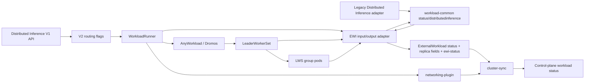

# Distributed Inference phase calculation in EWI

Legacy-compatible status for V2 Distributed Inference realized as a `LeaderWorkerSet` (LWS).

| | |
|---|---|
| Target release | 2.26.0 |
| Logical workload type | `DistributedInference` |
| Concrete root | `leaderworkerset.x-k8s.io/v1`, Kind `LeaderWorkerSet` |
| Legacy CRD | `DistributedInferenceWorkload` |
| Lifecycle calculator | `workload-common/status/distributedinference` |
| Status authority | External Workload Integrator (EWI) |

This file remains under `designs/status-plugin/` beside the Inference design, but the selected implementation does not add a Dromos plugin.

## 1. Decision

Use the Training/Workspace EWI ownership model:

1. AnyWorkload/Dromos owns generic WLR resource and plugin health.
2. A pure calculator in `workload-common/status/distributedinference` calculates legacy-compatible phase/message and replica counts from normalized LWS, Pod, deletion, build-error, dependency, and MNNVL state. Both the legacy Distributed Inference controller and EWI use this calculator.
3. EWI writes `ExternalWorkload.status.observedStatus`, status compatibility fields, and `run.ai/ewi-status=true` after a successful calculation.
4. Cluster-sync keeps EWI phase/message while the annotation is present and otherwise falls back to generic WLR phase.
5. Networking-plugin owns URL and Service/port values. Cluster-sync applies the legacy ready-replica URL gate using the count supplied by EWI.

No `status-plugin` is registered, no profile conditions are written to WLR, and no status-specific cluster-sync trigger is needed.



## 2. Legacy contract

| Legacy field | V2 source |
|---|---|
| `phase` | Shared Distributed Inference calculator through the EWI adapter |
| `phaseMessage` | Shared Distributed Inference calculator through the EWI adapter |
| `k8sPhase` | Legacy LWS phase from EWI: `Ready` while the generic API phase is `Running` |
| `replicas` | LWS `spec.replicas`, copied as positive-only `additionalFields.statusReplicas` |
| `readyReplicas` | Ready LWS groups, copied as positive-only `additionalFields.readyReplicas` |
| Requested pod count | WLR template: `replicas * leaderWorkerTemplate.size` |
| Images | WLR LWS leader/worker templates |
| Serving and external URLs | networking-plugin, gated by EWI ready replicas in cluster-sync |
| Service names and ports | networking-plugin |

Legacy `Ready` is exposed to the control-plane API as `Running`; EWI writes `Running` directly. The accepted control-plane delete request owns `Deleting`, matching the legacy controller's lack of a reliable delete status patch.

## 3. Inputs and watches

### 3.1 Calculator inputs

| Input | Use |
|---|---|
| LWS existence | `Creating` or `Failed` before the concrete root exists |
| LWS `spec.replicas` | Desired replica groups |
| LWS `spec.leaderWorkerTemplate.size` | Expected pods per group |
| Pods labeled `leaderworkerset.sigs.k8s.io/name=<lws-name>` | Group membership and pod lifecycle |
| `group-index` and `worker-index` pod labels | Group aggregation and leader readiness |
| Critical WLR controller issue | Resource build/apply error overlay |
| Critical `networking-plugin` or `mnnvl` issue | Relevant dependency error overlay |
| WLR MNNVL instruction | Whether MNNVL readiness gates an otherwise ready workload |
| `WLR.status.plugins["mnnvl"].phase` | ComputeDomain readiness already calculated by the MNNVL plugin |

EWI does not read ComputeDomain directly. The MNNVL plugin already publishes `Creating`, `Failed`, or `Ready` from the actual ComputeDomain state, so consuming its WLR status avoids duplicate RBAC and duplicate readiness logic.

### 3.2 Requeue behavior

- LWS and child Pod events flow through EWI's dynamic Karta/GVK handling.
- The dedicated Run:ai status Pod watcher also requeues the LWS on Pod add/delete and on status or deletion-timestamp changes. Workload identity labels are stable for a Pod lifetime and are not treated as update inputs. The shared task queue deduplicates equivalent generic and status-watcher refreshes.
- The WLR watcher requeues `leaderworkerset.x-k8s.io/v1 LeaderWorkerSet` for logical type `DistributedInference`.
- WLR comparison includes phase, issue details, plugin issues, and plugin phases, so MNNVL readiness and changed error text refresh EWI status.

## 4. Shared phase calculation

The shared package is side-effect free. It owns Pod classification, group and workload aggregation, replica messages, deletion precedence, build and missing-resource overlays, and MNNVL degradation. The legacy controller and EWI keep Kubernetes reads and normalize their resources into this common input.

Pod classification:

| Pod state | Internal group state |
|---|---|
| Deleting or `Failed` | Failed |
| Running with `PodReady=True` | Ready |
| Running without readiness or `Succeeded` | Running |
| Pending with image pull, ContainerCreating, or PodInitializing reason | Initializing |
| Pending with CreateContainer error | Failed |
| Other Pending/unknown | Pending |

Group priority:

1. Fewer pods than expected -> Pending.
2. Any failed pod -> Failed.
3. Any pending pod -> Pending.
4. Any initializing pod -> Initializing.
5. Missing worker index `0` leader -> Failed.
6. Ready leader -> Ready.
7. Otherwise -> Initializing.

Workload aggregation:

| Group result | Legacy result | EWI / CP phase |
|---|---|---|
| Zero desired replicas | `Ready` | `Running` |
| Failed groups, no ready group | `Failed` | `Failed` |
| Failed and ready groups coexist | `Degraded` | `Degraded` |
| Every desired group is missing/pending | `Pending` | `Pending` |
| Some groups are ready but not all | `Initializing` | `Initializing` |
| Every group is ready | `Ready` | `Running` |

When the base result is ready, a build issue, missing dependency, or required MNNVL phase other than `Ready` changes it to `Degraded`. Messages retain the legacy ordered replica counts and append the dependency detail.

```mermaid
stateDiagram-v2
    [*] --> Creating
    Creating --> Pending: LWS exists; groups missing or pending
    Creating --> Initializing: groups begin starting
    Creating --> Failed: groups fail before any is ready
    Pending --> Initializing: some groups start or become ready
    Pending --> Running: all groups ready
    Pending --> Failed: failed groups and none ready
    Pending --> Degraded: ready and failed groups coexist
    Initializing --> Running: all groups ready
    Initializing --> Failed: failed groups and none ready
    Initializing --> Degraded: ready and failed groups coexist
    Running --> Degraded: partial failure, build issue, or MNNVL not ready
    Degraded --> Running: groups and dependencies recover
    Degraded --> Failed: no ready groups remain
    Failed --> Pending: groups recreated
    Failed --> Initializing: replacement groups start
    Creating --> Deleting: delete accepted by control plane
    Pending --> Deleting: delete accepted by control plane
    Initializing --> Deleting: delete accepted by control plane
    Running --> Deleting: delete accepted by control plane
    Degraded --> Deleting: delete accepted by control plane
    Failed --> Deleting: delete accepted by control plane
    Deleting --> [*]
```



## 5. EWI integration

The dynamic LWS handler first produces generic ExternalWorkload fields. After logical type finalization, `applyRunaiStatus` runs only for a WLR-owned `DistributedInference` root.

On success EWI:

- overrides `ObservedStatus.Phase` and `ObservedStatus.Message`;
- sets `ObservedStatus.K8sStatus` to the legacy phase (`Ready` for generic `Running`) so cluster-sync preserves `k8sPhase`;
- merges positive `statusReplicas` and `readyReplicas` into `spec.additionalFields` without deleting unrelated fields; and
- sets `run.ai/ewi-status=true`.

On an invalid LWS shape, WLR read failure, or Pod list failure, EWI clears the annotation and keeps the generic resource status. Cluster-sync then applies WLR phase fallback.

This matches Training/Workspace's authoritative EWI handshake while keeping both legacy and V2 Distributed Inference on one state machine. The EWI adapter maps the shared legacy `Ready` result to V2 `Running`; the legacy adapter writes `Ready` unchanged.

## 6. Networking ownership

| Data | Owner |
|---|---|
| Phase, message, replicas, ready replicas | Shared Distributed Inference calculator; EWI writes the V2 result |
| URL values, auth endpoints, Service names/ports | networking-plugin |
| `readyReplicas > 0` URL visibility gate | cluster-sync using EWI additional fields |

EWI does not build URL resources. Cluster-sync suppresses distributed-inference URLs while authoritative EWI status has no positive `readyReplicas`; once one group is ready, the networking-plugin URL values are retained.

## 7. RBAC

EWI needs no new status-specific RBAC. Cluster-sync needs read-only access to LeaderWorkerSets (`get`, `list`, and `watch`) so its Pod parser can follow an LWS Pod's owner chain and associate the Pod with the correct workload.

EWI already has read access to:

- Pods;
- WorkloadRunners;
- LeaderWorkerSets through the existing dynamic GVK/Karta configuration.

EWI does not need ComputeDomain permission because MNNVL readiness is consumed from WLR plugin status. AnyWorkload does not need status-specific Knative or LWS permissions for this calculation.

## 8. Verification

### 8.1 Unit and integration coverage

| Layer | Coverage |
|---|---|
| Shared calculator | `workload-common/status/distributedinference/calculator_test.go`: missing LWS, deletion, zero replicas, Pod/group priority, ready/failed and ready/missing mixes, exact messages, build and missing-resource precedence, and MNNVL degradation |
| Legacy adapters | LWS Pod selection and LWS-shape normalization plus status-update, networking, and patch integration in `lws_status_test.go` and `distributed_status_test.go` |
| EWI adapter | Shared `Ready` maps to `Running`; missing resources are normalized deterministically before calculation |
| EWI integration | WLR-owned unstructured LWS, labeled Pod grouping, authoritative annotation, legacy `k8sPhase`, and replica additional fields |
| EWI watchers | DistInf WLR and relevant LWS Pod changes requeue concrete LWS; issue text and MNNVL phase changes are relevant |
| Cluster-sync | EWI precedence, WLR fallback, template image/requested-pod projection, numeric replica-field preservation, and ready-replica URL gate |
| Helm RBAC | Cluster-sync has read-only LeaderWorkerSet access for Pod owner resolution |

### 8.2 E2E oracle

Existing suites remain the legacy behavior oracle:

- `distributed/dinfBasic.test.ts`
- `distributed/dinfLifecycle.test.ts`
- `distributed/dinfNetwork.test.ts`

V2 validation must enable `ANY_WORKLOAD_DINF_SUBMISSION=true`, submit through `POST /api/v1/workloads/distributed-inferences`, assert an LWS-root WLR exists, and assert no legacy `DistributedInferenceWorkload` was created. Direct legacy-CR assertions move to WLR/LWS assertions in the separate E2E PR.

Required cluster scenarios:

| Scenario | Expected phase |
|---|---|
| All ready | `Running` |
| All failed | `Failed` |
| All pending | `Pending` |
| Ready plus failed | `Degraded` |
| Ready plus pending/missing | `Initializing` |
| Required MNNVL not ready after groups ready | `Degraded` |
| Zero replicas | `Running`, replica fields omitted from CP positive-only status |
| No ready replicas with networking endpoint | No CP URLs |

### 8.3 Cluster validation

On 2026-07-13, `nael-env-11` used only the per-type Inference routes:

```text
ANY_WORKLOAD_SUBMISSION=false
ANY_WORKLOAD_INFERENCE_SUBMISSION=true
ANY_WORKLOAD_DINF_SUBMISSION=true
ANY_WORKLOAD_TRAINING_SUBMISSION=true
ANY_WORKLOAD_WORKSPACE_SUBMISSION=true
```

The typed V1 endpoint produced an LWS-root WLR and no legacy `DistributedInferenceWorkload`. The EWI implementation observed:

| Scenario | Result | Observed CP phases and message |
|---|---|---|
| Ready | Passed | `Creating` -> optional `Pending` -> `Initializing` -> `Running`; `Replicas: 1; Ready: 1` |
| Failed | Passed | `Creating` -> `Failed`; `Replicas: 1; Failed: 1` |
| Pending | Passed | `Creating` -> `Pending`; `Replicas: 1; Pending: 1` |
| Non-existing image | Passed | `Creating` -> `Initializing`; `Replicas: 1; Initializing: 1` |
| Ready plus networking issue | Passed | `Creating` -> `Degraded`; ready replica count plus networking-plugin error |
| Ready plus failed replica | Passed | `Creating` -> `Pending` -> `Initializing` -> `Degraded`; `Replicas: 2; Ready: 1; Failed: 1` |

The full matrix passed on ; after adding the shared Pod watcher, the ready lifecycle passed again on final image (digest `sha256:dfe212f85cb9a6bba85ada1db1271931e7b936d049dca6fb4ef92aa7b00b6a34`). The ready test includes `k8sPhase`, images, requested pods, running pod count, replicas, and URL assertions.

After implementation commit `3719b93c524`, the six selected lifecycle scenarios were rerun against `nael-env-11` and final image . All six passed in 4.7 minutes: ready, failed, stable pending, non-existing image, ready with networking failure, and one-ready/one-failed replicas. The observed phase transitions and messages matched the table above, and test teardown removed all WLR resources.

## 9. Non-goals

- Reimplementing networking resources, URL formatting, or Service-port projection.
- Adding a Dromos status plugin.
- Reading ComputeDomains twice.
- Modifying the caller-facing Distributed Inference API in this story.
