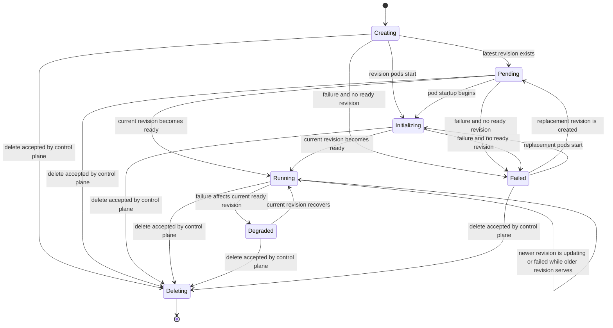

# Shared Inference phase calculation with EWI status ownership

Legacy-compatible status for V2 Inference realized as a Knative `Service`.

| | |
|---|---|
| Target release | 2.26.0 |
| Logical workload type | `Inference` |
| Concrete root | `serving.knative.dev/v1`, Kind `Service` |
| Legacy CRD | `InferenceWorkload` |
| Lifecycle calculator | `workload-common/status/inference` |
| V2 status writer | External Workload Integrator (EWI) |

This file remains under `designs/status-plugin/` beside the Distributed Inference design, but the selected implementation does not add a Dromos plugin.

## 1. Decision

Use the same ownership model already used by V2 Training and Workspace:

1. AnyWorkload/Dromos owns generic `WorkloadRunner.status` and plugin health.
2. A pure calculator in `workload-common/status/inference` calculates the legacy-compatible phase and message from normalized Knative Service state, pods, deletion state, and build errors. Both the legacy Inference controller and EWI use this calculator.
3. EWI stores the result in `ExternalWorkload.status.observedStatus` and sets `run.ai/ewi-status=true` only after a successful calculation.
4. Cluster-sync preserves EWI phase/message while that annotation is set. If EWI cannot read an input, it clears the annotation and cluster-sync falls back to the generic WLR phase.
5. Networking-plugin and EWI networking code remain the only owners of URLs, endpoints, and serving-port status.

No `status-plugin` is registered in `anyworkload-controller`, and cluster-sync does not read lifecycle conditions from WLR plugin status.

```mermaid
flowchart LR
    API["Inference V1 API"] -->|route by feature flag| Route["V2 routing flags"]
    Route -->|submit V2 manifest| WLR["WorkloadRunner"]
    WLR -->|reconcile template| AW["AnyWorkload / Dromos"]
    AW -->|create or update| KSVC["Knative Service"]
    KSVC -->|create latest revision| Pods["Latest revision pods"]
    WLR -->|read critical issues| EWI["EWI input/output adapter"]
    KSVC -->|normalize revisions and conditions| EWI
    Pods -->|normalize phase and readiness| EWI
    Legacy["Legacy Inference controller adapter"] -->|Calculate shared result| Calc["workload-common status/inference"]
    EWI -->|Calculate shared result| Calc
    Calc -->|return Ready-compatible phase and message| EWI
    EWI -->|write observedStatus and annotation| EW["ExternalWorkload observed status + ewi-status"]
    WLR -->|reconcile networking instructions| Net["networking-plugin"]
    EW -->|sync authoritative lifecycle| Sync["cluster-sync"]
    Net -->|project networking status| Sync
    Sync -->|report workload update| CP["Control-plane workload status"]
```



## 2. Legacy contract

The V2 path preserves these legacy lifecycle fields:

| Legacy field | V2 source |
|---|---|
| `phase` | Shared Inference calculator through the EWI adapter |
| `phaseMessage` | Shared Inference calculator through the EWI adapter |
| `latestCreatedRevisionName` | Knative Service status, copied to `ExternalWorkload.spec.additionalFields` |
| `latestReadyRevisionName` | Knative Service status, copied to `ExternalWorkload.spec.additionalFields` |
| URLs and Service ports | Networking-plugin and EWI networking projection |

The shared calculator returns the legacy semantic phase `Ready`. The legacy controller writes it unchanged, while the EWI adapter maps it to the control-plane phase `Running` before updating `ExternalWorkload`.

The accepted control-plane delete request owns the user-visible `Deleting` transition. EWI does not depend on observing the short-lived WLR deletion timestamp.

## 3. Inputs and watches

### 3.1 Calculator inputs

| Input | Use |
|---|---|
| Knative `Service.status.latestCreatedRevisionName` | Select current rollout and its pods |
| Knative `Service.status.latestReadyRevisionName` | Distinguish active, updating, failed-update, and degraded states |
| Knative Service conditions/messages | Detect image pull, name length, timeout, and current revision failures |
| Pods labeled `serving.knative.dev/revision=<latest-created>` | Pending, image pull, container creation, running, and readiness |
| Critical WLR controller issue | Preserve resource build/apply errors |
| Critical `networking-plugin` or `mnnvl` issue | Preserve a relevant dependency failure without taking ownership of networking data |

Configuration and Revision objects can participate in EWI event ownership traversal, but the phase calculation does not read them directly.

### 3.2 Requeue behavior

- Knative Service events run the normal EWI top-owner handler.
- A dedicated Run:ai status Pod watcher requeues the Knative Service on Pod add/delete and on changes to Pod status, deletion timestamp, or `run.ai/pod-status`. Workload identity labels are stable for a Pod lifetime and are not treated as update inputs. This closes the race where the final Service event can precede the final Pod readiness event.
- The WLR watcher requeues the concrete Knative Service for logical type `Inference`.
- WLR requeue comparison includes top-level phase, full issue details, plugin issue details, and plugin phases. A changed issue message or MNNVL phase is therefore not lost as a heartbeat-only update.

## 4. Phase calculation

Priority is first match wins.

| Inputs | Legacy result | EWI / CP phase |
|---|---|---|
| Service not available to the calculator | `Creating` | `Creating` |
| Current rollout has failure and no ready revision | `Failed` | `Failed` |
| Current rollout has failure and latest ready equals latest created | `Degraded` | `Degraded` |
| No latest-created revision | `Creating` | `Creating` |
| Older ready revision serves while new rollout progresses or fails | `Ready` plus update message | `Running` plus update message |
| Current revision is ready and all selected pods are ready | `Ready` | `Running` |
| Selected pods are running-not-ready, creating, or retrying image pull | `Initializing` | `Initializing` |
| Otherwise | `Pending` | `Pending` |

Important parity rules:

- A failed update remains `Running` when an older revision is still serving.
- Failure on the current ready revision is `Degraded`, not `Failed`.
- Plain Pending has higher aggregation priority than image-pull and ContainerCreating. Both pod list orders produce the same result.
- Zero selected pods remains vacuously all-ready when the latest-ready revision equals latest-created, matching the legacy calculator.
- Knative prerequisite validation errors retain the legacy documentation hint.



## 5. Shared calculator and EWI integration

The shared package is side-effect free and owns condition analysis, pod aggregation, phase precedence, prerequisite-error enrichment, and phase messages. It depends only on normalized Service state, Pods, deletion state, and an optional build error; it does not read Kubernetes resources or write status.

The legacy controller and EWI remain responsible for converting their Knative objects into the shared input. This keeps both APIs on one state machine while allowing their output vocabularies to differ only at the adapter boundary (`Ready` for legacy, `Running` for V2).

The legacy adapter preserves its existing edge semantics: it reuses retained non-empty revision names when the current Knative status is temporarily empty, and it represents a missing Knative Service as a failed service input so build errors are not hidden. EWI keeps its V2 behavior where unavailable Service input is `Creating` and the generic WLR phase remains the fallback.

EWI first runs the existing Knative parser to preserve native `K8sStatus`, conditions, resource fields, and URLs. After `ExternalWorkload.spec.type` is finalized, `applyRunaiStatus` runs only when:

- logical type is `Inference`; and
- the ExternalWorkload carries the WLR name label.

On success EWI overrides only `ObservedStatus.Phase` and `ObservedStatus.Message`, updates the two revision fields in `spec.additionalFields`, and sets `run.ai/ewi-status=true`.

On a WLR or pod read failure EWI keeps the generic Knative status, clears any stale `run.ai/ewi-status` annotation, and allows cluster-sync to use WLR phase fallback. This is the same handshake used by Training and Workspace.

## 6. Networking ownership

Lifecycle calculation does not construct or watch URL resources.

| Data | Owner |
|---|---|
| Phase and phase message | Shared Inference calculator; EWI writes the V2 result |
| Revision names | EWI from Knative Service status |
| Knative Service URL baseline | Existing EWI Knative parser |
| External URLs, auth endpoints, Service ports | networking-plugin plus cluster-sync projection |

The serving port is specification/networking data, not a lifecycle phase input.

## 7. RBAC

No new status-specific RBAC is required.

EWI already reads:

- Pods;
- WorkloadRunners;
- Knative Services, Configurations, and Revisions.

The AnyWorkload controller does not receive the prototype status-plugin Knative permissions.

## 8. Verification

### 8.1 Unit and integration coverage

| Layer | Coverage |
|---|---|
| Shared calculator | `workload-common/status/inference/calculator_test.go`: deletion, creating, pending, initializing, ready, failure, degradation, updates, scale-to-zero, messages, and mixed Pending/image-pull order independence |
| Legacy adapter | Shared `Ready` remains legacy `Ready`; Knative conditions and Pods are normalized into the shared input |
| EWI adapter | Shared `Ready` maps to control-plane `Running`; all other phases and messages pass through unchanged |
| EWI integration | WLR-owned Knative Service, revision pod read, authoritative annotation, revision fields, and fallback when WLR is absent |
| EWI watchers | Inference WLR changes and relevant Knative revision Pod changes requeue `serving.knative.dev/v1 Service` |
| Cluster-sync | EWI annotation preserves phase; absent annotation falls back to WLR |
| Composer | Throughput/latency metric translation and Knative autoscaler selection |

### 8.2 E2E oracle

Existing legacy suites remain the behavior oracle:

- `inferenceLifecycle.test.ts`
- `inferenceRevisions.test.ts`
- `inferenceNetwork.test.ts`
- `inferenceBasic.test.ts`

V2 validation must enable `ANY_WORKLOAD_INFERENCE_SUBMISSION=true`, submit through `POST /api/v1/workloads/inferences`, assert a Knative-root WLR exists, and assert no legacy `InferenceWorkload` was created. Direct legacy-CR assertions must be replaced in the separate E2E PR.

### 8.3 Cluster validation

On 2026-07-13, `nael-env-11` ran EWI image (digest `sha256:dfe212f85cb9a6bba85ada1db1271931e7b936d049dca6fb4ef92aa7b00b6a34`) with:

```text
ANY_WORKLOAD_SUBMISSION=false
ANY_WORKLOAD_INFERENCE_SUBMISSION=true
ANY_WORKLOAD_DINF_SUBMISSION=true
ANY_WORKLOAD_TRAINING_SUBMISSION=true
ANY_WORKLOAD_WORKSPACE_SUBMISSION=true
```

The typed V1 endpoint produced a Knative-root WLR and no legacy `InferenceWorkload`. Existing lifecycle tests observed:

| Scenario | Result | Observed CP phases and message |
|---|---|---|
| Ready | Backend portion passed twice | `Creating` -> optional `Initializing` -> `Running`; live EW remained `Running` after Pod readiness |
| Non-existing image | Passed | `Creating` -> `Failed`; `Failed to pull container image.` |
| Runtime error | Passed | `Creating` -> `Pending` -> `Initializing` -> `Failed`; legacy initializing and timeout messages |
| Oversized GPU request | Passed | `Creating` -> `Pending`, verified again after 10 seconds |

The ready test also passed image, requested-pod min/max, and latest-created/latest-ready revision assertions. Its only failure is the expected legacy-only assertion at `inferenceLifecycle.test.ts:182`, which looks for the intentionally removed `InferenceWorkload` CR. That assertion is replaced with WLR/Knative assertions in the separate E2E PR.

After implementation commit `3719b93c524`, the same matrix was rerun against `nael-env-11` and final image . The three negative scenarios passed in 4.3 minutes. The ready scenario reached control-plane `Running` on both attempts; a live cluster snapshot showed WLR `Running`, Knative Service `Ready=True`, matching latest-created/latest-ready revisions, and no legacy `InferenceWorkload`. Playwright then failed only at the documented legacy-CR assertion on line 182. Test teardown removed all WLR and Knative Service resources.

## 9. Non-goals

- Reworking networking URL or serving-port construction.
- Adding a WLR lifecycle status plugin.
- Adding a WLR finalizer for `Deleting`.
- Changing the caller-facing Inference API in this story.
