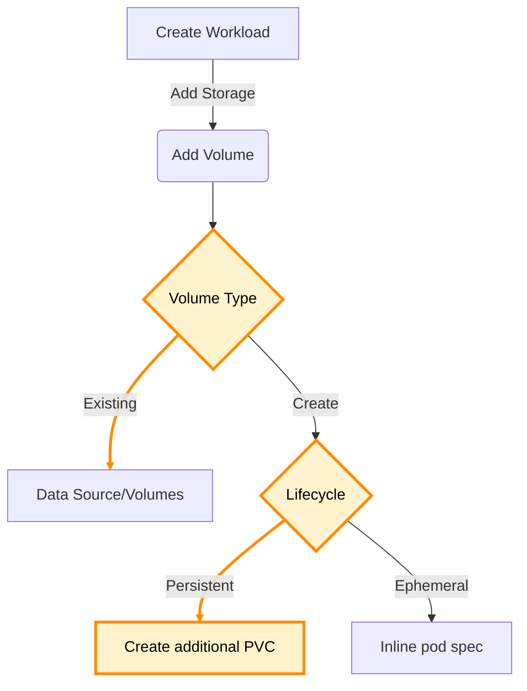
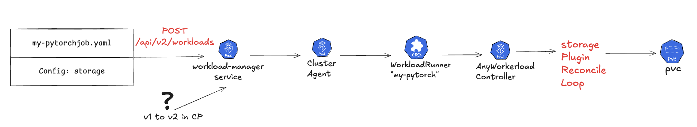
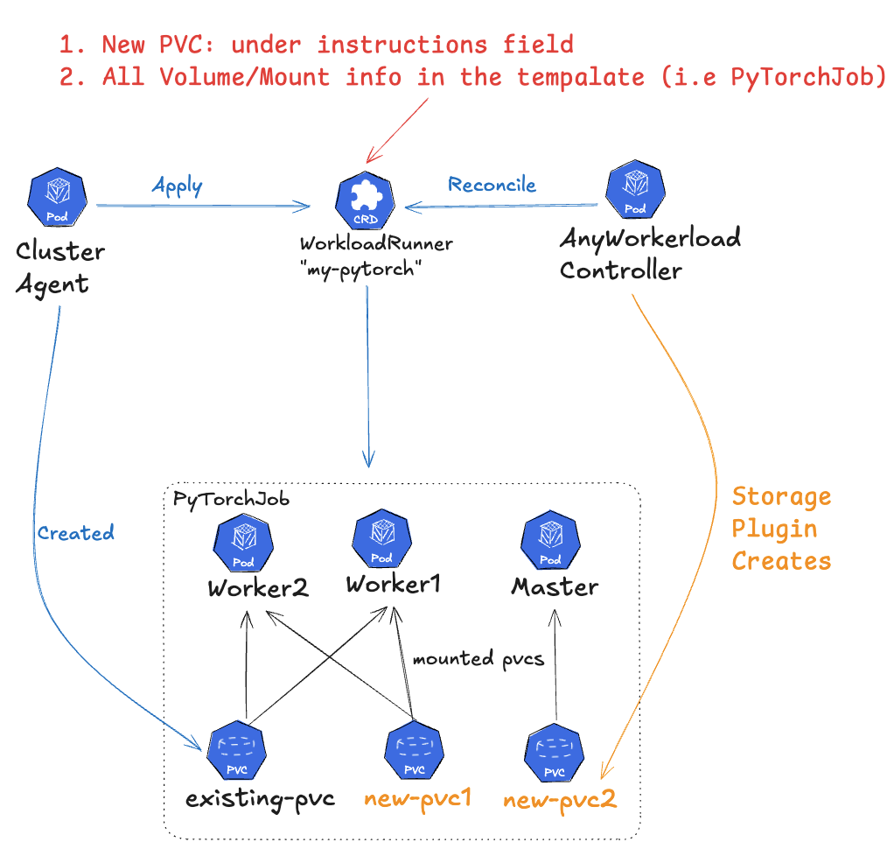
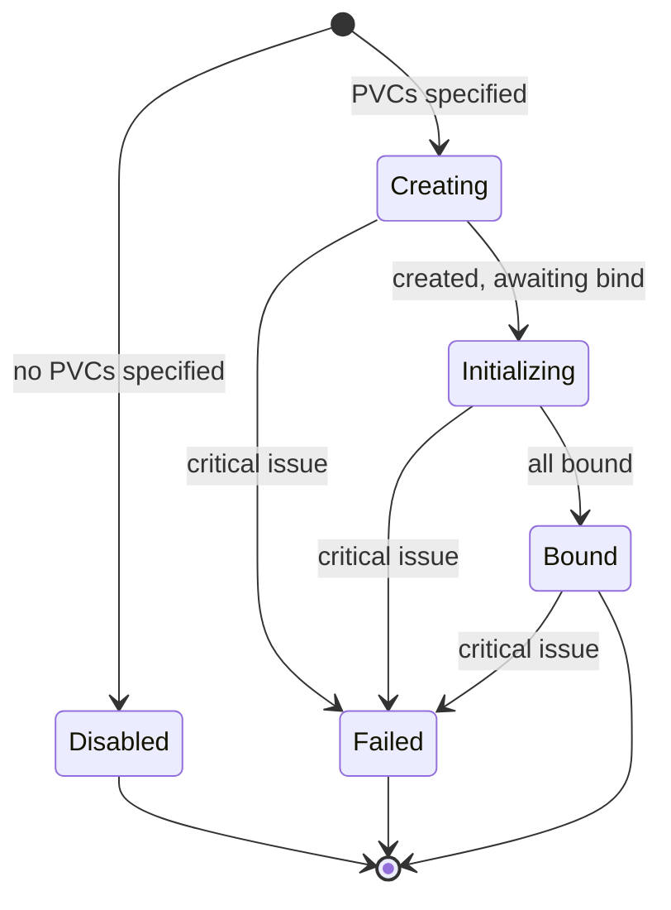

# Support Storage in Anyworkload Controller

# Table Of Contents
- [Support Storage in Anyworkload Controller](#support-storage-in-anyworkload-controller)
- [Table Of Contents](#table-of-contents)
- [Overview](#overview)
  - [Goals and Non-Goals](#goals-and-non-goals)
  - [Storage Types and Scope](#storage-types-and-scope)
- [Life of a Request](#life-of-a-request)
- [V2 API Extend](#v2-api-extend)
  - [V1 to V2 migration](#v1-to-v2-migration)
- [WorkloadRunner](#workloadrunner)
  - [Runner CRD Spec](#runner-crd-spec)
- [Storage Plugin](#storage-plugin)
    - [Error handling](#error-handling)
    - [Plugin Capability: ValidatorPlugin](#plugin-capability-validatorplugin)
    - [Plugin Capability: AdditionalResourcePlugin](#plugin-capability-additionalresourceplugin)
    - [Plugin Capability: WatcherPlugin](#plugin-capability-watcherplugin)
    - [Plugin Capability: StatusPlugin](#plugin-capability-statusplugin)
    - [Plugin Capability: ResourceMutatePlugin](#plugin-capability-resourcemutateplugin)
    - [Impact on the EWI Controller (None)](#impact-on-the-ewi-controller-none)
- [Open Questions](#open-questions)

# Overview

As part of the effort of making RunAI OSS and V2 Workloads supported we need to support Storage for workloads. 
Currently The v2 API for workloads does not provide a way to use storage properly. 
This design extends the V2 workloads API to support storage, and add a storage plugin to the anyworkload controller that reconciles PVCs bound to the lifecycle of a `WorkloadRunner`.

## Goals and Non-Goals

**Goals**

- Extend the V2 API for workloads to support storage.
- Reconcile PVCs that belong to a `WorkloadRunner` and are persistent throughout its lifetime.
- Allow any data source to be mounted as volume/volumeMounts in a flexible way (i.e how to mount the created/existing PVC/data source).

**Non Goals**

- Detailed support for V1 workloads. CP translation from V1 to V2 is being designed by others to centralize the logic since it covers more than storage. Mentioned here, but exact details are TBD.
- Migration path for already-running workloads (e.g a `TrainingWorkload` created in V1 and currently running on the cluster).
- S3/git-sync support, which is covered by a separate init-containers initiative.
- Rich UI support for abstracting storage assets like in V1 (e.g a UI form to select data sources).

## Storage Types and Scope

| Type      | Storage Plugin | Comment                                                                                                                
| --------- | -------- | ---------------------------------------------------------------------------------------------------------------------- 
| Volume    | Yes      | **Persistent: means creating additional PVC resource**. Ephemeral: inline spec definition.                                               
| ConfigMap | No       | Must already exist on the cluster. Inline spec definition.                                                           
| Secret    | No       | Must already exist on the cluster. Inline spec definition.
| EmptyDir  | No       | Inline spec definition.                                                                                     
| HostPath  | No       | Inline spec definition.                                                                                    
| Git, S3   | No       | Covered by the separate init-container initiative.                                                                     
| NFS       | No       | Adds volumeMount/volume spec for NFS as a built-in type.


The storage plugin itself will only cover the highlighted branch in the diagram below, that is when we need a new PVC and we want the lifecycle to be persistent.



# Life of a Request

The flow goes from the V2 API in the control plane, through the cluster agent, into a `WorkloadRunner` CR on the target cluster, where the anyworkload controller and its storage plugin reconcile the PVCs.

The V2 API today is raw. Enrichment for UI and the runai CLI will be added on top later. V1 endpoints stay as-is on the wire and are translated to V2 inside the control plane.



# V2 API Extend

**When creating a V2 Workload we have 2 parts:**
1. `manifest` That is the raw user spec (i.e the `PyTorchJob` pod spec). Here the user specifies directly the pod [volumes/volumeMounts](https://github.com/kubernetes/api/blob/master/core/v1/types.go), or the `initContainers` used in the S3 case. This is the responsibility of whoever submits the manifest of the specific workload.
2. `metadata` RunAI info including `configuration` which we extend to use `metadata.configuration.storage`. The second part depends on the use case, and that is exactly what the storage plugin is for: in this case, creating new PVCs. The spec follows [v1.PersistentVolumeClaim](https://github.com/kubernetes/api/blob/5506889802831f1cb6546b78a09b5c328ed2e35f/core/v1/types.go#L515). (`apiVersion`, `kind` and `namespace` ignored upstream).

> [!NOTE]
> For storage `v1.PersistentVolumeClaim` we accept any input here. The validation will happen upstream at the anyworkload > storage plugin level. This to avoid maintaining duplicate logic at several levels. 

**Example of API Payload**

- Request `POST /api/v2/workloads`
- Workload Type `PyTorchJob`
- The storage plugin only manages `new-pytorch-pvc` PVC while `existing-data-vol` is irrelevant and was created before. 

```json
{
  "metadata": {
    "name": "my-pytorch",
    "projectId": "4500002",
    "configuration": {
      "storage": {
        "newPvcs": [
          {
            "metadata": {
              "name": "new-pytorch-pvc"
            },
            "spec": {
              "accessModes": ["ReadWriteOnce"],
              "resources": {
                "requests": {
                  "storage": "1Gi"
                }
              },
              "storageClassName": "standard"
            }
          }
        ]
      }
    }
  },
  "manifest": {
    "apiVersion": "kubeflow.org/v1",
    "kind": "PyTorchJob",
    "metadata": {
      "name": "my-pytorch"
    },
    "spec": {
      "pytorchReplicaSpecs": {
        "Master": {
          "template": {
            "spec": {
              "containers": [
                {
                  "name": "pytorch",
                  "image": "busybox",
                  "volumeMounts": [
                    {"name": "new-vol", "mountPath": "/mnt/data"},
                    {"name": "existing-data-vol", "mountPath": "/mnt/data2"}
                  ]
                }
              ],
              "volumes": [
                {
                  "name": "new-vol",
                  "persistentVolumeClaim": {"claimName": "new-pytorch-pvc"}
                },
                {
                  "name": "existing-data-vol",
                  "persistentVolumeClaim": {"claimName": "some-existing-data-volume"}
                }
              ]
            }
          }
        },
        "Worker": {
          "replicas": 2,
          "template": {
            "spec": {
              "containers": [
                {
                  "name": "pytorch",
                  "image": "busybox",
                  "volumeMounts": [
                    {"name": "new-vol", "mountPath": "/mnt/data"}
                  ]
                }
              ],
              "volumes": [
                {
                  "name": "new-vol",
                  "persistentVolumeClaim": {"claimName": "new-pytorch-pvc"}
                }
              ]
            }
          }
        }
      }
    }
  }
}
```

**Conceptual Example with runai cli**

The manifest part `deploy.yaml` here the user will specify all the spec information such as volume/volumeMounts.

> UI / runai cli will be extended: `runai workload submit -f deploy.yaml --new-pvc "claimname=my-pvc,size=10M,accessmode-rwo"`

```yaml
kind: Deployment
spec:
  template:
    spec:
      containers:
      - name: my-app
        image: nginx:latest
        volumeMounts:
        - name: data-volume
          mountPath: /usr/share/nginx/html
      volumes:
      - name: data-volume
        persistentVolumeClaim:
          claimName: my-pvc
```

## V1 to V2 migration 

As mention in the non-goals: this design does not cover the exact details since it awaits a larger task for that, storage will be part of it. 
But, in general Karta will be used in the v1 to v2 phase to mutate the `volumes` and `volumeMounts` per workload v1 type.

# WorkloadRunner



## Runner CRD Spec 

New PVCs are specified per CR in a new field is added under `.spec.instructions`, following the pattern of the networking and mnvl plugins (see [workloadrunner_types.go](runai-cluster/cluster/sdk/apis/run/v1alpha1/workloadrunner_types.go)).

> [!NOTE]
> The config in .spec.instructions only specifies new PVCs to create. It does not describe where or how to mount them.


```yaml
kind: WorkloadRunner
spec:
  instructions:
    storage: # root key for the storage plugin (optional)
      newPvcs: []
```

**Full CR Example (Omitted some fields for simplicity) **

```yaml
apiVersion: run.ai/v1alpha1
kind: WorkloadRunner
metadata:
  name: my-pytorch
  namespace: runai-teama
spec:
  instructions:
    storage:
      newPvcs:
      - metadata:
          name: my-pytorch-pvc
        spec:
          accessModes:
            - ReadWriteOnce
          resources:
            requests:
              storage: 1Gi
          storageClassName: standard
  template:
    kind: PyTorchJob
    metadata:
    spec:
      pytorchReplicaSpecs:
        Master:
          # ...
        Worker:
          replicas: 2
          template:
            spec:
              containers:
              - volumeMounts:
                - name: my-pytorch-vol
                  mountPath: /mnt/data-pvc1
              volumes:
              - name: my-pytorch-vol
                persistentVolumeClaim:
                  claimName: my-pytorch-pvc
```


# Storage Plugin

The storage plugin runs as part of the anyworkload controller reconcile loop. It manages new PVCs that are bound to the lifecycle of the `WorkloadRunner`.

### Error handling 

- In general each Storage Plugin function returns an `error`. 
- Reconcile loop: During reconcile of the Anyworkload Controller, if a plugin call returns an error it will return it as part of the reconcile.
- The plugin will default to K8S default behavior where possible. For example: not waiting for PVC to be created before continue to apply the workload.

### Plugin Capability: ValidatorPlugin

```go
func WebhookValidate(ctx context.Context, existingRunner, desiredRunner *v1alpha1.WorkloadRunner) (admission.Warnings, field.ErrorList)
```

**Today in V1:**

- The flow for new PVC validates name (valid DNS), size presence/format, ownership conflicts, and storage class allow-listing.
- No access-mode, volume-mode, SC-existence, or size-cap checks.

**In V2:**

- Validate the namespace is either empty or equals to the workload runner namespace.
- Validate the list of `newPvcs` does not contain duplicate names.
- Validate `storageClassName`, `accessModes`, `resources.requests.storage` are set. 
- The rest of PVC validity we can leave to k8s upstream (i.e checking against k8s api if `storageClassName` exists). 

### Plugin Capability: AdditionalResourcePlugin

```go
func HandleAdditionalResources(
	ctx context.Context,
	runner *v1alpha1.WorkloadRunner,
	resource *unstructured.Unstructured,
	ri *riv1alpha1.ResourceInterface,
	k8sClient client.Client,
	state *reconcile.State,
) error
```

- Iterate pvcs in `runner.Spec.Instructions.StorageConfig.NewPvcs` and create the PVC (Server-Side Apply via Patch). 
- Always set `.spec.instructions.newPvcs[*]` fields: `"apiVersion": "v1"`, `kind": "PersistentVolumeClaim"` and `namespace: <runner namespace>`.
- Before patching for each PVC validate we are the owner using `Get` and if exist then `metav1.IsControlledBy(existing, runner)`. If there is a different owner: error.

### Plugin Capability: WatcherPlugin

The plugin only watches PVCs it owns:

```go
func Watchers(builder *builder.Builder) (*builder.Builder, error) {
    return bldr.Owns(&corev1.PersistentVolumeClaim{}), nil
}
```

### Plugin Capability: StatusPlugin

```go
func Status(ctx context.Context, runner *v1alpha1.WorkloadRunner, k8sClient client.Client, status framework.PluginStatusSetter, state *reconcile.State) error
```

> Issues are collected via `state *reconcile.State` during other calls (e.g `HandleAdditionalResources`) and are marked with severity so that it can be shows in the status. 

- One condition type for PVC's `PVCsReady`. 
- Phase represents the worst across all PVCs, all these are possible statuses for that representing the phase: 
  - `Disabled` if no PVCs are specified
  - `Creating` if any not yet created
  - `Initializing` if andy not yet Bound
  - `Failed` on critical issue
  - `Bound` if all bound


> [!NOTE]
> Exact status and conditions details will be finalized during implementation, this is initial draft.




**Example on live CR:**

```yaml
apiVersion: run.ai/v1alpha1
kind: WorkloadRunner
# ...
status:
  conditions:
  # ...
  plugins:
    networking-plugin:
      # ...
    storage-plugin:
      conditions:
      - lastTransitionTime: "2026-05-03T14:38:56Z"
        message: all new pvcs are Bound
        reason: Bound
        status: "True"
        type: PVCsReady
      phase: Ready

```
### Plugin Capability: ResourceMutatePlugin

Nothing to implement. The volume/mounts are already specified in the WR, so no mutation is needed.

### Impact on the EWI Controller (None)

The External Workload Integrator (`runai-cluster/cluster/external-workload-integrator`) creates an `ExternalWorkload` CR per top-level workload and tracks the WorkloadRunner via a label only. It is not affected by this design.

# Open Questions

- Time estimation TBD
- `NimService`: still unclear what needs to be covered.
- runai CLI / UI: what needs to be added?
