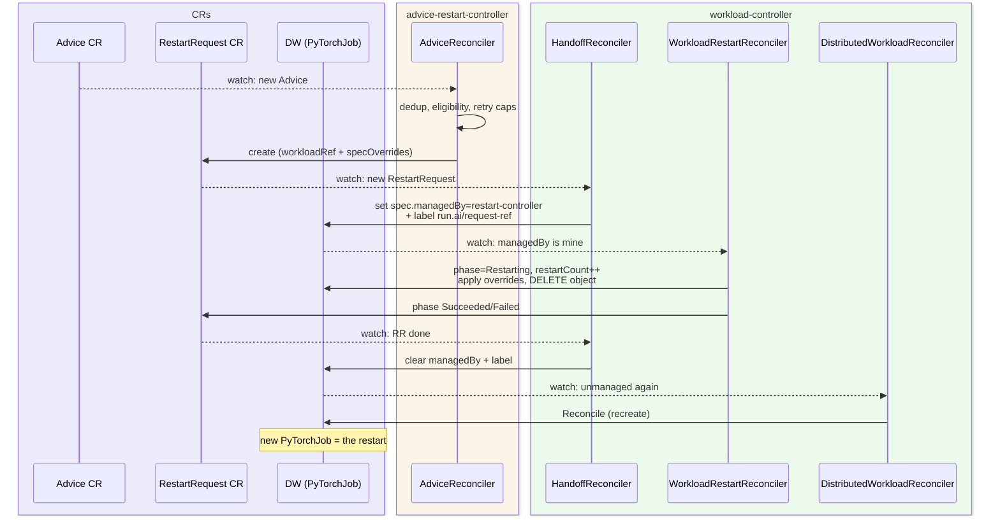
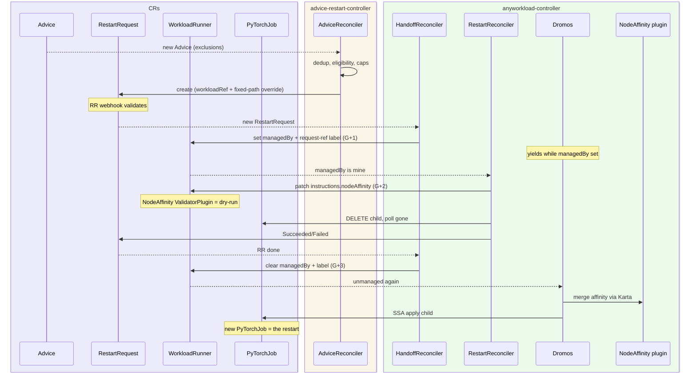

# Workload Restart for WorkloadRunner
- [Workload Restart for WorkloadRunner](#workload-restart-for-workloadrunner)
- [Overview](#overview)
  - [Motivation](#motivation)
  - [Goals and non-goals](#goals-and-non-goals)
- [Background: how restart works today (DistrubutedWorkload)](#background-how-restart-works-today-distrubutedworkload)
- [WorkloadRunner](#workloadrunner)
  - [WLR Updated CRD](#wlr-updated-crd)
    - [Example WLR CRD](#example-wlr-crd)
    - [Translating CRs Advice to WLR with Karta](#translating-crs-advice-to-wlr-with-karta)
- [Advice Restart Controller](#advice-restart-controller)
- [Anyworkload Controller extend](#anyworkload-controller-extend)
  - [Dromos modification](#dromos-modification)
  - [Dromos plugin: NodeAffinity](#dromos-plugin-nodeaffinity)
  - [Handoff Reconciler](#handoff-reconciler)
  - [Restart Reconciler](#restart-reconciler)
  - [Watching Changes](#watching-changes)
- [Hooks](#hooks)
  - [Advice Controller: Mutating Hook - Replace with CP (stamp heimdall.nvidia.com/workflow-id)](#advice-controller-mutating-hook---replace-with-cp-stamp-heimdallnvidiacomworkflow-id)
- [Cluster Agent and V1 to V2 Submission](#cluster-agent-and-v1-to-v2-submission)
- [External dependencies](#external-dependencies)
  - [UI / CLI](#ui--cli)
  - [EW / EWI / Cluster Sync](#ew--ewi--cluster-sync)
  - [Overseer](#overseer)
- [Backward compatability](#backward-compatability)
  
# Overview
Run:ai supports automatic workload restart driven by NVIDIA Heimdall (AJR): Heimdall detects a failing job and posts an `Advice` CR, which is translated into a `RestartRequest` (RR), executed today against `DistributedWorkload` (DW) by reconcilers living inside `workload-controller`.

Both DW and `workload-controller` are going away. This design moves the restart capability to the `WorkloadRunner` (WLR) world: the restart and handoff reconcilers are re-homed into `anyworkload-controller` and taught to restart WLR-managed workloads, matching today's DW behavior (PyTorchJob via Heimdall).
## Motivation
- We're going open source: `DistributedWorkload` will not exist and `workload-controller` is deprecated (EOL) (contains restart and handoff reconcilers).
  
- Restart via Heimdall is a capability that we need to maintain parity with `DistributedWorkload` behavior.
  
## Goals and non-goals
**Goals**

- Parity with the `DW` restart for `PyTorchJob` workloads, Heimdall-initiated restarts with same guarantees.
- **Hard requirement to maintain: the Run:ai workloadId is stable across restarts.** A restarted workload is the SAME workload in the CP.
- Parity scope, refined: workloads submitted through the v1 API and auto-cast to a `WLR` (the v1-to-v2 flow).
- Restart/handoff logic hosted in `anyworkload-controller`, operating on WLR.
- Reuse the existing `RestartRequest` CRD (In general avoiding new API surface where the old one fits).
- Maintain the existing flow and focus on enabling support `WLR` and stay within current boundries.
  

**Non-goals**

- Supporting restart for DW and WLR side-by-side in the same cluster.
- Extending restart beyond the current parity scope (other frameworks, non-Heimdall initiators). The design does not block it but, it’s not a goal.
- Changing Heimdall or the Advice CRD contract.
  
# Background: how restart works today (DistrubutedWorkload)

External Heimdall monitors workloads that carry the `heimdall.nvidia.com/workflow-id` label - stamped on the DW object at create by a mutating webhook in advice-restart-controller (the label lives only on the DW, not on the PyTorchJob or its pods) - and posts an `Advice` CR. From there:

> NOTE: see [background-context.md](./background-context.md) for detailed mapping of **DW existing** controllers, hooks and mapping of DW CRD fields to WLR gaps. 



**Key mechanics:**

- **Ownership handoff**: `spec.managedBy` is the mutual-exclusion switch between the workload reconciler and the restart reconciler. Because it is a spec write, setting it bumps `metadata.generation`.
- **Freshness fencing**: the `RR` pins the workload generation. The restart reconciler acts only on the expected generation.
- **Idempotency**: the immutable `run.ai/request-ref` label acts as a per-restart lock.
- **Admission**: a validating webhook enforces:
  - one active RR per workload, GVK allowlist
  - override-path allowlist, spec immutability
  - a DW validator protects `managedBy`.
- **Restart == Delete**: The `DW` reconciler recreates the framework object once ownership returns.
  
# WorkloadRunner 

## WLR Updated CRD 

**spec.managedBy** 
- ManagedBy field to be added to the `WLR` CRD, causes generation bump.
- Not tied to a "plugin"
  
**spec.instructions.nodeAffinity**
- New typed instruction on the `WLR` CRD, consumed by the NodeAffinity plugin

**spec.instructions**
- Defaults to `{}` (`+kubebuilder:default={}`): the restart patch is `add /spec/instructions/nodeAffinity` and `add` requires the parent to exist. No generation bump, so restart fencing is unaffected.
  
**status.phase**
- New phase `Restarting` supported enum
- Will be set by restart-reconciler

```go
type WorkloadRunnerSpec struct {
    // ...
	Template runtime.RawExtension `json:"template"`
    // ...
	// Defaults to {} so the restart's fixed-path add patch always has a parent.
	// +kubebuilder:default={}
	Instructions *Instructions `json:"instructions,omitempty"`

	// Specify by which controller the workload is managed by, default empty string means workload controller
	// +kubebuilder:default=""
	ManagedBy string `json:"managedBy,omitempty"`
}

type Instructions struct {
	// ...existing gpuOptimizations, networking, storage
	// NEW: consumed by the NodeAffinity plugin
	NodeAffinity *NodeAffinityConfig `json:"nodeAffinity,omitempty"`
}
```

### Example WLR CRD
The following example shows minified `WLR` **mid-restart** (contains `run.ai/request-ref` label).

```yaml
apiVersion: run.ai/v1alpha1
kind: WorkloadRunner
metadata:
  name: freeze-2
  namespace: runai-teama
  labels:
    run.ai/request-ref: <RR-UID>                   # New: RR lock added by handoff - present only during restart, removed at handback
spec:
  managedBy: restart-controller-workloadrunner    # NEW field: dromos yields while non-empty; cleared at handback
  instructions:
    nodeAffinity:                                  # NEW: NodeAffinity plugin input; merged into the child's pod affinity at apply time
      nodeAffinity:                                # standard corev1.NodeAffinity
        requiredDuringSchedulingIgnoredDuringExecution:
          nodeSelectorTerms:
          - matchExpressions:
            - key: kubernetes.io/hostname
              operator: NotIn
              values: [node-a]
  template:
    apiVersion: kubeflow.org/v1
    kind: PyTorchJob
    metadata:
      name: freeze-2
      labels:
        heimdall.nvidia.com/workflow-id: <workloadId> # New: stamped; Heimdall monitors via this label, needs to be propagated to PyTorchJob (not happening in DW, bug)
    spec:
      pytorchReplicaSpecs:
        Master:
          replicas: 1
          template:
            spec:
              affinity:
                nodeAffinity:
                  requiredDuringSchedulingIgnoredDuringExecution:
                    nodeSelectorTerms:
                    - matchExpressions:
                      - key: gpu-type                # user-set affinity - part of the submitted template, untouched by the plugin
                        operator: In
                        values: ["a100"]
              containers: [ ... ]
        Worker:
          replicas: 3
          template: { ... }                        # same NotIn merged into workers
status:
  phase: Restarting                                   # New: Restarting phase, no status.RestartCount
```

Below is how an `Advice` and `RestartRequest` CR's.
gvk targets `WorkloadRunner`; `specOverrides` is a single fixed-path op at `/spec/instructions/nodeAffinity`.
Heimdall monitors via the workflow-id label on the WLR's PyTorchJob and references the running child job.

```yaml
apiVersion: heimdall.nvidia.com/v1alpha1
kind: Advice
metadata:
  name: restart-advice-freeze-2-6mw7
  namespace: runai-teama
spec:
  advice:
    state: ADVICE_STATE_RESTARTED                  # only RESTARTED triggers the flow (TERMINATED ignored)
    nodeConstraints:
      exclusions:                                  # faulty nodes -> become the NotIn affinity on the child
      - node-a
  job:                                             # points at the CHILD (framework object), not the WLR
    apiVersion: kubeflow.org/v1
    kind: PyTorchJob
    name: freeze-2
    heimdallId: debug-freeze-2
    jobId: debug-freeze-2
    attemptIndex: 0
```

RestartRequest CR - created by advice-restart-controller after the top-owner walk (PyTorchJob -> WLR).

```yaml
apiVersion: run.ai/v1alpha1
kind: RestartRequest
metadata:
  namespace: runai-teama
  ownerReferences:
  - apiVersion: run.ai/v1alpha1                    # Changed: owner is the WLR (was DistributedWorkload)
    kind: WorkloadRunner
    name: freeze-2
    uid: <WLR-UID>
spec:
  workloadRef:
    gvk:                                           # Changed: targets WorkloadRunner (was run.ai/v2alpha1 DistributedWorkload)
      group: run.ai
      version: v1alpha1
      kind: WorkloadRunner
    name: freeze-2
    generation: 1                                  # pinned pre-handoff WLR generation (handoff -> 2, overrides patch -> 3)
  specOverrides:                                   # Changed: one fixed path for ALL frameworks; value = current instruction affinity + advice exclusions unioned into the NotIn term
  - op: add
    path: /spec/instructions/nodeAffinity
    value:
      nodeAffinity:
        requiredDuringSchedulingIgnoredDuringExecution:
          nodeSelectorTerms:
          - matchExpressions:
            - key: kubernetes.io/hostname
              operator: NotIn
              values: [node-a]
```

### Translating CRs Advice to WLR with Karta

**How it works in DistributedWorkload**

- All pytorchReplicaSpecs get's updated with node exclusions and restart.  
- Advice CRD translates to generic JSON Patch by the Advice restart controller.

> Note: advice CRD itself does not have granulairty of master/worker its just `advice.Spec.Advice.NodeConstraints.Exclusions` : `[]string` that's it, exlusion and all nodes.

Reminder: `/spec/nodeAffinityRequired` and `/masterSpec/nodeAffinityRequired` exists only on the `DW`. On a `PyTorchJob` the same rule lands as standard k8s node affinity inside each replica template.

**WLR adjusted behavior**

- The `RR` CRD stays unchanged: `specOverrides` carries one JSON-patch op at the fixed path `/spec/instructions/nodeAffinity` - framework-independent, no per-framework template paths.
- The Generation based decision flow of restart stays the same (i.e G+1 ongoing restart, G+2 new restart to execute etc).
- The advice controller unions the advice exclusions into the `kubernetes.io/hostname NotIn` values of the WLR's current `nodeAffinity` instruction before emitting the patch: the `add` op replaces the value, so without the union a later restart would drop previously excluded nodes.
- The restart reconciler applies the patch during the restart window (the G+2 bump) and the NodeAffinity plugin materializes it as pod affinity on the child at apply time.
- TODO: We are going to modify the WLR CR here, need to verify with viper team about a new webhook they adding that might block us, if it does  - need to add `advice-restart-controller` service account to the allow list. 

```yaml
# RestartRequest CR with WLR Path
specOverrides:
- op: add
  path: /spec/instructions/nodeAffinity
  value:                                     # current instruction affinity + advice exclusions unioned into the NotIn values
    nodeAffinity:
      requiredDuringSchedulingIgnoredDuringExecution:
        nodeSelectorTerms:
        - matchExpressions:
          - key: kubernetes.io/hostname
            operator: NotIn
            values: [node-1, node-2]
```

After dromos re-applies the child, the NodeAffinity plugin produces this PyTorchJob:

```yaml
apiVersion: kubeflow.org/v1
kind: PyTorchJob
spec:
  pytorchReplicaSpecs:
    Master:
      template:
        spec:
          affinity:
            nodeAffinity:
              requiredDuringSchedulingIgnoredDuringExecution:
                nodeSelectorTerms:
                - matchExpressions:
                  - key: kubernetes.io/hostname
                    operator: NotIn
                    values: ["node-1", "node-2"]
          containers: [...]
```
# Advice Restart Controller

- Stays the same, with extended support for `WLR`.  
- Not Karta-aware: it never touches the template spec, it only creates `RR` with  `instructions.nodeAffinity` 
  
# Anyworkload Controller extend

Currently the package contains instance of WLR Controller (using dromos). 
The 2 reconcilers handoff and restart will be added to this package and live in memory all within the same pod. 
The anyworkload-controller pod will contain: WLR controller (Existing dromos) and 2 new: restart and handoff.

> Note: Additionaly Webhooks (mutating/validating) will be added to the package as needed.



## Dromos modification

Currently the controller-runtime manager is [internal for dromos](https://github.com/run-ai/runai/blob/19a0fbc492fc2bfe27a88cae882b436042339e4a/runai-cluster/cluster/dromos/pkg/app/app.go#L89), We need this to add hooks, reconcilers and more.

- We don't want to to add specific restart/handoff reconcilers to dromos.
- The goal is to do a minor refactor to dromos in order to allow using the controller manager in anyworkload controller, probably by separating [dromos.RunController](https://github.com/run-ai/runai/blob/master/runai-cluster/cluster/dromos/pkg/app/app.go#L75C6-L75C19) and allow re-using manager.
  
## Dromos plugin: NodeAffinity

New plugin will be introduced in Dromos, it will be responsible for actually modifying the underlying resource (i.e `PyTorchJob`) node affinity rules. 
The minimum we need is node exclusions by hostname `kubernetes.io/hostname`, this will match the current capabilities.

**Why new plugin**:

1. The "know-how" of using karta stays inside dromos, no need to introduce Karta for advice and restart reconcilers.
  - The Advice restart controller will only set `instructions.nodeAffinity` in a WorkloadRunner
  - The Restart reconciler will only be responsible for the the deletion of the object and restart logic, leaving the "spec-patch" to dromos.
2. Clear distinction between user-set nodeAffinity and restart controller, easier to understand how to merge these 2 together (a challenge needed to be solve in current version as well)
  

**Plugin Shape**

```go
import corev1 "k8s.io/api/core/v1"

type NodeAffinityConfig struct {
    // Standard k8s node affinity, merged into every component's pod affinity.
    // corev1 embed - same type karta already works with; grows with k8s, no custom type to evolve.
    // +optional
    NodeAffinity *corev1.NodeAffinity `json:"nodeAffinity,omitempty"`
}
```

```yaml
kind: WorkloadRunner
spec:
  instructions:
    nodeAffinity:
      nodeAffinity:
        requiredDuringSchedulingIgnoredDuringExecution:
          nodeSelectorTerms:
          - matchExpressions:
            - key: kubernetes.io/hostname
              operator: NotIn
              values: [node-a, node-b]
  template:                   
    ...
```

**Plugin capabilities:**

- `ResourceMutatePlugin`: merge the instruction's `corev1.NodeAffinity` into every component's pod affinity (mnnvl plugin pattern)
- `ValidatorPlugin`: on `WLR` write with `instructions.nodeAffinity` set: karta supports affinity for this GVK and hostnames valid. Denial at admission is the DW dry-run equivalent - the restart reconciler's patch fails BEFORE the child is deleted.
- `StatusPlugin`: `status.plugins["node-affinity"]` applied affinity, provides visibility.
  

**Merging exclusions into the child's pod affinity:**

- Re-use mnnvl's existing node-affinity merge (`plugins/mnnvl/node_affinity_builder.go`) via a shared dromos pkg.
- Merge must stay deterministic (sorted, deduped values) - the MutateResource loop hard-fails after 5 non-converging rounds and the child is never applied.
- Duplicates compare requirement values as sets (required and preferred) - an order-variant duplicate would double a preferred weight.
- Empty selector shapes keep their Kubernetes meaning: `nil`/`[]` mean no constraint; a selector of only empty terms matches **no nodes** and wins the merge instead of being dropped.
- Plugin execution order is deterministic (name order), so re-applies produce byte-identical children across controller restarts.
- Add a convergence test with mnnvl + nodeAffinity enabled on the same workload (none exists today).
  
## Handoff Reconciler

- Location: Workload-controller is deprecated, re-implementing with `WLR` support in anyworkload controller.
  
## Restart Reconciler

- Location: Workload-controller is deprecated, re-implementing with `WLR` support in anyworkload controller.
- Sets `WLR` with `status.phase=Restarting` (same behavior)
  
## Watching Changes

This section addresses the Reconcile Watch pattern. 
Adjusting the existing watch behavior for `DW` / `Workload Controller`.

**In dromos:**

Since `spec.managedBy` is introduced in `WLR` it make sense to provide dromos users with a Watch predicate. Alternative: This can also be generic shim predicate in dromos and during initiation we can pass it.

```go
func ManagedByPredicate(want string) predicate.Predicate {
    sel := func(obj client.Object) bool {
        wlr, ok := obj.(*dromosv1alpha1.WorkloadRunner)
        if !ok {
            return want == "" // non-WLR events: only the built-in controller passes
        }
        return wlr.ManagedBy == want
    }
    return predicate.Funcs{
        CreateFunc: func(e event.CreateEvent) bool { return sel(e.Object) },
        UpdateFunc: func(e event.UpdateEvent) bool { return sel(e.ObjectNew) },
    }
}
```

**Watch SetupWithManager:**

```go
builder := ctrl.NewControllerManagedBy(mgr).
    Named(c.name).
    For(&dromosv1alpha1.WorkloadRunner{}, ctrlbuilder.WithPredicates(
        predicate.GenerationChangedPredicate{},
        dromospredicates.ManagedByPredicate(""),
    )).
    Watches(&kartav1alpha1.Karta{},
        handler.EnqueueRequestsFromMapFunc(c.mapKartaToWorkloadRunnerEvent))
```

The `restart-reconiler` can add: `dromospredicates.ManagedByPredicate("restart-controller-workloadrunner")`

**Yield guard** in `dromos/pkg/controller/workloadrunner_controller.go`, in Reconcile check and before `reconcileSpec`:

```go
func (c *WorkloadRunnerController) Reconcile(ctx context.Context, req ctrl.Request) (ctrl.Result, error) {
  if runner.DeletionTimestamp != nil {
      return ctrl.Result{}, nil
  }

  // Right after the `DeletionTimestamp` 
  // Yield: another controller owns this runner. Complements the watch
  // predicate; events queued before the marker was set still reach here.
  if runner.Spec.ManagedBy != "" {
      logger.V(1).Info("runner managed by another controller, yielding", "managedBy", runner.Spec.ManagedBy)
      return ctrl.Result{}, nil
  }

  // reconcileSpec comes after 
  // ...
}
```

# Hooks

Below is a high level description of the hooks that are involved in the current process.

**Advice Controller: ValidatingAdmissionPolicy (CEL, no pod)**

- Part of the Advice Controller operand. Today it guards the label on DW `metadata.labels`.
- For `WLR` the label lives only in `spec.template.metadata.labels`, so the guard moves there:
  a second VAP matching `run.ai/v1alpha1 workloadrunners` on UPDATE, same two CEL rules
  (no remove, no modify).
- Why still needed: dromos SSA force-owns the child's labels from the template; if the label is
  stripped from the template in-cluster, the next reconcile removes it from the child and Heimdall
  loses the job mid-flight. The VAP blocks that at admission.  

**Restart Reconciler: Validating webhook (**`/validate-restartrequest`**)**

- Part of the Workload Controller.
- Change location: together with the restart-reconciler.
- Adapt logic to support `WLR`
- Override-path allowlist shrinks to a single static entry: `/spec/instructions/nodeAffinity` (framework-independent).
  

**Restart Reconciler: Validating webhook**

- Part of the DistributedWorkload Controller.
- Change location: together with the restart-reconciler.
- Adapt logic to support `WLR`, Enforces `managedBy` <-> `request-ref` label consistency + label immutability.
  

**Dromos NodeAffinity ValidatorPlugin**

- Validates `instructions.nodeAffinity`: karta supports affinity for the GVK, hostnames valid
- The dry-run equivalent: fail the `RR` before the child is deleted
- Strictness is apiserver parity, not scheduler parity: the webhook must not reject an instruction a real pod could legally carry (the apiserver deliberately skips label-value validation inside affinity).

## Advice Controller: Mutating Hook - Replace with CP (stamp heimdall.nvidia.com/workflow-id)

**The requirement**

- Default is to enable restart for `WLR`, Opt-out annotation on `WLR` template object: `run.ai/disable-ajr-integration: true`
- Heimdall monitors `PyTorchJob` workloads using a label on the `DW` `heimdall.nvidia.com/workflow-id: workloadId` that was supposed to be propagated into the `PyTorchJob` but there is an existing bug: We only stamp the `DW` not the `PyTorchJob`, heimdall bypassed that but we need to fix that, stamp the `PyTorchJob` with the heimdall annotation.

**Current approach**

The `advice-restart-controller` has a mutating webhook (`/mutate-distributedworkload`).
It stamps the `DW` on `CREATE`.
In theory we can extend this by registring an additional hook for `/mutate-workloadrunner-enrollment` but, the design suggests an alternative via CP.
 
**The problem with hook**

- More moving parts: A Mutating webhook is another component to monitor and control. 
- Cluster Agent will wipe it unless we add protections
  
**Alternative solution - stamp at the control plane**

Instead of extending the mutating webhook to WLR, the CP stamps the label into the workload manifest at v1-to-v2 submission. 
Because the label rides the CP manifest, the agent re-asserts it on every sync. 
No CREATE enrollment webhook is needed.

**How**

No new code changes is needed, only wiring what exists today in CP:

- Cluster: go-operator reports operand readiness in `RunaiConfig.Status.OperandStatuses`
  (key `advice-restart-controller`). The operand's `Status()` also verifies the Heimdall
  Advice CRD is served, so `ready == true` implies deployed AND CRD installed.
- The only new code is in `workloads-manager`, inside `editManifestWithMetadata`
(`api_workloads_v2_manifest.go`), next to the existing label stamps
 
> Note: Regarding the final location of where in CP this happens it depends on  whether we should (a) enable restart only for native distributed training or (b) to any workload that is pytorch. 
> After a sync with product we decided that if (b) is good IFF it doesn't add extra work, than we want it. 
> In case of option (a) only DW the label stamping should happen as part of v1-v2 submission handler, otherwise in the workloads-manmager when submitting v2 workload. 
> It will be determined after a careful work on the agent wipe issue, since we need to protect wipes from Suspend/Resume it might be enough for /update as well.


> Notes: Same access pattern NIM already uses

**Trade-offs in CP approach**

- **No support for cluster applied workloads** Today's webhook runs at K8s admission, so it catches **every** DW created in the cluster, including someone doing `kubectl apply -f my-dw.yaml` directly. 
For that case the webhook has a fallback: if there's no `workloadId` annotation (which only CP-submitted workloads have), it invents a fresh UUID and stamps that as the workflow-id. 
  > Why it's OK: Workloads are assumed to be CP-created only. 

- **Reporting staleness.** The cluster config arrives via cluster-sync every 10s and freezes if the cluster disconnects. 
Worst case: a submission in the seconds right after enabling AJR isn't stamped, or a stale "enabled" stamps a label on a cluster that just disabled it. 
  > As mitigation we can gate on `state == Connected`.

# Cluster Agent and V1 to V2 Submission

**TLDR:** One agent change: generalize the existing KAI pre-copy to preserve restart state on the `WLR`.

**The problem**

- The agent rebuilds the `WLR` from the CP payload every sync and replaces everything (labels, spec etc).
- v1-cast workloads are immutable from CP except Suspend/Resume.
- The rewrite wipes in-cluster restart state

**The fix: preserve allowlist**

> NOTE the real fix would be to do SSA at the agent but that's out of scope and will be handled elsewhere

The agent already does that for `kai.scheduler/topology*` annotations. 
Extend with a fixed allowlist for `WLR`:

- `run.ai/request-ref` label
- `spec.managedBy`
- `spec.instructions.nodeAffinity` - accumulated exclusions, exist only in-cluster

> `instructions.nodeAffinity` is cluster-owned: CP never composes it for v1-cast workloads, so live-wins preserve is always correct.

> Future cluster-written instruction fields face the same wipe - when one appears, widen the preserve to the whole `spec.instructions` subtree rather than growing the allowlist (the CP never authors `instructions`).
  
# External dependencies

## UI / CLI

- No changes required
- Cluster sync ignores the `Restarting` Phase and returns `Unknown`
- The UI / CLI never shows `Restarting` Phase, it simply shows the last known state (i.e `Running`)
- Since there's no regression, it's out of scope to improve this for this design 
  
## EW / EWI / Cluster Sync

> Note: Due to the nature of the design scope, this must be addressed but will be addressed in a complementary design.

- Changes are required  
- Recap: `EWI` watches the `WLR` and creates `EW` with the `PyTorchJob` as parent, while keeping workload info (workload ID) of `WLR` on the `EW`. This means that every "restart" will create a new `EW`.
- The problem: once an EW get's deleted Cluster Sync service deletes it in the CP and the UI/CLI will not show the events prior related to this workload.

**Possible approaches**

1. **EWI sets the WLR as the EW's ownerReference (currently the prefered approach)** (not the child) for WLR-owned children, so the EW naturally survives child recreation and just re-points to the new child. 
2. **Guard the delete hop in cluster-sync**: teach the EW `DeleteFunc`/`HandleDelete` to skip the CP `DeleteWorkload` call when the EW's WLR (via `run.ai/workload-runner-name`) has `spec.managedBy` set, i.e. a restart is in flight.
3. **Re-parent the EW before deleting the child**: the restart reconciler patches the EW's ownerReference to the WLR (or removes it) before the child delete, so GC never touches the EW.

## Overseer

**No code changes required.** `Restarting` is skipped fail-closed, same as `DW` behavior
([isRunnerActivePhase](runai-cluster/cluster/workload-overseer/pkg/util/functions.go#L165),
[desiredAnnotationDelta](runai-cluster/cluster/workload-overseer/pkg/handlers/timestamp_annotations.go#L62),
[IsFinitePhase](runai-cluster/cluster/workload-controller/pkg/api/common/constants.go#L88)).

**Same as DW:** mid-restart invisibility, idle policy, auto-delete protection.

**The one delta (time-limit clock):** `DW` always resets the clock on restart. `WLR` preserves
`run.ai/start-time` when restarting from `Running`, so the project time limit is
**cumulative** across restarts. 
It does reset only when the WLR hit `Failed`. 

This pairs with how `WLR` behaves in general: the overseer clock
follows the WLR phase, not child recreation. We will not adjust it.

# Backward compatability

None, The 2 are not going to live side-by-side. There is no version where both `DW` and `WLR` supports restarting.

**The gr8 plan**

- Skip e2e until the new implementation is done, fix e2e with new version and enable it.