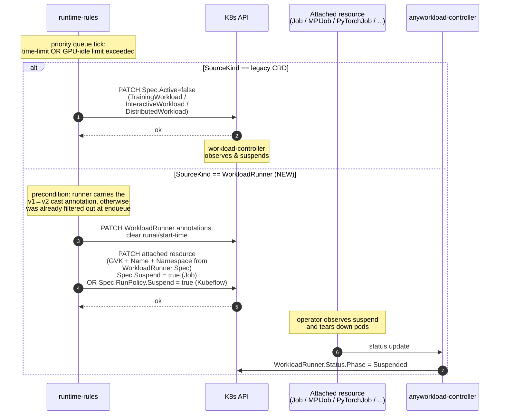
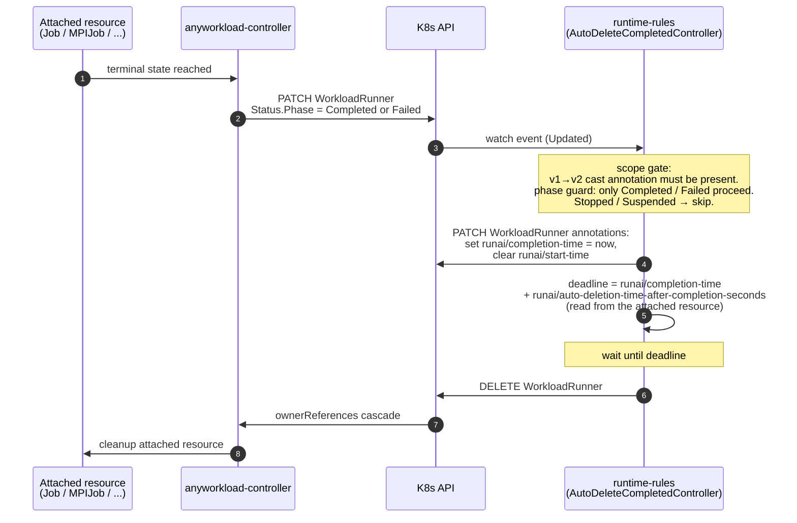

# Runtime-Rules support for WorkloadRunner-wrapped workloads

## Table of Contents
1. [Background](#1-background)
2. [Goals and Non-Goals](#2-goals-and-non-goals)
3. [Approach](#3-approach)
4. [Flows](#4-flows)
5. [Component Changes](#5-component-changes)
6. [Open Decisions](#6-open-decisions)
7. [Dependencies](#7-dependencies)
8. [Risks](#8-risks)

---

## 1. Background

The **runtime-rules** is a cluster-side controller that enforces per-project policies on running workloads:

- **Time limits**: suspends a workload after a configurable absolute duration (`TrainingJobTimeLimitSecs`, `InteractiveJobTimeLimitSecs`).
- **GPU idle timeouts**: suspends a workload after it has been GPU-idle for too long (`*JobMaxIdleDurationSecs`).
- **Auto-deletion**: deletes a workload some time after it completes (`AutoDeletionTimeAfterCompletionSeconds`).

Today the runtime-rules watches three legacy CRDs — `TrainingWorkload`, `InteractiveWorkload`, `DistributedWorkload` — and acts on them by setting `Spec.Active = false` (suspend) or calling `client.Delete` (auto-delete).

Meanwhile the **control-plane** is migrating workload submission onto the generic `WorkloadRunner` CRD (`EnableWorkloadRunner=true`, default). Under this path, every legacy v1 workload is cast by the control-plane into a `WorkloadRunner` and reconciled by `anyworkload-controller`. The wrapped `Spec.Template` is a `batch/v1.Job` (covering both Training and Interactive workloads — the category is carried on a label set by the control-plane, see §5/control-plane) or one of the distributed-training operator kinds (`MPIJob`, `PyTorchJob`, `TFJob`, `XGBoostJob`, `JAXJob`). `RunaiJob` is being retired and is not used in the new path.

**Problem**: the runtime-rules doesn't watch `WorkloadRunner`. Every workload that takes the new path silently bypasses time-limit, idle, and auto-delete enforcement.

## 2. Goals and Non-Goals

### Goals

- Re-establish parity: WorkloadRunner-wrapped workloads receive the **same** time-limit, idle, and auto-delete treatment they would have received as legacy CRDs. **In-scope wrapped Kinds: `batch/v1.Job`, `MPIJob`, `PyTorchJob`, `TFJob`, `XGBoostJob`, `JAXJob`. Other wrapped Kinds are explicitly skipped (see Non-Goals).**
- Preserve the legacy path: the three existing watches (`TrainingWorkload`, `InteractiveWorkload`, `DistributedWorkload`) keep working unchanged during the transition — they do not depend on, and are not affected by, the new WorkloadRunner path.
- Keep the runtime-rules blast radius narrow: no per-Kind container parsing, no new dependency on the submission format.
- Gate the new behavior behind a feature flag (`ENABLE_WORKLOAD_RUNNER_RULES`).

### Non-Goals

- **No expansion of supported workload kinds.** The runtime-rules governs the kinds it governs today; this change does not add Deployment / StatefulSet / KnativeService / Pod / LeaderWorkerSet. Anything outside the legacy scope is explicitly skipped.
- **No new project-spec fields.** Existing per-category limits (`Training*` / `Interactive*` / `Distributed*` use `Training*`) drive enforcement.
- **No change to legacy suspend / delete code paths.**
- **No control-plane API call from the runtime-rules.** Suspend and delete are both in-cluster K8s operations (patch on the attached resource for suspend; `client.Delete` on the runner for delete). No Karta dependency.
- **No new responsibility on `anyworkload-controller`.** Timestamp annotations are owned by the runtime-rules; GPU detection reads the attached resource directly.

## 3. Approach

The runtime-rules treats a `WorkloadRunner` as if it were one of the three legacy CRDs:

1. **Watch** `WorkloadRunner` alongside the three legacy CRDs. **Scope gate**: only runners carrying the **v1→v2 cast annotation** (stamped by the control-plane when it migrates a legacy v1 submission onto a `WorkloadRunner`) are eligible. All other runners — those born directly as v2 — are skipped end-to-end. This keeps the runtime-rules blast radius restricted to workloads that would have been governed by the legacy CRDs.
2. **Classify** each eligible runner into a category (`Training` / `Interactive` / `Distributed`) by looking at the wrapped Kind in `Spec.Template`:
   - `batch/v1.Job` → `Training` *or* `Interactive` (disambiguated by a category label set by the control-plane — see §5/control-plane).
   - Distributed-operator kinds → `Distributed`.
   - Anything else → skip.
3. **Project the runner onto the existing `JobWorkload` shape** (the unified internal type already used by the time-limit queue and the auto-delete handler) so that all downstream logic — limit comparison, idle math, completion math — runs unchanged.
4. **Diverge only at the action edges, but stay in-cluster**:
   - **Suspend** → patch the **runner's attached resource** (the wrapped `batch/v1.Job` / `MPIJob` / `PyTorchJob` / `TFJob` / `XGBoostJob` / `JAXJob`) via the Kubernetes API, flipping the operator's native suspend field (`Spec.Suspend = true` on `batch/v1.Job`; `Spec.RunPolicy.Suspend = true` on the Kubeflow kinds). The runtime-rules does **not** call the control-plane v2 API and does **not** route through Karta — it operates directly on the attached resource CR, the same way `anyworkload-controller` already does. The legacy path's K8s patch on `Spec.Active` for the three legacy CRDs is preserved unchanged.
   - **Delete** → `client.Delete` directly on the `WorkloadRunner` object. `anyworkload-controller` cascades cleanup of the attached resource via `ownerReferences`. No control-plane API call; no Karta dependency. The legacy path's direct `client.Delete` on the three legacy CRDs is preserved unchanged.
5. **Source GPU and auto-delete-after-completion signals from the runner's attached resource**, not the `WorkloadRunner` itself. The control-plane stamps both onto the attached resource at submission time:
   - GPU-presence — the same signal the runtime-rules already reads on legacy CRDs (resource requests on the pod template).
   - `runai/auto-deletion-time-after-completion-seconds` — annotation on the attached resource.

   The runtime-rules fetches the attached resource via the GVK + Name + Namespace already published on `WorkloadRunner.Spec` (the same reference `anyworkload-controller` uses to attach to it). No per-Kind container parsing in the runtime-rules — the existing legacy-CRD reader works on the attached resource unchanged because the attached resource **is** a pod-template-bearing Kind.
6. **Source run-start / completion signals from two annotations on the `WorkloadRunner` itself, maintained by the runtime-rules**:
   - `runai/start-time` — stamped when the runner first enters `Phase ∈ {Running, Degraded}`; the `runai/completion-time` annotation is cleared at the same time (so a resume after a prior `Completed`/`Failed` reset gets a fresh allowance).
   - `runai/completion-time` — stamped when the runner enters `Phase ∈ {Completed, Failed}`; the `runai/start-time` annotation is cleared at the same time (terminating the current run's enforcement window).

   The runtime-rules owns the lifecycle of both annotations — there is no `anyworkload-controller` prerequisite for the timestamp signals. See §3.1 for how this closes the suspend ↔ resume loop.

The unifying design choice: the runtime-rules stays switch-driven on a single category string. It does **not** grow polymorphism, plugin registries, or per-Kind strategy classes. The runner is just a fourth input shape converted into the existing internal type.

### 3.1 Resume semantics (closing the suspend ↔ resume loop)

The runtime-rules suspends a workload when it crosses a time-limit or GPU-idle limit. The user may resume that workload — and the runtime-rules must then treat it as a **fresh run** with a fresh allowance, not re-suspend it on the next tick because `now − creationTimestamp` is still beyond the limit.

For the three legacy CRDs this is already solved by two cooperating facts:

- `workload-controller` resets `Status.StartTime` to `nil` whenever the workload is not running, and writes a fresh `time.Now()` when the next pod starts (`workload_status_calculator.go:484` `handleStartTimeStatus`).
- The runtime-rules `WorkloadCache` (`runtime-rules/pkg/util/workload_cache.go:20`) is keyed by `JobUuid + Status.StartTime.String()` (see the comment on line 41: *"using start time to make sure we don't add the same workload twice (after resume)"*).

Same run = same key (one suspend per run). Resumed run = new `Status.StartTime` = new key (re-enqueued, fresh `elapsed = now − Status.StartTime`).

For `WorkloadRunner` we keep the same shape, but the runtime-rules itself maintains the start-time annotation rather than depending on an upstream publisher. The lifecycle is a small state machine driven by `runner.Status.Phase`:

| Observed phase transition | `runai/start-time` | `runai/completion-time` |
|---|---|---|
| → `Running` or `Degraded`, and `start-time` absent | **stamp** `now` | **clear** if present |
| → `Completed` or `Failed`, and `completion-time` absent | **clear** if present | **stamp** `now` |
| Runtime-rules' own suspend action (see §3 point 4) | **clear** | (no change) |
| Any other observation | no-op | no-op |

The cache key uses the `start-time` annotation. Three flows close the loop:

- **Failed → Resumed run** (e.g., a transient error followed by user resume). Phase goes `Failed` → `Running`; on the `Failed` transition the runtime-rules stamped `completion-time` and cleared `start-time`; on the subsequent `Running` transition `completion-time` is cleared and a fresh `start-time` is stamped. The cache key flips; the new run gets the full allowance.
- **Suspended → Resumed run** (runtime-rules-initiated time-limit or idle suspend, then user resume). The runtime-rules' own suspend action clears `start-time` at the moment it patches the attached resource. When `anyworkload-controller` reflects `Phase = Suspended`, the runtime-rules is already in the "not enforcing" state. When the user resumes (the control-plane clears `Spec.Suspend` on the attached resource), phase returns to `Running`; the runtime-rules stamps a fresh `start-time` (the annotation is absent). Cache key flips; fresh allowance.
- **Steady-state running**. Once `start-time` is present and phase stays `Running`/`Degraded`, the runtime-rules takes no annotation action. `elapsed = now − start-time` grows monotonically and the time-limit fires exactly once per run.

Why the runtime-rules owns these annotations (rather than `anyworkload-controller`): the original draft assumed an upstream publisher derived from the attached resource's own `Status.StartTime`. The current design pulls that responsibility into the runtime-rules because (a) the runtime-rules is the only consumer of the timestamps and (b) it removes a cross-team prerequisite from the rollout — no `anyworkload-controller` change is required for the timestamps.

GPU-idle is unaffected: on resume the attached resource recreates its pods, so the Prometheus idle metric also restarts from zero — same as the legacy path.

## 4. Flows

### Suspend flow (time-limit or idle-timeout fires)

The runtime-rules enforcement logic is identical for both paths until it has to act. The branch is on `WorkloadTask.SourceKind`. The new path stays entirely in-cluster — no control-plane API call, no Karta:

### Auto-delete-after-completion flow

For each terminal `WorkloadRunner`, the `AutoDeleteCompletedController` issues a direct `client.Delete` on the runner once the configured delay has elapsed. `anyworkload-controller` cascades cleanup of the attached resource via `ownerReferences`. No control-plane API call, no Karta.

## 5. Component Changes

### Runtime-rules
- Add a fourth controller watching `WorkloadRunnerList`, gated by `ENABLE_WORKLOAD_RUNNER_RULES`.
- Add a fourth dispatch arm in the auto-delete controller for the same kind.
- **Scope filter at the handler edge**: drop any runner that does not carry the **v1→v2 cast annotation**. This makes the new path opt-in per workload, not per cluster — only legacy submissions that have been migrated onto `WorkloadRunner` are governed; runners born directly as v2 are out of scope.
- Add a category inference helper (`Kind + label → category`).
- Add a conversion helper that produces a populated `JobWorkload` from a `WorkloadRunner`:
  - `StartTime` ← parse from the `runai/start-time` annotation the runtime-rules itself maintains (see §3.1).
  - `CompletionTime` ← parse from `runai/completion-time` (same).
  - `AutoDeletionTimeAfterCompletionSeconds` ← parse from the annotation on the **attached resource** (fetched via the GVK + Name + Namespace published on `WorkloadRunner.Spec`).
  - GPU-presence ← read from the attached resource's pod template, using the same logic the runtime-rules already applies to legacy CRDs.
- Add an **annotation-lifecycle helper** that, on every observed runner update, applies the state machine in §3.1: stamp/clear `runai/start-time` and `runai/completion-time` according to `Status.Phase`. The runtime-rules is the sole writer for both annotations.
- **Suspend action** — patch the attached resource directly via the K8s API:
  - `batch/v1.Job` → `Spec.Suspend = true`.
  - Kubeflow operators (`MPIJob` / `PyTorchJob` / `TFJob` / `XGBoostJob` / `JAXJob`) → `Spec.RunPolicy.Suspend = true`.

  Also clear the runner's `runai/start-time` annotation in the same reconcile pass (closes the suspend ↔ resume loop, see §3.1).
- **Delete action** — `client.Delete` directly on the `WorkloadRunner`. `anyworkload-controller` cascades cleanup of the attached resource via `ownerReferences`.
- New env config: `ENABLE_WORKLOAD_RUNNER_RULES`.
- **No** control-plane HTTP client, OAuth2 credentials, or v2 API dependency. Removed compared to the prior draft.
- New RBAC:
  - `get / list / watch / patch` on `run.ai/v1alpha1/workloadrunners` (patch needed for annotation lifecycle; delete needed for auto-delete).
  - `delete` on `run.ai/v1alpha1/workloadrunners`.
  - `get / patch` on `batch/v1/jobs`, `kubeflow.org/v1/mpijobs`, `kubeflow.org/v1/pytorchjobs`, `kubeflow.org/v1/tfjobs`, `kubeflow.org/v1/xgboostjobs`, `kubeflow.org/v1/jaxjobs` (suspend the attached resource).

### anyworkload-controller
**No change required.** The previous draft made this team a hard prerequisite (publish `GPURequested` condition, stamp the two timestamp annotations). All three responsibilities have been folded back into the runtime-rules or moved upstream onto the attached resource — `anyworkload-controller` only needs to keep doing what it already does (reflect `Status.Phase` and propagate `Spec.Suspend` to the attached resource if a downstream caller other than the user sets it).

### control-plane
- Stamp the **v1→v2 cast annotation** on every `WorkloadRunner` produced by migrating a legacy v1 submission (the only runners this design covers). Working assumption for the key: `runai/v1-cast`; final key + value vocabulary pinned in §6.
- Stamp a category label `runai/workload-category: training | interactive` on every `WorkloadRunner` whose `Spec.Template` wraps a `batch/v1.Job` — this is the only way the runtime-rules can distinguish Training from Interactive for `Job`-backed runners. The source of truth is the submission category the control-plane already holds (the same field that drove the legacy `TrainingWorkload` vs `InteractiveWorkload` CRD choice). Distributed kinds do not need the label — the wrapped Kind alone is sufficient. The exact label key + value vocabulary is pinned in §6.
- Stamp the `runai/auto-deletion-time-after-completion-seconds: "<seconds>"` annotation on the **attached resource** (not the `WorkloadRunner`) at submission time, carrying the value from the user's submission.
- Ensure the attached resource's pod template carries the GPU resource request when the user submission asked for GPUs (no change vs. today — the runtime-rules reads it the same way it reads the legacy CRDs).
- **No** v2 action endpoint required. The `WorkloadsV2ByIdAction.yaml` fragment work that the prior draft depended on is descoped from this design.

### Helm
- New env var on the `runtime-rules` deployment (`ENABLE_WORKLOAD_RUNNER_RULES`).
- Updated ClusterRole (see runtime-rules RBAC above).

## 6. Open Decisions

### v1→v2 cast annotation key

Working assumption: `runai/v1-cast` (value irrelevant — presence is the gate). The exact key needs to be pinned with the control-plane team. Until pinned, the runtime-rules treats missing-annotation runners as out-of-scope (the intended behavior) — there is no quiet failure mode here since the scope filter is the conservative direction.

### Category label key and value vocabulary

The control-plane stamps a category label on every `WorkloadRunner` wrapping a `batch/v1.Job` so the runtime-rules can distinguish Training from Interactive (Distributed kinds need no label — the wrapped Kind is enough). The exact label key (`runai/workload-category` is the working assumption) and the allowed values (`training | interactive`, or `training | workspace`) need to be pinned with the control-plane team. Until pinned, the runtime-rules treats unknown values as skip-and-increment a `runai_workloadrunner_unknown_category_total` counter (see §8 Risks).

The timestamp annotation contracts — `runai/start-time`, `runai/completion-time` — are decided and owned by the runtime-rules (see §3.1). The auto-delete annotation contract — `runai/auto-deletion-time-after-completion-seconds` on the attached resource — is decided and owned by the control-plane (see §5).

## 7. Dependencies

- **Hard prerequisite, control-plane team** (single owner for all submission-time stamping):
  - Stamp the v1→v2 cast annotation on every migrated `WorkloadRunner`.
  - Stamp the category label on every `Job`-backed `WorkloadRunner`.
  - Stamp `runai/auto-deletion-time-after-completion-seconds` on the attached resource at submission time.
  - Confirm GPU resource requests on the attached resource's pod template (this is already the case for legacy submissions — verify parity for the new path).
- **Not a prerequisite anymore**:
  - `anyworkload-controller` — no longer needs to publish `GPURequested` or stamp the timestamp annotations (runtime-rules owns the timestamps; GPU read directly from the attached resource).
  - `workloads-manager` v2 action endpoint — no longer used (suspend is a K8s patch on the attached resource; delete is `client.Delete` on the WorkloadRunner).

The runtime-rules change should land **after** the control-plane prerequisites. The feature flag (`ENABLE_WORKLOAD_RUNNER_RULES=false` by default) lets the runtime-rules code merge before activation if needed.

## 8. Risks

- **Scope-gate correctness** — if the control-plane forgets to stamp the v1→v2 cast annotation on a migrated submission, that workload silently bypasses enforcement (same failure mode as today; no regression vs. baseline). Visibility comes from a "skipped due to missing v1-cast annotation" counter alongside the category-label counter.
- **Category label correctness** — if the control-plane fails to stamp the category label on a `Job`-backed runner, the runtime-rules skips enforcement entirely. Visibility comes from a `runai_workloadrunner_unknown_category_total` counter.
- **Per-Kind suspend field drift** — suspend now requires knowing the per-Kind suspend field (`Spec.Suspend` on `batch/v1.Job`, `Spec.RunPolicy.Suspend` on Kubeflow operators). If a future Kind in scope changes its suspend contract, the runtime-rules breaks for that Kind. Mitigation: keep the table in §3 point 4 colocated with a small per-Kind suspend helper, and add a Kind-allowlist test for each entry.
- **Attached-resource read latency** — fetching the attached resource on every reconcile to read GPU presence + auto-delete annotation adds an extra API call per enforcement tick vs. the prior draft (which read everything from the WorkloadRunner). Mitigation: cache the attached resource's relevant fields on the queue task at enqueue time; the queue tick already runs at a rate well below API-server budget.
