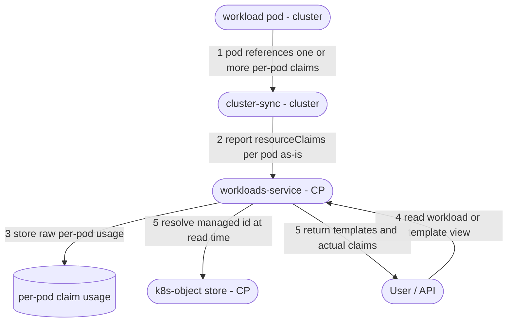

# DRA Management and Submission

## Table of Contents

[TOC]

---

## 1. Background

### Overview

Dynamic Resource Allocation (DRA) is a Kubernetes feature that lets pods request and share resources (such as GPUs and NICs) in a more flexible and expressive way than the classic `requests`/`limits` in a container's `resources` field. 

The resources are requested using either a standalone `ResourceClaim` instance that pods specify in the spec or a `ResourceClaimTemplate` instance that the pod spec references.

The key differences between the two methods:

- **Sharing**: A standalone claim can be shared by multiple pods (same physical device), while a template creates a per-pod claim that cannot be shared.
- **Lifecycle/ownership**: the template-generated claim is owned by the pod and GC'd with it.

The feature designed here serves two purposes:

* Enable the **creation and management** of `ResourceClaimTemplate` instances through the Run:ai API, UI, and CLI.
* Allow workloads (anyworkload and native) to run with `ResourceClaimTemplate` (either Run:ai-managed templates or pre-existing templates in the target namespace).

### References

| Details | Link                                                         |
| ------- | ------------------------------------------------------------ |
| PRD     | https://docs.google.com/document/d/1LPvjpdUlX2MpVl3TkUNgbwTcafRIbc7vskVNeyCexRQ/edit?tab=t.0 |
| K8s Doc | https://kubernetes.io/docs/concepts/resource-management/dynamic-resource-allocation/ |

## 2. Definition of Done

1. The `k8s-objects-tracker` keeps track of all the `ResourceClaimTemplates` in the Run:ai related namespaces (both managed and unmanaged).

2. The `k8s-objects-tracker` keeps track of `DeviceClasses` in the cluster. 🟢

3. New RBAC resource type for controlling templates access exists. 🟢

   1. Two new permission sets are introduced, following the same model as other asset types:
      1. **Edit Access** — create/update/delete templates.
      2. **View Access** — read-only access to templates.

4. Permitted users can create/update/delete/view `ResourceClaimTemplates` in the control plane. 

   

   

   1. Support only 1.34+ clusters (in which the feature is enabled by default). 🟢

   2. Spec identical to k8s spec. 🟢

   3. Creation rejected if the spec contains a `DeviceClass` that does not exist in the cluster.  

      

      

5. The `ResourceClaimTemplates` are synced to the cluster.

   

   1. In the cluster, they are replicated to all the relevant namespaces and keeps being replicated dynamically (for newly created projects, for example). 

      

   2. Removal of a `ResourceClaimTemplate` in the CP also removes it from the cluster.

   3. It is possible to remove a `ResourceClaimTemplate` even if there are running pods that use it (in k8s, the claims are detached from the template). New/rescheduled pods will fail, but this is unlikely for native workloads (CP will block this) and user responsibility on anyworkload submission.

   4. Sync/replication issues are reported to the CP.

      

6. Workloads can be submitted with reference to `ResourceClaimTemplates` (both managed and non-managed).
   1. ***Anyworkload***: as part of the spec, thus limited to any-workloads allowing `podSpec` control.

   2. ***Native workloads***: DRA field in the spec. 

      

   3. Submission is rejected if the status of the referenced `ResourceClaimTemplate` is not successful (e.g. not synced/replicated).

      

7. Usage visibility.
   1. It is possible to obtain the list of workloads currently referencing a `ResourceClaimTemplate`.
   2. It is possible to obtain the list of `ResourceClaimTemplate` and `ResourceClaims` that a workload references, with pod granularity.

### Out of Scope

1. Reacting to a `DeviceClass` that is **removed after** a template was created (reflecting a degraded / unschedulable status on the template). Creation-time validation is covered by DoD 4.3; runtime removal is out of scope for now.
1. Listing **compute assets** returns the DRA `ResourceClaimTemplate`s as well (they surface in the compute asset list alongside compute assets). No need to include the spec itself (TBD).

### Possible Additions

1. Option to convert compute asset to DRA.

## 3. Alternatives

### Assets 

**Assets** are the traditional way of managing k8s objects (PVCs, secrets, etc) from the control plane. Additionally, there are **data volumes** that the control plane syncs to the cluster which support multiple scopes, but they are not naturally integrated with the submission as assets, and their sync/replication status is not as granular as assets.

Assuming that more cluster objects are expected to be supported in the future, apart from DRA, this feature raises the question if we want to continue with assets or add a new type of control plane element. Let's call this **k8s-object**. Following the team decision, the k8s-object is **single-scope** (like assets); multi-scope support is out of scope for this design.

| Aspect | Assets Support |
| :----- | :---------------- |
| Native workload submission | 🟢 Referenced by asset ID in the `assets` block (already supported) |
| Submission UI | 🟢 Existing drag-into-workload support |
| Listing integration | 🟢 Automatically integrated into the asset lists |
| Per-scope status exposure | 🟢 Built-in via `AssetClusterStatusInfo` (per-scope issues) |
| Scope | 🟡 Single scope with hierarchical (descendant-tree) visibility |
| Spec model | 🔴 Rigid, typed spec per kind; not designed for k8s raw spec |
| Storage | 🔴 Dedicated table (+DAO) per asset kind |
| Filtering | 🔴 API using obsolete filtering mechanism |

A recommended approach would be to enhance the assets to support k8s object kind of resources. That includes:

* Adding generic spec table with single JSON column. 
* Tenant scope will not be supported.
* New APIs that adopt the modern filtering standard — see **Filtering** below (including the asset-specific scope-hierarchy expansion).

#### Filtering

Assets today use an obsolete query-string filtering mechanism. The new k8s-object APIs should adopt the platform's modern filtering standard — the `queryapi` package already used by `workloads`, `org-unit-service`, and `datavolumes-service`:

- **`filterBy`** — comma-separated predicates in the form `field<op>value`. Operators: `==`, `!=`, `<=`, `>=`, `=@` (contains), `!@` (not-contains), `=^` (starts-with), `=$` (ends-with). Multiple predicates are **AND**-ed; **OR** is expressed as `a||b` inside a single value. Companion params: `sortBy`, `sortOrder`, `offset`, `limit`, and a free-text `search`. Filterable fields are whitelisted per model.
- **RBAC** visibility (`permittedScopes`) is derived from the token and applied implicitly — it is **not** part of `filterBy`.

**Scope hierarchy (the asset-specific part).** Filtering by an exact scope is a normal predicate (e.g. `filterBy=departmentId==<id>`). Expanding to the rest of the hierarchy is done with **separate booleans**, not a filter operator — matching the existing workloads-templates precedent (`filterBy=projectId==X&includeAncestors=true`):

- `includeAncestors=true` — also return objects from ancestor scopes (department → cluster → tenant).
- `includeDescendants=true` — also return objects from descendant scopes (department → its projects).

When either flag is set, exactly one scope predicate (`projectId` / `departmentId` / `clusterId`) must be present in `filterBy`; the API strips it and expands it into the scope set — ancestors via the org-unit ancestor resolver, descendants via the org-unit department→projects expansion already used by assets.

> **Hierarchy denormalization (going forward).** Legacy assets store only the scope's own id — a **project-scoped** row leaves `departmentId` NULL, so descendant-by-department filtering needs an org-unit department→projects expansion. We will **not** migrate existing assets, but from now on the new k8s-object will **write `departmentId` (and `clusterId`) on project-scoped rows** at create (like workloads/policy). That turns `includeDescendants` into a plain `departmentId==` / `clusterId==` column predicate instead of a per-query org-unit fan-out.

```
GET /api/v1/k8s-objects/resource-claim-template
  ?filterBy=departmentId==<id>,name=@gpu-
  &includeDescendants=true
  &sortBy=createdAt&sortOrder=desc&offset=0&limit=50
```

> `filterBy` + `includeAncestors` is already in production (workloads templates); `filterBy` + `includeDescendants` would be a small addition to the standard — descendant expansion exists today only on the legacy asset / `k8s-objects-tracker` endpoints.

### Symbolic VS K8s Raw Spec

#### Comparison

Comparison between **symbolic** (Run:ai-defined) spec that we translate into k8s, or the **raw** k8s spec stored (mostly) as-is.

| Aspect                | Raw k8s spec                                                 | Symbolic spec                                                |
| :-------------------- | :----------------------------------------------------------- | :----------------------------------------------------------- |
| Version independence  | 🔴 Spec is pinned to the k8s version it was authored in       | 🟢 Version-agnostic; the concrete object is generated per cluster at apply time |
| Translation mechanism | 🟢 No translation needed                                      | 🔴 Translation layer per supported k8s version.               |
| Validation            | 🟢 Validate against the correct k8s version (much less effort) | 🔴 Validate the symbolic model, then trust the generation     |
| Expressiveness        | 🟢 Anything k8s accepts is expressible                        | 🔴 Limited to what Run:ai models; arbitrary drivers/fields are hard |
| Cluster upgrade       | 🔴 Stored spec may drift from the cluster; see below          | 🟡 A served-version change requires re-translation, but it is a deterministic automated process. |

The PRD itself pushes into raw k8s spec, which seems to be the right choice.

#### K8s Spec Variations

DRA's core (structured parameters) reached beta in 1.32 (`v1beta1`) and GA in 1.34 (`v1`); the API also changed in `v1beta2` (1.33). As we support only 1.34+ versions, we only need to work with v1, which has the following spec:

```yaml
apiVersion: resource.k8s.io/v1
kind: ResourceClaimTemplate
metadata:
  (the same)
spec:
  spec:                  
    devices:
      requests:
        - name: gpu
          exactly:                
            deviceClassName: gpu.nvidia.com
            allocationMode: ExactCount   # default, can be omitted
            count: 2
            selectors:
              - cel:
                  expression: >-
                    device.attributes['gpu.nvidia.com'].productName == 'NVIDIA H100 80GB HBM3'

```

### Sync and Replication Issues Reporting

Deciding how DRA templates report problems requires understanding how the two existing mechanisms do it today. There are **two distinct error classes**:

- **Sync issues** — the control plane fails to *apply* the object to the cluster at all (bad spec, admission rejection, create/update error). These are reported by the **agent** on its next sync.
- **Replication issues** — the object was applied to its origin namespace, but *replicating it out* to the other target namespaces (the additional scopes) partially or fully failed. These are observed on the cluster **after** apply.

A great advantage of assets (over data volumes) is **granularity**: assets expose replication issues **per scope**, while data volumes expose only a **single aggregate** status.

Assets use **two separate reporting paths**, stored in two different places:

**Path 1 — agent apply/sync failures (cluster-wide, not per-scope).**

1. `assets-service` records the desired state and the outbound sync in its `sync_status` table (per tenant/cluster/asset).
2. The **agent** polls for updates, composes the k8s object (PVC for data-source assets, Secret for credentials), and applies it — project-scoped assets go directly to the project namespace; cluster/department-scoped assets go to the `runai` namespace.
3. If the apply fails (create/update error, admission-webhook rejection), the agent captures the per-asset error and returns it in its next `ClusterSyncReport`.
4. `assets-service` stores that error on the `sync_status` row (`message`) and, on a `statusInfo=true` read, derives `status = Failed` with a **generic, cluster-wide message** (e.g. *"The data source couldn't be synchronized to the cluster"*). There is **no per-scope `issues[]`** for this path.

**Path 2 — replication / post-apply observed issues (per-scope).**

1. For cluster/department-scoped assets, `shared-objects-controller` replicates the source object from `runai` into each target project namespace. On a per-namespace failure it writes an annotation `clone.run.ai/<namespace> = "ReplicationError"` on the source object (and clears it on success).
2. `cluster-sync` watches these objects and extracts issues: it reads the `clone.run.ai/<namespace>` annotations and also detects runtime problems such as a `ClaimLost` PVC (`LostPhase`).
3. `cluster-sync` posts the object + its issues to `k8s-objects-tracker`, which maps each issue's namespace to a **scope** (`runai` → the asset's own cluster/department scope; `runai-<projectId>` → that project scope) and stores one row **per scope** in the `resource_issues` table.
4. `assets-service` reads `k8s-objects-tracker` (`/internal/api/v1/cluster-objects/status`) and exposes `AssetClusterStatusInfo` with a per-scope `issues[]` (`ReplicationError`, `LostPhase`, or the CP-inferred `NotCreated` when the object never appears). Issues are RBAC-filtered to scopes the caller can read.

> Precedence: the agent `sync_status` state takes priority — while an apply is pending/failed, that status is shown; only once the agent has processed the asset does the `k8s-objects-tracker` (per-scope) view take over.


## 4. APIs

### 4.1 Template Management APIs

#### Create a `ResourceClaimTemplate`

`POST /api/v1/k8s-objects/resource-claim-template`

```yaml
meta:
  name: two-gpus
  description: 2 x NVIDIA GPU
  scope: project
  projectId: 123
  clusterId: <cluster-uuid>
spec:
  apiVersion: resource.k8s.io/v1  ## worth keeping even if we only support v1
  objectMeta:
    annotations:
      ...
    labels:
      ...
  objectSpec:
    devices:
      requests:
        - name: gpu
          exactly:
            deviceClassName: gpu.nvidia.com
            count: 2
```

- `meta.name` — unique within scope.
- `meta.scope` — one of `project` / `department` / `cluster`, with exactly one of `projectId` / `departmentId` / `clusterId` set accordingly.
- `spec.apiVersion` — the object's API version. Kept even in a v1-only design for forward-compatibility, since future k8s versions (e.g. `v2`) may change the spec shape.
- `spec.objectSpec` — the device spec (the k8s `ResourceClaimSpec`: `devices` / `constraints` / `config`), analogous to a `podSpec`. Run:ai wraps it into the `ResourceClaimTemplate`'s `spec.spec` and sets `metadata.name` / `namespace` when it materializes the object(s) in the cluster.
- `spec.objectMeta` — allows the user to specify annotations and labels for the created `ResourceClaimTemplate`. 

#### Other endpoints (outline)

These endpoints operate on **managed** templates only (the ones created and owned through Run:ai). Unmanaged templates are not returned here — they are surfaced via the k8s-objects-tracker APIs below.

| Method & path | Purpose |
| :-- | :-- |
| `GET /api/v1/k8s-objects/resource-claim-template` | List managed templates (modern `filterBy` + `includeAncestors`/`includeDescendants` scope expansion — see §3 *Filtering*; plus `statusInfo` for per-scope status) |
| `GET /api/v1/k8s-objects/resource-claim-template/{id}` | Get a single managed template, including status and per-scope issues |
| `PUT /api/v1/k8s-objects/resource-claim-template/{id}` | Update a managed template (re-applied to all target namespaces) |
| `DELETE /api/v1/k8s-objects/resource-claim-template/{id}` | Delete a managed template (removed from all target namespaces) |
| `GET /api/v1/k8s-objects/resource-claim-template/{id}/workloads` | List workloads currently referencing the template (DoD 7.1) |

### 4.2 Template Tracking APIs (k8s-objects-tracker)

The control plane tracks **all** `ResourceClaimTemplate` instances that exist in the Run:ai-related namespaces — both managed (created through Run:ai) and unmanaged (created directly via `kubectl` in a `runai-<project>` namespace). Tracking APIs are served by `k8s-objects-tracker`.

Following the storage-class pattern (a user-facing `v2` read + an internal `v1` sync):

| Method & path | Purpose |
| :-- | :-- |
| `GET /api/v2/resource-claim-templates?clusterId=<id>` | List all tracked templates (managed + unmanaged) for a cluster; each entry carries a `managed` flag, the scope inferred from its namespace, and observed status/issues. Authorizes `read` on the `ResourceClaimTemplate` resource type |
| `POST /api/v1/resource-claim-templates/sync?clusterId=<id>` | Internal (`x-internal`) — the cluster pushes the full set of `ResourceClaimTemplate`s it observes in the Run:ai namespaces; the tracker upserts/reconciles them. Authorizes `sync` (same shape as `storage-classes/sync`) |

### 4.3 DeviceClass Tracking APIs (k8s-objects-tracker)

`DeviceClass`es are the categories of devices a `ResourceClaimTemplate` requests (via `deviceClassName`). They are **cluster-scoped** (not namespaced), **driver-defined**, and therefore vary per cluster — e.g. `gpu.nvidia.com` where the NVIDIA DRA driver is installed, or `mrdma.google.com` / `netdev.google.com` on GKE networking DRA. There is no standard set, so the control plane cannot hardcode them.

The control plane therefore tracks the `DeviceClass`es of each cluster through `k8s-objects-tracker`, exactly like `StorageClass`es (both are cluster-scoped objects). This backs:

- **DoD 2** — the tracker keeps an up-to-date list of the cluster's `DeviceClass`es.
- **DoD 4.3** — template creation is rejected when the referenced `deviceClassName` does not exist in the target cluster (validated against this list).
- UX — the user can pick a valid `deviceClassName` per cluster when authoring a template.

Following the same storage-class pattern (a user-facing `v2` read + an internal `v1` sync):

| Method & path | Purpose |
| :-- | :-- |
| `GET /api/v2/device-classes?clusterId=<id>` | List the `DeviceClass`es tracked for a cluster. Cluster-scoped, so a flat per-cluster list (no scope / per-scope issues). Authorizes `read` on the `DeviceClass` resource type |
| `POST /api/v1/device-classes/sync?clusterId=<id>` | Internal (`x-internal`) — the cluster pushes the full set of `DeviceClass`es it observes; the tracker upserts/reconciles them. Authorizes `sync` (same shape as `storage-classes/sync`) |

## 5. User Visibility

This chapter covers DoD 7 (usage visibility): the workload detail should show which `ResourceClaimTemplate` it uses and expose the actual `ResourceClaim` binding, and the template detail should list the workloads currently referencing it.

There are two ways to obtain this link:

- **CP-composed at submission** — like the way the control plane composes `environments`/connection metadata onto the workload from the submitted spec. This only exists for native workloads (anyworkloads submit a raw `podSpec` that the CP does not compose), so it cannot cover anyworkloads, which makes it irrelevant.
- **Reported from the cluster (chosen)** — `cluster-sync` reads the DRA references off the running pods and reports them to the control plane, exactly like it reports per-pod requested/allocated resources and structure `elements[]`. This covers **all** workloads (native, anyworkload, and even directly-created pods) and reflects the **actual** binding rather than the submitted intent.

### Reporting flow (cluster-sync path)

1. A pod may reference **one or more** claims in `spec.resourceClaims`. Each entry has a pod-local `name` and points to either a `ResourceClaimTemplate` (`resourceClaimTemplateName`) or a **standalone** `ResourceClaim` (`resourceClaimName`); containers opt in by listing that pod-local name under `resources.claims`.  Anyworkloads can use either form.
2. The **actual allocated `ResourceClaim`** is not in the spec — k8s publishes it in `status.resourceClaimStatuses` once bound (see example below).
3. `cluster-sync` watches pods and reads, **per pod**: from `spec.resourceClaims` the pod-local name and the template/standalone reference, and from `status.resourceClaimStatuses` the **actual bound `ResourceClaim` name**. It reports these **as-is**; it does **not** decide whether a template is managed — the pod carries no ownership information.
4. It reports the claims as a new per-pod field on `PodSyncFields` (alongside the existing per-pod resources and `elements[]`).
5. `workloads-service` stores the per-pod usage **exactly as reported** — the actual `ResourceClaim` name, plus the template name/namespace when the claim came from one. No managed/ownership resolution happens on this ingest path.
6. The **visibility APIs** resolve managed vs unmanaged (and the k8s-object id) **at read time, in the API logic** — matching template-backed claims by `(template name, namespace → scope, cluster)` against the managed k8s-object store / `k8s-objects-tracker`. This keeps the high-frequency sync/write path cheap and avoids `workloads-service` interrogating the k8s-object service on every report. Standalone claims have no template and are always unmanaged. Both the workload (forward) and template (reverse) views are served from the stored per-pod usage.



**Granularity.** Reporting is **per-pod** (the source of truth, since claims are pod-scoped in `spec.resourceClaims`), rolled up to **per-replica-type** and **workload** — consistent with the existing `environments[]` / pods model. Per-container reporting is intentionally not used: the platform exposes no per-container resource surface today, and claims are declared per-pod (only *referenced* by containers).

### What the pod exposes (example)

Take a template plus a two-container pod, where only one container consumes the claim:

```yaml
apiVersion: resource.k8s.io/v1
kind: ResourceClaimTemplate
metadata:
  name: single-gpu
  namespace: default
spec:
  spec:
    devices:
      requests:
        - name: gpu
          exactly:
            deviceClassName: gpu.nvidia.com
            count: 1
---
apiVersion: v1
kind: Pod
metadata:
  name: dra-gpu-test
  namespace: default
spec:
  restartPolicy: Never
  resourceClaims:
    - name: gpu-1                          # pod-local claim name
      resourceClaimTemplateName: single-gpu
  containers:
    - name: cuda                           # consumes the claim
      image: nvidia/cuda:12.4.0-base-ubuntu22.04
      command: ["nvidia-smi", "-L"]
      resources:
        claims:
          - name: gpu-1
    - name: ubuntu                         # does NOT consume the claim
      image: ubuntu
      command: ["sleep", "infinity"]
```

Once scheduled, the pod (trimmed to the DRA-relevant fields) looks like this — note that the **actual allocated `ResourceClaim` name only appears in `status`**:

```yaml
apiVersion: v1
kind: Pod
metadata:
  name: dra-gpu-test
  namespace: default
spec:
  nodeName: ip-10-0-143-61.ec2.internal
  resourceClaims:
    - name: gpu-1                          # pod-local name
      resourceClaimTemplateName: single-gpu   # the template it was generated from
  containers:
    - name: cuda
      resources:
        claims:
          - name: gpu-1                    # this container consumes the claim
    - name: ubuntu
      resources: {}                        # no claim
status:
  phase: Running
  resourceClaimStatuses:
    - name: gpu-1                                   # pod-local name
      resourceClaimName: dra-gpu-test-gpu-1-mk4s8   # <-- the ACTUAL allocated ResourceClaim
```

So `cluster-sync` combines two sources per pod:

- `spec.resourceClaims[]` — the pod-local `name` and the `resourceClaimTemplateName` (or `resourceClaimName` for a standalone claim), plus which containers consume it via `resources.claims`.
- `status.resourceClaimStatuses[]` — the mapping from the pod-local `name` (`gpu-1`) to the **real generated `ResourceClaim`** (`dra-gpu-test-gpu-1-mk4s8`). This binding is what the workload view exposes, and it is **not** available in the spec.

### Visibility APIs

#### Forward — a workload's DRA usage

`GET /api/v1/workloads/{workloadId}/resource-claims`

Lists the claims used by the workload, grouped per pod (a pod may use several claims). Each entry carries the actual `ResourceClaim` binding and, **when the claim was generated from a template**, the referenced template. A **standalone** `ResourceClaim` (used directly, not created from a template) appears with `template: null`.

```yaml
pods:
  - podId: 6f1c-...            # the pod using the claims
    podName: bert-worker-0
    task: worker               # replica role, when known (leader/worker/master)
    resourceClaims:
      - claimName: bert-worker-0-gpus   # the actual ResourceClaim bound to the pod
        template:                       # present only when generated from a template
          name: gpu-topology
          managed: true                 # false for unmanaged templates
          id: 3a9e-...                  # k8s-object id; null when unmanaged
      - claimName: shared-infiniband    # a standalone ResourceClaim, not created from a template
        template: null                  # no template -> standalone claim (always unmanaged)
```

#### Reverse — workloads referencing a template

`GET /api/v1/k8s-objects/resource-claim-template/{id}/workloads`

(The same endpoint already listed under §4.1.) Lists the workloads currently referencing the template, with the pods that use it. This view is **template-only** by nature: standalone `ResourceClaim`s have no template, so they never appear here — only in the workload's forward view above.

```yaml
workloads:
  - workloadId: 1b2c-...
    name: bert-training
    type: Training
    projectId: 123
    pods:
      - podName: bert-worker-0
        claimName: bert-worker-0-gpus
```

### Data model / DB changes

Because both APIs are **sub-resources served by direct queries** (like `elements`, which already rolls up per-pod resources on the fly without touching `workloads_view`), the storage change is minimal and the Postgres views are **not** affected.

The change lives entirely in `workloads-service` — the cluster side is stateless (k8s objects only). `cluster-sync` reports the per-pod DRA usage as a new field on `PodSyncFields`, so that per-pod data needs to be persisted. 

Two options, to be decided in the implementation phase:

- **`jsonb` column on the `pods` table** (e.g. `resource_claims`) — the claims are stored inline on the pod row (a GIN index supports the reverse lookup).
- **Dedicated association table** `pod_resource_claims(pod_id, workload_id, namespace, template_name, claim_name)` — one row per `(pod, claim)`, with a B-tree index on `template_name`; simpler joins/aggregation for the reverse view. `claim_name` is always set; `template_name` is **null for standalone claims** (used directly, not created from a template).

Either way, the `managed` flag and k8s-object id are **not stored** — the API logic resolves them at read time by matching `template_name` + namespace against the managed k8s-object store, keeping the write/sync path free of any cross-service lookup. For the reverse view, the API maps the template id to its `(name, namespace)` and queries by `template_name`.

No need to change the `workloads_view` as we do not have this information in the main `Workload` object.

## 6. Task Breakdown

| # | Task | Notes / references | Effort / comments |
| :-- | :-- | :-- | :-- |
| 1 | `k8s-objects-tracker` tracks `DeviceClass`es (incl. APIs) | DoD 2; §4.3 — cluster-scoped, storage-class pattern (`v2` read + `v1` sync). Precondition for DeviceClass validation. | Done |
| 2 | New asset support — management | DoD 4 (incl. 4.4); §3 (Assets), §4.1 — enhanced-assets k8s-object: generic JSON spec table, CRUD APIs. | Done |
| 3 | Modern filtering for the new asset list APIs | §3 (Filtering), §4.1 — adopt the `queryapi` `filterBy` standard; scope-hierarchy expansion via `includeAncestors`/`includeDescendants`; denormalize `departmentId`/`clusterId` onto project-scoped rows so descendants is a column predicate. | Done |
| 4 | New RBAC resource type + permission sets | DoD 3 — new `ResourceClaimTemplate` resource type with **Edit Access** and **View Access** permission sets. | Done |
| 5 | New asset support — `DeviceClass` validation | DoD 4.3 — reject creation when `deviceClassName` is absent from the cluster's tracked `DeviceClass`es. | Done |
| 6 | New asset sync + replicate | DoD 5; §3 (Sync and Replication Issues Reporting) — apply to the cluster, replicate to target namespaces, report sync/replication issues to the CP. | Done |
| 7 | `k8s-objects-tracker` tracks `ResourceClaimTemplate`s (incl. APIs) | DoD 1; §4.2 — managed + unmanaged, storage-class pattern (`v2` read + `v1` sync). | Done |
| 8 | Submission — anyworkload | DoD 6.1 — reference a template in the `podSpec`. | Done (testing only) |
| 9 | Submission — native workloads (incl. policies) | DoD 6.2 — DRA field in the native spec; wire through the composer and policy enforcement. | CP blocks deleting a template that is still referenced by native workloads (delete-in-use guard). |
| 10 | Ensure anyworkload policies model the DRA fields correctly | DoD 6.1 — policy schema/validation covers the `resourceClaims` fields for anyworkloads. | — |
| 11 | Reject submission if the referenced template is not ready | DoD 6.3 — reject when the referenced template's status is not successful (e.g. not synced/replicated). Applies to anyworkload and native. | — |
| 12 | `cluster-sync` reports DRA usage | DoD 7; §5 — read `spec.resourceClaims` + `status.resourceClaimStatuses` per pod, add to `PodSyncFields`, persist per-pod usage. | Done |
| 13 | Visibility API — workloads of a template (reverse) | DoD 7.1; §5 — `GET /api/v1/k8s-objects/resource-claim-template/{id}/workloads`. | — |
| 14 | Visibility API — templates of a workload (forward) | DoD 7.2; §5 — `GET /api/v1/workloads/{id}/resource-claims`, incl. standalone claims and the actual `ResourceClaim` binding. | — |
| 15 | UI — management + visibility screens | §1 — template CRUD + the workload/template usage views. | Need figma. |
| 16 | CLI — template management | §1 — CLI verbs for template CRUD. | Requires mini design. |

