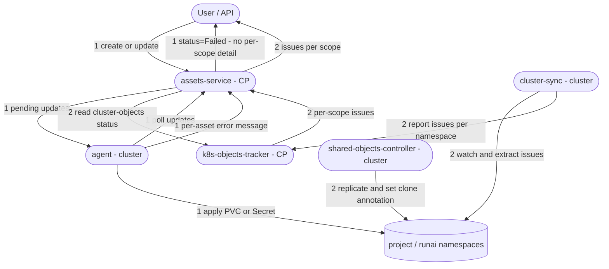
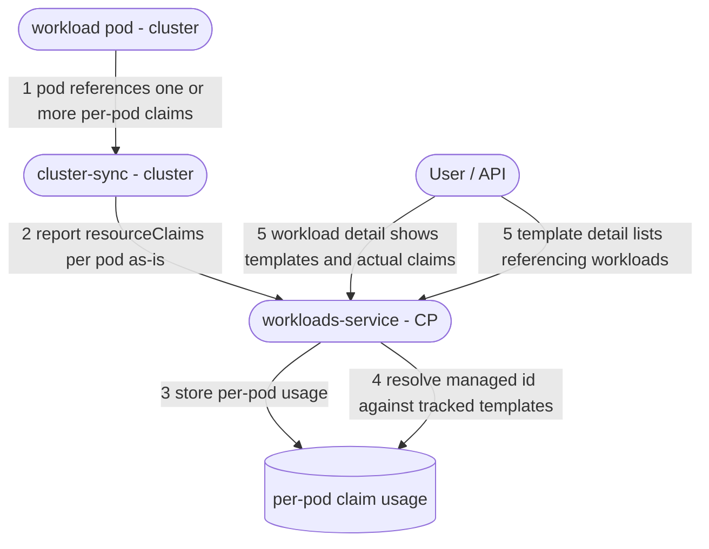

# DRA Management and Submission

## Table of Contents

[TOC]

---

## 1. Background

### Overview

Dynamic Resource Allocation (DRA) is a Kubernetes feature that lets pods request and share resources (such as GPUs and NICs) in a more flexible and expressive way than the classic `requests`/`limits` in a container's `resources` field. 

The resources are requested using either a standalone `ResourceClaim` instance that pods specify in the spec or a `ResourceClaimTemplate` instance that the pod spec references.

The key differences between the two methods:

- **Sharing**: A standalone claim can be shared by multiple pods (same physical device), while a template creates a per-pod claim that cannot be shared.
- **Lifecycle/ownership**: the template-generated claim is owned by the pod and GC'd with it.

The feature designed here serves two purposes:

* Enable the **creation and management** of `ResourceClaimTemplate` instances through the Run:ai API, UI, and CLI.
* Allow workloads (anyworkload and native) to run with `ResourceClaimTemplate` (either Run:ai-managed templates or pre-existing templates in the target namespace).

### References

| Details | Link                                                         |
| ------- | ------------------------------------------------------------ |
| PRD     | https://docs.google.com/document/d/1LPvjpdUlX2MpVl3TkUNgbwTcafRIbc7vskVNeyCexRQ/edit?tab=t.0 |
| K8s Doc | https://kubernetes.io/docs/concepts/resource-management/dynamic-resource-allocation/ |

## 2. Requirements

1. The cluster should report whether it supports DRA to the control plane as part of `ClusterConfiguration`.

   1. `ResourceClaimTemplate` creation is blocked when the cluster does not support DRA. 

   1. Workload submission referencing a template is rejected when the cluster does not support DRA.

   1. ⚠️**TBD** Only overall DRA support will be checked (not per-feature VS spec).

      

2. Users can create/update/delete/view `ResourceClaimTemplates` in the control plane. 

   1. Adopt assets to support k8s-objects.

   2. **Direction (per team decision):** target **only v1 (1.34+)**. Supporting earlier spec variations (`v1beta1`/`v1beta2`) is a stretch goal, still ⚠️**TBD**.

   3. ⚠️**TBD** Spec identical to k8s spec rather than symbolic spec translated to k8s spec. (Leaning to raw/identical, reinforced by the v1-only direction.) 

3. New RBAC resource type for controlling templates access.

   1. Two new permission sets are introduced, following the same model as other asset types:
      1. **Edit Access** — create/update/delete templates.
      2. **View Access** — read-only access to templates.

4. Sync the `ResourceClaimTemplates` to the cluster.

   

   1. In the cluster, the template is replicated to all the desired scope(s) and keep being replicated dynamically (for newly created project, for example). 

      

   2. Removal of a template in the CP also remove it from the cluster.

   3. Sync/replication issues are reported to the CP.

      

5. The `k8s-objects-tracker` should keep track of all the templates in the Run:ai related namespaces (both managed and unmanaged).

6. Workloads can be submitted with reference to a template (both managed and non-managed).
   1. ***Anyworkload***: as part of the spec, limited to any-workloads allowing `podSpec` control.
   2. ***Native workloads***: DRA field in the spec. 
   3. Submission is rejected if the status of the referenced template is not successful (e.g. not synced/replicated).

7. It is possible to remove a template even if there are running pods that use it (in k8s, the claims are detached from the template). New/rescheduled pods will fail, but this is unlikely for native workloads (CP will block this) and user responsibility on anyworkload submission.

8. Usage visibility.
   1. The template detail view shows the list of workloads currently referencing it.
   2. The workload detail view shows which template it references and exposes the associated `ResourceClaim` (the actual binding), so users can inspect the allocation.

### Out of Scope

1. *referenced `DeviceClass` does not exist* → REQ-8.2: "If the referenced `DeviceClass` does not exist in the cluster — `ResourceClaimTemplate` creation is blocked." → ⚠️ Will require us to upload device types 

### Possible Additions

1. Option to convert compute asset to DRA.

## 3. Alternatives

### Assets 

**Assets** are the traditional way of managing k8s objects (PVCs, secrets, etc) from the control plane. Additionally, there are **data volumes** that the control plane syncs to the cluster which support multiple scopes, but they are not naturally integrated with the submission as assets, and their sync/replication status is not as granular as assets.

Assuming that more cluster objects are expected to be supported in the future, apart from DRA, this feature raises the question if we want to continue with assets or add a new type of control plane element. Let's call this **k8s-object**. Following the team decision, the k8s-object is **single-scope** (like assets); multi-scope support is out of scope for this design.

| Aspect | Assets Support |
| :----- | :---------------- |
| Native workload submission | 🟢 Referenced by asset ID in the `assets` block (already supported) |
| Submission UI | 🟢 Existing drag-into-workload support |
| Listing integration | 🟢 Automatically integrated into the asset lists |
| Per-scope status exposure | 🟢 Built-in via `AssetClusterStatusInfo` (per-scope issues) |
| Scope | 🟡 Single scope with hierarchical (descendant-tree) visibility |
| Spec model | 🔴 Rigid, typed spec per kind; not designed for k8s raw spec |
| Storage | 🔴 Dedicated table (+DAO) per asset kind |
| Filtering | 🔴 API using obsolete filtering mechanism |

A recommended approach would be to enhance the assets to support k8s object kind of resources. That includes:

* Adding generic spec table with single JSON column. 
* New APIs to work with the new filtering standards.

### Symbolic VS K8s Raw Spec

#### K8s Spec Variations

DRA's core (structured parameters) reached beta in 1.32 (`v1beta1`) and GA in 1.34 (`v1`); the API also changed in `v1beta2` (1.33). The following example demonstrates the different variations. 

The following template is the v1beta1 way of requesting 2 x H100 devices:

```yaml
apiVersion: resource.k8s.io/v1beta1
kind: ResourceClaimTemplate
metadata:
  name: two-h100
  namespace: runai-<project>
spec:
  spec:
    devices:
      requests:
        - name: gpu
          deviceClassName: gpu.nvidia.com   # <- NO `exactly:` wrapper — fields are inline
          allocationMode: ExactCount
          count: 2
          selectors:
            - cel:
                expression: >-
                  device.attributes['gpu.nvidia.com'].productName == 'NVIDIA H100 80GB HBM3'
```

The same request looks different in v1:

```yaml
apiVersion: resource.k8s.io/v1
kind: ResourceClaimTemplate
metadata:
  (the same)
spec:
  spec:                  
    devices:
      requests:
        - name: gpu
          exactly:                   # <- the "single request" wrapper
            deviceClassName: gpu.nvidia.com
            allocationMode: ExactCount   # default, can be omitted
            count: 2
            selectors:
              - cel:
                  expression: >-
                    device.attributes['gpu.nvidia.com'].productName == 'NVIDIA H100 80GB HBM3'

```

Some differences:

| Nuance                                                       | v1beta1 (1.32)                 | v1beta2 (1.33)                           | v1 (1.34)                                   |
| :----------------------------------------------------------- | :----------------------------- | :--------------------------------------- | :------------------------------------------ |
| `exactly` wrapper                                            | ❌ fields inline on the request | ✅                                        | ✅                                           |
| `firstAvailable` prioritized list                            | ❌                              | ⚠️ alpha, needs `DRAPrioritizedList` gate | ✅ beta / on by default                      |
| `capacity.requests` (ask for a real memory amount, e.g. `memory: 40Gi`) | ❌                              | ❌                                        | ⚠️ alpha, needs `DRAConsumableCapacity` gate |

#### Comparison

Comparison between **symbolic** (Run:ai-defined) spec that we translate into k8s, or the **raw** k8s spec stored (mostly) as-is.

| Aspect | Raw k8s spec | Symbolic spec |
| :----- | :------------ | :----------- |
| Version independence | 🔴 Spec is pinned to the k8s version it was authored in | 🟢 Version-agnostic; the concrete object is generated per cluster at apply time |
| Translation mechanism | 🟢 No translation needed | 🔴 Translation layer per supported k8s version. |
| Validation | 🟢 Validate against the correct k8s version (much less effort) | 🔴 Validate the symbolic model, then trust the generation |
| Expressiveness | 🟢 Anything k8s accepts is expressible | 🔴 Limited to what Run:ai models; arbitrary drivers/fields are hard |
| Cluster upgrade | 🔴 Stored spec may drift from the cluster; see below | 🟡 A served-version change require re-translation, but it is a determenistic auomated process. |

#### The cluster-upgrade problem (raw spec)

The main concern with a raw spec is what happens when the cluster is upgraded to a newer k8s version.

***What k8s actually does on upgrade?***

K8s serves a resource in multiple API versions simultaneously and converts between them through an internal representation. The DRA versions (`v1beta1`/`v1beta2`/`v1`) are different *syntax of the same object* (inline fields vs the `exactly` wrapper, etc.). Objects stored in an older version are migrated lazily **on the next write** (or via an explicit storage-version migration). 

So on upgrade:

- Existing templates keep working; running pods and their claims are unaffected.
- A `GET` as `v1` returns the `exactly` shape; a `GET` as `v1beta1` (still served during the deprecation window) returns the inline shape.

***Does this create CP/cluster inconsistency?***

1. **During the deprecation window** (both versions served): if the CP stored the spec as `v1beta1` and the cluster's storage version is `v1`, they look different but mean the same. Our agent sync always applies (it doesn't run a diff), so as long as the version is still served the apiserver accepts it and converts.
2. **After the old version is removed** (k8s removes beta APIs a few releases after GA, so `v1beta1`/`v1beta2` will eventually disappear): the CP's stored old-version spec becomes **un-appliable** — the apiserver will simply reject it.

***Control plane options***

1. ***Auto-conversion*** by re-applying each outdated template on the cluster, reading back the converted object, and uploading it to the control plane (leveraging the apiserver's own conversion). This only works during a **limited window** (typically 3 versions, 9 months) until the old k8s version is removed from the cluster — and requires the system to detect an upgrade and migrate in time.
2. ***Indication*** to the user that the template needs to be fixed. Responsibility on the user to re-apply the fix.

### Sync and Replication Issues Reporting

Deciding how DRA templates report problems requires understanding how the two existing mechanisms do it today. There are **two distinct error classes**:

- **Sync issues** — the control plane fails to *apply* the object to the cluster at all (bad spec, admission rejection, create/update error). These are reported by the **agent** on its next sync.
- **Replication issues** — the object was applied to its origin namespace, but *replicating it out* to the other target namespaces (the additional scopes) partially or fully failed. These are observed on the cluster **after** apply.

A great advantage of assets (over data volumes) is **granularity**: assets expose replication issues **per scope**, while data volumes expose only a **single aggregate** status.

Assets use **two separate reporting paths**, stored in two different places:

**Path 1 — agent apply/sync failures (cluster-wide, not per-scope).**

1. `assets-service` records the desired state and the outbound sync in its `sync_status` table (per tenant/cluster/asset).
2. The **agent** polls for updates, composes the k8s object (PVC for data-source assets, Secret for credentials), and applies it — project-scoped assets go directly to the project namespace; cluster/department-scoped assets go to the `runai` namespace.
3. If the apply fails (create/update error, admission-webhook rejection), the agent captures the per-asset error and returns it in its next `ClusterSyncReport`.
4. `assets-service` stores that error on the `sync_status` row (`message`) and, on a `statusInfo=true` read, derives `status = Failed` with a **generic, cluster-wide message** (e.g. *"The data source couldn't be synchronized to the cluster"*). There is **no per-scope `issues[]`** for this path.

**Path 2 — replication / post-apply observed issues (per-scope).**

1. For cluster/department-scoped assets, `shared-objects-controller` replicates the source object from `runai` into each target project namespace. On a per-namespace failure it writes an annotation `clone.run.ai/<namespace> = "ReplicationError"` on the source object (and clears it on success).
2. `cluster-sync` watches these objects and extracts issues: it reads the `clone.run.ai/<namespace>` annotations and also detects runtime problems such as a `ClaimLost` PVC (`LostPhase`).
3. `cluster-sync` posts the object + its issues to `k8s-objects-tracker`, which maps each issue's namespace to a **scope** (`runai` → the asset's own cluster/department scope; `runai-<projectId>` → that project scope) and stores one row **per scope** in the `resource_issues` table.
4. `assets-service` reads `k8s-objects-tracker` (`/internal/api/v1/cluster-objects/status`) and exposes `AssetClusterStatusInfo` with a per-scope `issues[]` (`ReplicationError`, `LostPhase`, or the CP-inferred `NotCreated` when the object never appears). Issues are RBAC-filtered to scopes the caller can read.

> Precedence: the agent `sync_status` state takes priority — while an apply is pending/failed, that status is shown; only once the agent has processed the asset does the `k8s-objects-tracker` (per-scope) view take over.



## 4. APIs

### 4.1 Template Management APIs

> **Assumption:** the APIs below assume an **enhanced-assets** model, and a **raw** Kubernetes spec. 

#### Create a `ResourceClaimTemplate`

`POST /api/v1/k8s-objects/resource-claim-template`

```yaml
meta:
  name: gpu-nic-topology
  description: 2x H100 paired with a NIC on the same NUMA node
  scope: project
  projectId: 123
  clusterId: <cluster-uuid>
spec:
  apiVersion: resource.k8s.io/v1  ## worth keeping even if we only support v1
  objectSpec:
    devices:
      requests:
        - name: gpu
          exactly:
            deviceClassName: gpu.nvidia.com
            count: 2
```

- `meta.name` — unique within scope.
- `meta.scope` — one of `project` / `department` / `cluster`, with exactly one of `projectId` / `departmentId` / `clusterId` set accordingly.
- `spec.apiVersion` — the object's API version. Kept even in a v1-only design for forward-compatibility, since future k8s versions (e.g. `v2`) may change the spec shape.
- `spec.objectSpec` — the device spec (the k8s `ResourceClaimSpec`: `devices` / `constraints` / `config`), analogous to a `podSpec`. Run:ai wraps it into the `ResourceClaimTemplate`'s `spec.spec` and sets `metadata.name` / `namespace` when it materializes the object(s) in the cluster.
- Creation is rejected if DRA prerequisites are not met on the target cluster (feature gate disabled, or a referenced `DeviceClass` does not exist).

#### Other endpoints (outline)

These endpoints operate on **managed** templates only (the ones created and owned through Run:ai). Unmanaged templates are not returned here — they are surfaced via the k8s-objects-tracker APIs below.

| Method & path | Purpose |
| :-- | :-- |
| `GET /api/v1/k8s-objects/resource-claim-template` | List managed templates visible in a scope (supports the existing scope / `includeDescendants` / `statusInfo` query params) |
| `GET /api/v1/k8s-objects/resource-claim-template/{id}` | Get a single managed template, including status and per-scope issues |
| `PUT /api/v1/k8s-objects/resource-claim-template/{id}` | Update a managed template (re-applied to all target namespaces) |
| `DELETE /api/v1/k8s-objects/resource-claim-template/{id}` | Delete a managed template (removed from all target namespaces) |
| `GET /api/v1/k8s-objects/resource-claim-template/{id}/workloads` | List workloads currently referencing the template (REQ-7) |

### 4.2 Template Tracking APIs (k8s-objects-tracker)

The control plane tracks **all** `ResourceClaimTemplate` instances that exist in the Run:ai-related namespaces — both managed (created through Run:ai) and unmanaged (created directly via `kubectl` in a `runai-<project>` namespace). Tracking APIs are served by `k8s-objects-tracker`.

Following the storage-class pattern (a user-facing `v2` read + an internal `v1` sync):

| Method & path | Purpose |
| :-- | :-- |
| `GET /api/v1/resource-claim-templates?clusterId=<id>` | List all tracked templates (managed + unmanaged) for a cluster; each entry carries a `managed` flag, the scope inferred from its namespace, and observed status/issues. Authorizes `read` on the `ResourceClaimTemplate` resource type |
| `POST /api/v1/resource-claim-templates/sync?clusterId=<id>` | Internal (`x-internal`) — the cluster pushes the full set of `ResourceClaimTemplate`s it observes in the Run:ai namespaces; the tracker upserts/reconciles them. Authorizes `sync` (same shape as `storage-classes/sync`) |

## 5. User Visibility

This chapter covers REQ-8 (usage visibility): the workload detail should show which `ResourceClaimTemplate` it uses and expose the actual `ResourceClaim` binding, and the template detail should list the workloads currently referencing it.

There are two ways to obtain this link:

- **CP-composed at submission** — like the way the control plane composes `environments`/connection metadata onto the workload from the submitted spec. This only exists for native workloads (anyworkloads submit a raw `podSpec` that the CP does not compose), so it cannot cover anyworkloads which makes it irrelevant 
- **Reported from the cluster (chosen)** — `cluster-sync` reads the DRA references off the running pods and reports them to the control plane, exactly like it reports per-pod requested/allocated resources and structure `elements[]`. This covers **all** workloads (native, anyworkload, and even directly-created pods) and reflects the **actual** binding rather than the submitted intent.

### Reporting flow (cluster-sync path)

1. A pod may reference **one or more** per-pod `ResourceClaim`s generated from templates; for each, `spec.resourceClaims` carries the `ResourceClaimTemplate` name and the generated `ResourceClaim` name.
2. `cluster-sync` watches pods and reads `spec.resourceClaims` **per pod**. It reports each reference **as-is** (template name + generated claim name); it does **not** decide whether a template is managed — it only sees the pod, which carries no ownership information.
3. It reports the claims as a new per-pod field on `PodSyncFields` (alongside the existing per-pod resources and `elements[]`).
4. `workloads-service` stores the per-pod usage and **resolves `managed` vs unmanaged** by matching each `(template name, namespace → scope, cluster)` against the templates already tracked by `k8s-objects-tracker` / the managed k8s-object store, attaching the k8s-object id for managed ones.
5. The **visibility APIs** (below) read it back: the workload detail exposes the referenced template(s) and the actual `ResourceClaim` per pod (multiple claims per pod supported); the reverse view (template → referencing workloads) is answered from the same stored per-pod usage.



**Granularity.** Reporting is **per-pod** (the source of truth, since claims are pod-scoped in `spec.resourceClaims`), rolled up to **per-replica-type** and **workload** — consistent with the existing `environments[]` / pods model. Per-container reporting is intentionally not used: the platform exposes no per-container resource surface today, and claims are declared per-pod (only *referenced* by containers).

### Visibility APIs

> **Assumption:** both views are exposed as **dedicated sub-resources** — one under the workload (`/api/v1/workloads/{id}/...`) and one under the template (`/api/v1/k8s-objects/resource-claim-template/{id}/...`) — rather than embedded in the main `Workload` / template responses. This mirrors how the workloads service already serves `pods`, `elements`, and `endpoints` as sub-resources (each computed by direct queries, not by the main read view).

#### Forward — a workload's DRA usage

`GET /api/v1/workloads/{workloadId}/resource-claims`

Lists the claims used by the workload, grouped per pod (a pod may use several claims), each with the referenced template and the actual `ResourceClaim` binding.

```yaml
pods:
  - podId: 6f1c-...            # the pod using the claims
    podName: bert-worker-0
    task: worker               # replica role, when known (leader/worker/master)
    resourceClaims:
      - claimName: bert-worker-0-gpus   # the actual ResourceClaim bound to the pod
        template:
          name: gpu-topology
          managed: true                 # false for unmanaged templates
          id: 3a9e-...                  # k8s-object id; null when unmanaged
      - claimName: bert-worker-0-nic
        template:
          name: fast-nic
          managed: false
          id: null
```

#### Reverse — workloads referencing a template

`GET /api/v1/k8s-objects/resource-claim-template/{id}/workloads`

(The same endpoint already listed under §4.1.) Lists the workloads currently referencing the template, with the pods that use it.

```yaml
workloads:
  - workloadId: 1b2c-...
    name: bert-training
    type: Training
    projectId: 123
    pods:
      - podName: bert-worker-0
        claimName: bert-worker-0-gpus
```

### Data model / DB changes

Because both APIs are **sub-resources served by direct queries** (like `elements`, which already rolls up per-pod resources on the fly without touching `workloads_view`), the storage change is minimal and the Postgres views are **not** affected.

The change lives entirely in `workloads-service` — the cluster side is stateless (k8s objects only). `cluster-sync` reports the per-pod DRA usage as a new field on `PodSyncFields`, so that per-pod data needs to be persisted. Two options:

- **`jsonb` column on the `pods` table** (e.g. `resource_claims`) — cheapest, but the reverse lookup (template → workloads) becomes a `jsonb` scan.
- **Dedicated association table** `pod_resource_claims(pod_id, workload_id, namespace, template_name, template_id/managed, claim_name)` — indexable, which makes both the forward and reverse queries (and any per-replica-type roll-up) efficient. One row per `(pod, claim)`, so a pod with multiple claims is simply multiple rows.

A `workloads_view` change would be needed **only** if we later decide to embed a claim summary directly on the main `Workload` object — which the sub-resource approach above deliberately avoids.

