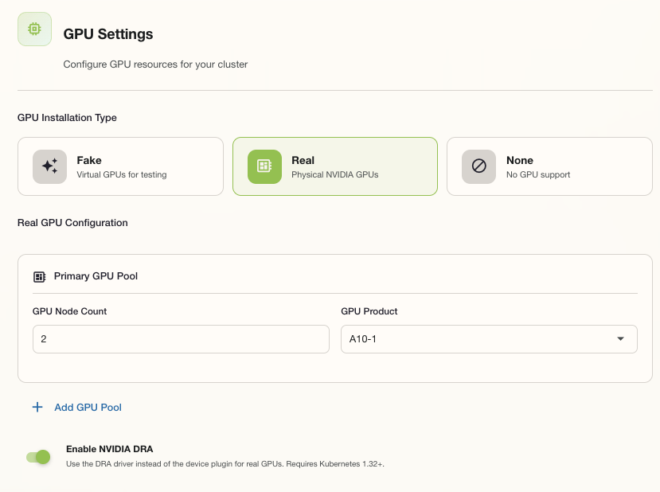

# EKS DRA GPU — Testing Runbook

A repeatable setup for exercising Dynamic Resource Allocation (DRA) with NVIDIA
GPUs on an EKS cluster, used to validate the behavior described in
[`dra-basic-support.md`](dra-basic-support.md).

## Provisioning the cluster (Argo)

This environment was provisioned through **Argo**. In **GPU Settings**:

- **GPU Installation Type:** `Real` (Physical NVIDIA GPUs).
- **Primary GPU Pool:** `GPU Node Count = 2`, `GPU Product = A10-1`.
- **Enable NVIDIA DRA:** toggle **on** — this deploys the NVIDIA DRA driver
  instead of the device plugin for real GPUs.

With the DRA toggle on, Argo brings up the NVIDIA DRA driver and the
`gpu.nvidia.com` DeviceClass as part of provisioning, so the manual Helm
install in step 2 below is normally **not** needed — keep it only as a fallback
if you provisioned without the flag (or need to change `nvidiaDriverRoot` /
overrides).

> The toggle notes "Requires Kubernetes 1.32+", which is when DRA reached beta.
> The design here targets the GA `resource.k8s.io/v1` API, so use **1.34+**
> (validated on 1.35).



## Prerequisites (once per cluster)

- **EKS ≥ 1.34** so DRA is GA at `resource.k8s.io/v1` (validated on 1.35).
- A **GPU node group** (e.g. `g5`/`g6`) using the **EKS accelerated AMI**,
  which ships the NVIDIA driver on the host filesystem.
- **NVIDIA GPU Operator** installed. If a fresh cluster doesn't have it:

  ```bash
  helm repo add nvidia https://helm.ngc.nvidia.com/nvidia && helm repo update
  helm install --wait gpu-operator nvidia/gpu-operator \
    -n gpu-operator --create-namespace \
    --set driver.enabled=false          # AMI already provides the host driver
  ```

## 1. Sanity checks

```bash
kubectl api-resources --api-group=resource.k8s.io        # expect v1 (deviceclasses, resourceclaims, resourceslices)
kubectl get nodes -L node.kubernetes.io/instance-type    # confirm GPU instances are Ready
```

## 2. Install the DRA driver (the command that "just works" on EKS)

```bash
helm repo add nvidia https://helm.ngc.nvidia.com/nvidia && helm repo update
helm install nvidia-dra-driver-gpu nvidia/nvidia-dra-driver-gpu \
  -n nvidia-dra-driver-gpu --create-namespace \
  --set resources.gpus.enabled=true \
  --set gpuResourcesEnabledOverride=true
```

## 3. Verify it is healthy (no init loop)

```bash
kubectl -n nvidia-dra-driver-gpu get pods -o wide        # kubelet-plugin pods -> 2/2 Running on each GPU node
kubectl get deviceclasses.resource.k8s.io                # gpu.nvidia.com present
kubectl get resourceslices.resource.k8s.io               # one gpu.nvidia.com slice per GPU node
```

## 4. Smoke test — `dra-test.yaml`

```yaml
apiVersion: resource.k8s.io/v1
kind: ResourceClaimTemplate
metadata: { name: single-gpu, namespace: default }
spec:
  spec:
    devices:
      requests:
        - name: gpu
          exactly: { deviceClassName: gpu.nvidia.com, count: 1 }
---
apiVersion: v1
kind: Pod
metadata: { name: dra-gpu-test, namespace: default }
spec:
  restartPolicy: Never
  tolerations:
    - { key: nvidia.com/gpu, operator: Exists, effect: NoSchedule }
  resourceClaims:
    - { name: gpu, resourceClaimTemplateName: single-gpu }
  containers:
    - name: cuda
      image: nvidia/cuda:12.4.0-base-ubuntu22.04
      command: ["nvidia-smi", "-L"]
      resources:
        claims: [{ name: gpu }]
```

```bash
kubectl apply -f dra-test.yaml
kubectl get resourceclaims.resource.k8s.io -w      # pending -> allocated
kubectl logs dra-gpu-test                          # e.g. GPU 0: NVIDIA A10G ...
```

