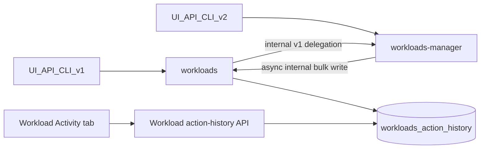

# Per-workload action history plan

## Overview

This plan adds a workload-scoped Activity history showing who submitted an accepted create, update, delete, suspend, or resume action and when it was accepted. It intentionally does not record changed fields or the eventual asynchronous cluster outcome.

- `workloads` owns the action-history table and the workload-authorized read/write APIs.
- Public v1 actions are recorded directly by `workloads`; direct v2/YAML and NIM actions are forwarded asynchronously by `workloads-manager`.
- A new paginated `GET /api/v1/workloads/{workloadId}/actions` endpoint supplies the UI, while an internal bulk endpoint accepts manager-produced records.
- [Next Phase] A separate workload `Activity` tab displays only date/time, action, and subject, keeping Kubernetes Event history unchanged.
- Tenant, cluster, and orphan cleanup bound storage while retaining actions for soft-deleted workloads.

## Architecture decision

- Store records in a dedicated `workloads_action_history` (should it be just "actions"/"actions_history" since it is already in the workloads schema) table owned by `[control-plane/workloads](control-plane/workloads)`. This service already owns canonical workload identity and the workload-scoped history APIs used by the drawer. Keeping the read model here avoids joining v1 data with the manager queue and keeps workload authorization on the existing `workloads/read` resource. The plural `workloads_*_history` name follows the existing `workloads_phase_history` convention.  
*** Why not adding a json/array column in the workloads table? ***
- Do not store these rows in `[control-plane/workloads-manager](control-plane/workloads-manager)`. Its `workloads_queue` database is an orchestration/agent-sync store, direct v1 workloads may never enter it, and making it the history owner would split v1/v2 reads and couple the UI to queue retention.
- Do not use `[control-plane/audit-service](control-plane/audit-service)`. It is a platform-wide administrative audit/export surface with separate `events-history` authorization and TTL semantics. The requested Activity tab is workload-scoped, available to workload readers, and deliberately narrower than an administrative audit log.
- Keep the table separate from `events` and `workloads_phase_history`: those are Kubernetes events and phase transitions, while the new rows are accepted user commands.
- Treat workloads and workloads-manager as two public command entry points. V1 typed/native and bulk APIs enter workloads; direct v2/YAML and NIM APIs enter workloads-manager. Both must produce records because direct v2 update/delete/run-state calls do not converge on workloads.




## Data model and storage

- Add a paired migration using the next available workloads sequence under `[pkg/database/migrations/up](control-plane/workloads/pkg/database/migrations/up)` and `[pkg/database/migrations/down](control-plane/workloads/pkg/database/migrations/down)`, currently expected to be `03000006_workloads_action_history.up.sql` and `.down.sql`. Both files carry the repository SPDX header and use `IF EXISTS`/`IF NOT EXISTS`, matching current migrations.
- Use `uuid`, `bigint`, `varchar`, and `timestamp with time zone`, plus `idx_*` index names. Validate action values in OpenAPI/service code instead of introducing a SQL `CHECK`, which is not used by the workloads migrations.
- Include `cluster_id` only for lifecycle cleanup. It is not returned to the Activity UI, but lets `HandleClusterDeleteRequest` remove rows efficiently after a cluster is removed. Add a second `(tenant_id, cluster_id)` cleanup index.
- Keep no foreign key to `workloads`: a direct v2 create action may reach workloads before manager’s asynchronous workload-creation notification, so a foreign key would make valid action inserts race and fail. `workload_name` is a write-time snapshot so soft-deleted workloads still have a label.
- Insert with `ON CONFLICT DO NOTHING` on the caller-generated UUID, matching Kubernetes event ingestion. The same ID is reused when manager-to-workloads delivery retries; external API retries are separate accepted commands and are not deduplicated by trace ID.
- Implement a GORM model in `[pkg/database/models](control-plane/workloads/pkg/database/models)` and DAO methods alongside `[events_dao.go](control-plane/workloads/pkg/database/dao/events_dao.go)`. Reads always bind tenant and workload ID, call the existing `setDefaultLimit` (default 50, maximum 500), and order by `created_at DESC, id DESC`.
- Add explicit `DbDeleteWorkloadActionHistoryOfTenantId` and `DbDeleteWorkloadActionHistoryOfClusterId` DAO methods. Call them from `[HandleTenantDeleteRequest` and `HandleClusterDeleteRequest](control-plane/workloads/pkg/common/common.go)` beside the existing event cleanup. Project deletion does not currently purge workload events, so do not introduce project-specific action cleanup.
- Extend `[pkg/database/cleaner.go](control-plane/workloads/pkg/database/cleaner.go)` with an orphan-action query parallel to `eventsDeleteQuery`: remove action rows only when no canonical workload row exists and the row is older than `CreatingWorkloadsMinutesToLive`. The grace period prevents the cleaner racing manager’s asynchronous create notification, while still bounding storage after workloads are hard-deleted.

Cleaner query shape:

```sql
DELETE FROM workloads_action_history AS action_history
WHERE action_history.created_at < NOW() - INTERVAL '60' MINUTE
  AND NOT EXISTS (
    SELECT 1
    FROM workloads
    WHERE workloads.id = action_history.workload_id
);
```

The implementation formats the interval from `DBCleanerConfig.CreatingWorkloadsMinutesToLive`; `60` above is its current default.

Example up migration:

```sql
-- SPDX-FileCopyrightText: Copyright (c) 2026 NVIDIA CORPORATION & AFFILIATES. All rights reserved.
-- SPDX-License-Identifier: Apache-2.0

CREATE TABLE IF NOT EXISTS workloads_action_history (
    id            uuid PRIMARY KEY,
    tenant_id     bigint NOT NULL,
    cluster_id    uuid NOT NULL,
    workload_id   uuid NOT NULL,
    subject       varchar NOT NULL,
    subject_type  varchar NOT NULL,
    action        varchar NOT NULL,
    created_at    timestamp with time zone NOT NULL
);

CREATE INDEX IF NOT EXISTS idx_workloads_action_history_tenant_workload_created_at
    ON workloads_action_history (tenant_id, workload_id, created_at DESC, id DESC);

CREATE INDEX IF NOT EXISTS idx_workloads_action_history_tenant_cluster
    ON workloads_action_history (tenant_id, cluster_id);
```

Example down migration:

```sql
-- SPDX-FileCopyrightText: Copyright (c) 2026 NVIDIA CORPORATION & AFFILIATES. All rights reserved.
-- SPDX-License-Identifier: Apache-2.0

DROP INDEX IF EXISTS idx_workloads_action_history_tenant_cluster;
DROP INDEX IF EXISTS idx_workloads_action_history_tenant_workload_created_at;
DROP TABLE IF EXISTS workloads_action_history;
```

## Decision rationale

- **Dedicated table instead of extending `events`:** cluster events have Kubernetes-specific fields and idempotency keys; mixing user commands into them would complicate existing history queries and filters.
- **Workloads ownership:** it is the canonical workload read service for active and deleted workloads and already enforces workload-scoped authorization. Manager remains a producer because it owns direct v2 acceptance, not the tenant-facing history.
- **No audit-service dependency:** this feature is visible to workload readers and follows workload lifetime/navigation. Audit-service targets administrative, cross-resource audit/export use cases and would impose unrelated permission and retention behavior.
- **Asynchronous manager delivery:** an accepted workload command must not fail because its informational history write is unavailable. Bounded retry plus idempotent IDs follows the existing manager-to-workloads notification pattern; final failures are observable through logs/metrics.
- **Bulk internal write:** v1 batches can contain many workloads. One bounded request avoids per-row HTTP overhead while preserving one history row per workload.
- **Offset pagination:** it matches the existing workload event/history contract and generated UI clients. The composite index keeps the expected per-workload history size efficient without introducing a second cursor convention.
- **No workload foreign key:** manager action delivery can precede creation of the canonical workloads row. Explicit tenant/cluster cleanup plus the orphan cleaner avoids insertion races and unbounded orphan data while preserving history for soft-deleted workloads.

## Producer coverage and deduplication

- In `[control-plane/workloads/pkg/services_crud](control-plane/workloads/pkg/services_crud)`, record accepted v1 create/delete operations for workspace, training, distributed, inference, and distributed inference; inference/distributed-inference updates; workspace/training/distributed suspend/resume; and each successful item from `batch_workloads`. Capture `subject` and `subject_type` from `runaictx`, never request input.
- Keep the existing internal delegation: v1 any-workload create/update already uses manager’s `/internal/v2/workloads` family, and v1 bulk operations use `/internal/workloads/batch`. Workloads records those original public v1 actions; manager must not record its internal handling.
- In `[control-plane/workloads-manager/pkg/services](control-plane/workloads-manager/pkg/services)`, record direct public v2/YAML create/update/delete/run-state and NIM create/update after the manager DB accepts the command. Place the hook at the implementation layer so in-process NIM calls are covered. Pass an explicit `recordAction`/origin option so `TranslatedFromV1`, `skipAuth`, and `ProcessBatch` paths cannot duplicate v1 records.
- Map direct run-state values to `suspend`/`resume`. A manifest PUT remains `update`, even if its contents indirectly affect run state.
- Add an async bulk method to `[workloads-manager/pkg/clients/workloads](control-plane/workloads-manager/pkg/clients/workloads)` using the generated workloads client and the existing create-notification context/header/backoff pattern. Copy the user context before detaching it, retry with the same record UUIDs, and emit a metric/log after final failure. History delivery must not fail or roll back an accepted workload operation.
- Do not record internal workload creation/patch notifications, connection-metadata fallback, manager `ProcessBatch`, agent updates, cluster sync/reporting, watchdog changes, or pub/sub cleanup. They are implementation/runtime effects, not new user commands.
- A batch creates one row per accepted workload ID and none for synchronously rejected IDs. The existing generic-batch transport-error path can theoretically apply a manager change without reporting acceptance; call this out as a known coverage risk rather than writing an uncertain history row.
- Use small service-local recorder interfaces for tests. Keep transport types in the workloads OpenAPI/generated client rather than workloads-and-policies.

## Workload-scoped read API

- Add `GET /api/v1/workloads/{workloadId}/actions` in `[swagger/source/openapi.yaml](control-plane/workloads/swagger/source/openapi.yaml)`, authorized as `workloads/read` with `workloadId` as the resource ID. Derive tenant from `runaictx` and do not require a live workload row, so soft-deleted workload history remains readable.
- Return `id`, `workloadId`, `workloadName`, `subject`, `subjectType`, `action`, and `createdAt`. Use existing `offset`, `limit` (default 50, maximum 500), and optional `next` conventions. Do not expose cluster ID or accept tenant/subject filters.
- Add internal `POST /internal/workloads/actions` with at most 500 items. The body carries record/workload/cluster identity, action, and acceptance time; workloads derives tenant, subject, and subject type from forwarded context. Stable IDs make retries idempotent.
- Reuse the existing `Events` OpenAPI tag so generation places methods on `EventsAPIServicer`/`EventsApi` and no new Redoc tag registration is needed. Name the model `WorkloadActionRecord` to avoid collision with manager’s existing `WorkloadAction` suspend/resume enum.
- Register public schemas in `[swagger/source/schemas/_index.yaml](control-plane/workloads/swagger/source/schemas/_index.yaml)`, add `x-test-coverage`, and regenerate workloads server/client plus the checked-in frontend client through the service Makefile.

Example path wiring in `swagger/source/openapi.yaml`:

```yaml
paths:
  /api/v1/workloads/{workloadId}/actions:
    $ref: "./resources/WorkloadActions.yaml"

  /internal/workloads/actions:
    $ref: "./resources/InternalWorkloadActions.yaml"
```

Example public read resource:

```yaml
get:
  summary: Get workload action history
  description: Returns user actions accepted for a workload.
  operationId: get_workload_actions
  x-service: workloads
  x-test-coverage:
    - control-plane/workloads/pkg/services/events_api_test.go
  x-authorize:
    resource-type: workloads
    action: read
    id: workloadId
  tags:
    - Events
  parameters:
    - $ref: "../../../../infra/openapi/docs/parameters/path/WorkloadId.yaml"
    - $ref: "../../../../infra/openapi/docs/parameters/query/optional/Offset.yaml"
    - $ref: "../../../../infra/openapi/docs/parameters/query/optional/Limit.yaml"
  responses:
    200:
      description: Executed successfully.
      content:
        application/json:
          schema:
            $ref: "../schemas/Events/GetWorkloadActionsResponse.yaml"
    401:
      $ref: "../../../../infra/openapi/docs/responses/401Unauthorized.yaml"
    403:
      $ref: "../../../../infra/openapi/docs/responses/403Forbidden.yaml"
    404:
      $ref: "../../../../infra/openapi/docs/responses/404NotFound.yaml"
    500:
      $ref: "../../../../infra/openapi/docs/responses/500InternalServerError.yaml"
    503:
      $ref: "../../../../infra/openapi/docs/responses/503ServiceUnavailable.yaml"
```

Example internal bulk-write resource:

```yaml
post:
  summary: Store workload actions
  description: Stores accepted workload actions produced by workloads-manager.
  operationId: internal_create_workload_actions
  x-service: workloads
  x-internal: true
  x-no-authorization: true
  x-test-coverage:
    - control-plane/workloads/pkg/services/events_api_test.go
  tags:
    - Events
  requestBody:
    required: true
    content:
      application/json:
        schema:
          $ref: "../schemas/Events/CreateWorkloadActionsRequest.yaml"
  responses:
    204:
      description: Actions stored successfully.
    400:
      $ref: "../../../../infra/openapi/docs/responses/400BadRequest.yaml"
    500:
      $ref: "../../../../infra/openapi/docs/responses/500InternalServerError.yaml"
    503:
      $ref: "../../../../infra/openapi/docs/responses/503ServiceUnavailable.yaml"
```

Example schemas:

```yaml
# schemas/Events/WorkloadActionType.yaml
type: string
enum:
  - create
  - update
  - delete
  - suspend
  - resume

---
# schemas/Events/WorkloadActionRecord.yaml
type: object
required:
  - id
  - workloadId
  - workloadName
  - subject
  - subjectType
  - action
  - createdAt
properties:
  id:
    type: string
    format: uuid
  workloadId:
    type: string
    format: uuid
  workloadName:
    type: string
  subject:
    type: string
  action:
    $ref: "./WorkloadActionType.yaml"
  createdAt:
    type: string
    format: date-time

---
# schemas/Events/GetWorkloadActionsResponse.yaml
type: object
required:
  - actions
properties:
  next:
    type: integer
    format: int32
    example: 50
  actions:
    type: array
    items:
      $ref: "./WorkloadActionRecord.yaml"

---
# schemas/Events/CreateWorkloadActionsRequest.yaml
type: object
required:
  - actions
properties:
  actions:
    type: array
    minItems: 1
    maxItems: 500
    items:
      $ref: "./WorkloadActionRecordInput.yaml"

---
# schemas/Events/WorkloadActionRecordInput.yaml
type: object
required:
  - id
  - clusterId
  - workloadId
  - workloadName
  - action
  - createdAt
properties:
  id:
    type: string
    format: uuid
  clusterId:
    type: string
    format: uuid
  workloadId:
    type: string
    format: uuid
  action:
    $ref: "./WorkloadActionType.yaml"
  createdAt:
    type: string
    format: date-time
```

The internal payload deliberately omits tenant, subject, and subject type; workloads derives them from the forwarded authenticated context.

## UI

- Add a separate `Activity` tab beside Event history in `[workload-drawer-content.vue](control-plane/frontend/src/components/workload/workload-drawer-content/workload-drawer-content.vue)` and mirror it in `[workload-structure.vue](control-plane/frontend/src/views/workload/workload-structure/workload-structure.vue)`. Separation is intentional: Event history remains Kubernetes events/phase transitions, while Activity contains user commands.
- Use the tab literal `"activity"` in `EWorkloadDrawerTabs`/`TWorkloadDrawerTab`, and extend deep-link handling in `[workload.model.ts](control-plane/frontend/src/models/workload.model.ts)` and `[use-workload-drawer-navigation.composable.ts](control-plane/frontend/src/composables/use-workload-drawer-navigation.composable.ts)`.
- Add `getWorkloadActions(workloadId, offset, limit)` to `[workload.service.ts](control-plane/frontend/src/services/cluster/workload.service/workload.service.ts)`, calling the generated `workloadServiceApi.eventsApi.getWorkloadActions`. This intentionally improves on the legacy Event history raw-URL call and keeps the new API typed.
- Build the tab under `[workload-drawer-content/tabs](control-plane/frontend/src/components/workload/workload-drawer-content/tabs)` with Run:ai table wrappers, loader/error/empty states, and server-side pagination. Keep page rows and `next` in the workload Pinia store; do not load and filter the entire history client-side.
- Display only `Date & time`, `Action`, and `Performed by`. Use existing user-display formatting for `subject`; retain `subjectType` in the API model for service-account handling but do not add another column.
- Add `EIntervalLabels.WorkloadActivityTab` and refresh using the existing workload-history interval behavior without replacing rows during background refresh. The tab is workload-level only and follows the existing element-empty-state behavior.
- Make Activity available under normal `workloads/read` access, including deleted-workload drawers. Verify authorization does not require the live workload row; an empty action list returns successfully rather than proving the workload exists.

## Verification

- Workloads migration/DAO/API tests: up/down migration behavior, tenant/workload isolation, deterministic pagination, duplicate IDs, tenant/cluster/orphan cleanup, soft-deleted-workload lookup, bounded bulk writes, and workload-read authorization.
- Workloads lifecycle tests: each accepted v1 create/update/delete/suspend/resume path records the correct workload and subject; native and delegated modes emit exactly once; mixed batch responses create rows only for accepted IDs.
- Workloads-manager tests: direct v2 and in-process NIM paths send one explicit action; retries reuse event IDs; `TranslatedFromV1`, `ProcessBatch`, internal notify/patch, agent update, and sync paths send none.
- Frontend tests: tab visibility/deep links, loading/error/empty states, server pagination, deleted workloads, and rendering only subject/action/time.
- Run `make build test lint validate` in workloads and workloads-manager, regenerate OpenAPI artifacts through their Makefiles, then run frontend build/typecheck/unit/lint targets. Add targeted e2e coverage for UI/API/CLI v1 and direct v2 create/update/delete/suspend/resume flows.

