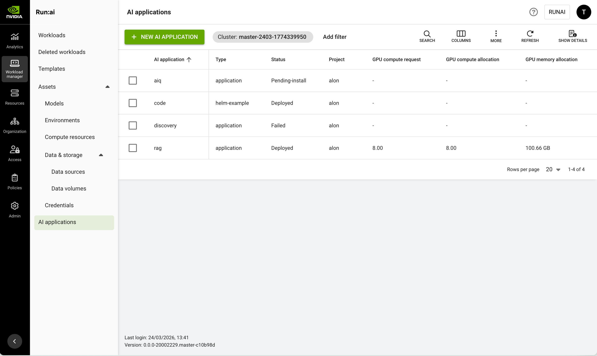

# AI Applications

This guide explains the procedure for managing AI applications.

## AI Applications Table

The AI applications table can be found under **Workload manager** in the NVIDIA Run:ai platform.

The AI applications table provides a list of all the AI applications scheduled on the NVIDIA Run:ai [Scheduler](../platform-management/runai-scheduler/scheduling/concepts-and-principles.md), and allows you to manage them.

<figure><figcaption></figcaption></figure>

The AI applications table consists of the following columns:

| Column                 | Description                                                                                     |
| ---------------------- | ----------------------------------------------------------------------------------------------- |
| AI application         | The name of the AI application                                                                  |
| Type                   | The name of the Helm chart                                                                      |
| Status                 | The different [phases](ai-applications.md#ai-application-status) in an AI application lifecycle |
| Project                | The project in which the AI application runs                                                    |
| GPU compute request    | Amount of GPU devices requested                                                                 |
| GPU compute allocation | Amount of GPU devices allocated                                                                 |
| GPU memory request     | Amount of GPU memory Requested                                                                  |
| GPU memory allocation  | Amount of GPU memory allocated                                                                  |
| CPU compute request    | Amount of CPU cores requested                                                                   |
| CPU compute allocation | Amount of CPU cores allocated                                                                   |
| CPU memory request     | Amount of CPU memory requested                                                                  |
| CPU memory allocation  | Amount of CPU memory allocated                                                                  |

### Connections Associated with the AI Application

A connection refers to the method by which you can access and interact with the AI application's running workloads. It is essentially the "doorway" through which you can reach and use the services the application provides.

Click one of the values in the **Connection(s)** column to view the list of connections and their parameters. Connections are network interfaces that communicate with the workloads running inside the AI application. A connection is either the URL the application exposes or the IP and port of the node the workload is running on.

| Column          | Description                                                                |
| --------------- | -------------------------------------------------------------------------- |
| Name            | The name of the application running on the workload                        |
| Connection type | The network connection type selected for the workload                      |
| Access          | Who is authorized to use this connection (everyone, specific groups/users) |
| Port            | The port on the node through which the workload is accessible              |
| Address         | The connection URL                                                         |
| Copy button     | Copy URL to clipboard                                                      |
| Connect button  | Enabled only for supported tools                                           |

### AI Application Status

The AI application status in NVIDIA Run:ai reflects the underlying **Helm release status**.

NVIDIA Run:ai surfaces the Helm chart state as-is and maps it to the AI application lifecycle. For a complete description of Helm release states, see the [Helm ](https://helm.sh/docs/helm/helm_status/)documentation.

### Customizing the Table View

* Filter - Click ADD FILTER, select the column to filter by, and enter the filter values
* Search - Click SEARCH and type the value to search by
* Sort - Click each column header to sort by
* Column selection - Click COLUMNS and select the columns to display in the table
* Download table - Click MORE and then Click Download as CSV. Export to CSV is limited to 20,000 rows.
* Refresh - Click REFRESH to update the table with the latest data
* Show/Hide details - Click to view additional information on the selected row

### Show/Hide Details

Click a row in the AI applications table and then click **SHOW DETAILS** at the upper-right of the action bar to open the details pane.

The details pane displays a diagram of the AI application's structure. Each workload in the AI application appears in its own group, connected to the endpoints and Kubernetes resources it uses:

* **Workload** - The workload, with a status indicator (Running, Pending, Failed, and so on)
* **Endpoint** - A network endpoint the workload exposes
* **Secret** - A Kubernetes Secret the workload references
* **PVC** - A PersistentVolumeClaim the workload references
* **ConfigMap** - A Kubernetes ConfigMap the workload references

A legend in the upper-left corner of the diagram identifies each node type. Use the **Type** filter or the search box above the diagram to filter nodes by type or name.

Click a workload node to expand it and view its GPU compute allocation, GPU memory allocation, CPU compute allocation, and CPU memory allocation. The expanded view includes a link to open the workload in the Workloads table.

Use the zoom and pan controls, or the minimap, to navigate the diagram.

## Creating an AI Application

<Note>

**Note**

AI application submission is enabled by default. If you do not see it in the menu, contact your administrator to enable it under **General settings** → Workloads → AI application submission.

</Note>

1. To create an AI application, go to Workload manager → AI applications.
2. Click **+ NEW AI APPLICATION**
3. Within the new form, select the **cluster** and **project**. To create a new project, click **+NEW PROJECT** and refer to [Projects](../platform-management/aiinitiatives/organization/projects.md) for a step-by-step guide.
4. Enter a unique **name** for the AI application. If the name already exists in the project, you will be requested to submit a different name.
5. Under **Source**, select the AI application source:
   * **NGC catalog** - GPU-optimized containers, pre-trained models, and Helm charts pulled from the NVIDIA GPU Cloud (NGC). Recommended for standard NVIDIA-certified AI stacks and enterprise-ready models:
     * Select a **Repository** from the dropdown menu. Repositories can be public or private.
     * If the selected repository is private, a **Set repository credentials** section appears. Select an existing [NGC API key](../workloads-in-nvidia-run-ai/workload-assets/credentials.md) credential or create a new one. The credential is used to authenticate with the private repository and browse its charts.
     * Select or type a **Chart name** from the available charts in the selected repository.
     * Select the **Chart version** to deploy. To browse available charts, click **View on NGC catalog**.
   * **Custom URL** - Provide a link to a Helm chart hosted on a private or public repository (for example, GitHub, S3, or a private registry). Use this for proprietary applications or customized versions of existing charts:
     * Enter the **Chart URL**. The URL must point directly to a versioned Helm chart package (`.tgz` file), for example: `https://helm.ngc.nvidia.com/nvidia/blueprint/charts/nvidia-blueprint-rag-v2.3.0.tgz`.
   * **Upload file** - Upload a packaged Helm chart (`.tgz`) file from your local machine. Use this to deploy a chart you built locally without hosting it in a repository or registry:
     * Click **Chart file** and select a `.tgz` file. The file must be no larger than 10 MB.
6.  Optional: Under **Set application overrides** to override specific parameters in your Helm chart, enter the corresponding key-value pairs in YAML format. These will replace the defaults in your values.yaml.

    ```yaml
    key_one: "<value>"
    key_two:
      key_two_subkey_one: "<value>"
      key_two_subkey_two: "<value>"
    ```
7. Click **CREATE AI APPLICATION**

## Managing and Monitoring

After the AI application is created, the workloads are added to the [Workloads](../workloads-in-nvidia-run-ai/workloads.md) table, where they can be managed and monitored.

## Accessing AI Application Endpoints

NVIDIA Run:ai automatically discovers and displays externally accessible network endpoints for each workload within an AI application. Endpoints are surfaced when the Helm chart includes Kubernetes networking resources. For more information, see [Kubernetes Services, Load Balancing, and Networking](https://kubernetes.io/docs/concepts/services-networking/).

The **Connection(s)** column shows the endpoint URL directly if there is one workload endpoint, or the number of endpoints if there are multiple. Click the value to open the connections panel and see the full list of endpoints per workload.

**Using an endpoint:**

* Click **Copy** to copy the URL to your clipboard.

**No endpoints displayed:**

If no endpoints appear, the workloads may not yet be in a running state, or the networking configuration in the Helm chart may not be set up correctly. Check the following:

* Verify the AI application status is **Running**.
* Confirm that the Helm chart includes the required networking configuration.
* Check the Helm values to ensure networking is enabled — some charts disable it by default.

## Using API

Go to the [AI Applications](api:main-api:GET/api/v1/ai-applications) API reference to view the available actions.
