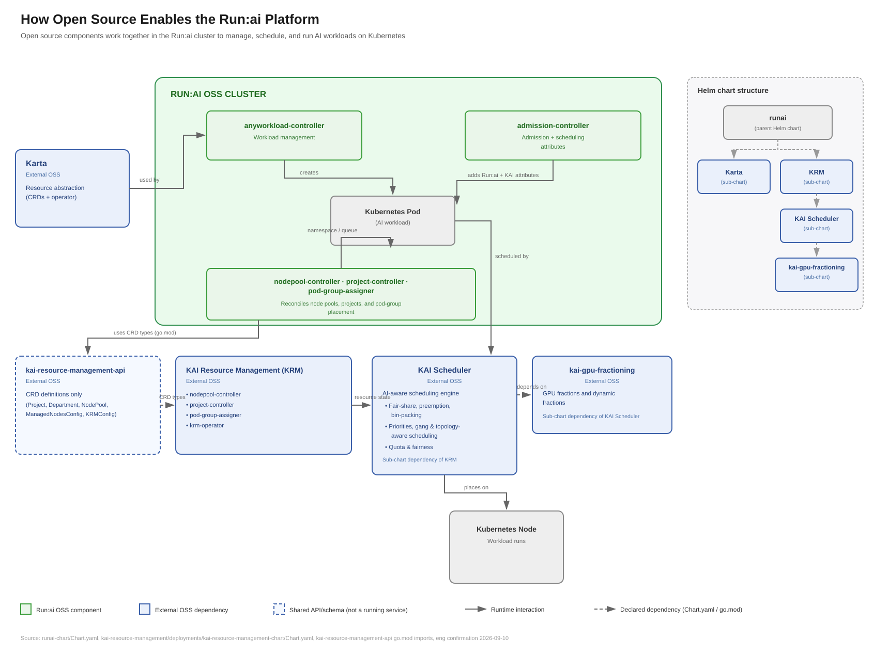

# External Dependencies

NVIDIA Run:ai's cluster components build on external open-source projects, pulled in as versioned Helm chart dependencies or Go modules rather than built from Run:ai source. NVIDIA Run:ai packages, configures, and manages these dependencies as part of the platform, so no separate installation or maintenance is required to use them. The diagram below shows how these dependencies connect to Run:ai's own cluster components in the workload scheduling pipeline.

Helm chart dependencies are declared in [`runai-chart/Chart.yaml`](https://github.com/dsx-ai-factory/run-ai/blob/main/runai-cluster/cluster/runai-chart/Chart.yaml) and documented in the [Chart dependencies](https://github.com/dsx-ai-factory/run-ai/blob/main/runai-cluster/cluster/runai-chart/README.md#chart-dependencies) section of the runai-chart README.

## KAI Scheduler

**Source:** [`kai-scheduler/KAI-Scheduler`](https://github.com/kai-scheduler/KAI-Scheduler)
**Dependency of:** `runai-chart` - a direct Helm chart dependency (`oci://ghcr.io/kai-scheduler/kai-scheduler`, declared in `Chart.yaml`)

KAI (Kubernetes AI) Scheduler is an open-source, CNCF-donated AI-aware scheduling engine. It applies fair-share, preemption, bin-packing, and multi-node placement rules to GPU workloads, and is the engine underlying the NVIDIA Run:ai Scheduler.

NVIDIA Run:ai integrates KAI with specific configuration overrides - the `go-operator` owns `kai-config` and the `kai-nodepool-controller` creates one KAI SchedulingShard per node pool. KAI's default queue, shard, and config-deployer components are disabled.

## kai-gpu-fractioning

**Source:** [`kai-scheduler/kai-gpu-fractioning`](https://github.com/kai-scheduler/kai-gpu-fractioning)
**Dependency of:** KAI Scheduler, not `runai-chart` directly - so it does not need its own entry in `Chart.yaml`

kai-gpu-fractioning is a Kubernetes operator that enables multiple pods to safely share a single GPU with enforced memory boundaries. It runs alongside KAI Scheduler: KAI Scheduler decides which fraction of which GPU a workload gets, and kai-gpu-fractioning enforces that memory boundary on the node and exports per-pod metrics for the resulting fractional GPUs.

## Karta

**Source:** [`run-ai/karta`](https://github.com/run-ai/karta)
**Dependency of:** `runai-chart` - a direct Helm chart dependency (`oci://ghcr.io/run-ai/karta`, declared in `Chart.yaml`)

Karta is a CRD-based resource abstraction layer with its own operator. It replaced the legacy `ResourceInterface` (RI) CRD as the way Run:ai represents and reconciles workload resource attachments in the cluster. The `karta-migrate` Helm hook handles the one-time migration from RI to Karta CRs on upgrade.

## KAI Resource Management (KRM)

**Source:** [`kai-scheduler/kai-resource-management-api`](https://github.com/kai-scheduler/kai-resource-management-api)
**Dependency of:** Run:ai's own cluster services (including `nodepool-controller` and `project-controller`) - a Go module dependency declared in each service's `go.mod`, not a Helm chart dependency and not a separately running service

KRM defines the shared CRD schema (`kai.resources`: NodePool, Department, Project, ManagedNodesConfig) that Run:ai's controllers and KAI Scheduler both read, so they coordinate through shared cluster state rather than direct calls. Migrating legacy CRDs onto `kai.resources` runs automatically this release and self-gates once complete; it isn't a customer-facing toggle.

---

## Integrating a Custom Version

To replace any of these dependencies with a custom build:

1. Fork the relevant external repository and make your changes.
2. Build and publish your custom chart to an OCI registry.
3. Update the dependency entry in [`runai-chart/Chart.yaml`](https://github.com/dsx-ai-factory/run-ai/blob/main/runai-cluster/cluster/runai-chart/Chart.yaml) - change `repository` to your registry and `version` to your build.
4. Run `helm dep update` in `runai-cluster/cluster/runai-chart/` to pull in your version.
5. Deploy with `helm upgrade` or via `local-dev.sh`.
