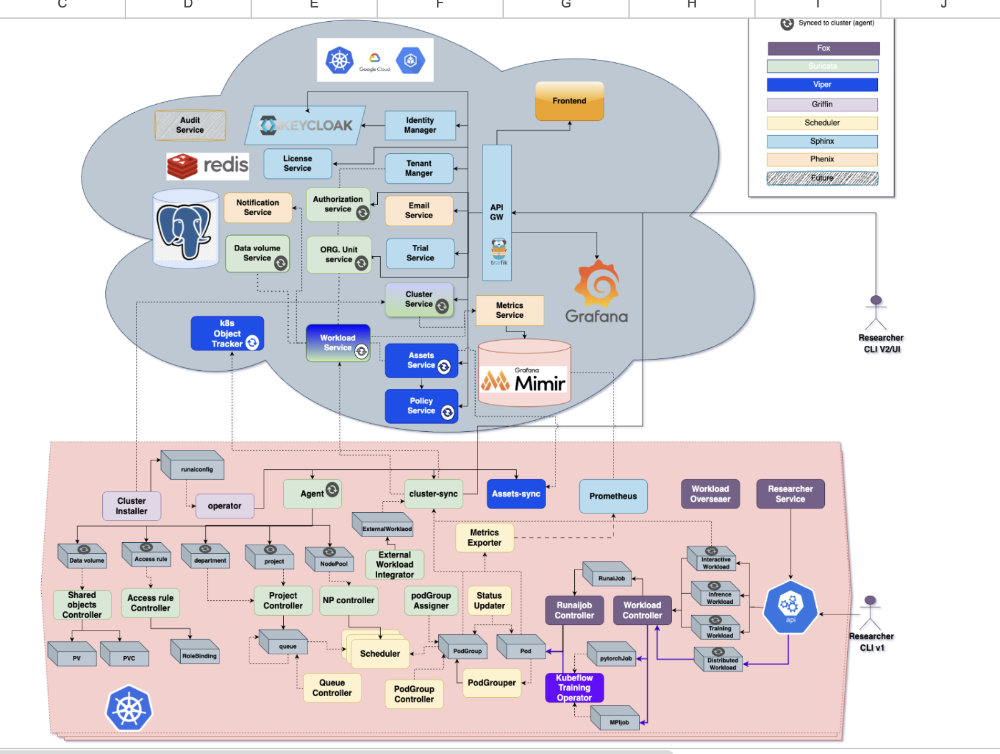

# NVIDIA Run:ai Architecture

## System Overview

  

NVIDIA Run:ai consists of two main components, both deployed on Kubernetes:

- **Control Plane** — Deployed centrally (SaaS or self-hosted). Provides the REST API, web UI,
  authentication, RBAC, scheduling policy, workload lifecycle management, and observability
  aggregation across all connected clusters.

- **Cluster Plane** — Deployed into each managed Kubernetes cluster. Pulls configuration from the
  control plane, enforces scheduling decisions locally, and reports cluster state back.

---

## Control Plane Services

Source: [`run-ai/runai/control-plane/`](https://github.com/run-ai/runai/tree/master/control-plane)

| Service | Description | Team | Type |
|---------|-------------|------|------|
| [assets-service](https://github.com/run-ai/runai/tree/master/control-plane/assets-service) | Manages environments, compute resources, data sources, and credentials | Viper | Service |
| [audit-service](https://github.com/run-ai/runai/tree/master/control-plane/audit-service) | Audit log support | Phoenix | Service |
| [authorization](https://github.com/run-ai/runai/tree/master/control-plane/authorization) | RBAC configuration; helps all services enforce access control | Suricata | Service |
| [bff-service](https://github.com/run-ai/runai/tree/master/control-plane/bff-service) | Backend for Frontend | — | Service |
| [catalog-service](https://github.com/run-ai/runai/tree/master/control-plane/catalog-service) | Catalog management | — | Service |
| [cli-exposer](https://github.com/run-ai/runai/tree/master/control-plane/cli-exposer) | CLI v2 installation, binary downloads, and documentation | Fox | Service |
| [cluster-service](https://github.com/run-ai/runai/tree/master/control-plane/cluster-service) | Cluster status and configuration | Suricata / Griffin | Service |
| [datavolumes-service](https://github.com/run-ai/runai/tree/master/control-plane/datavolumes-service) | Data volume creation, sharing, and deletion; persistent storage only | Viper | Service |
| [email-service](https://github.com/run-ai/runai/tree/master/control-plane/email-service) | Sends notification emails | Phoenix | Service |
| [fielder](https://github.com/run-ai/runai/tree/master/control-plane/fielder) | — | — | Service |
| [frontend](https://github.com/run-ai/runai/tree/master/control-plane/frontend) | Web UI | — | Service |
| [gateway-hub](https://github.com/run-ai/runai/tree/master/control-plane/gateway-hub) | API gateway; routes traffic and handles authentication (JWT / Keycloak) | Sphinx | Service |
| [identity-manager](https://github.com/run-ai/runai/tree/master/control-plane/identity-manager) | Manages identities by configuring Keycloak | Sphinx | Service |
| [k8s-objects-tracker](https://github.com/run-ai/runai/tree/master/control-plane/k8s-objects-tracker) | Tracks cluster objects (PVCs, secrets, configmaps, storage classes) | Viper | Service |
| [keycloak-extensions](https://github.com/run-ai/runai/tree/master/control-plane/keycloak-extensions) | Custom Keycloak extensions | Sphinx | Service |
| [metrics-service](https://github.com/run-ai/runai/tree/master/control-plane/metrics-service) | Unified internal API for querying time-series databases (Mimir, Thanos, Grafana Cloud) | Phoenix | Service |
| [notifications-proxy](https://github.com/run-ai/runai/tree/master/control-plane/notifications-proxy) | Proxy for notification delivery | Phoenix | Service |
| [notifications-service](https://github.com/run-ai/runai/tree/master/control-plane/notifications-service) | Manages notification configuration and sends via email service | Phoenix | Service |
| [org-unit-service](https://github.com/run-ai/runai/tree/master/control-plane/org-unit-service) | Manages projects and departments | Suricata | Service |
| [policy-service](https://github.com/run-ai/runai/tree/master/control-plane/policy-service) | Manages workload policies | Viper | Service |
| [presets-loader](https://github.com/run-ai/runai/tree/master/control-plane/presets-loader) | Imports default assets for use by all tenants | Lemur | Service |
| [tenants-manager](https://github.com/run-ai/runai/tree/master/control-plane/tenants-manager) | Manages tenants from creation to deletion | Sphinx | Service |
| [trial-service](https://github.com/run-ai/runai/tree/master/control-plane/trial-service) | Manages trial accounts (uses tenants-manager) | Sphinx | Service |
| [workloads-manager](https://github.com/run-ai/runai/tree/master/control-plane/workloads-manager) | Manages workload operations | Suricata | Service |
| [authorization-migrator](https://github.com/run-ai/runai/tree/master/control-plane/authorization-migrator) | Authorization data migration | Suricata | Migration |
| [cluster-migrator](https://github.com/run-ai/runai/tree/master/control-plane/cluster-migrator) | Cluster data migration | — | Migration |
| [metric-stores-migrator](https://github.com/run-ai/runai/tree/master/control-plane/metric-stores-migrator) | Metric store migration | Phoenix | Migration |
| [org-units-migrator](https://github.com/run-ai/runai/tree/master/control-plane/org-units-migrator) | Org unit data migration | Suricata | Migration |
| [secret-generator](https://github.com/run-ai/runai/tree/master/control-plane/secret-generator) | Generates secrets for service configuration | — | Utility |
| [runai-cli](https://github.com/run-ai/runai/tree/master/control-plane/runai-cli) | CLI v2 source | Fox | CLI |
| [control-plane-chart](https://github.com/run-ai/runai/tree/master/control-plane/control-plane-chart) | Helm chart for the full control plane | Griffin | Helm |

---

## Cluster Components

Source: [`run-ai/runai/runai-cluster/cluster/`](https://github.com/run-ai/runai/tree/master/runai-cluster/cluster)

| Component | Description | Team | Type |
|-----------|-------------|------|------|
| [agent](https://github.com/run-ai/runai/tree/master/runai-cluster/cluster/agent) | Pulls configuration from the control plane and creates matching cluster CRs | Suricata | Service |
| [admission-controller](https://github.com/run-ai/runai/tree/master/runai-cluster/cluster/admission-controller) | Runs validation and mutation webhooks for the Kubernetes API server | Scheduler | Service |
| [cluster-api](https://github.com/run-ai/runai/tree/master/runai-cluster/cluster/cluster-api) | Exposes CLI capabilities via API (attach, exec, port-forward) | Fox | Service |
| [cluster-sync](https://github.com/run-ai/runai/tree/master/runai-cluster/cluster/cluster-sync) | Reports the status of cluster resources back to the control plane | Suricata | Service |
| [external-workload-integrator](https://github.com/run-ai/runai/tree/master/runai-cluster/cluster/external-workload-integrator) | Detects and integrates workloads not submitted through NVIDIA Run:ai | Suricata | Service |
| [go-operator](https://github.com/run-ai/runai/tree/master/runai-cluster/cluster/go-operator) | Manages all NVIDIA Run:ai cluster components (install, upgrade, configure) | Griffin | Service |
| [inference-workload-controller](https://github.com/run-ai/runai/tree/master/runai-cluster/cluster/inference-workload-controller) | Manages inference workload lifecycle | Lemur | Service |
| [init-ca](https://github.com/run-ai/runai/tree/master/runai-cluster/cluster/init-ca) | Creates credentials and certificates for NVIDIA Run:ai | Griffin | Service |
| [metrics-exporter](https://github.com/run-ai/runai/tree/master/runai-cluster/cluster/metrics-exporter) | Exports NVIDIA Run:ai metrics to Prometheus | Scheduler | Service |
| [nodepool-controller](https://github.com/run-ai/runai/tree/master/runai-cluster/cluster/nodepool-controller) | Creates scheduler instances per node pool; labels nodes | Suricata | Service |
| [oauth2-proxy](https://github.com/run-ai/runai/tree/master/runai-cluster/cluster/oauth2-proxy) | Authentication proxy for interactive workspaces (e.g. Jupyter) | Viper | Service |
| [pod-group-assigner](https://github.com/run-ai/runai/tree/master/runai-cluster/cluster/pod-group-assigner) | Assigns multi-nodepool workloads to an appropriate node pool | Suricata | Service |
| [project-controller](https://github.com/run-ai/runai/tree/master/runai-cluster/cluster/project-controller) | Manages projects and departments; creates scheduler queues; replicates assets | Suricata | Service |
| [runaijob-controller](https://github.com/run-ai/runai/tree/master/runai-cluster/cluster/runaijob-controller) | Controls pods for interactive and training workloads | Fox | Service |
| [shared-objects-controller](https://github.com/run-ai/runai/tree/master/runai-cluster/cluster/shared-objects-controller) | Manages data volume PV/PVC replication across clusters | Viper | Service |
| [status-updater](https://github.com/run-ai/runai/tree/master/runai-cluster/cluster/status-updater) | Updates pod group status | Scheduler | Service |
| [workload-controller](https://github.com/run-ai/runai/tree/master/runai-cluster/cluster/workload-controller) | Manages workloads: jobs, ingress, workload authentication | Fox | Service |
| [accessrule-controller](https://github.com/run-ai/runai/tree/master/runai-cluster/cluster/accessrule-controller) | Manages role bindings to match control plane RBAC rules | Suricata | Service |
| [advice-restart-controller](https://github.com/run-ai/runai/tree/master/runai-cluster/cluster/advice-restart-controller) | Restart advice controller | — | Service |
| [anyworkload-controller](https://github.com/run-ai/runai/tree/master/runai-cluster/cluster/anyworkload-controller) | Controller for any workload type | — | Service |
| [application-controller](https://github.com/run-ai/runai/tree/master/runai-cluster/cluster/application-controller) | Application controller | — | Service |
| [dgxc-cp-config-fetcher](https://github.com/run-ai/runai/tree/master/runai-cluster/cluster/dgxc-cp-config-fetcher) | Fetches control plane configuration for DGX Cloud deployments | — | Service |
| [dromos](https://github.com/run-ai/runai/tree/master/runai-cluster/cluster/dromos) | — | — | Service |
| [runtime-rules](https://github.com/run-ai/runai/tree/master/runai-cluster/cluster/runtime-rules) | Runtime policy rules enforcement | — | Service |
| [workload-exporter](https://github.com/run-ai/runai/tree/master/runai-cluster/cluster/workload-exporter) | Exports workload data | — | Service |
| [karta-migrate](https://github.com/run-ai/runai/tree/master/runai-cluster/cluster/karta-migrate) | Migration tooling for the karta CRD translation layer | — | Migration |
| [runai-crd-upgrader](https://github.com/run-ai/runai/tree/master/runai-cluster/cluster/runai-crd-upgrader) | Upgrades CRDs when changes are required | Griffin | Utility |
| [helm-hooks-handler](https://github.com/run-ai/runai/tree/master/runai-cluster/cluster/helm-hooks-handler) | Handles Helm pre/post install hooks | Griffin | Utility |
| [runai-chart](https://github.com/run-ai/runai/tree/master/runai-cluster/cluster/runai-chart) | Helm chart for the full cluster installation | Griffin | Helm |

### KAI Scheduler

Source: [`run-ai/runai/runai-cluster/kai-scheduler/`](https://github.com/run-ai/runai/tree/master/runai-cluster/kai-scheduler)

The KAI (Kubernetes AI) Scheduler is NVIDIA Run:ai's AI-aware scheduling engine. It applies
fair-share, preemption, bin-packing, and multi-nodepool placement rules to GPU workloads.

---

## Owning Teams

| Team | Colour in diagram |
|------|-------------------|
| Fox | Dark blue |
| Viper | Blue |
| Griffin | Light purple |
| Scheduler | Yellow |
| Sphinx | Light blue |
| Phoenix | Light yellow/beige |
| Lemur | Future / hatched |
