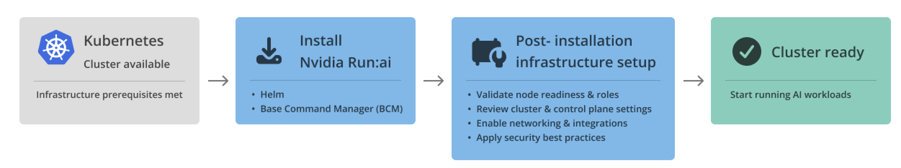

# Deploy Infrastructure Quick Start

This guide walks through the initial deployment of NVIDIA Run:ai infrastructure: preparing your environment, installing the platform, and completing the onboarding wizard. This is part of Day 1 (Setup) of the platform lifecycle and assumes Day 0 planning is complete. For the full picture, see the [Installation and Configuration overview](../../installation-and-configuration/overview.md).

<figure><figcaption></figcaption></figure>

## Prerequisites

Before you begin, ensure that:

* A Kubernetes cluster is up and running.
* [Helm](https://helm.sh/) 3.14 or later is installed.
* You have `kubectl` access to the cluster with admin-level permissions.
* You have reviewed [System Requirements](../../installation-and-configuration/system-requirements/README.md) and prepared your Kubernetes environment accordingly.

## Install the Platform

The platform supports the following installation paths, depending on your environment. All three are available for both Open Source and NVIDIA Run:ai Support-Entitled, except BCM, which is available for NVIDIA Run:ai Support-Entitled only.

* [Guided Installation](../../installation-and-configuration/installation/guided-installation/README.md) (Recommended) - `runai-installer` CLI - reads a single configuration YAML file and performs the full installation. Best for most deployments.
* [Manual Helm](../../installation-and-configuration/installation/install-using-helm/preparations.md) - NVIDIA Run:ai Helm charts, deployed directly. Best for organizations managing deployments through their own tooling (for example, Argo CD), or needing granular control over Helm values.
* [BCM](../../installation-and-configuration/installation/bcm-install.md) (NVIDIA Run:ai Support-Entitled only) - NVIDIA Base Command Manager. Best for DGX SuperPOD environments managed by BCM.

## Complete the Onboarding Wizard

After installation, sign in to the NVIDIA Run:ai UI. The onboarding wizard launches automatically and guides you through the required steps.

The wizard includes both infrastructure-level and organizational steps. Complete the infrastructure-related steps below, then continue with authentication and the remaining organizational setup in the [Configure the Platform Quick Start](configure-the-platform-quick-start.md#complete-the-onboarding-wizard).

<Note>

**Note**

Do not close the wizard before all steps are complete. The onboarding wizard cannot be reopened once dismissed.

</Note>

### Connect Your Cluster

<Note>

**Note**

If the NVIDIA Run:ai cluster is already deployed and connected to the control plane (e.g., via BCM installation or a pre-run Helm installation), the wizard will automatically detect the connection and skip this part.

</Note>

A cluster is your organization's compute infrastructure, where AI workloads are executed. The wizard generates the [Helm](../../installation-and-configuration/installation/install-using-helm/preparations.md) command that you run on your Kubernetes cluster to install the required components and prepare the cluster for workload scheduling.

The wizard displays **Waiting for cluster to connect** while the cluster is being installed and connected to the control plane. Once the installation completes successfully and the cluster establishes communication with the control plane, the wizard updates to **Cluster connected**. After completing the wizard flow, the cluster is added to the [Clusters](../../installation-and-configuration/operations/clusters.md) table.

### Configure Email Server

Configure the [email server](../../settings/general-settings/notifications.md#email-notifications) used by NVIDIA Run:ai to send system notifications and user invitations. Email configuration ensures that users receive onboarding emails, password resets, and other platform notifications. This step prepares the platform for user onboarding and ongoing communication.

## Next Steps

Once the platform is installed and connected, continue with the rest of Day 1 [Configuration](../../installation-and-configuration/configuration/README.md) to make the cluster production-ready, then Day 2 [Operations](../../installation-and-configuration/operations/README.md) to keep it running reliably. See the [Installation and Configuration overview](../../installation-and-configuration/overview.md) for the full lifecycle, including upgrade and troubleshooting guidance.
