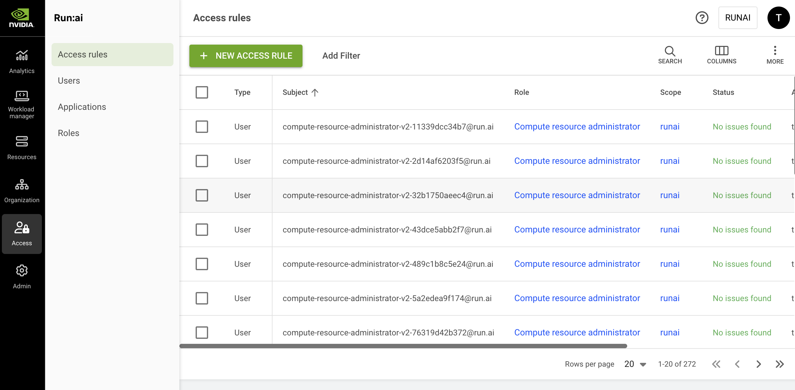

# Access Rules

Access rules provide users, groups, or service accounts privileges to system entities. An access rule is the assignment of a [role ](roles.md)to a [subject in a scope](../../platform-management/aiinitiatives/adapting-ai-initiatives.md#scopes-in-an-organization): `<Subject>` is a `<Role>` in a `<Scope>`. For example, user **user@domain.com** is a **department admin** in **department A**.

## Access Rules Table

The Access rules table can be found under **Access** in the NVIDIA Run:ai platform.

The Access rules table provides a list of all the access rules defined in the platform and allows you to manage them.

<Info>

**Flexible management**

It is also possible to manage access rules directly for a specific [user](users.md), [service account](service-accounts.md), [project](../../platform-management/aiinitiatives/organization/projects.md), or [department](../../platform-management/aiinitiatives/organization/departments.md).

</Info>

<figure><figcaption></figcaption></figure>

The Access rules table consists of the following columns:

| Column        | Description                                                                                                  |
| ------------- | ------------------------------------------------------------------------------------------------------------ |
| Type          | The type of subject assigned to the access rule (user, SSO group, or service account).                       |
| Subject       | The user, SSO group, or service account assigned with the role                                               |
| Role          | The role assigned to the subject                                                                             |
| Scope         | The scope to which the subject has access. Click the name of the scope to see the scope and its subordinates |
| Status        | The access rule creation status.                                                                             |
| Authorized by | The user who granted the access rule                                                                         |
| Creation time | The timestamp for when the rule was created                                                                  |
| Last updated  | The last time the access rule was updated                                                                    |

### Access Rule Status

The following table describes the condition of access rules and whether they were successfully created for the selected scope. The status indicates whether the access rule is synced in the cluster.

| Status          | Description                                                                                                                                                        |
| --------------- | ------------------------------------------------------------------------------------------------------------------------------------------------------------------ |
| No issues found | No issues were found while creating the access rule                                                                                                                |
| Issues found    | Issues were found while enforcing the access rule in the cluster(s). |
| Creating…       | The access rule is being created in the cluster                                                                                                                    |
| No status       | Status cannot be displayed because the current version of the cluster is not up to date or unknown                                                                 |

### Customizing the Table View

* Filter - Click ADD FILTER, select the column to filter by, and enter the filter values
* Search - Click SEARCH and type the value to search by
* Sort - Click each column header to sort by
* Column selection - Click COLUMNS and select the columns to display in the table
* Download table - Click MORE and then Click Download as CSV. Export to CSV is limited to 20,000 rows.

## Adding New Access Rules

To add a new access rule:

1. Click **+NEW ACCESS RULE**
2. Select a subject - **User, SSO Group**, or **Service Account**
3. Select or enter the subject identifier. You can define up to 10 subjects of the selected type:
   * **User** for a local user created in NVIDIA Run:ai or for an SSO user as recognized by the IDP. Search by name or email, or manually enter the user's email if they do not appear in the search results.
   * **Group name** as recognized by the IDP
   * **Service account name** as created in NVIDIA Run:ai
4. Select a **role**
5. Select up to 10 **scopes** where the access rule will apply
6. Click **SAVE RULE**

## Editing an Access Rule

Access rules cannot be edited. To change an access rule, you must delete the rule, and then create a new rule to replace it.

## Deleting an Access Rule

1. Select one or more access rules you want to delete
2. Click **DELETE**
3. On the dialog, click **DELETE** to confirm

## Transitioning Access Rules to New Roles

Due to the deprecation of some roles, referred to as [legacy roles](roles.md#roles-in-nvidia-run-ai), access rules using them should be transitioned to supported roles. When access rules still use legacy roles, a banner at the top of the Access rules table prompts you to transition them. Transitioning recreates each selected rule under a new role with the same subject and scope, and deletes the legacy rule.

To transition access rules:

1. On the banner, click **transition to new roles**
2. In the **Transition Access Rules To New Roles** dialog, select the access rules to transition
3. For each legacy role listed, select a **new role**. For some legacy roles, NVIDIA Run:ai pre-selects a recommended replacement, which you can change.
4. Click **TRANSITION ACCESS RULES** to confirm

<Info>

**Required permissions**

Your role must include the **Create**, **Read**, **Update**, and **Delete** permissions on the **Access rules** resource.

</Info>

## Viewing Your User Access Rule

To view the assigned roles and scopes you have access to:

1. Click the user avatar at the top right corner, then select **Settings**
2. Click **User details**

The list of assigned roles and scopes will be displayed.

## Using API

Go to the [Access rules](https://run-ai-docs.nvidia.com/api/2.26/authentication-and-authorization/access-rules) API reference to view the available actions.
