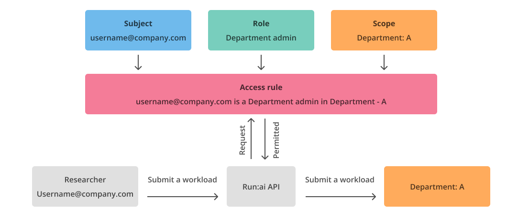

# Authentication and Authorization

NVIDIA Run:ai authentication and authorization enables a streamlined experience for the user with precise controls covering the data each user can see and the actions each user can perform in the NVIDIA Run:ai platform.

Authentication verifies user identity during login, and authorization assigns the user with specific permissions according to the assigned [access rules](accessrules.md).

Authenticated access is required to use all aspects of the NVIDIA Run:ai interfaces, including the NVIDIA Run:ai platform, the NVIDIA Run:ai Command Line Interface (CLI) and APIs.

## Authentication

There are multiple methods to authenticate and access NVIDIA Run:ai.

### Single Sign-On (SSO)

NVIDIA Run:ai supports three methods to set up SSO:

* [SAML](sso/saml.md)
* [OpenID Connect (OIDC)](sso/openidconnect.md)
* [OpenShift](sso/openshift.md)

When using SSO, it is highly recommended to manage at least one local user, as a breakglass account (an emergency account), in case access to SSO is not possible.

### Username and Password

Username and password access can be used when SSO integration is not possible.

### Secret Key (for Application Programmatic Access)

Secret is the authentication method for [Service accounts](service-accounts.md). Service accounts use the NVIDIA Run:ai APIs to perform automated tasks including scripts and pipelines based on their assigned [access rules](accessrules.md).

## Authorization

The NVIDIA Run:ai platform uses Role Based Access Control (RBAC) to manage authorization. Once a user or service account is authenticated, they can perform actions according to their assigned access rules.

### Role Based Access Control (RBAC) in NVIDIA Run:ai

While Kubernetes RBAC is limited to a single cluster, NVIDIA Run:ai expands the scope of Kubernetes RBAC, making it easy for administrators to manage access rules across multiple clusters.

RBAC at NVIDIA Run:ai is configured using access rules. An access rule is the assignment of a [role](roles.md) to a [subject in a scope](../../platform-management/aiinitiatives/adapting-ai-initiatives.md#scopes-in-an-organization): `<Subject>` is a `<Role>` in a `<Scope>`.

* **Subject**
  * A user, group, or service account assigned with the role
* **Role**
  * A set of permissions that can be assigned to subjects. NVIDIA Run:ai provides predefined roles that are system-defined and cannot be edited or deleted. Administrators can also create custom roles via the API to meet specific organizational requirements.
  * A permission is a set of actions (view, edit, create and delete) over a NVIDIA Run:ai entity (e.g. projects, workloads, users). For example, a role might allow a user to create and read Projects, but not update or delete them. For a reference of all available permissions, see [Permissions](permissions.md)
* **Scope**
  * A scope is part of an organization in which a set of permissions (roles) is effective. Scopes include Projects, Departments, Clusters, Account (all clusters).

Below is an example of an access rule: **username@company.com** is a **Department admin** in **Department: A**

