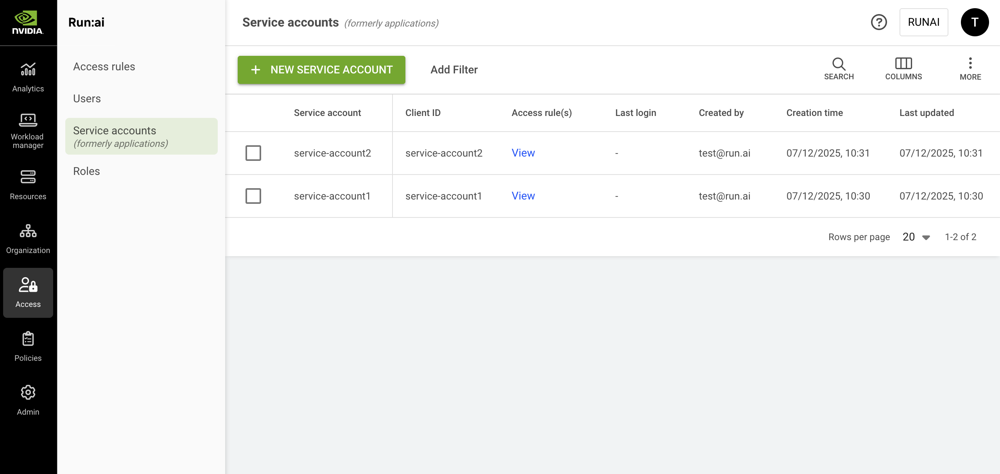

# Service Accounts (formerly applications)

Service accounts are used for API integrations with NVIDIA Run:ai. A service account contains a client ID and a client secret. With the client credentials, you can obtain an access token as detailed in [API authentication](https://run-ai-docs.nvidia.com/api/2.26/getting-started/how-to-authenticate-to-the-api) and use it within subsequent API calls.

Service accounts are assigned with [access rules ](accessrules.md)to manage permissions. For example, service account **ci-pipeline-prod** is assigned with a **Researcher** role in **Cluster: A**.

<Info>

**Note**

You can also create your own access keys for API integrations with NVIDIA Run:ai. See [User access keys](../../settings/user-settings/user-access-keys.md) for more details.

</Info>

## Service Accounts Table

The Service accounts table can be found under **Access** in the NVIDIA Run:ai platform.

The Service accounts table provides a list of all the services accounts defined in the platform, and allows you to manage them.

<figure><figcaption></figcaption></figure>

The Service accounts table consists of the following columns:

| Column          | Description                                            |
| --------------- | ------------------------------------------------------ |
| Service account | The name of the service account                        |
| Client ID       | The client ID of the service account                   |
| Access rule(s)  | The access rules assigned to the service account       |
| Last login      | The timestamp for the last time the user signed in     |
| Created by      | The user who created the service account               |
| Creation time   | The timestamp for when the service account was created |
| Last updated    | The last time the service account was updated          |

### Customizing the Table View

* Filter - Click ADD FILTER, select the column to filter by, and enter the filter values
* Search - Click SEARCH and type the value to search by
* Sort - Click each column header to sort by
* Column selection - Click COLUMNS and select the columns to display in the table
* Download table - Click MORE and then Click Download as CSV. Export to CSV is limited to 20,000 rows.

## Creating a Service Account

To create a service account:

1. Click **+NEW SERVICE ACCOUNT**
2. Enter the service account's **name**
3. Click **CREATE**
4. Copy the **Client ID** and **Client secret** and store them securely
5. Click **DONE** or click **ADD ACCESS RULES** to proceed to the **Access rules** step
6. In the **Access rules** step:
   * Select a **role**
   * Select up to 10 **scopes** where the access rule will apply
   * Click **SAVE RULE**
   * Click **CLOSE**

<Info>

**Note**

The client secret is visible only at the time of creation. It cannot be recovered but can be regenerated.

</Info>

## Adding an Access Rule to a Service Account

To create an access rule:

1. Select the service account you want to add an access rule for
2. Click **ACCESS RULES**
3. Click **+ACCESS RULE**
4. Select a **role**
5. Select up to 10 **scopes** where the access rule will apply
6. Click **SAVE RULE**
7. Click **CLOSE**

## Deleting an Access Rule from a Service Account

To delete an access rule:

1. Select the service account you want to remove an access rule from
2. Click **ACCESS RULES**
3. Find the access rule assigned to the user you would like to delete
4. Click on the trash icon
5. Click **CLOSE**

## Regenerating a Client Secret

To regenerate a client secret:

1. Locate the service account you want to regenerate its client secret
2. Click **REGENERATE CLIENT SECRET**
3. Click **REGENERATE**
4. Copy the **New client secret** and store it securely
5. Click **DONE**

<Warning>

**Important**

Regenerating a client secret revokes the previous one.

</Warning>

## Deleting a Service Account

1. Select the service account you want to delete
2. Click **DELETE**
3. On the dialog, click **DELETE** to confirm

## Using API

Go to the [Service accounts](https://run-ai-docs.nvidia.com/api/2.26/authentication-and-authorization/service-accounts), [Access rules](https://run-ai-docs.nvidia.com/api/2.26/authentication-and-authorization/access-rules) API reference to view the available actions.
