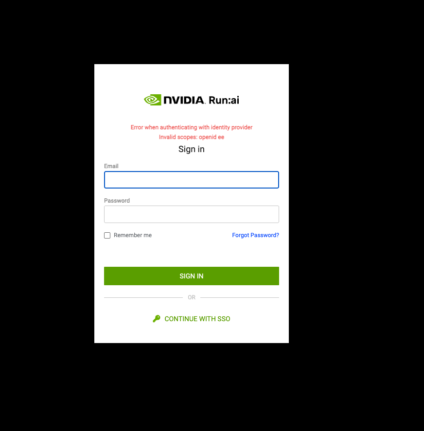

# Set Up SSO with OpenID Connect

Single Sign-On (SSO) is an authentication scheme, allowing users to log-in with a single pair of credentials to multiple, independent software systems.

This guide explains the procedure to [configure SSO to NVIDIA Run:ai](../overview.md#single-sign-on-sso) using the OpenID Connect protocol.

## Prerequisites

Before you start, make sure you have the following available from your identity provider:

* Discovery URL - The OpenID server where the content discovery information is published.
* ClientID - The ID used to identify the client with the Authorization Server.
* Client Secret - A secret password that only the Client and Authorization server know.
* Optional: Scopes - A set of user attributes to be used during authentication to authorize access to a user's details.

## Setup

### Adding the Identity Provider

1. Go to **General settings**
2. Open the Security section and click **+IDENTITY PROVIDER**
3. Select **Custom OpenID Connect**
4. Enter the **Discovery URL**, **Client ID**, and **Client Secret**
5. Copy the Redirect URL to be used in your identity provider
6. Optional: Add the OIDC scopes
7. Optional: Enter the user attributes and their value in the identity provider as shown in the below table
8. Click **SAVE**
9. Optional: Enable **Auto-Redirect to SSO** to automatically redirect users to your configured identity provider’s login page when accessing the platform.

| Attribute            | Default value in NVIDIA Run:ai | Description                                                                                                                                                                                                  |
| -------------------- | ------------------------------ | ------------------------------------------------------------------------------------------------------------------------------------------------------------------------------------------------------------ |
| User role groups     | GROUPS                         | If it exists in the IDP, it allows you to assign NVIDIA Run:ai role groups via the IDP. The IDP attribute must be a list of strings or an object where the group names are the values.                       |
| Linux User ID        | UID                            | If it exists in the IDP, it allows Researcher containers to start with the Linux User UID. Used to map access to network resources such as file systems to users. The IDP attribute must be of type integer. |
| Linux Group ID       | GID                            | If it exists in the IDP, it allows Researcher containers to start with the Linux Group GID. The IDP attribute must be of type integer.                                                                       |
| Supplementary Groups | SUPPLEMENTARYGROUPS            | If it exists in the IDP, it allows Researcher containers to start with the relevant Linux supplementary groups. The IDP attribute must be a list of integers.                                                |
| Email                | email                          | Defines the user attribute in the IDP holding the user's email address, which is the user identifier in NVIDIA Run:ai                                                                                        |
| User first name      | firstName                      | Used as the user’s first name appearing in the NVIDIA Run:ai user interface                                                                                                                                  |
| User last name       | lastName                       | Used as the user’s last name appearing in the NVIDIA Run:ai user interface                                                                                                                                   |

### Testing the Setup

1. Log in to the NVIDIA Run:ai platform as an admin
2. Add [access rules](../accessrules.md) to an SSO user defined in the IDP
3. Open the NVIDIA Run:ai platform in an incognito browser tab
4. On the sign-in page click **CONTINUE WITH SSO**\
   You are redirected to the identity provider sign in page
5. In the identity provider sign-in page, log in with the SSO user who you granted with access rules
6. If you are unsuccessful signing-in to the identity provider, follow the [Troubleshooting](openidconnect.md#troubleshooting) section below

### Editing the Identity Provider

You can view the identity provider details and edit its configuration:

1. Go to **General settings**
2. Open the Security section
3. On the identity provider box, click **Edit identity provider**
4. You can edit either the **Discovery URL**, **Client ID**, **Client Secret**, **OIDC scopes**, or the **User attributes**

### Removing the Identity Provider

You can remove the identity provider configuration:

1. Go to **General settings**
2. Open the Security section
3. On the identity provider card, click **Remove identity provider**
4. In the dialog, click **REMOVE** to confirm the action

<Info>

**Note**

To avoid losing access, removing the identity provider must be carried out by a local user.

</Info>

## Troubleshooting

If testing the setup was unsuccessful, try the different troubleshooting scenarios according to the error you received.

### Troubleshooting Scenarios

<Accordion title="Error: '403 - Sorry, we can’t let you see this page. Something about permissions…'">

**Error: '403 - Sorry, we can’t let you see this page. Something about permissions…'**

**Description:** The authenticated user is missing permissions

**Mitigation**:

1. Validate either the user or its related group/s are assigned with [access rules](../accessrules.md)
2. Validate groups attribute is available in the configured OIDC Scopes
3. Validate the user’s groups attribute is mapped correctly

**Advanced:**

1. Open the Chrome DevTools: Right-click on page → Inspect → Console tab
2. Run the following command to retrieve and paste the user’s token: `localStorage.token;`
3. Paste in [https://jwt.io](https://jwt.io/)
4. Under the Payload section validate the values of the user’s attribute

</Accordion>

<Accordion title="Error: '401 - We’re having trouble identifying your account because your email is incorrect or can’t be found.'">

**Error: '401 - We’re having trouble identifying your account because your email is incorrect or can’t be found.'**

**Description:** Authentication failed because email attribute was not found.

**Mitigation**:

1. Validate email attribute is available in the configured OIDC Scopes
2. Validate the user’s email attribute is mapped correctly

</Accordion>

<Accordion title="Error: 'Unexpected error when authenticating with identity provider'">

**Error: 'Unexpected error when authenticating with identity provider'**

**Description:** User authentication failed

<figure><figcaption></figcaption></figure>

**Mitigation**: Validate the configured OIDC Scopes exist and match the Identity Provider’s available scopes

**Advanced:** Look for the specific error message in the URL address

</Accordion>

<Accordion title="Error: 'Unexpected error when authenticating with identity provider (SSO sign-in is not available)'">

**Error: 'Unexpected error when authenticating with identity provider (SSO sign-in is not available)'**

**Description:** User authentication failed

<figure><figcaption></figcaption></figure>

**Mitigation**:

1. Validate the configured OIDC scope exists in the Identity Provider
2. Validate the configured Client Secret match the Client Secret in the Identity Provider

**Advanced:** Look for the specific error message in the URL address

</Accordion>

<Accordion title="Error: 'Client not found'">

**Error: 'Client not found'**

**Description:** OIDC Client ID was not found in the Identity Provider

**Mitigation**: Validate the configured Client ID matches the Identity Provider Client ID

</Accordion>
