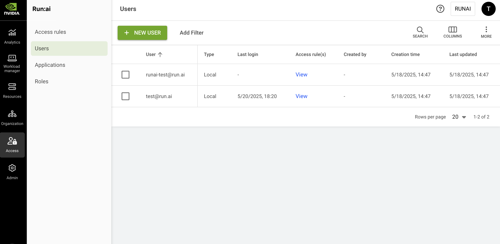

# Users

Users can be managed locally, or via the identity provider (Idp), while assigned with [access rules](accessrules.md) to manage permissions. For example, user **user@domain.com** is a **department admin** in **department A**.

## Users Table

The Users table can be found under **Access** in the NVIDIA Run:ai platform.

The users table provides a list of all the users in the platform.\
You can manage users and user permissions (access rules) for both local and [SSO users](overview.md#single-sign-on-sso).

<Info>

**Single Sign-On Users**

SSO users are managed by the identity provider and appear once they have signed in to NVIDIA Run:ai.

</Info>

<figure><figcaption></figcaption></figure>

The Users table consists of the following columns:

| Column         | Description                                        |
| -------------- | -------------------------------------------------- |
| User           | The unique identity of the user (email address)    |
| Full name      | The user's first and last name                     |
| Type           | The type of the user - SSO / local                 |
| Last login     | The timestamp for the last time the user signed in |
| Access rule(s) | The access rule assigned to the user               |
| Created By     | The user who created the user                      |
| Creation time  | The timestamp for when the user was created        |
| Last updated   | The last time the user was updated                 |

### Customizing the Table View

* Filter - Click ADD FILTER, select the column to filter by, and enter the filter values
* Search - Click SEARCH and type the value to search by
* Sort - Click each column header to sort by
* Column selection - Click COLUMNS and select the columns to display in the table
* Download table - Click MORE and then Click Download as CSV. Export to CSV is limited to 20,000 rows.

## Creating a Local User

To create a local user:

1. Click **+NEW LOCAL USER**
2. Enter the user’s **Email address**
3. (Optional) Enter the user’s **First name** and **Last name**. The full name is displayed alongside the user’s email across the platform.
4. (Optional) Select the checkbox to send an email invitation to the new user. The invitation allows the user to sign in and get started. To enable email invitations, make sure email notifications are configured under [**General settings**](../../settings/general-settings/notifications.md).
5. Click **CREATE**
6. Review and copy the user’s credentials:
   * **User Email**
   * **Temporary password** to be used on first sign-in
7. Click **DONE** or click **ADD ACCESS RULES** to proceed to the **Access rules** step
8. In the **Access rules** step:
   * Select a **role**
   * Select up to 10 **scopes** where the access rule will apply
   * Click **SAVE RULE**
   * Click **CLOSE**

<Info>

**Note**

The temporary password is visible only at the time of user’s creation and must be changed after the first sign-in.

</Info>

## Editing a User

Administrators can update the first and last name of an existing local user. Names for SSO users are sourced from the identity provider and cannot be edited in NVIDIA Run:ai.

To edit a local user:

1. Select the local user you want to edit
2. Click **EDIT**
3. Update the user’s **First name** and **Last name**
4. Click **SAVE**

## Adding an Access Rule to a User

To create an access rule:

1. Select the user you want to add an access rule for
2. Click **ACCESS RULES**
3. Click **+ACCESS RULE**
4. Select a **role**
5. Select up to 10 **scopes** where the access rule will apply
6. Click **SAVE RULE**
7. Click **CLOSE**

## Deleting User’s Access Rule

To delete an access rule:

1. Select the user you want to remove an access rule from
2. Click **ACCESS RULES**
3. Find the access rule assigned to the user you would like to delete
4. Click on the trash icon
5. Click **CLOSE**

## Resetting a User Password

To reset a user’s password:

1. Select the user you want to reset it’s password
2. Click **RESET PASSWORD**
3. Click **RESET**
4. Review and copy the user’s credentials:
   * **User Email**
   * **Temporary password** to be used on next sign-in
5. Click **DONE**

## Deleting a User

1. Select the user you want to delete
2. Click **DELETE**
3. In the dialog, click **DELETE** to confirm

<Info>

**Note**

To ensure administrative operations are always available, at least one local user with System Administrator role should exist.

</Info>

## Using API

Go to the [Users](https://run-ai-docs.nvidia.com/api/2.26/authentication-and-authorization/users), [Access rules](https://run-ai-docs.nvidia.com/api/2.26/authentication-and-authorization/access-rules) API reference to view the available actions.
