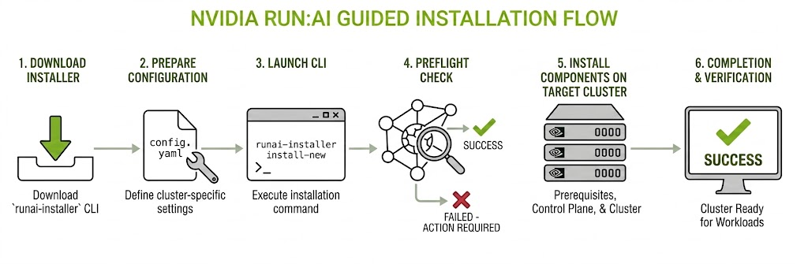

---
---

# Guided Installation

The `runai-installer` CLI is the recommended way to install NVIDIA Run:ai, for both Open Source and Support-Entitled Release installations. It enhances the installation experience by doing everything through a single configuration file - see [Installer Flow](#installer-flow) below for what it does step by step. The installer supports:

- Both [connectivity types](../../overview.md#connected-and-air-gapped-environments) - connected or air-gapped.
- Both [deployment models](../../system-requirements/deployment-model.md) - same-cluster or multi-cluster.
- All supported [Kubernetes distributions](../../support-matrix.md).

## When to Use the Installer

Use `runai-installer` when:

- You are deploying a new NVIDIA Run:ai environment (upgrades are not yet supported by the installer).
- You want built-in preflight validation before any changes are applied.
- You prefer a single tool that validates your configuration, runs preflight checks, installs prerequisites, and deploys the NVIDIA Run:ai control plane and cluster.

For environments with an existing GitOps pipeline (Argo CD) or where administrators manage Helm releases directly, see [Manual Helm](../install-using-helm/preparations.md).

## Installer Flow

The `runai-installer` CLI installs NVIDIA Run:ai from a configuration YAML file. Before applying any changes, it validates your configuration, runs preflight checks, installs any required prerequisites, and deploys the NVIDIA Run:ai control plane and cluster components. The flow is the same for same-cluster and multi-cluster installations - in a multi-cluster deployment, the installer runs once per Kubernetes cluster.

The following diagram shows the installer flow - from downloading the `runai-installer` CLI to a verified, workload-ready cluster:

The installation is built from two artifacts: the `runai-installer` binary (available for AMD64 and ARM64) and a declarative `config.yaml` file - the single input that describes what to install and how. At run time, the installer writes detailed logs to a local directory and persists session state in the cluster, so an interrupted installation can be resumed without re-entering configuration values.

The installer is not a one-time step - rerunning it against an already-installed cluster with an updated `config.yaml` adds any prerequisites or features that were skipped initially, installing only what is missing and leaving the rest of the deployment untouched.

## What the Installer Does

The installer assumes your Kubernetes cluster and infrastructure already meet [System Requirements](../../system-requirements/README.md) - deployment model, infrastructure (hardware, OS, Kubernetes distribution, storage, and permissions), networking (load balancer, ingress controller, FQDNs, DNS, and TLS certificates), third-party services, and external access to critical services. The following sections describe what the installer itself configures and deploys.

### Configures Networking

Configures routing, FQDNs, and TLS for both the control plane and cluster. See [Networking Setup](../../system-requirements/networking-setup.md) for how these components work and how to prepare them beforehand.

- **Routing** - On standard Kubernetes, `externalConnection.type` routes traffic through your own Ingress Controller and Load Balancer (`ingress`) or an existing Gateway resource (`gatewayApi`). On OpenShift, the installer configures Routes automatically. Host-based routing is used by default, with path-based routing available via `cluster.workloadRouting`.
- **FQDN and DNS** - Takes the control plane, cluster, and workload domains as configuration fields, and wires them into the routing and TLS it configures.
- **TLS** - Accepts your own certificate and private key per FQDN, or generates self-signed certificates automatically when `tls.generateSelfSigned` is enabled. For certificates signed by a private or local CA, also accepts a CA certificate chain via `tls.caChainPath`.

### Handles Registry Authentication

NVIDIA Run:ai's images and Helm charts are pulled from NGC, configured with `registry.type: ngc`. Open Source installations use this same setting and do not require any credentials; Support-Entitled Release installations require an NGC API Key to authenticate.

For Support-Entitled Release installations, authentication works differently depending on connectivity:

- **Connected installs** authenticate directly to NVIDIA's registry, using an NGC Personal Key - a token beginning with `nvapi-`, presented with the literal username `$oauthtoken`. See [Connected Registry Credentials](connected/preparations.md#registry-credentials) for how to generate and configure it.
- **Air-gapped installs** never connect to NVIDIA's registry directly, so the `registry` block instead holds basic-auth credentials (`username` and `password` or `passwordPath`) for your own private mirror registry. See [Air-Gapped Registry Credentials](air-gapped/preparations.md#registry-credentials) for how to generate and configure it.

### Installs Prerequisites

The GPU Operator and Prometheus are required for every installation - the GPU Operator provisions and manages GPUs on worker nodes, so the NVIDIA Run:ai cluster can run AI workloads at all, and Prometheus provides the metrics NVIDIA Run:ai's own monitoring is built on. Additional prerequisites apply depending on your environment - for example, the Network Operator, for RDMA or Multi-Node NVLink-capable nodes. See [Prerequisites and Features](prerequisites-and-features.md#prerequisites) for what each component does, when you need it, and air-gapped installation instructions where a dedicated guide exists.

- **Connected installs** configure and install each required prerequisite automatically, before deploying NVIDIA Run:ai itself, when its `mode` is set to `install`.
- **Air-gapped installs** require each prerequisite to be installed beforehand, using its own vendor's air-gapped installation instructions, with `mode: skip` set for each one - the installer rejects the configuration if any is set to `mode: install`, and does not verify that a skipped prerequisite is actually present.

<Note>

**Note**

A missing prerequisite does not block the cluster from coming up, but affected workloads cannot schedule and metrics do not work.

</Note>

### Installs Features

Features extend NVIDIA Run:ai to support specific workload types, and only need enabling for the workload types you actually plan to run - Knative Serving for standard (single-node) inference, the Kubeflow Training Operator for distributed training, and so on for each supported workload type. See [Prerequisites and Features](prerequisites-and-features.md#features) for what each component does, when you need it, and air-gapped installation instructions where a dedicated guide exists.

- **Connected installs** configure and enable each feature automatically when its `mode` is set to `install`.
- **Air-gapped installs** require each feature to be installed beforehand, using its own vendor's air-gapped installation instructions, with `mode: skip` set for each one - the installer rejects the configuration if any is set to `mode: install`.

### Deploys the NVIDIA Run:ai Control Plane and Cluster

The NVIDIA Run:ai control plane and cluster each ship as a single Helm chart, and the installer deploys whichever one(s) `install.mode` calls for - `full_installation` for both charts together, or `runai_control_plane_only` / `runai_cluster_only` for each chart separately in a multi-cluster deployment.

Each chart also bundles the third-party services it depends on (PostgreSQL, Keycloak, and others), installed as part of the same chart. These images are sourced from their official upstream registries (Docker Hub, Quay, registry.k8s.io) - see [Third-Party Services](../../system-requirements/third-party-services.md) for which services each chart brings in.

- **Connected installs** pull NVIDIA Run:ai's images directly from NGC and each third-party service's images directly from its own upstream registry, during installation, over the outbound access you prepare beforehand - see [External Access to Critical Services](../../system-requirements/external-access-to-critical-services.md) for the outbound connectivity a connected install needs.
- **Air-gapped installs** pull the same images - NVIDIA Run:ai's from NGC, each third-party service's from its own upstream registry - on a separate, internet-connected machine beforehand. You run `airgap pack` on that machine to build a single bundle containing every image the release needs - NVIDIA Run:ai's and each third-party service's alike - then load that bundle into your own private mirror registry inside your air-gapped environment. See [Air-Gapped Bundle](air-gapped/preparations.md#air-gapped-bundle) for the full procedure.

## Next Steps

Start with [Connected Installation](connected/preparations.md) for an internet-connected environment, or [Air-Gapped Installation](air-gapped/preparations.md) for one with no outbound internet access. Each covers:

* **Preparations** - System requirements, prerequisites and features, registry credentials, and downloading the installer. For air-gapped installations, this also includes building the [air-gapped bundle](air-gapped/preparations.md#air-gapped-bundle).
* **Same-Cluster Installation** - Install the control plane and cluster together, on one Kubernetes cluster.
* **Multi-Cluster Installation** - Install the control plane and one or more clusters on separate Kubernetes clusters.
* **Configuration Templates** - Complete, ready-to-use configurations for specific use cases.

See also the [Configuration Reference](configuration-reference.md) for all configuration YAML fields and their accepted values, to build your own configuration from scratch.
