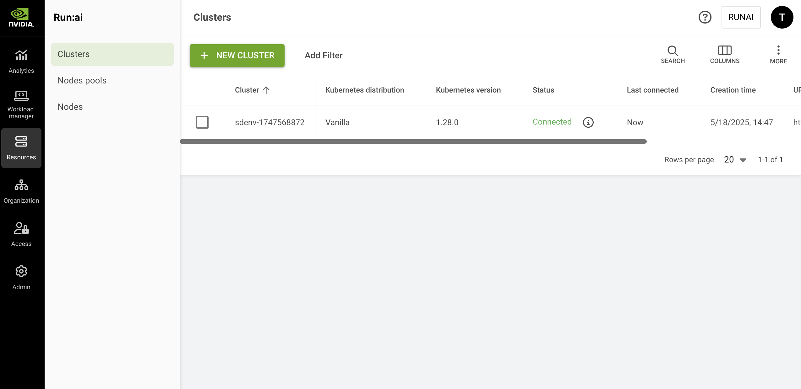

# Clusters

This guide explains the procedure to view and manage Clusters.

The Cluster table provides a quick and easy way to see the status of your cluster.

## Clusters Table

The Clusters table can be found under **Resources** in the NVIDIA Run:ai platform.

The clusters table provides a list of the clusters added to NVIDIA Run:ai platform, along with their status.

<figure><figcaption></figcaption></figure>

The clusters table consists of the following columns:

| Column                        | Description                                                                                                                                                                                                                                                                                                                 |
| ----------------------------- | --------------------------------------------------------------------------------------------------------------------------------------------------------------------------------------------------------------------------------------------------------------------------------------------------------------------------- |
| Cluster                       | The name of the cluster                                                                                                                                                                                                                                                                                                     |
| Kubernetes distribution       | The flavor of Kubernetes distribution                                                                                                                                                                                                                                                                                       |
| Kubernetes version            | The version of Kubernetes installed                                                                                                                                                                                                                                                                                         |
| Status                        | The status of the cluster. For more information see the [table below](clusters.md#cluster-status). Hover over the information icon for a short description and links to troubleshooting                                                                                                                                     |
| Last connected                | <p>Indicates the most recent time the cluster successfully connected to the control plane.</p><ul><li>If the cluster is currently connected, the value is displayed as Now.</li><li>If the cluster is disconnected or has experienced issues, the exact timestamp of the last successful connection is displayed.</li></ul> |
| Network topologies            | The network topologies associated with the cluster                                                                                                                                                                                                                                                                          |
| Creation time                 | The timestamp when the cluster was created                                                                                                                                                                                                                                                                                  |
| URL                           | The URL that was given to the cluster                                                                                                                                                                                                                                                                                       |
| NVIDIA Run:ai cluster version | The NVIDIA Run:ai version installed on the cluster                                                                                                                                                                                                                                                                          |
| NVIDIA Run:ai cluster UUID    | The unique ID of the cluster                                                                                                                                                                                                                                                                                                |

### Cluster Status

| Status                | Description                                                                                                                                                                                          |
| --------------------- | ---------------------------------------------------------------------------------------------------------------------------------------------------------------------------------------------------- |
| Waiting to connect    | The cluster has never been connected.                                                                                                                                                                |
| Disconnected          | There is no communication from the cluster to the Control plane. This may be due to a network issue. [See troubleshooting scenarios.](clusters.md#troubleshooting-scenarios)                         |
| Missing prerequisites | Some prerequisites are missing from the cluster. As a result, some features may be impacted. [See troubleshooting scenarios.](clusters.md#troubleshooting-scenarios)                                 |
| Service issues        | At least one of the services is not working properly. You can view the list of nonfunctioning services for more information. [See troubleshooting scenarios.](clusters.md#troubleshooting-scenarios) |
| Connected             | The NVIDIA Run:ai cluster is connected, and all NVIDIA Run:ai services are running.                                                                                                                  |

### Network Topologies Associated with the Cluster

Click one of the values in the Network topologies column to view the list of network topologies and their parameters.

| Column        | Description                                                           |
| ------------- | --------------------------------------------------------------------- |
| Topology      | The name of the topology                                              |
| Labels        | The ordered set of node label keys that define the topology hierarchy |
| Node pools    | The node pool(s) the network topology is associated with              |
| Created by    | The user who created the network topology                             |
| Creation time | The timestamp of when the network topology was created                |

### Customizing the Table View

* Filter - Click ADD FILTER, select the column to filter by, and enter the filter values
* Search - Click SEARCH and type the value to search by
* Sort - Click each column header to sort by
* Column selection - Click COLUMNS and select the columns to display in the table
* Download table - Click MORE and then Click Download as CSV. Export to CSV is limited to 20,000 rows.

## Adding a New Cluster

Follow the setup and installation instructions below to get the installation instructions to install the NVIDIA Run:ai cluster.

### **Setup**

1. In the NVIDIA Run:ai UI, go to Resources -> Clusters
2. Enter a unique **name** for your cluster
3. Optional: Choose the NVIDIA Run:ai cluster version (latest, by default)
4. Enter the Cluster URL. For more information, see [Fully Qualified Domain Name](../../getting-started/installation/install-using-helm/system-requirements.md#fully-qualified-domain-name-fqdn) requirement.
5. Click **CONTINUE**

### Installation Instructions

1. Follow the installation instructions and run the commands provided on your Kubernetes cluster. To add a new cluster, see the [installation guide](../../getting-started/installation/install-using-helm/helm-install.md).
2. Click **DONE**

The cluster is displayed in the table with the status **Waiting to connect**. Once installation is complete, the cluster status changes to **Connected**.

## Managing Network Topologies

Network topologies optimize placement and accelerate distributed workloads by keeping pods on nodes that are as close to each other as possible in the network. For more details, see [Accelerating workloads with network topology-aware scheduling](../../platform-management/aiinitiatives/resources/topology-aware-scheduling/README.md).

To add topologies that represent the cluster's network:

1. Select the cluster you want to add a network topology for
2. In the top action bar, click **NETWORK TOPOLOGIES**
3. In the **Network Topologies Associated with \<Cluster Name>** modal, click **+ NETWORK TOPOLOGY**
4. Enter a unique **name** for the topology. If the name already exists, you will be requested to enter a different name.
5. Click **+ LABEL** to add the node label keys that represent the network hierarchy
   * Order labels from farthest (first) to closest (last)
   * Ensure the labels match the corresponding keys on the nodes. For example: `cloud.provider.com/topology-block`, `cloud.provider.com/topology-rack`, `kubernetes.io/hostname`
   * Drag labels to adjust their order if needed
6. Click **SAVE NETWORK TOPOLOGY**

After creating the network topology, the administrator must associate it with the relevant node pool(s). See [Node pools](../../platform-management/aiinitiatives/resources/node-pools.md) for more details:

* If you are using the default node pool (that is, no additional node pools are defined), attach the topology to the default node pool.
* If different node pools have different topologies, each node pool must be linked to its corresponding topology.
* If the entire cluster shares the same topology, link the same topology to all node pools.

## Removing a Cluster

1. Select the cluster you want to remove
2. Click **REMOVE**
3. A dialog appears: Make sure to carefully read the message before removing
4. Click **REMOVE** to confirm the removal.

## Using the API

Go to the [Clusters](https://run-ai-docs.nvidia.com/api/2.26/organizations/clusters) API reference to view the available actions

## Troubleshooting

Before starting, make sure you have access to the Kubernetes cluster where NVIDIA Run:ai is deployed with the necessary permissions

### Troubleshooting Scenarios

<Accordion title="Cluster disconnected">

**Cluster disconnected**

**Description:** When the cluster's status is ‘disconnected’, there is no communication from the cluster services reaching the NVIDIA Run:ai Platform. This may be due to networking issues or issues with NVIDIA Run:ai services.

**Mitigation:**

1. Check NVIDIA Run:ai’s services status:
   1. Open your terminal
   2. Make sure you have access to the Kubernetes cluster with permissions to view pods
   3.  Copy and paste the following command to verify that NVIDIA Run:ai’s services are running:

       ```bash
       kubectl get pods -n runai | grep -E 'runai-agent|cluster-sync|assets-sync'
       ```
   4. If any of the services are not running, see the ‘cluster has service issues’ scenario.
2. **Check the network connection**
   1. Open your terminal
   2. Make sure you have access to the Kubernetes cluster with permissions to create pods
   3.  Copy and paste the following command to create a connectivity check pod:

       ```bash
       kubectl run control-plane-connectivity-check -n runai --image=wbitt/network-multitool --command -- /bin/sh -c 'curl -sSf <control-plane-endpoint> > /dev/null && echo "Connection Successful" || echo "Failed connecting to the Control Plane"'
       ```
   4. Replace `<control-plane-endpoint>` with the URL of the Control Plane in your environment. If the pod fails to connect to the Control Plane, check for potential network policies
3. **Check and modify the network policies**
   1. Open your terminal
   2.  Copy and paste the following command to check the existence of network policies:

       ```bash
       kubectl get networkpolicies -n runai
       ```
   3.  Review the policies to ensure that they allow traffic from the NVIDIA Run:ai namespace to the Control Plane. If necessary, update the policies to allow the required traffic

       Example of allowing traffic:

       ```yaml
       apiVersion: networking.k8s.io/v1
       kind: NetworkPolicy
       metadata:
         name: allow-control-plane-traffic
         namespace: runai
       spec:
         podSelector:
           matchLabels:
             app: runai
         policyTypes:
           - Ingress
           - Egress
         egress:
           - to:
               - ipBlock:
                   cidr: <control-plane-ip-range>
             ports:
               - protocol: TCP
                 port: <control-plane-port>
         ingress:
           - from:
               - ipBlock:
                   cidr: <control-plane-ip-range>
             ports:
               - protocol: TCP
                 port: <control-plane-port>
       ```
   4. Check infrastructure-level configurations:
      * Ensure that firewall rules and security groups allow traffic between your Kubernetes cluster and the Control Plane
      * Verify required ports and protocols:
        * Ensure that the necessary ports and protocols for NVIDIA Run:ai’s services are not blocked by any firewalls or security groups
4. **Check NVIDIA Run:ai services logs**
   1. Open your terminal
   2. Make sure you have access to the Kubernetes cluster with permissions to view logs
   3.  Copy and paste the following commands to view the logs of the NVIDIA Run:ai services:

       ```bash
       kubectl logs deployment/runai-agent -n runai
       kubectl logs deployment/cluster-sync -n runai
       kubectl logs deployment/assets-sync -n runai
       ```
   4. Try to identify the problem from the logs. If you cannot resolve the issue, continue to the next step.
5.  **Diagnosing internal network issues:**\
    NVIDIA Run:ai operates on Kubernetes, which uses its internal subnet and DNS services for communication between pods and services. If you find connectivity issues in the logs, the problem might be related to Kubernetes' internal networking.

    To diagnose DNS or connectivity issues, you can start a debugging Pod with networking utilities:

    1.  Copy the following command to your terminal, to start a pod with networking tools:

        ```bash
        kubectl run -i --tty netutils --image=dersimn/netutils -- bash
        ```

        This command creates an interactive pod (`netutils`) where you can use networking commands like `ping`, `curl`, `nslookup`, etc., to troubleshoot network issues.
    2. Use this pod to perform network resolution tests and other diagnostics to identify any DNS or connectivity problems within your Kubernetes Cluster.

</Accordion>

<Accordion title="Cluster disconnected due to a faulty GPU node">

**Cluster disconnected due to a faulty GPU node**

**Description:** A single faulty GPU node can cause the entire cluster to show a **Disconnected** status in the NVIDIA Run:ai platform, even when all other nodes are healthy. This typically occurs when the node is stuck in GPU validation and the NVIDIA Run:ai system DaemonSets cannot complete initialization on it. This happens because the NVIDIA Run:ai platform evaluates cluster health based on all system DaemonSet pods being available. A single stuck pod causes the DaemonSet to report as unavailable, which cascades to the cluster-level health status.

Cordoning the node is not sufficient. A common first response is to cordon the faulty node using `kubectl cordon`. However, cordoning only prevents new pods from being scheduled on the node. It does not evict pods that already tolerate the `node.kubernetes.io/unschedulable` taint. The `runai-container-toolkit` DaemonSet tolerates this taint by default. As a result, its pod remains running (or stuck) on the cordoned node, and the cluster continues to report as Disconnected.

**Mitigation:** These steps require `cluster-admin` permissions to taint nodes. To isolate the faulty node and allow the cluster to recover:

1. Add a custom taint to the faulty node to prevent new DaemonSet pods from being scheduled on it:

    ```bash
    kubectl taint node <node-name> runai/gpu-fault=true:NoSchedule
    ```
2. Delete the stuck DaemonSet pod on the faulty node. The taint from step 1 prevents the DaemonSet controller from recreating it, which reduces the expected pod count and allows the DaemonSet to report as fully available:

    ```bash
    kubectl -n runai delete pod -l app=runai-container-toolkit --field-selector spec.nodeName=<node-name>
    ```
3. Verify the cluster status returns to **Connected** in the NVIDIA Run:ai platform UI.
4. Once the hardware issue on the node is resolved, remove the taint:

    ```bash
    kubectl taint node <node-name> runai/gpu-fault=true:NoSchedule-
    ```

<Info>

**Note**

If the node has no workloads worth preserving on its remaining healthy GPUs, a full drain and reboot (`kubectl drain <node-name> --ignore-daemonsets --delete-emptydir-data`) is an alternative approach. This resolves the underlying hardware fault directly and the taint workaround is not needed.

</Info>

</Accordion>

<Accordion title="Cluster has service issues">

**Cluster has service issues**

**Description:** When a cluster's status is ‘Has service issues\`, it means that one or more NVIDIA Run:ai services running in the cluster are not available.

**Mitigation:**

1. **Verify non-functioning services**
   1. Open your terminal
   2. Make sure you have access to the Kubernetes cluster with permissions to view the `runaiconfig` resource
   3.  Copy and paste the following command to determine which services are not functioning:

       ```bash
       kubectl get runaiconfig -n runai runai -ojson | jq -r '.status.conditions | map(select(.type == "Available"))'
       ```
2. **Check for Kubernetes events**
   1. Open your terminal
   2. Make sure you have access to the Kubernetes cluster with permissions to view events
   3.  Copy and paste the following command to get all [Kubernetes events](https://kubernetes.io/docs/reference/kubernetes-api/cluster-resources/event-v1/):

       ```bash
       kubectl get events -A
       ```
3. **Inspect resource details**
   1. Open your terminal
   2. Make sure you have access to the Kubernetes cluster with permissions to describe resources
   3.  Copy and paste the following command to check the details of the required resource:

       ```bash
       kubectl describe <resource_type> <name>
       ```

</Accordion>

<Accordion title="Cluster is waiting to connect">

**Cluster is waiting to connect**

**Description:** When the cluster's status is ‘waiting to connect’, it means that no communication from the cluster services reaches the NVIDIA Run:ai Platform. This may be due to networking issues or issues with NVIDIA Run:ai services.

**Mitigation:**

1. **Check NVIDIA Run:ai’s services status**
   1. Open your terminal
   2. Make sure you have access to the Kubernetes cluster with permissions to view pods
   3.  Copy and paste the following command to verify that NVIDIA Run:ai’s services are running:

       ```bash
       kubectl get pods -n runai | grep -E 'runai-agent|cluster-sync|assets-sync'
       ```
   4. If any of the services are not running, see the ‘cluster has service issues’ scenario.
2. **Check the network connection**
   1. Open your terminal
   2. Make sure you have access to the Kubernetes cluster with permissions to create pods
   3.  Copy and paste the following command to create a connectivity check pod:

       ```bash
       kubectl run control-plane-connectivity-check -n runai --image=wbitt/network-multitool --command -- /bin/sh -c 'curl -sSf <control-plane-endpoint> > /dev/null && echo "Connection Successful" || echo "Failed connecting to the Control Plane"'
       ```
   4. Replace `<control-plane-endpoint>` with the URL of the Control Plane in your environment. If the pod fails to connect to the Control Plane, check for potential network policies:
3. **Check and modify the network policies**
   1. Open your terminal
   2.  Copy and paste the following command to check the existence of network policies:

       ```bash
       kubectl get networkpolicies -n runai
       ```
   3. Review the policies to ensure that they allow traffic from the NVIDIA Run:ai namespace to the Control Plane. If necessary, update the policies to allow the required traffic
   4.  Example of allowing traffic:

       ```yaml
       apiVersion: networking.k8s.io/v1
       kind: NetworkPolicy
       metadata:
         name: allow-control-plane-traffic
         namespace: runai
       spec:
         podSelector:
           matchLabels:
             app: runai
         policyTypes:
           - Ingress
           - Egress
         egress:
           - to:
               - ipBlock:
                   cidr: <control-plane-ip-range>
             ports:
               - protocol: TCP
                 port: <control-plane-port>
         ingress:
           - from:
               - ipBlock:
                   cidr: <control-plane-ip-range>
             ports:
               - protocol: TCP
                 port: <control-plane-port>
       ```
   5. Check infrastructure-level configurations:
   6. Ensure that firewall rules and security groups allow traffic between your Kubernetes cluster and the Control Plane
   7. Verify required ports and protocols:
      * Ensure that the necessary ports and protocols for NVIDIA Run:ai’s services are not blocked by any firewalls or security groups
4. **Check NVIDIA Run:ai services logs**
   1. Open your terminal
   2. Make sure you have access to the Kubernetes cluster with permissions to view logs
   3.  Copy and paste the following commands to view the logs of the NVIDIA Run:ai services:

       ```bash
       kubectl logs deployment/runai-agent -n runai
       kubectl logs deployment/cluster-sync -n runai
       kubectl logs deployment/assets-sync -n runai
       ```
   4. Try to identify the problem from the logs. If you cannot resolve the issue, continue to the next step

</Accordion>

<Accordion title="Cluster is missing prerequisites">

**Cluster is missing prerequisites**

**Description:** When a cluster's status displays Missing prerequisites, it indicates that at least one of the Mandatory Prerequisites has not been fulfilled. In such cases, NVIDIA Run:ai services may not function properly.

**Mitigation:**

If you have ensured that all prerequisites are installed and the status still shows _missing prerequisites_, follow these steps:

1. Check the message in the NVIDIA Run:ai platform for further details regarding the missing prerequisites.
2. **Inspect the** `runai-public` ConfigMap:
   1.  Open your terminal. In the terminal, type the following command to list all ConfigMaps in the `runai` namespace:

       ```bash
       kubectl get configmap runai-public -n runai
       ```
3. **Describe the ConfigMap**
   1. Locate the ConfigMap named `runai-public` from the list
   2.  To view the detailed contents of this ConfigMap, type the following command:

       ```bash
       kubectl describe configmap runai-public -n runai
       ```
4. **Find Missing Prerequisites**
   1. In the output displayed, look for a section labeled `dependencies.required`
   2. This section provides detailed information about any missing resources or prerequisites. Review this information to identify what is needed

</Accordion>
