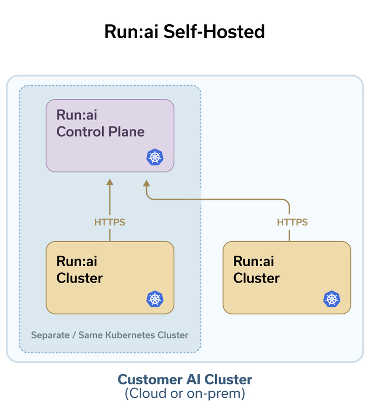
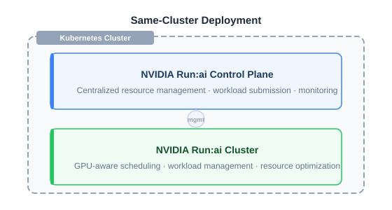

# Overview

NVIDIA Run:ai is a Kubernetes-native platform for efficient GPU resource management and AI workload orchestration. It runs on customer-managed infrastructure: the hardware, Kubernetes cluster, and network that the organization owns and operates. NVIDIA Run:ai delivers the software that manages and orchestrates the GPUs; the customer provides everything it sits on.

This page explains the platform components, the setup lifecycle, and what to understand before installing - deployment models, shared responsibility, installation options, and installation paths.

<Note>

**Note**

To prepare your environment and install NVIDIA Run:ai, go to the [Next Steps](#next-steps).

</Note>

## Platform Components

NVIDIA Run:ai is made up of two components, both installed on a Kubernetes cluster. See [Architecture and Components](../developer/architecture.md) for a deeper look at how they fit together:

* **NVIDIA Run:ai control plane** - Provides centralized resource management, handles workload submission, and delivers cluster monitoring and analytics. The control plane is the management layer; it connects to one or more NVIDIA Run:ai clusters and gives administrators and users a single place to operate across them.
* **NVIDIA Run:ai cluster** - Set of cluster services that provide enhanced scheduling and workload management on each Kubernetes cluster where workloads run. The cluster component extends Kubernetes native scheduling with Run:ai's GPU-aware capabilities.

Every installation includes at least one NVIDIA Run:ai control plane and one NVIDIA Run:ai cluster. In a typical deployment, both are installed on the same Kubernetes cluster. As your environment grows, you can connect additional NVIDIA Run:ai clusters to the same control plane. See [Deployment Model](#deployment-model).

<figure><figcaption></figcaption></figure>

## Setup Lifecycle

Setting up NVIDIA Run:ai follows a three-phase lifecycle that reflects the natural progression from planning through ongoing operations.

### Day 0: Planning

Day 0 covers the planning and preparation before installing NVIDIA Run:ai on your Kubernetes cluster.

* Choose your deployment model - same-cluster or multi-cluster
* Meet infrastructure requirements - hardware, Kubernetes distribution, and prerequisites such as the GPU Operator
* Set up networking - load balancer, ingress controller, FQDNs, DNS, and TLS certificates
* Enable external access for administrators and users to reach the NVIDIA Run:ai control plane and clusters
* Review third-party services deployed as part of the installation, such as Keycloak and PostgreSQL

### Day 1: Installation and Configuration

Day 1 gets NVIDIA Run:ai running on your Kubernetes cluster and covers the infrastructure configuration that makes it production-ready for your environment. Which configurations apply depends on your environment and workload needs. Configuration is performed after installation and is typically done once, though it may be revisited as your environment evolves.

* Install NVIDIA Run:ai using the path that fits your environment - Guided Installation, Manual Helm, or Base Command Manager
* Assign node roles and configure advanced NVIDIA Run:ai cluster and control plane settings
* Configure Kubernetes cluster authentication through the NVIDIA Run:ai identity provider
* Configure networking for external access, service mesh, and container access
* Apply security hardening to your cluster
* Set up shared storage
* Connect third-party integrations

### Day 2: Operations

Day 2 covers the ongoing operational tasks that keep NVIDIA Run:ai healthy and your clusters running smoothly.

* View and manage your clusters
* Tune NVIDIA Run:ai system services for scale, high availability, and resource right-sizing as your environment grows
* Perform node maintenance and restore from backup when needed
* Monitor GPU and workload metrics, collect logs, and review event history

### Upgrades

Upgrades are a lifecycle event that can occur at any phase and are not bound to a specific day. To upgrade NVIDIA Run:ai, see [Upgrade](upgrade/helm.md).

## Understanding Installation

### Deployment Model

The NVIDIA Run:ai control plane and NVIDIA Run:ai clusters can be deployed across your Kubernetes environment in one of two models. The two components can run either on the same Kubernetes cluster or on separate Kubernetes clusters; in both cases, network connectivity between them is required. See [Deployment Model](system-requirements/deployment-model.md) for more details.

* **Same-cluster deployment** - The NVIDIA Run:ai control plane and the first NVIDIA Run:ai cluster are installed on the same Kubernetes cluster. This is the most common deployment model. Infrastructure such as the load balancer, ingress controller, and DNS can be shared between the two components.

* **Multi-cluster deployment** - The NVIDIA Run:ai control plane runs on a dedicated Kubernetes cluster, while one or more NVIDIA Run:ai clusters run on separate Kubernetes clusters. Each NVIDIA Run:ai cluster requires its own load balancer, ingress controller, FQDNs, and TLS certificates.

### Shared Responsibility

NVIDIA Run:ai operates under a shared responsibility model. NVIDIA provides and manages the NVIDIA Run:ai software, while the customer provides and operates the underlying infrastructure. This distinction defines which components the customer prepares and operates, and which are delivered and maintained as part of the NVIDIA Run:ai platform.

When using the recommended [guided installer](installation/guided-installation/README.md#what-the-installer-does), several customer-owned prerequisites in this table are set up for you. When installing manually via Helm, all customer-owned items must be in place before the Helm charts are applied. Third-party services are the exception: they are deployed by the NVIDIA Run:ai Helm charts in both installation paths and do not need to be installed beforehand.

| Category                  | Components                                                                                                       | Owner    |
| ------------------------- | ---------------------------------------------------------------------------------------------------------------- | -------- |
| Platform software         | NVIDIA Run:ai images and Helm charts                                                                             | NVIDIA   |
| Third-party services      | Keycloak, Traefik, Valkey, NATS, and others                                                                      | Customer |
| Hardware                  | Control plane system nodes, cluster system nodes, worker nodes                                                   | Customer |
| Kubernetes infrastructure | OS, Kubernetes distribution, container runtime, storage class, shared storage                                   | Customer |
| Networking                | Load balancer, ingress controller, FQDN, DNS, TLS certificates                                                   | Customer |
| Prerequisites             | GPU Operator, Network Operator, Prometheus                                                                       | Customer |

<Note>

**Note**

Third-party services are deployed by the NVIDIA Run:ai Helm charts, but the customer is responsible for operating and maintaining them after installation.

</Note>

Since you own the infrastructure, you can apply OS and Kubernetes security patches and hardening independently, without coordinating with NVIDIA, provided the environment stays within the [support matrix](support-matrix.md) and the permissions, connectivity, and configuration that NVIDIA Run:ai requires remain intact.

### Installation Options

NVIDIA Run:ai is an open source platform, with NVIDIA Run:ai Support-Entitled available as a supported version of the same platform. Both share the same installation model and support both connected and air-gapped environments. NVIDIA Run:ai Support-Entitled requires an NGC API key to pull platform images and Helm charts.

| Type                            | Description                                          | NGC API Key Required |
| ------------------------------- | ----------------------------------------------------- | --------------------- |
| Open Source                    | Full platform functionality, community-supported.     | No                    |
| NVIDIA Run:ai Support-Entitled | Support-entitled version with support SLAs and other entitlements.    | Yes                   |

#### Connected and Air-Gapped Environments

NVIDIA Run:ai can be deployed in either a connected or air-gapped environment, regardless of type. Both use the same [installation paths](#installation-paths) and tooling.

| Connectivity | Description                                                                                                                                                                            |
| ------------ | -------------------------------------------------------------------------------------------------------------------------------------------------------------------------------------- |
| Connected    | The cluster can reach the internet to pull images and Helm charts directly from NGC and upstream registries during installation.                                                       |
| Air-gapped   | The cluster has no internet access. Regardless of installation path, you first pack all required images into a tarball on a connected machine, then transfer the tarball into the air-gapped environment and load the images into your own internal registry before installing with either the Guided Installation or Manual Helm. |

#### Kubernetes and OpenShift

NVIDIA Run:ai runs on both Kubernetes and OpenShift, and the installation model is the same for both. Where they differ is in how certain infrastructure pieces work: OpenShift routes traffic through its built-in router rather than an ingress controller, installs operators like the GPU Operator through OLM rather than Helm, and manages TLS at the router level rather than through Kubernetes secrets. These differences are handled within each installation guide, and the overall flow remains the same.

### Installation Paths

NVIDIA Run:ai supports three installation paths. Choose based on your tooling, environment, and the balance you want between installation convenience and fine-grained control over configuration values.

| Path | Tooling | Best For |
| ---- | ------- | -------- |
| **[Guided Installation](installation/guided-installation/README.md)** (recommended) | `runai-installer` CLI - reads a single configuration YAML file and performs the full installation | Most deployments |
| **[Manual Helm](installation/install-using-helm/preparations.md)** | NVIDIA Run:ai Helm charts, deployed directly | Organizations managing deployments through their own tooling (for example, Argo CD), or needing granular control over Helm values |
| **[BCM](installation/bcm-install.md)** (NVIDIA Run:ai Support-Entitled only) | NVIDIA Base Command Manager | DGX SuperPOD environments managed by BCM |

### Artifact Sources

During installation, NVIDIA Run:ai pulls platform images, Helm charts, and third-party service images from different sources depending on whether you use Open Source or NVIDIA Run:ai Support-Entitled, and your environment. Understanding these sources helps you plan network access, registry credentials, and air-gapped deployments.

* **NVIDIA Run:ai platform images and Helm charts** are published to NVIDIA NGC. Open Source installations access them without credentials. NVIDIA Run:ai Support-Entitled installations require an NGC API key. Organizations that mirror artifacts to an internal registry (for example, JFrog Artifactory) can configure the installer or Helm charts to pull from that registry instead.

* **Third-party service images** (PostgreSQL, Keycloak, and others) are pulled from their official upstream registries on Docker Hub, Quay, and the Kubernetes registry (`registry.k8s.io`) for Open Source and NVIDIA Run:ai Support-Entitled installations.

* **Air-gapped installations** do not pull from NGC or upstream registries directly. On a connected machine, every required image - platform, third-party, and any overrides you provide - is packed into a single tarball. After transferring the tarball into the air-gapped network, the images are loaded into your own internal registry, and the installation pulls from there instead.

### What an Installation Includes

An NVIDIA Run:ai installation relies on several categories of software and infrastructure. Some components are installed and managed by NVIDIA Run:ai, while others are customer-provided prerequisites or optional components that enable specific platform capabilities. For a detailed breakdown of ownership responsibilities, see [Shared Responsibility](#shared-responsibility).

* **Infrastructure you provide** - The hardware, operating system, Kubernetes distribution, networking, and storage that host NVIDIA Run:ai. These components must be in place before installation begins. See [System Requirements](system-requirements/README.md).

* **Third-party services** - A set of supporting services deployed as part of the installation, including Keycloak for authentication and identity management, PostgreSQL as the centralized database, Traefik as the API gateway, NATS for asynchronous communication, and others. See [Third-Party Services](system-requirements/third-party-services.md).

* **Prerequisites** - Components that NVIDIA Run:ai requires: GPU Operator (provisions and manages GPUs on worker nodes) and Prometheus (required for metrics collection and monitoring). The Network Operator is required only if you are using Multi-Node NVLink (MNNVL) workloads. See [Prerequisites and Features](installation/guided-installation/prerequisites-and-features.md#prerequisites).

* **Feature-specific components** - Optional components required only for specific NVIDIA Run:ai features. When using the guided installer, these components can be enabled in the configuration file and installed alongside NVIDIA Run:ai. See [Prerequisites and Features](installation/guided-installation/prerequisites-and-features.md#features).

  | Component | Required for |
  | --------- | ------------ |
  | Knative Serving | Standard inference |
  | Kubeflow Training Operator | Distributed training |
  | MPI Operator | MPI-based distributed training |
  | LeaderWorkerSet (LWS) | Distributed inference |
  | NIM Operator | NVIDIA NIM microservices |
  | Grove | Multi-component, gang-scheduled workload orchestration (for example, disaggregated Dynamo deployments) |
  | Dynamo | Inference pipeline optimization |

## Next Steps

<Note>

**BCM installations**

If you are deploying NVIDIA Run:ai through NVIDIA Base Command Manager (BCM), do not follow the steps below. BCM manages its own prerequisites, support matrix, and installation process. Refer directly to the [BCM installation instructions](installation/bcm-install.md) for your supported release.

</Note>

* Check the [Support Matrix](support-matrix.md) to know which Kubernetes/OpenShift versions, operating system, GPU and other operators, and third-party service versions NVIDIA Run:ai supports - this determines what to prepare and install in your environment.
* Complete [System Requirements](system-requirements/README.md) to plan your deployment model and prepare your infrastructure, networking, and more, before installation begins.
* Install using the path that fits your environment:
  * [Guided Installation](installation/guided-installation/README.md) - Recommended for most installations.
  * [Manual Helm](installation/install-using-helm/preparations.md) - For organizations managing releases through their own tooling.
