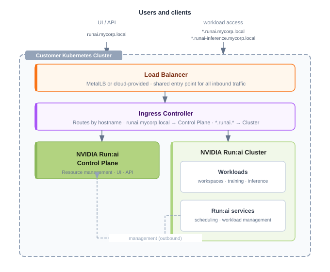
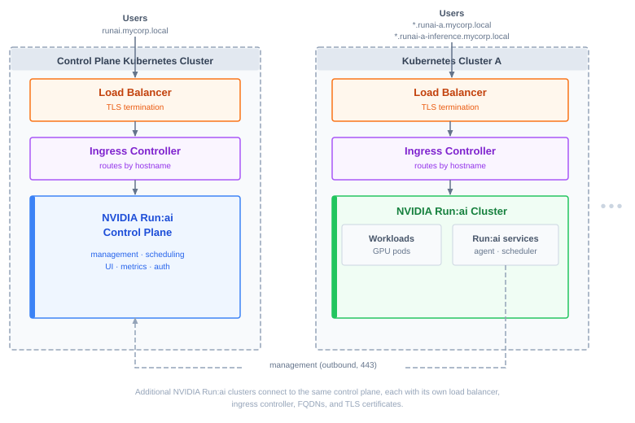

---
---

# Deployment Model

The NVIDIA Run:ai control plane and NVIDIA Run:ai clusters can be deployed across your Kubernetes environment in one of two models. The infrastructure required depends on which model you choose:

* **Same-cluster deployment** - The NVIDIA Run:ai control plane and the first NVIDIA Run:ai cluster are installed on the same Kubernetes cluster. This is the most common deployment model. Infrastructure such as the load balancer, ingress controller, and DNS can be shared between the two components.
* **Multi-cluster deployment** - The NVIDIA Run:ai control plane is installed on a dedicated Kubernetes cluster, while one or more NVIDIA Run:ai clusters are installed on separate Kubernetes clusters. Each NVIDIA Run:ai cluster requires its own load balancer, ingress controller, FQDNs, and TLS certificates.

## Connectivity

NVIDIA Run:ai involves two distinct traffic flows, each with its own connectivity requirements:

* **Management traffic (outbound)** - NVIDIA Run:ai cluster services initiate the connection to the control plane FQDN (for example, `runai.mycorp.local`) over HTTPS (port 443). In restricted networks, allow outbound HTTPS from the NVIDIA Run:ai cluster nodes to the control plane FQDN.
* **User access traffic (inbound)** - Users and clients require inbound access to:
  * The NVIDIA Run:ai control plane, for UI and API access.
  * Each NVIDIA Run:ai cluster, for access to workspaces, training, and inference workloads exposed through the cluster's load balancer and ingress controller.

In a same-cluster deployment, both inbound flows arrive at the same Kubernetes cluster and can share the load balancer and ingress controller. In a multi-cluster deployment, each NVIDIA Run:ai cluster must be reachable by its users - this is why the load balancer, ingress controller, and cluster-specific FQDNs and TLS certificates are required per cluster. The control plane domain and its certificate remain single regardless of deployment model.

The following diagram shows the traffic flows in a same-cluster deployment:

<Note>

**Note**

The load balancer is drawn inside the cluster, as with MetalLB in on-premises deployments. In managed cloud environments it is provided by the cloud provider. Either way, it is the single shared entry point for inbound traffic.

</Note>

The following diagram shows the traffic flows in a multi-cluster deployment, where each cluster has its own load balancer and ingress controller:

## Infrastructure by Deployment Model

Use the tables below to determine how many of each networking, DNS, and TLS component to provision before you begin installation, based on the deployment model you chose:

* **Single** - One component shared across the whole deployment.
* **Per cluster** - One component required for each additional NVIDIA Run:ai cluster beyond the control plane.

For setup instructions, see [Networking Setup](networking-setup.md).

### Load Balancer and Ingress

#### Kubernetes

| Component | Same-cluster | Multi-cluster |
|---|---|---|
| Load balancer | Single | Per cluster |
| Ingress controller | Single | Per cluster |

#### OpenShift

OpenShift ships with a pre-installed router that serves as both load balancer and ingress controller, so no separate installation is required.

| Component | Same-cluster | Multi-cluster |
|---|---|---|
| Router (built-in) | Single | Per cluster |

### DNS

<Note>

**Note**

Applies to Kubernetes only. On OpenShift, the domain is derived from the cluster's route domain (`oc get routes -A`) rather than manually configured DNS records.

</Note>

| Component | Same-cluster | Multi-cluster |
|---|---|---|
| Control plane domain | Single | Single |
| Cluster domain1 | Not required | Per cluster |
| Workspace and training wildcard domain | Single | Per cluster |
| Inference wildcard domain2 | Single | Per cluster |

1 Only needed when the NVIDIA Run:ai cluster is installed on a different Kubernetes cluster than the control plane. In a same-cluster deployment, the cluster uses the control plane domain and does not need its own.

2 Required only if inference workloads are exposed externally.

### TLS Certificates

#### Kubernetes

| Component | Same-cluster | Multi-cluster |
|---|---|---|
| Control plane certificate | Single | Single |
| Cluster domain certificate | Single | Per cluster |
| Workspace and training wildcard certificate | Single | Per cluster |
| Inference wildcard certificate1 | Single | Per cluster |

1 Required only if inference workloads are exposed externally.

#### OpenShift

| Component | Same-cluster | Multi-cluster |
|---|---|---|
| Router certificate | Single | Per cluster |
