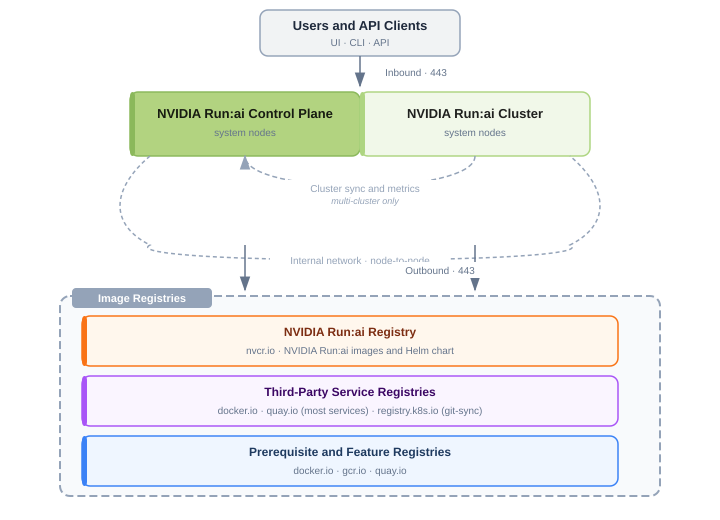

# External Access to Critical Services

NVIDIA Run:ai requires certain network connectivity and access. This page outlines the network endpoints and protocols that must be reachable from your NVIDIA Run:ai control plane and cluster nodes to support installation, artifact retrieval, and ongoing platform communication.

Meeting these requirements ensures that:

* Users and API clients can reach the NVIDIA Run:ai control plane and cluster
* The NVIDIA Run:ai cluster can sync with and report metrics to the control plane
* The control plane and cluster nodes can pull the images required for installation

| Category | Requirement | Details |
|---|---|---|
| Inbound | Ports open for user and API access | See [Inbound Rules](#inbound-rules) |
| Outbound | Control plane and cluster sync | See [Control Plane and Cluster Sync](#control-plane-and-cluster-sync) |
| Outbound | NVIDIA Run:ai registry and catalog access | See [NVIDIA Run:ai Registry and Catalogs](#nvidia-runai-registry-and-catalogs) |
| Outbound | Networking component registry access | See [Networking Component Registries](#networking-component-registries) |
| Outbound | Third-party service registry access | See [Third-Party Service Registries](#third-party-service-registries) |
| Outbound | Prerequisite and feature component registry access | See [Prerequisite and Feature Registries](#prerequisite-and-feature-registries) |
| Internal | Node-to-node connectivity | See [Internal Network](#internal-network) |

<Note>

**Note**

Ensure the inbound and outbound rules below are correctly applied to your firewall before proceeding with installation.

</Note>

## Inbound Rules

To allow your organization's NVIDIA Run:ai users to interact with the cluster using the [NVIDIA Run:ai Command-line interface](../../reference/cli/install-cli.md), or access specific UI features, certain inbound ports need to be open:

| Name                        | Description       | Source  | Destination                | Port |
| --------------------------- | ----------------- | ------- | --------------------------- | ---- |
| NVIDIA Run:ai control plane | HTTPS entry point | 0.0.0.0 | NVIDIA Run:ai system nodes | 443  |
| NVIDIA Run:ai cluster       | HTTPS entry point | 0.0.0.0 | NVIDIA Run:ai system nodes | 443  |

## Outbound Rules

### Control Plane and Cluster Sync

<Note>

**Note**

These rules apply only to [multi-cluster deployments](deployment-model.md), where the NVIDIA Run:ai cluster is installed on a separate Kubernetes cluster from the control plane. In a same-cluster deployment, the control plane and cluster run on the same Kubernetes cluster and communicate internally.

</Note>

| Name          | Description                                                                      | Source                             | Destination                      | Port |
| ------------- | --------------------------------------------------------------------------------- | ----------------------------------- | --------------------------------- | ---- |
| Cluster sync  | Sync NVIDIA Run:ai cluster with NVIDIA Run:ai control plane                       | NVIDIA Run:ai cluster system nodes | NVIDIA Run:ai control plane FQDN | 443  |
| Metric store  | Push NVIDIA Run:ai cluster metrics to NVIDIA Run:ai control plane's metric store | NVIDIA Run:ai cluster system nodes | NVIDIA Run:ai control plane FQDN | 443  |

### NVIDIA Run:ai Registry and Catalogs

| Name                       | Description                                                 | Source                                    | Destination        | Port |
| -------------------------- | ------------------------------------------------------------ | ------------------------------------------ | ------------------- | ---- |
| NVIDIA Run:ai NGC Registry | Pull NVIDIA Run:ai images and Helm chart for installation   | All Kubernetes nodes                      | nvcr.io             | 443  |
| NVIDIA NGC                 | Browse NGC catalog                                           | NVIDIA Run:ai control plane system nodes | api.ngc.nvidia.com  | 443  |
| Hugging Face               | Browse Hugging Face models                                    | NVIDIA Run:ai control plane system nodes | huggingface.co      | 443  |

### Networking Component Registries

The ingress controller you install as part of [Networking Setup](networking-setup.md) is pulled from the following registry:

| Name                        | Description                                     | Source                | Destination | Port |
| ---------------------------- | ------------------------------------------------ | ---------------------- | ----------- | ---- |
| Ingress Controller Registry  | HAProxy ingress controller image repository | All Kubernetes nodes | docker.io   | 443  |

### Third-Party Service Registries

NVIDIA Run:ai deploys the following third-party services as part of installation. Images are pulled from Docker Hub, Quay, or the Kubernetes registry. For the full registry model, see [Image Registry](third-party-services.md#image-registry) in Third-Party Services.

| Name          | Description                        | Source                              | Destination      | Port |
| ------------- | ------------------------------------ | ------------------------------------ | ------------------ | ---- |
| Keycloak      | Identity federation and SSO service | NVIDIA Run:ai control plane system nodes | docker.io / quay.io | 443  |
| PostgreSQL    | Centralized platform database       | NVIDIA Run:ai control plane system nodes | docker.io / quay.io | 443  |
| Traefik       | API gateway                         | NVIDIA Run:ai control plane system nodes | docker.io / quay.io | 443  |
| NATS          | Message broker                      | NVIDIA Run:ai control plane system nodes | docker.io / quay.io | 443  |
| Thanos        | Long-term metrics storage           | NVIDIA Run:ai control plane system nodes | docker.io / quay.io | 443  |
| Valkey        | Workload cache                      | NVIDIA Run:ai cluster system nodes  | docker.io / quay.io | 443  |
| oauth2-proxy  | Workload access authentication      | NVIDIA Run:ai cluster system nodes  | docker.io / quay.io | 443  |
| git-sync      | Git data source sync                | NVIDIA Run:ai cluster system nodes  | registry.k8s.io      | 443  |

#### Gov-Ready

For a [Gov-ready installation](gov-ready-third-party-services.md), the following services are pulled from Docker Hub as hardened images. You provide Docker Hub credentials to pull them.

| Name          | Description                                    | Source                                   | Destination | Port |
| ------------- | ----------------------------------------------- | ----------------------------------------- | ----------- | ---- |
| Keycloak      | Identity federation and SSO service             | NVIDIA Run:ai control plane system nodes | docker.io   | 443  |
| PostgreSQL    | Client image that waits for the database        | NVIDIA Run:ai control plane system nodes | docker.io   | 443  |
| Traefik       | API gateway                                     | NVIDIA Run:ai control plane system nodes | docker.io   | 443  |
| NATS          | Message broker                                  | NVIDIA Run:ai control plane system nodes | docker.io   | 443  |
| Thanos        | Long-term metrics storage                       | NVIDIA Run:ai control plane system nodes | docker.io   | 443  |
| Valkey        | Workload cache                                  | NVIDIA Run:ai cluster system nodes       | docker.io   | 443  |
| git-sync      | Git data source sync                            | NVIDIA Run:ai cluster system nodes       | docker.io   | 443  |

### Prerequisite and Feature Registries

NVIDIA Run:ai requires additional prerequisite and feature components to be installed on the cluster, such as the GPU Operator and Prometheus Operator. These components are pulled from the following registries:

| Name                        | Type          | Description                                     | Source                | Destination | Port |
| ---------------------------- | ------------- | ------------------------------------------------ | ---------------------- | ----------- | ---- |
| NVIDIA NGC Catalog          | Prerequisite  | GPU Operator image repository                    | All Kubernetes nodes   | nvcr.io     | 443  |
| Red Hat Container Registry   | Prerequisite  | Prometheus Operator image repository             | All Kubernetes nodes   | quay.io     | 443  |
| Google Container Registry    | Feature       | Knative image repository                          | All Kubernetes nodes   | gcr.io      | 443  |
| Docker Hub Registry          | Feature       | Kubeflow Training Operator image repository       | All Kubernetes nodes   | docker.io   | 443  |

## Internal Network

Ensure that all Kubernetes nodes can communicate with each other across all necessary ports. Kubernetes assumes full interconnectivity between nodes, so you must configure your network to allow this seamless communication. Specific port requirements may vary depending on your network setup.

## IPv6 Considerations

For IPv6-only environments, `nvcr.io` only has an IPv4 DNS record, so clients on IPv6-only networks cannot resolve it and image pulls will fail. Two options:

* **Configure NAT64/DNS64** - Translates between IPv6 and IPv4 so the cluster reaches the registry transparently.
* **Deploy an internal mirror registry** - Use Harbor, Artifactory, or a similar registry over IPv6, configured to pull from `nvcr.io` over IPv4. Point the cluster at the mirror through the container runtime config and NVIDIA Run:ai Helm image-registry overrides. Choose this option for air-gapped or strictly controlled networks.

`gcr.io`, `quay.io`, and `docker.io` are reachable over IPv6 directly.
