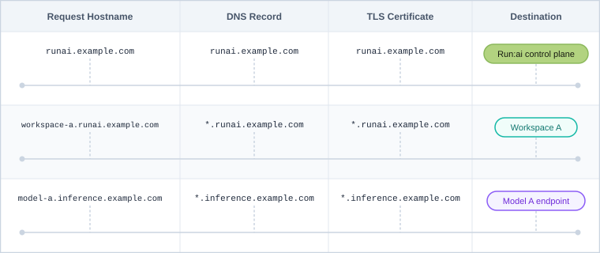

---
---

# Networking Setup

NVIDIA Run:ai relies on your Kubernetes cluster's networking to route traffic between users, the NVIDIA Run:ai control plane, and NVIDIA Run:ai clusters. This section describes the networking components you must install and configure before installation:

* [Load Balancer](#load-balancer) - Exposes services outside the cluster through a single IP address.
* [Ingress Controller](#ingress-controller) - Routes external traffic to the NVIDIA Run:ai control plane and cluster services.
* [FQDN and DNS](#fqdn-and-dns) - Domain names and DNS records used to route traffic by hostname.
* [TLS Certificates](#tls-certificates) - Secures HTTPS access to exposed services.
* [Local Certificate Authority (CA)](#local-certificate-authority-ca) - Required if your certificates are signed by a private CA.

<Note>

**Note**

* As per the [deployment model](deployment-model.md), each component is installed once or once per NVIDIA Run:ai cluster.
* FQDN, TLS certificates, and the Local Certificate Authority are not provisioned automatically by NVIDIA Run:ai. These must be prepared beforehand and applied when installing the NVIDIA Run:ai control plane and NVIDIA Run:ai cluster, according to the installation path - [Guided Installation](../installation/guided-installation/README.md) or [Manual Helm](../installation/install-using-helm/preparations.md).

</Note>

## Load Balancer

<Note>

**Deployment model**

Install the load balancer once for a same-cluster deployment, or on each cluster for a multi-cluster deployment. For more information, see [Deployment Model](deployment-model.md).

</Note>

In Kubernetes, services of type `LoadBalancer` are used to expose applications outside the cluster through a single, stable IP address, providing a consistent entry point for external traffic. In managed cloud environments this capability is built-in, while in self-hosted and on-premise deployments it must be provided explicitly.

MetalLB fulfills this role by allocating external IP addresses from a predefined pool and advertising them on the external network, enabling access to services running inside the cluster.

In NVIDIA Run:ai, this is required to support north-south traffic, including access to the NVIDIA Run:ai control plane, APIs, and UI, as well as externally exposed workloads - standard inference (Knative) endpoints, development workspaces, training, and distributed inference workloads.

1. Reserve a range of IP addresses (recommended a full 32 subnet) for example: `172.20.10.0-172.20.10.255`
2. Install MetalLB:

    ```bash
    helm repo add metallb https://metallb.github.io/metallb
    helm repo update
    helm install metallb metallb/metallb --version 0.15.3 --namespace metallb-system --create-namespace
    ```

3. Create a YAML file named `metalLB-config.yaml` and replace `<IPADDRESS-RANGE-START>-<IPADDRESS-RANGE-END>` with the reserved range of IP addresses:

    ```yaml
    apiVersion: metallb.io/v1beta1
    kind: IPAddressPool
    metadata:
      name: runai-ip-pool
      namespace: metallb-system
    spec:
      addresses:
      - <IPADDRESS-RANGE-START>-<IPADDRESS-RANGE-END> # for example 172.20.10.0-172.20.10.255
    ---
    apiVersion: metallb.io/v1beta1
    kind: L2Advertisement
    metadata:
      name: runai-l2-advertisement
      namespace: metallb-system
    spec:
      ipAddressPools:
      - runai-ip-pool
    ```

4. Apply the YAML:

    ```bash
    kubectl apply -f metalLB-config.yaml
    ```

## Ingress Controller

<Note>

**Deployment model**

Install the ingress controller once for a same-cluster deployment, or on each cluster for a multi-cluster deployment. For more information, see [Deployment Model](deployment-model.md).

</Note>

NVIDIA Run:ai requires a [Kubernetes Ingress Controller](https://kubernetes.io/docs/concepts/services-networking/ingress-controllers/) to be installed on the Kubernetes cluster. OpenShift and RKE2 come with a pre-installed ingress controller. Once installed, you'll reference this controller when configuring NVIDIA Run:ai - [Guided Installation](../installation/guided-installation/README.md) accepts it as a configuration field, while [Manual Helm](../installation/install-using-helm/preparations.md) sets it via a Helm value. See the installation guide for your chosen path for the exact syntax.

There are multiple ways to install and configure an ingress controller. The following example demonstrates how to install and configure the [HAProxy Kubernetes Ingress Controller](https://www.haproxy.com/documentation/kubernetes-ingress/) using [helm](https://helm.sh/).

<Accordion title="Vanilla Kubernetes">

**Vanilla Kubernetes**

```bash
helm repo add haproxytech https://haproxytech.github.io/helm-charts
helm repo update
helm install haproxy-kubernetes-ingress haproxytech/kubernetes-ingress \
 --create-namespace \
 --namespace haproxy-controller \
 --set controller.kind=DaemonSet \
 --set controller.service.type=NodePort
```

<Note>

**Note**

For ingresses with TLS, HAProxy redirects HTTP requests to the port set in `controller.config.ssl-redirect-port`. The default is 8443, the controller's container port, which clients cannot reach through a NodePort Service. Set it to the HTTPS port that clients connect to. Use the HTTPS NodePort when clients reach the nodes directly, or 443 when an external load balancer forwards port 443 to the HTTPS NodePort. For example, add `--set-string controller.config.ssl-redirect-port=443` to the command above. For more information, refer to [ssl-redirect-port](https://www.haproxy.com/documentation/kubernetes-ingress/community/configuration-reference/configmap/) in the HAProxy Kubernetes Ingress Controller documentation.

</Note>

</Accordion>

<Accordion title="Managed Kubernetes (EKS, GKE, AKS)">

**Managed Kubernetes (EKS, GKE, AKS)**

```bash
helm repo add haproxytech https://haproxytech.github.io/helm-charts
helm repo update
helm install haproxy-kubernetes-ingress haproxytech/kubernetes-ingress \
 --create-namespace \
 --namespace haproxy-controller \
 --set controller.service.type=LoadBalancer
```

</Accordion>

<Accordion title="Oracle Kubernetes Engine (OKE)">

**Oracle Kubernetes Engine (OKE)**

```bash
helm repo add haproxytech https://haproxytech.github.io/helm-charts
helm repo update
helm install haproxy-kubernetes-ingress haproxytech/kubernetes-ingress \
 --create-namespace \
 --namespace haproxy-controller \
 --set controller.kind=DaemonSet \
 --set controller.service.type=LoadBalancer \
 --set controller.service.externalTrafficPolicy=Local \
 --set controller.service.annotations."oci-network-load-balancer\.oraclecloud\.com/is-preserve-source"="True" \
 --set controller.service.annotations."oci-network-load-balancer\.oraclecloud\.com/security-list-management-mode"=All \
 --set controller.service.annotations."oci\.oraclecloud\.com/load-balancer-type"=nlb
```

</Accordion>

## Routing Traffic to and from NVIDIA Run:ai Services

This section describes how to route traffic to and from NVIDIA Run:ai services. Proper traffic routing is required to enable secure access to the NVIDIA Run:ai control plane (via the UI or API), as well as external access to development workspaces, training workloads, and inference workloads. External access means the workload is reachable from outside the Kubernetes cluster, for example by a user's browser or client. See [FQDN and DNS](#fqdn-and-dns).

<Note>

**Note**

When exposed externally, inference workloads always use host-based routing via their own wildcard subdomain, regardless of whether workspaces and training workloads use host-based or path-based routing.

</Note>

NVIDIA Run:ai supports two routing approaches for exposing services: host-based routing and path-based routing. While path-based routing exposes multiple services under a shared domain using URL paths, host-based routing assigns each service its own subdomain. Since many development tools and applications expect to run at the root path, host-based routing avoids common compatibility issues and is therefore used by default in NVIDIA Run:ai.

NVIDIA Run:ai uses host-based routing by default, which relies on DNS and TLS configuration to securely expose services. To support this, three key components must be configured:

* A Fully Qualified Domain Name (FQDN) structure
* TLS certificates for secure communication
* Ingress rules connecting the FQDN and TLS certificates to route traffic by hostname - [Guided Installation](../installation/guided-installation/README.md) creates these automatically as part of installation, while [Manual Helm](../installation/install-using-helm/preparations.md) requires you to create the Ingress resource yourself; see the installation guide for your chosen path for details

Together, these components ensure that traffic is routed correctly and securely across all NVIDIA Run:ai services: host-based routing binds together the configured domains (FQDN), TLS certificates, and ingress rules to expose workloads externally, with each workload assigned its own subdomain and URL. For example:

```bash
https://<project>-<workload>.<CLUSTER_URL>
```

<Note>

**Note**

NVIDIA Run:ai also supports path-based routing, which you can use instead of the default host-based routing if it better fits your environment - [Guided Installation](../installation/guided-installation/README.md) accepts it as a configuration field, while [Manual Helm](../installation/install-using-helm/preparations.md) sets it via a Helm value; see the installation guide for your chosen path for the exact syntax.

</Note>

## FQDN and DNS

<Note>

**Deployment model**

* Configure wildcard FQDNs once for a same-cluster deployment, or separately for each NVIDIA Run:ai cluster in a multi-cluster deployment.
* Applies to Kubernetes only - on OpenShift, the domain is derived automatically from the cluster's route domain.

</Note>

NVIDIA Run:ai services rely on Fully Qualified Domain Names (FQDNs) to route traffic between system components and to expose workloads externally. FQDNs are needed for:

* Enabling communication between the control plane and the cluster
* Exposing development workspaces, training, and distributed inference workloads via subdomains
* Exposing standard inference workloads (Knative) via dedicated subdomains

Configure domain names for each of the following, and create the DNS records in your own DNS provider before installation. You then supply the domain values to NVIDIA Run:ai as part of installation - [Guided Installation](../installation/guided-installation/README.md) accepts them as fields in the configuration file, while [Manual Helm](../installation/install-using-helm/preparations.md) applies them via Helm values.

| Domain | Purpose | Example |
|---|---|---|
| Control plane domain | Access to the NVIDIA Run:ai control plane UI and API. | `runai.mycorp.local` |
| Cluster domain | Control plane ↔ cluster communication. The IP address of this domain must be resolvable within the organization's private network. Only needed when the NVIDIA Run:ai cluster is installed on a different Kubernetes cluster than the control plane - in a same-cluster deployment, the cluster uses the control plane domain instead. | `runai.mycorp.local` (same as the control plane domain) in a same-cluster deployment, or `runai-a.mycorp.local` for cluster A in a multi-cluster deployment |
| Workspaces, training, and distributed inference workloads | External access | `*.runai.mycorp.local`, or `*.runai-a.mycorp.local` for cluster A in a multi-cluster deployment |
| Standard inference workloads (Knative) | External access | `*.runai-inference.mycorp.local`, or `*.runai-a-inference.mycorp.local` for cluster A in a multi-cluster deployment |

<Note>

**Note**

The inference wildcard (`*.runai-inference.mycorp.local`) is only required for standard inference (Knative, single-node) workloads exposed outside the cluster. Other inference workloads (for example, distributed inference using serving frameworks such as LWS, Dynamo, KServe, or others) do not use this domain. For cluster-local standard inference, skip the inference wildcard record and the matching inference wildcard certificate.

</Note>

For example, in a same-cluster deployment, all of the domains above resolve to the same cluster public IP address, or to the cluster's load balancer IP in on-premises environments. This ensures that each workspace or workload is assigned a unique subdomain under the wildcard domains:

```bash
runai.mycorp.local             → <cluster IP>
*.runai.mycorp.local           → <cluster IP>
*.runai-inference.mycorp.local → <cluster IP>
```

In a multi-cluster deployment, each NVIDIA Run:ai cluster's domains resolve to that cluster's own IP address instead.

The following diagram shows how each request hostname maps to a DNS record, TLS certificate, and destination:



## TLS Certificates

<Note>

**Deployment model**

The number of certificates required depends on your deployment model and Kubernetes distribution. For more information, see [Deployment Model](deployment-model.md).

</Note>

TLS certificates secure communication between NVIDIA Run:ai components and enable HTTPS access to exposed services. Obtain the certificate and private key files for each domain before installation. How they are applied depends on the installation path - [Guided Installation](../installation/guided-installation/README.md) accepts file paths in the configuration file; [Manual Helm](../installation/install-using-helm/preparations.md) requires creating Kubernetes secrets manually.

NVIDIA Run:ai requires up to four TLS certificates, each aligned with a specific domain:

* Control plane certificate
* Cluster domain certificate
* Workspaces, training, and distributed inference workload certificate
* Standard inference certificate (wildcard)

### Control Plane Certificate

Secures HTTPS access to the NVIDIA Run:ai UI and API. On OpenShift, NVIDIA Run:ai uses the OpenShift default Ingress router for serving. The TLS certificate configured for this router must be issued by a trusted CA. For more details, see the OpenShift documentation on [configuring certificates](https://docs.redhat.com/en/documentation/openshift_container_platform/4.18/html/security_and_compliance/configuring-certificates#replacing-default-ingress).

### Cluster Domain Certificates (Single-Domain)

To enable secure communication between the NVIDIA Run:ai control plane and the cluster, configure a TLS certificate associated with the cluster's main domain (e.g. `runai.mycorp.local`). On OpenShift, NVIDIA Run:ai uses the OpenShift default Ingress router for serving. The TLS certificate configured for this router must be issued by a trusted CA. For more details, see the OpenShift documentation on [configuring certificates](https://docs.redhat.com/en/documentation/openshift_container_platform/4.18/html/security_and_compliance/configuring-certificates#replacing-default-ingress).

### Workspaces, Training, and Distributed Inference Wildcard Certificate

<Note>

**Note**

For path-based routing, this certificate is not required.

</Note>

To allow secure access to workspace and training workloads via subdomains, configure a wildcard TLS certificate that matches the cluster domain (e.g. `*.runai.mycorp.local`). On OpenShift, a wildcard TLS certificate for Workspace and Training workloads is not required. OpenShift Routes handle TLS termination for workspace and training endpoints using the platform's built-in routing and certificate management.

### Standard Inference Wildcard Certificate

<Note>

**Note**

The inference wildcard certificate is only required for standard inference (Knative, single-node) workloads exposed externally via wildcard FQDN. Other inference workloads (for example, distributed inference using serving frameworks such as LWS, Dynamo, KServe, or others) do not require this certificate. For cluster-local standard inference, skip this section.

</Note>

To securely expose inference services over HTTPS, configure a wildcard TLS certificate for the inference domain (e.g. `*.runai-inference.mycorp.local`). On OpenShift, a wildcard TLS certificate for Inference workloads is not required. OpenShift Routes handle TLS termination for inference endpoints using the platform's built-in routing and certificate management.

## Local Certificate Authority (CA)

A local certificate authority (CA) serves as the root certificate for organizations that cannot use a publicly trusted certificate authority.

In air-gapped environments, you must configure and install the local CA's public key in the Kubernetes cluster. This is required for the installation to succeed.

How you provide the CA chain depends on the installation path - [Guided Installation](../installation/guided-installation/README.md) accepts a `tls.caChainPath` field in the configuration file; [Manual Helm](../installation/install-using-helm/preparations.md) requires creating a Kubernetes secret manually. See the installation guide for your chosen path for the exact procedure.
