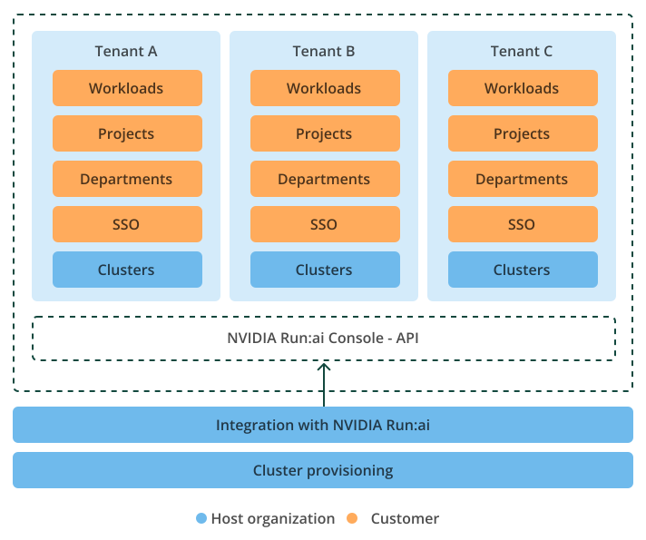

# Overview

NVIDIA Run:ai empowers organizations to establish and operate a secure and scalable multi-tenant control plane to provide AI Platform-as-a-Service (PaaS) to untrusted organizations. This model is ideal for enterprises, service providers, and public sector institutions seeking to deliver isolated, policy-driven AI infrastructure to internal teams, departments, or external partners, all while centralizing control and maintaining infrastructure efficiency.

NVIDIA Run:ai multi-tenancy is implemented at the control plane level and requires a separate Kubernetes cluster isolated from other tenants. While NVIDIA Run:ai provides logical and access isolation through its own tenant model, Kubernetes cluster provisioning including network, compute, and storage isolation must be implemented by the host organization at the infrastructure level.

## Multi-Tenant Deployment

A multi-tenant deployment involves a centralized NVIDIA Run:ai control plane managed by a host organization (platform owner). This setup is designed to create and govern AI infrastructure across multiple tenants, ensuring both logical and operational separation while maintaining central administration. Here are the key benefits:

* **Centralized Control** - The host organization manages the entire control plane, including tenants and access.
* **Managed solution** - Tenants have full access to NVIDIA Run:ai features without the need to manage the underlying infrastructure themselves.
* **Environment Isolation** - Tenants are associated with separate Kubernetes clusters, ensuring isolated access, distinct quotas, and individualized usage reporting.

## Multi-Tenancy: Cluster vs. Namespace

### Untrusted Tenants: Multi-Tenant Control Plane

Untrusted tenants, such as external organizations, are typically assigned dedicated Kubernetes clusters to ensure **cluster-level isolation**. This model provides complete separation between tenants at the infrastructure level, with no shared network, compute, or storage resources. The host organization centrally manages the control plane while maintaining strict tenant isolation and administrative boundaries.

* Each external organization is assigned a dedicated Kubernetes cluster
* The control plane is centrally managed by the host organization
* Offers the highest level of security and isolation - network, compute, and storage resources are not shared between tenants
* Ideal for scenarios involving untrusted organizations, providing strict separation and full administrative autonomy

### Trusted Tenants: Namespace Isolation

Trusted tenants, such as internal teams or departments, can be separated within a shared Kubernetes cluster using **soft isolation** based on namespaces. Kubernetes policies enforce access controls and resource boundaries, while some infrastructure components may remain shared across tenants.

* Logical separation using Kubernetes namespaces within a single, shared cluster
* Suitable for internal departments or trusted teams
* Isolation boundaries are enforced through Kubernetes policies (RBAC, network policies, resource quotas), though some resources and services remain shared
* Efficient and easy to manage, but does not provide the same level of isolation as dedicated clusters - best suited for trusted, internal segmentation

## Deployment Flow for Onboarding a New Organization

To onboard a new tenant environment, the host organization follows these steps:

1. [**Tenant creation**](../installation-and-configuration/installation/guided-installation/onboard-a-tenant.md#create-a-tenant) - Set up a dedicated NVIDIA Run:ai tenant for each external organization. This tenant links to the external organization's cluster for identity, access, and resource segmentation.
2. [**Kubernetes cluster provisioning**](../installation-and-configuration/installation/guided-installation/onboard-a-tenant.md#provision-the-tenants-kubernetes-cluster) - Provision a dedicated Kubernetes cluster using your infrastructure management tools such as NVIDIA Base Command Manager or OpenStack.
3. [**NVIDIA Run:ai system requirements installation**](../installation-and-configuration/installation/organization-onboarding/system-requirements.md) - Install necessary components such as storage integrations, ingress controllers, Knative, and the Kubeflow training operator and configure TLS certificates and DNS resolutions.
4. [**NVIDIA Run:ai cluster installation**](../installation-and-configuration/installation/guided-installation/onboard-a-tenant.md#register-the-cluster) - Deploy the NVIDIA Run:ai cluster on the external organization's Kubernetes environment and establish connectivity to the assigned tenant.

Once these steps are complete, the external organization's environment will be production-ready, enabling them to deploy and manage AI workloads on the NVIDIA Run:ai platform without infrastructure overhead.

<figure><figcaption></figcaption></figure>

## Platform Interfaces

NVIDIA Run:ai provides two distinct layers of access in a managed multi-tenant deployment: one for managing the platform across tenants, and one for individual tenant interaction. These interfaces are securely separated to ensure operational control and tenant isolation.

### Management Interface (API)

A centralized API designed for platform owners to manage tenants, clusters, and access across multiple environments. This interface is intended for system-level automation and integration with external portals or services.

Capabilities include:

* **Tenant management** - Create, configure, and remove tenant environments.
* **Cluster registration and association** - Connect Kubernetes clusters to their assigned tenants.
* **Access control (RBAC)** - Manage user and application roles at the platform level.

The management interface is only available to platform operators and is not accessible by tenants.

### Tenant Interfaces (UI / API / CLI)

Each tenant accesses their environment through isolated interfaces:

* **Web UI** - A user interface for managing projects, workloads, and users.
* **API** - Provides programmatic access for workload submissions, user operations, and system integration.
* **CLI** - Command-line tools for operations within the tenant's scope.

These interfaces limit visibility and access strictly to the tenant's domain, ensuring no platform-wide or inter-tenant access.

## Responsibility Matrix

| Responsibility | Platform Owner (Host Organization) | System Administrator (External Organization) | AI Practitioner (External Organization) |
| --- | --- | --- | --- |
| Create and manage tenants | ✓ | ✗ | ✗ |
| Provision Kubernetes clusters | ✓ | ✗ | ✗ |
| Fulfill NVIDIA Run:ai System Requirements | ✓ | ✗ | ✗ |
| Install and connect cluster to tenant | ✓ | ✗ | ✗ |
| Configure SSO, RBAC and access policies | ✗ | ✓ | ✗ |
| Manage organization structure | ✗ | ✓ | ✗ |
| Submit and monitor AI workloads | ✗ | ✗ | ✓ |
| View usage and quota reports | ✗ | ✗ | ✓ |
