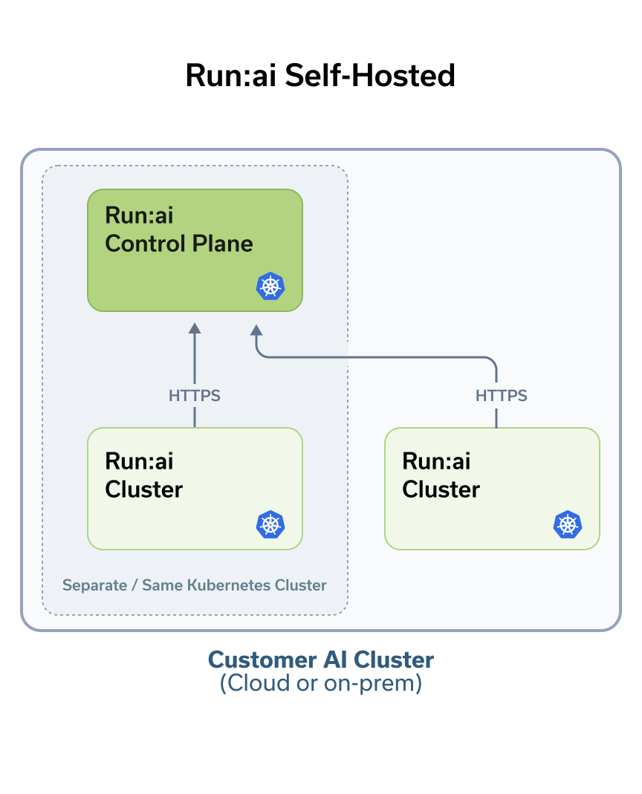
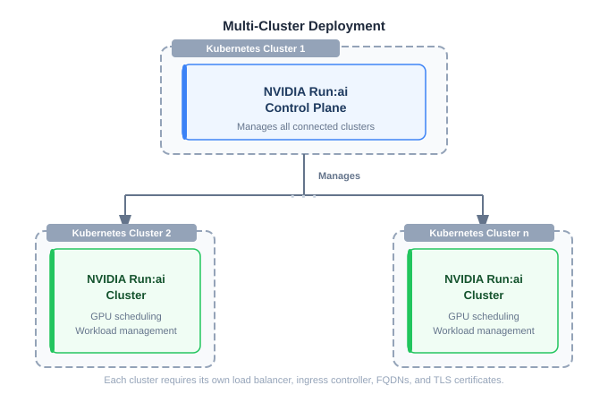

# Overview

NVIDIA Run:ai multi-tenant is a Kubernetes-native platform for delivering AI Platform-as-a-Service (PaaS) to multiple tenant organizations from a centrally managed control plane. It runs on host-organization-managed infrastructure: the hardware, Kubernetes clusters, and network that the host organization owns and operates, plus each tenant's own Kubernetes cluster. NVIDIA Run:ai delivers the software that manages and orchestrates the GPUs; the host organization provides everything it sits on. For the multi-tenancy concepts referenced throughout this page - isolation models, platform interfaces, and the platform owner/tenant responsibility split - see [Overview](../getting-started/overview.md).

This page explains the installation lifecycle and what to understand before installing - deployment model, shared responsibility, and installation paths.

<Note>

**Note**

To prepare your environment and install NVIDIA Run:ai, go to the [Next Steps](#next-steps).

</Note>

## Platform Components

NVIDIA Run:ai is made up of two components, both installed on a Kubernetes cluster. See [Architecture and Components](../../developer/architecture.md) for a deeper look at how they fit together:

* **NVIDIA Run:ai control plane** - Installed once by the host organization, in multi-tenant mode. Provides centralized resource management, tenant management, and access control across every tenant, and delivers cluster monitoring and analytics.
* **NVIDIA Run:ai cluster** - Installed on each tenant's own Kubernetes cluster, and registered against the host organization's control plane. Extends Kubernetes native scheduling with Run:ai's GPU-aware capabilities for that tenant.

Every multi-tenant deployment includes exactly one NVIDIA Run:ai control plane, always on a dedicated Kubernetes cluster, and one NVIDIA Run:ai cluster per tenant. See [Deployment Model](#deployment-model).

## Installation Lifecycle

Setting up NVIDIA Run:ai multi-tenant follows a three-phase lifecycle, repeated for each new tenant.

### Day 0: Planning

Day 0 covers the planning and preparation before installing the control plane, and before onboarding each new tenant.

* Meet infrastructure requirements for the control plane cluster and for each tenant's cluster - hardware, OS, Kubernetes distribution, storage, and permissions
* Set up networking for the control plane and for each tenant cluster - load balancer, ingress controller, FQDNs, DNS, and TLS certificates
* Review third-party services deployed as part of the installation, such as Keycloak and PostgreSQL
* Review prerequisites required for each tenant cluster, such as the GPU Operator and Prometheus
* Provision an external metrics store (Grafana Labs or Mimir) for the control plane
* Enable external access for administrators, users, and tenant clusters to reach the NVIDIA Run:ai control plane

### Day 1: Setup

Day 1 gets the control plane running, and onboards each tenant.

* Install the NVIDIA Run:ai control plane in multi-tenant mode, using the path that fits your environment - Guided Installation or Manual Helm
* Create a tenant, provision its Kubernetes cluster, and install and register the NVIDIA Run:ai cluster against the control plane
* Configure access rules and roles to scope tenant and platform-owner permissions
* Assign node roles and configure advanced control plane and cluster settings
* Configure networking for external access, service mesh, and container access
* Apply security hardening to your cluster

### Day 2: Operations

Day 2 covers the ongoing operational tasks that keep the control plane and every tenant cluster healthy.

* View and manage tenants and their clusters
* Tune NVIDIA Run:ai system services for scale and resource right-sizing as tenants are added
* Perform node maintenance and restore from backup when needed
* Monitor GPU and workload metrics, collect logs, and review event history, per tenant and platform-wide

### Upgrades

Upgrades are a lifecycle event that can occur at any phase and are not bound to a specific day. Upgrade the control plane first, then each tenant's cluster. To upgrade NVIDIA Run:ai, see [Upgrade](upgrade/plan-the-upgrade.md).

## Understanding the Installation

### Deployment Model

NVIDIA Run:ai multi-tenant always uses a multi-cluster deployment model: the control plane is installed on a dedicated Kubernetes cluster, and each tenant's NVIDIA Run:ai cluster is installed on its own separate Kubernetes cluster - the control plane and a tenant's cluster are never the same Kubernetes cluster. Each tenant cluster requires its own load balancer, ingress controller, FQDNs, and TLS certificates. See [Deployment Model](system-requirements/deployment-model.md) for more details.

### Shared Responsibility

NVIDIA Run:ai multi-tenant operates under two layers of shared responsibility. The first is the NVIDIA/host-organization split for infrastructure: NVIDIA provides and manages the NVIDIA Run:ai software, while the host organization provides and operates the underlying infrastructure for both the control plane and every tenant cluster. A tenant is never responsible for infrastructure - the host organization provisions and installs each tenant's cluster on the tenant's behalf.

| Category                  | Components                                                                       | Owner              |
| -------------------------- | --------------------------------------------------------------------------------- | ------------------ |
| Platform software          | NVIDIA Run:ai images and Helm charts                                              | NVIDIA             |
| Third-party services       | Keycloak, Traefik, Valkey, NATS, and others                                       | Host Organization  |
| Metrics store              | External metrics backend (Grafana Labs or Mimir) for the control plane            | Host Organization  |
| Hardware                   | Control plane system nodes, and system/worker nodes for each tenant cluster       | Host Organization  |
| Kubernetes infrastructure  | OS, Kubernetes distribution, container runtime, storage class, shared storage     | Host Organization  |
| Networking                 | Load balancer, ingress controller, FQDN, DNS, TLS certificates - per cluster      | Host Organization  |
| Prerequisites              | GPU Operator, Network Operator, Prometheus - per tenant cluster                   | Host Organization  |

The second layer applies once the platform is running, and is separate from infrastructure: platform-level responsibility is split between the platform owner (host organization) and each tenant. See [Responsibility Matrix](../getting-started/overview.md#responsibility-matrix) for the full breakdown - in short, the host organization owns tenant creation, cluster provisioning, and control-plane-level system requirements, while each tenant owns its own SSO/RBAC configuration and organization structure.

### Installation Options

NVIDIA Run:ai multi-tenant is an open source platform, with the NVIDIA Run:ai Support-Entitled Release available as a supported version of the same platform. Both share the same installation model. NVIDIA Run:ai Support-Entitled requires an NGC API key to pull platform images and Helm charts.

| Type                            | Description                                          | NGC API Key Required |
| ------------------------------- | ----------------------------------------------------- | --------------------- |
| Open Source                    | Full platform functionality, community-supported.     | No                    |
| NVIDIA Run:ai Support-Entitled Release | Support-entitled version with support SLAs and other entitlements.    | Yes                   |

#### Kubernetes and OpenShift

Each tenant cluster can run on either Kubernetes or OpenShift. The NVIDIA Run:ai control plane runs on Kubernetes. Where Kubernetes and OpenShift differ for a tenant cluster: OpenShift routes traffic through its built-in router rather than an ingress controller, installs operators such as the GPU Operator through OLM rather than Helm, and manages TLS at the router level rather than through Kubernetes secrets. These differences are handled within the cluster installation guide, and the overall flow remains the same.

### Installation Paths

NVIDIA Run:ai multi-tenant supports two installation paths for both the control plane and each tenant cluster.

| Path | Tooling | Best For | Type |
| ---- | ------- | -------- | ---- |
| **[Guided Installation](installation/guided-installation/README.md)** (recommended) | `runai-installer` CLI, with `controlPlane.multiTenant: true` set for the control plane install | Most deployments | Open Source, NVIDIA Run:ai Support-Entitled |
| **[Manual Helm](installation/install-using-helm/preparations.md)** | NVIDIA Run:ai Helm charts, deployed directly | Organizations managing deployments through their own tooling, or needing granular control over Helm values | Open Source, NVIDIA Run:ai Support-Entitled |

### Artifact Sources

Understanding where installation artifacts come from helps you plan network access and registry credentials.

* **NVIDIA Run:ai platform images and Helm charts** are published to NVIDIA NGC. Open Source installations access them without credentials. NVIDIA Run:ai Support-Entitled installations require an NGC API key.

* **Third-party service images** (PostgreSQL, Keycloak, and others) are pulled from their official upstream registries on Docker Hub, Quay, and the Kubernetes registry (`registry.k8s.io`) for Open Source and NVIDIA Run:ai Support-Entitled installations.

### What an Installation Includes

An NVIDIA Run:ai multi-tenant installation relies on several categories of software and infrastructure. Some components are installed and managed by NVIDIA Run:ai, while others are host-organization-provided prerequisites or optional components that enable specific platform capabilities. For a detailed breakdown of ownership responsibilities, see [Shared Responsibility](#shared-responsibility).

* **Infrastructure you provide** - The hardware, operating system, Kubernetes distribution, networking, and storage that host the control plane and each tenant cluster. These components must be in place before installation begins. See [System Requirements](system-requirements/README.md).

* **Third-party services** - A set of supporting services deployed as part of the control plane and cluster charts, including Keycloak for authentication and identity management, PostgreSQL as the centralized database, Traefik as the API gateway, NATS for asynchronous communication, and others. See [Third-Party Services](system-requirements/third-party-services.md).

* **External metrics store** - A multi-tenant control plane requires an externally managed metrics backend - Grafana Labs or Mimir - to aggregate metrics across tenants. See [Metrics Store Requirements](system-requirements/metrics-store-requirements/README.md).

* **Prerequisites** - Components that NVIDIA Run:ai requires on each tenant cluster: GPU Operator (provisions and manages GPUs on worker nodes) and Prometheus (required for metrics collection and monitoring). The Network Operator is required only if you are using Multi-Node NVLink (MNNVL) workloads. See [Prerequisites and Features](installation/guided-installation/prerequisites-and-features.md#prerequisites).

* **Feature-specific components** - Components required only for specific NVIDIA Run:ai workload types on a tenant cluster, such as distributed training or inference. When using the guided installer, these components can be enabled in the configuration file and installed alongside NVIDIA Run:ai. See [Prerequisites and Features](installation/guided-installation/prerequisites-and-features.md#features).

## Next Steps

* Check the [Support Matrix](support-matrix.md) to know which Kubernetes/OpenShift versions, operating system, GPU and other operators, and third-party service versions NVIDIA Run:ai multi-tenant supports - this determines what to prepare and install in your environment.
* Complete [System Requirements](system-requirements/README.md) to plan your deployment and prepare your infrastructure, networking, and more, before installation begins.
* Install the control plane and onboard your first tenant using the path that fits your environment:
  * **[Guided Installation](installation/guided-installation/README.md)** - Recommended for most deployments. Install the control plane, then [onboard your first tenant](installation/guided-installation/create-a-tenant-and-cluster.md) - create the tenant, provision its cluster, and install and register the NVIDIA Run:ai cluster.
  * **[Manual Helm](installation/install-using-helm/install-control-plane.md)** - For organizations managing deployments through their own tooling, or needing granular control over Helm values. Install the control plane, then [onboard your first tenant](installation/install-using-helm/create-a-tenant-and-cluster.md) - create the tenant, provision its cluster, and install and register the NVIDIA Run:ai cluster.
