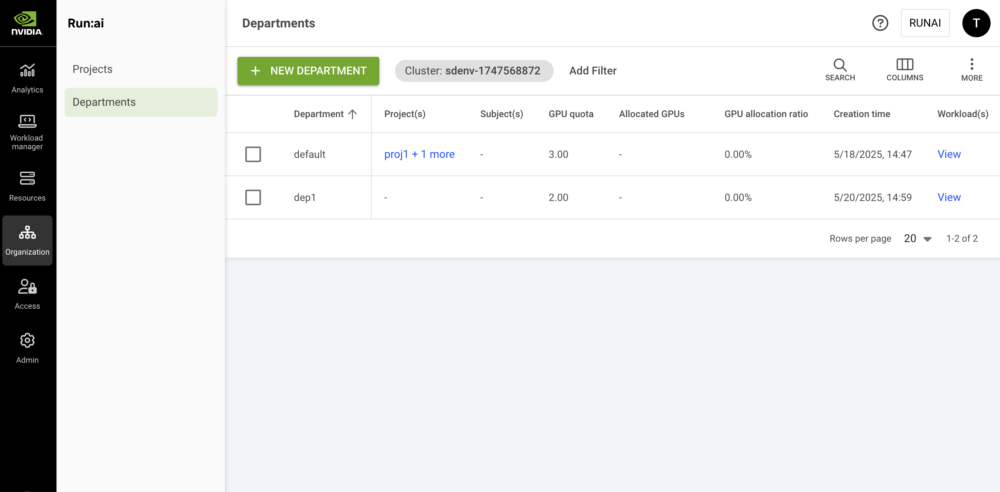

# Departments

Departments group multiple projects under a shared organizational scope. By organizing projects into a department, you can manage resources and governance at scale, for example, by allocating quotas across a set of projects, applying policies at the department level, and creating assets that can be shared across all projects (or selected descendant projects) within the department.

For example, in an academic environment, a department can be the Physics Department grouping various projects (AI Initiatives) within the department, or grouping projects where each project represents a single student.

## Departments Table

The Departments table can be found under **Organization** in the NVIDIA Run:ai platform.

The Departments table lists all departments defined for a specific cluster and allows you to manage them. You can switch between clusters by selecting your cluster using the filter at the top.

<figure><figcaption></figcaption></figure>

The Departments table consists of the following columns:

| Column                      | Description                                                                                                                                                                                                                                                                                                                                                                                           |
| --------------------------- | ----------------------------------------------------------------------------------------------------------------------------------------------------------------------------------------------------------------------------------------------------------------------------------------------------------------------------------------------------------------------------------------------------- |
| Department                  | The name of the department                                                                                                                                                                                                                                                                                                                                                                            |
| Description                 | A description of the department                                                                                                                                                                                                                                                                                                                                                                       |
| Node pool(s)                | The node pools associated with this department. By default, all node pools within a cluster are associated with each department. Administrators can change the node pools’ quota parameters for a department. Click the values under this column to view the list of node pools with their parameters (as described below)                                                                            |
| Cluster                     | The cluster that the department is associated with                                                                                                                                                                                                                                                                                                                                                    |
| Project(s)                  | List of projects associated with this department                                                                                                                                                                                                                                                                                                                                                      |
| Subject(s)                  | The users, SSO groups, or service accounts with access to the project. Click the values under this column to view the list of subjects with their parameters (as described below). This column is only viewable if your role in NVIDIA Run:ai platform allows you those permissions.                                                                                                                  |
| GPU quota                   | GPU quota associated with the department                                                                                                                                                                                                                                                                                                                                                              |
| Allocated GPUs              | The total number of GPUs allocated by successfully scheduled workloads in projects associated with this department                                                                                                                                                                                                                                                                                    |
| Avg. GPU allocation         | The average number of GPU devices allocated by workloads submitted within this department, based on the selected time range.                                                                                                                                                                                                                                                                          |
| Avg. GPU utilization        | The average percentage of GPU utilization across all workloads submitted within this department, based on the selected time range.                                                                                                                                                                                                                                                                    |
| Avg. GPU memory utilization | The average percentage of GPU memory usage across all workloads submitted within this department, based on the selected time range.                                                                                                                                                                                                                                                                   |
| Allocated CPUs (Core)       | The total number of CPU cores allocated by workloads submitted within this project. (This column is only available if the CPU Quota setting is enabled, as described below).                                                                                                                                                                                                                          |
| Allocated CPU Memory        | The total number of CPUs allocated by successfully scheduled workloads under this project. (This column is only available if the CPU Quota setting is enabled, as described below).                                                                                                                                                                                                                   |
| GPU allocation ratio        | The ratio of Allocated GPUs to GPU quota. This number reflects how well the department’s GPU quota is utilized by its descendant projects. A number higher than 100% means the department is using over quota GPUs. A number lower than 100% means not all projects are utilizing their quotas. A quota becomes allocated once a workload is successfully scheduled.                                  |
| CPU allocation ratio        | The ratio of Allocated CPUs (cores) to CPU quota (cores). This number reflects how much the project’s ‘CPU quota’ is utilized by its descendent workloads. A number higher than 100% indicates the project is using over quota CPU cores.                                                                                                                                                             |
| CPU memory allocation ratio | The ratio of Allocated CPU memory to CPU memory quota. This number reflects how well the project’s ‘CPU memory quota’ is utilized by its descendent workloads. A number higher than 100% indicates the project is using over quota CPU memory.                                                                                                                                                        |
| CPU quota (Cores)           | CPU quota allocated to this project. (This column is only available if the CPU Quota setting is enabled, as described below). This number represents the sum of all node pools’ CPU quota allocated to this project. The ‘unlimited’ value means the CPU (cores) quota is not bounded and workloads using this project can use as many CPU (cores) resources as they need (if available).             |
| CPU memory quota            | CPU memory quota allocated to this project. (This column is only available if the CPU Quota setting is enabled, as described below). This number represents the sum of all node pools’ CPU memory quota allocated to this project. The ‘unlimited’ value means the CPU memory quota is not bounded and workloads using this Project can use as much CPU memory resources as they need (if available). |
| Creation time               | The timestamp for when the department was created                                                                                                                                                                                                                                                                                                                                                     |
| Workload(s)                 | The list of workloads under projects associated with this department. Click the values under this column to view the list of workloads with their resource parameters (as described below)                                                                                                                                                                                                            |

### Projects Associated with the Department

Click one of the values of Projects(s) column, to view the list of workloads and their parameters.

| Column                | Description                                                                                                                                                                                                                                                                                                                                                                                           |
| --------------------- | ----------------------------------------------------------------------------------------------------------------------------------------------------------------------------------------------------------------------------------------------------------------------------------------------------------------------------------------------------------------------------------------------------- |
| Project               | The name of the project                                                                                                                                                                                                                                                                                                                                                                               |
| GPU quota             | The GPU quota allocated to the project. This number represents the sum of all node pools’ GPU quota allocated to this project.                                                                                                                                                                                                                                                                        |
| CPU quota (Cores)     | CPU quota allocated to this project. (This column is only available if the CPU Quota setting is enabled, as described below). This number represents the sum of all node pools’ CPU quota allocated to this project. The ‘unlimited’ value means the CPU (cores) quota is not bounded and workloads using this project can use as many CPU (cores) resources as they need (if available).             |
| CPU memory quota      | CPU memory quota allocated to this project. (This column is only available if the CPU Quota setting is enabled, as described below). This number represents the sum of all node pools’ CPU memory quota allocated to this project. The ‘unlimited’ value means the CPU memory quota is not bounded and workloads using this Project can use as much CPU memory resources as they need (if available). |
| Allocated GPUs        | The total number of GPUs allocated by successfully scheduled workloads under this project                                                                                                                                                                                                                                                                                                             |
| Allocated CPUs (Core) | The total number of CPU cores allocated by workloads submitted within this project. (This column is only available if the CPU Quota setting is enabled, as described below).                                                                                                                                                                                                                          |
| Allocated CPU Memory  | The total number of CPUs allocated by successfully scheduled workloads under this project. (This column is only available if the CPU Quota setting is enabled, as described below).                                                                                                                                                                                                                   |
| GPU allocation ratio  | The ratio of Allocated GPUs to GPU quota. This number reflects how well the project’s GPU quota is utilized by its descendent workloads. A number higher than 100% indicates the project is using over quota GPUs.                                                                                                                                                                                    |
| CPU allocation ratio  | The ratio of Allocated CPUs (cores) to CPU quota (cores). This number reflects how much the project’s ‘CPU quota’ is utilized by its descendent workloads. A number higher than 100% indicates the project is using over quota CPU cores.                                                                                                                                                             |

### Node Pools with Quota Associated with the Department

Click one of the values of Node pool(s) with quota column, to view the list of node pools and their parameters.

| Column                     | Description                                                                                                                                                                                                                                                                                                                   |
| -------------------------- | ----------------------------------------------------------------------------------------------------------------------------------------------------------------------------------------------------------------------------------------------------------------------------------------------------------------------------- |
| Node pool                  | The name of the node pool is given by the administrator during node pool creation. All clusters have a default node pool created automatically by the system and named ‘default’.                                                                                                                                             |
| Priority                   | The node pool's order of priority for newly created projects under this department                                                                                                                                                                                                                                            |
| GPU quota                  | The amount of GPU quota the administrator dedicated to the department for this node pool (floating number, e.g. 2.3 means 230% of a GPU capacity)                                                                                                                                                                             |
| Department Rank            | The department’s scheduling rank relative to other departments sharing the same node pool                                                                                                                                                                                                                                     |
| Over-quota weight          | Represents a weight used to calculate the amount of non-guaranteed overage resources a department can get on top of its quota in this node pool. All unused resources are split between departments that require the use of overage resources.                                                                                |
| Max GPU devices allocation | The maximum GPU device allocation the department can get from this node pool - the maximum sum of quota and over-quota GPUs                                                                                                                                                                                                   |
| CPU (Cores)                | The amount of CPU (cores) quota the administrator has dedicated to the department for this node pool (floating number, e.g. 1.3 Cores = 1300 mili-cores). The ‘unlimited’ value means the CPU (Cores) quota is not bound and workloads using this node pool can use as many CPU (Cores) resources as they need (if available) |
| CPU memory                 | The amount of CPU memory quota the administrator has dedicated to the department for this node pool (floating number, in MB or GB). The ‘unlimited’ value means the CPU memory quota is not bounded and workloads using this node pool can use as much CPU memory resource as they need (if available).                       |
| Allocated GPUs             | The total amount of GPUs allocated by workloads using this node pool under projects associated with this department. The number of allocated GPUs may temporarily surpass the GPU quota of the department if over quota is used.                                                                                              |
| Allocated CPU (Cores)      | The total amount of CPUs (cores) allocated by workloads using this node pool under all projects associated with this department. The number of allocated CPUs (cores) may temporarily surpass the CPUs (Cores) quota of the department if over quota is used.                                                                 |
| Allocated CPU memory       | The actual amount of CPU memory allocated by workloads using this node pool under all projects associated with this department. The number of Allocated CPU memory may temporarily surpass the CPU memory quota if over quota is used.                                                                                        |

### Subjects Authorized for the Project

Click one of the values of the Subject(s) column, to view the list of subjects and their parameters. This column is only viewable if your role in the NVIDIA Run:ai system affords you those permissions.

| Column        | Description                                                                                                                                                                                                                     |
| ------------- | ------------------------------------------------------------------------------------------------------------------------------------------------------------------------------------------------------------------------------- |
| Subject       | A user, SSO group, or service account assigned with a role in the scope of this department                                                                                                                                      |
| Type          | The type of subject assigned to the access rule (user, SSO group, or service account).                                                                                                                                          |
| Scope         | The scope of this department within the organizational tree. Click the name of the scope to view the organizational tree diagram, you can only view the parts of the organizational tree for which you have permission to view. |
| Role          | The role assigned to the subject, in this department’s scope                                                                                                                                                                    |
| Authorized by | The user who granted the access rule                                                                                                                                                                                            |
| Last updated  | The last time the access rule was updated                                                                                                                                                                                       |

<Info>

**Note**

A role given in a certain scope, means the role applies to this scope and any descendant scopes in the organizational tree.

</Info>

### Workloads Associated with the Department

Click one of the values of Workload(s) column, to view the list of workloads and their parameters

| Column                  | Description                                                                                                                                                                                      |
| ----------------------- | ------------------------------------------------------------------------------------------------------------------------------------------------------------------------------------------------ |
| Workload                | The name of the workload, given during its submission. Optionally, an icon describing the type of workload is also visible                                                                       |
| Type                    | The type of the workload, e.g. Workspace, Training, Inference                                                                                                                                    |
| Status                  | The state of the workload and time elapsed since the last status change                                                                                                                          |
| Created by              | The subject that created this workload                                                                                                                                                           |
| Running/ requested pods | The number of running pods out of the number of requested pods for this workload. e.g. a distributed workload requesting 4 pods but may be in a state where only 2 are running and 2 are pending |
| Creation time           | The date and time the workload was created                                                                                                                                                       |
| GPU compute request     | The amount of GPU compute requested (floating number, represents either a portion of the GPU compute, or the number of whole GPUs requested)                                                     |
| GPU memory request      | The amount of GPU memory requested (floating number, can either be presented as a portion of the GPU memory, an absolute memory size in MB or GB, or a MIG profile)                              |
| CPU memory request      | The amount of CPU memory requested (floating number, presented as an absolute memory size in MB or GB)                                                                                           |
| CPU compute request     | The amount of CPU compute requested (floating number, represents the number of requested Cores)                                                                                                  |

### Customizing the Table View

* Filter - Click ADD FILTER, select the column to filter by, and enter the filter values
* Search - Click SEARCH and type the value to search by
* Sort - Click each column header to sort by
* Column selection - Click COLUMNS and select the columns to display in the table
* Download table - Click MORE and then Click Download as CSV. Export to CSV is limited to 20,000 rows.

## Adding a New Department

To create a new Department:

1. Click **+NEW DEPARTMENT**
2. Select a **scope**.\
   By default, the field contains the scope of the current UI context cluster, viewable at the top left side of your screen. You can change the current UI context cluster by clicking the ‘Cluster: cluster-name’ field and applying another cluster as the UI context. Alternatively, you can choose another cluster within the ‘+ New Department’ form by clicking the organizational tree icon on the right side of the scope field, opening the organizational tree and selecting one of the available clusters.
3. Enter a **name** for the department. Department names must start with a letter and can only contain lower case latin letters, numbers or a hyphen ('-’).
4.  Choose how to proceed:

    * Click **CREATE DEPARTMENT & CLOSE** to create the department without assigning resources.
    * Click **CREATE DEPARTMENT & CONTINUE** to assign resources and scheduling behavior.

    <Info>
<strong>Note</strong>
<ul><li>The department is created and appears in the <strong>Departments</strong> grid.</li><li>
When you select <strong>CREATE DEPARTMENT &#x26; CLOSE</strong>, the department is created without assigned resources. The department's quota is set to 0, which means workloads can run only when spare GPUs are available in the node pool. The following default settings are applied:
<ul><li>The department is created with a <strong>Medium Low</strong> rank.</li><li>Over quota weight is always applied when distributing over-quota GPUs among departments in the same rank. By default, the department’s weight is derived proportionally from its assigned GPU quota. Since the quota is set to 0, the effective weight is 0. If <strong>Over quota weight</strong> is enabled via <strong>General settings</strong>, the department is assigned a default weight of 2.</li></ul></li></ul></Info>

### Assigning GPU Quota

Assign GPUs to the department and define how the [Scheduler](../../runai-scheduler/scheduling/concepts-and-principles.md) prioritizes node pools when running the project’s workloads.

1. Review the **node pools** available to the department. The list includes all node pools configured in the platform and represents the department’s default (suggested) configuration. This configuration determines which node pools and priority order are applied to newly created projects in the department. Administrators can override this configuration per project by selecting different node pools and adjusting their order.
2.  Add **node pools** and set the default order in which workloads will be scheduled to use them. The leftmost node pool is the first one workloads will attempt to schedule onto. The Scheduler first tries to allocate resources using the highest priority node pool, then the next in priority, until it reaches the lowest priority node pool list, then the Scheduler starts from the highest again.

    <Info>
<strong>Note</strong>
<ul><li>When no node pools are configured, you can assign quota for the whole department, instead of per node pool. After node pools are created, you can assign quota for each node pool separately.</li><li>The order of node pools can be overridden during workload submission by an admin policy or by the user.</li></ul></Info>
3. Review the GPU quota per node pool:
   * **Unassigned** - The number of GPUs not assigned to subordinate projects.
   * **Total** - The total number of GPUs assigned to the department in this node pool.
4. Set the department's **GPU quota** in the selected node pool. A **Quota distribution** next to the department visualizes how GPUs are distributed across the department for that node pool. The graph reflects:
   * **Assigned quota** - The number of GPUs from the node pool that are assigned to this department.
   * **Unassigned quota** - The number of GPUs still available in the node pool that are not yet assigned for any department.
   *   **Sum of other departments’ assigned quota** - The total number of GPUs already assigned to all other departments in this same node pool.

       <Info>
<strong>Note</strong>

When assigning a department GPU quota that exceeds the node pool’s available GPUs, or setting the department quota to <strong>Unlimited</strong>, the system may display warnings, but the quota is not enforced. Actual GPU consumption is constrained by the physical capacity of the node pool or cluster, regardless of the assigned quota.
</Info>
5. You can adjust **other departments' quotas** to free up additional resources. A table lists all departments and their assigned GPU quotas. Updating these values redistributes the department’s assigned and unassigned GPU quota across projects for the selected node pool, as reflected in the **Quota distribution** graph next to each department:
   * Use the **Search** icon to find a department
   * Click the **GPU** quota value and set the number of GPUs
   * Click **APPLY**
6. These steps apply to the selected node pool. If multiple node pools are configured, repeat the process for each.
7. Click **SAVE & CONTINUE**

### Defining GPU Over Quota

Define how workloads can consume GPUs beyond the department's assigned quota when additional resources are available.

1.  **Allow workloads to exceed the department’s quota** is enabled by default, allowing workloads in the department to consume GPUs beyond the assigned quota. If disabled, workloads from the department will run only within the assigned quota and will not consume additional GPUs, even if resources are available.

    <Info>
<strong>Note</strong>

Workloads running over quota are <strong>opportunistic</strong> and may be preempted or stopped at any time when higher priority workloads require resources.
</Info>
2. Set the **max GPU allocation**. This value defines the maximum GPU device allocation the department can get from the node pool, representing the maximum sum of assigned quota and over-quota GPUs:
   * By default, this field is set to **Unlimited**, allowing the department to consume any available over-quota GPUs
   * Enter a **number** equal to or above the assigned quota
3. Rank departments in the order in which their workloads will be scheduled. A department’s **rank** determines the scheduling priority of its workloads only when competing for over-quota GPUs within the same node pool. By default, departments are assigned a **Medium Low** rank. Departments with a higher rank are scheduled before departments with a lower rank when over-quota GPUs become available. When multiple departments share the same rank, available over-quota GPUs are distributed according to each department's **weight**:
   * Filter the list of departments:
     * Click **Add filter**
     * Select **Rank** to filter by rank level, or **Department** to filter by department name
     * Enter or select the filter criteria and click **APPLY**
   * Locate and select departments:
     * Locate the department or departments whose rank you want to change
     * Select one or more departments
   *   Change the rank:

       * Click **MOVE TO RANK**
       * In the **Move to Rank** dialog, select the destination rank
       * Click **MOVE \<n> DEPARTMENTS** to confirm the change

       To learn more about department ranks, see [The NVIDIA Run:ai Scheduler: concepts and principles](../../runai-scheduler/scheduling/concepts-and-principles.md).
4. Assign **weights** to determine the departments' share of resources. A department’s weight determines how available over-quota GPUs are distributed between departments that have the same rank within the same node pool. Weight behavior depends on whether **Over quota weight** is enabled or disabled via **General settings**. When disabled, the department’s weight is proportional to its assigned GPU quota, displayed for reference, and cannot be edited. When enabled, all departments within the same rank are assigned a **default weight of 2**, and the value can be adjusted per department:
   * Filter the list of departments:
     * Click **Add filter**
     * Select **Rank** to filter by rank level, or **Department** to filter by department name
     * Enter or select the filter criteria and click **APPLY**
   * Review weight distribution:
     * Departments are grouped by rank
     * For each department, the **Weight distribution** graph shows:
       * The departments **weight**
       * The **total weight of other departments** in the same rank
   * Edit the department's weight (when Over quota weight is enabled):
     * Click the **Weight** value for the project and enter a value
     * Click **APPLY**
5. These steps apply to the selected node pool. If multiple node pools are configured, repeat the process for each.
6. Click **SAVE &** **CONTINUE**

### Assigning CPU Quota

Assign CPU resources (cores and memory) to the project and define the maximum CPU usage per node pool. This form is displayed only if **CPU quota** is enabled via the **General settings**.

1. Set the number of **CPU (Cores)** department can use in the selected node pool. By default, CPU cores are set to **Unlimited**, allowing the department to consume any available CPU resources in the node pool. Enter a **number**.
2.  Set the amount of **CPU memory** available to the department in the selected node pool. By default, CPU memory is set to **Unlimited**, allowing the department to consume any available CPU resources in the node pool. Enter a **number** and select a unit (**MB**, **MiB**, or **GB**)

    <Info>
<strong>Note</strong>
<ul><li>When assigning a department CPU quota that exceeds the node pool’s available CPUs, or setting the CPU quota to <strong>Unlimited</strong>, the system may display warnings, but the quota is not enforced. Actual CPU consumption is constrained by the physical capacity of the node pool or cluster, regardless of the assigned quota.</li><li>When the <strong>CPU quota</strong> feature flag is disabled, any previously set CPU quotas for a project are automatically removed.</li></ul></Info>
3. These steps apply to the selected node pool. If multiple node pools are configured, repeat the process for each.
4. Click **SAVE & CONTINUE**

### Setting Scheduling Rules

Scheduling rules control how compute resources are used by workloads. The restrict either the resources (nodes) on which workloads can run or the duration of the run time. Scheduling rules are set for departments and apply to specific workload types. See [Scheduling rules](../../policies/scheduling-rules.md) for more details.

1. Click **+RULE**
2. Select a rule type from the dropdown:
   1. **+ Idle GPU timeout** - Limit the duration of a workload whose GPU is idle
   2. **+ Workload time limit** - Set a time limit for workspaces regardless of their activity (e.g., stop the workspace after 1 day of work)
   3. **+ Node type (Affinity**) - Limit workloads to run on specific node types
3. For each rule, select the **workload type(s)** to which the rule applies and configure the rule parameters
4. Click **SAVE & CONTINUE**

Once scheduling rules are set for a department, all matching workloads associated with the department have the restrictions applied to them, as defined, when the workload is submitted. New scheduling rules added to a department are not applied over previously created workloads associated with that department.

<Info>

**Note**

Setting scheduling rules in a department enforces the rules on all associated projects.

</Info>

### Applying Access Rules

1. Click **+ACCESS RULE**
2. Select a subject - **User, SSO group**, or **Service account**
3. Select or enter the subject identifier. You can define up to 10 subjects of the selected type:
   * **User email** for a local user created in NVIDIA Run:ai or for SSO user as recognized by the IDP
   * **Group name** as recognized by the IDP
   * **Service account name** as created in NVIDIA Run:ai
4. Select a **role**
5. Click **SAVE RULE**
6. Click **CLOSE**

## Editing a Department

1. Select the Department you want to edit
2. Click **EDIT**
3. From the dropdown menu, select the form you want to modify
4. Update the settings and click **SAVE & CONTINUE**

<Info>

**Note**

When editing a department:

* You can navigate directly to a specific form without completing the full department creation flow again.
* Changes apply only to the selected form; previously configured settings in other forms remain unchanged.
* You cannot set GPU and CPU quotas below the quotas currently consumed by **non-preemptible workloads**.
* You cannot set CPU or GPU quotas that are less than the quota already assigned to its **subordinate projects**.

</Info>

## Viewing a Department’s Policy

To view the policy of a department:

1. Select the department for which you want to view its [policies](../../policies/native-workload-policies.md). This option is only active if the department has defined policies in place.
2. Click **VIEW POLICY** and select the workload type for which you want to view the policies
3. In the Policy form, view the workload rules that are enforcing your department for the selected workload type as well as the defaults:
   * **Parameter** - The workload submission parameter that Rule and Default is applied on
   * **Type (applicable for data sources only)** - The data source type (Git, S3, nfs, pvc etc.)
   * **Default** - The default value of the Parameter
   * **Rule** - Set up constraints on workload policy fields
   * **Source** - The origin of the applied policy (cluster, department or project)

<Info>

**Note**

* The policy affecting the department consists of rules and defaults. Some of these rules and defaults may be derived from the policies of a parent cluster (source). You can see the source of each rule in the policy form.
* A policy set for a department affects all subordinated projects and their workloads, according to the policy workload type.

</Info>

## Deleting a Department

1. Select the department you want to delete
2. Click **DELETE**
3. On the dialog, click **DELETE** to confirm the deletion

<Info>

**Note**

Deleting a department permanently deletes its subordinated projects, any assets created in the scope of this department, and any of its subordinated projects such as compute resources, environments, data sources, templates, and credentials. However, workloads running within the department’s subordinated projects, or the policies defined for this department or its subordinated projects - remain intact and running.

</Info>

## Using CLI

To view the available actions on departments, see the department [CLI v2 reference](../../../reference/cli/runai/runai-department.md).

## Using API

To view the available actions, go to the [Departments](https://run-ai-docs.nvidia.com/api/2.26/organizations/departments) API reference.
