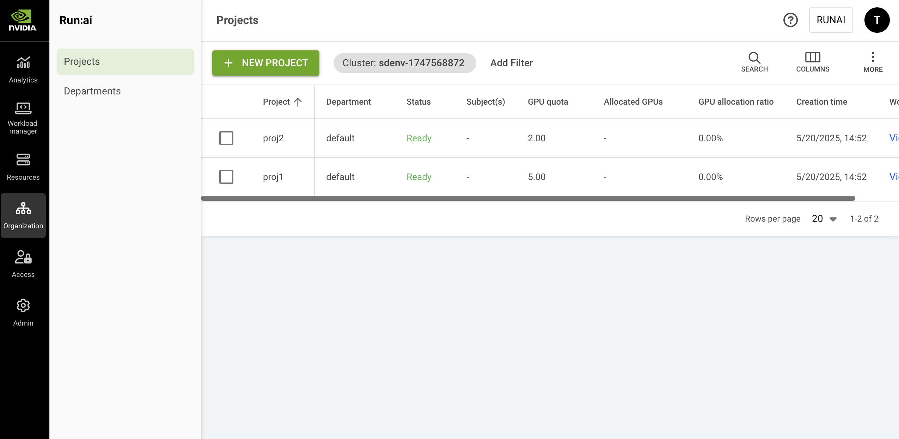

# Projects

Researchers submit AI workloads to NVIDIA Run:ai. To control how resources are allocated and prioritized across teams and initiatives, NVIDIA Run:ai uses [Projects](../adapting-ai-initiatives.md#mapping-your-organization) as the primary organization management unit. Projects allow administrators to define resource quotas, scheduling behavior, access controls, and policy enforcement, while logically separating workloads between different organizational efforts.

A project can represent a team, an individual user, or a specific initiative, and can be assigned dedicated GPU and CPU quotas, scheduling rules, and permissions. Projects can also be grouped into [departments](departments.md) to reflect the organizational hierarchy and enable centralized resource governance.

For example, a team working on a face-recognition initiative might collaborate under a shared project named `face-recognition-2024`. Alternatively, each team member can be assigned an individual project with a personal resource quota to ensure predictable and isolated resource usage.

## Projects Table

The Projects table can be found under **Organization** in the NVIDIA Run:ai platform.

The Projects table provides a list of all projects defined for a specific cluster, and allows you to manage them. You can switch between clusters by selecting your cluster using the filter at the top.

<figure><figcaption></figcaption></figure>

The Projects table consists of the following columns:

| Column                                          | Description                                                                                                                                                                                                                                                                                                                                                                                           |
| ----------------------------------------------- | ----------------------------------------------------------------------------------------------------------------------------------------------------------------------------------------------------------------------------------------------------------------------------------------------------------------------------------------------------------------------------------------------------- |
| Project                                         | The name of the project                                                                                                                                                                                                                                                                                                                                                                               |
| Description                                     | A description of the project                                                                                                                                                                                                                                                                                                                                                                          |
| Department                                      | The name of the parent department. Several projects may be grouped under a department.                                                                                                                                                                                                                                                                                                                |
| Cluster                                         | The cluster that the project is associated with                                                                                                                                                                                                                                                                                                                                                       |
| Status                                          | The Project creation status. Projects are manifested as Kubernetes namespaces. The project status represents the Namespace creation status.                                                                                                                                                                                                                                                           |
| Node pool(s)                                    | The node pools associated with the project. By default, a new project is associated with all node pools within its associated cluster. Administrators can change the node pools’ quota parameters for a project. Click the values under this column to view the list of node pools with their parameters (as described below).                                                                        |
| Subject(s)                                      | The Subject(s) with access to the project (User, SSO Group, Service account, or All authenticated users and service accounts). Click the values under this column to view the list of subjects with their parameters (as described below). This column is only viewable if your role in the NVIDIA Run:ai platform allows you those permissions.                                                                                                              |
| GPU quota                                       | The GPU quota allocated to the project. This number represents the sum of all node pools’ GPU quota allocated to this project.                                                                                                                                                                                                                                                                        |
| Allocated GPUs                                  | The total number of GPUs allocated by successfully scheduled workloads under this project                                                                                                                                                                                                                                                                                                             |
| Avg. GPU allocation                             | The average number of GPU devices allocated by workloads submitted within this project, based on the selected time range                                                                                                                                                                                                                                                                              |
| Avg. GPU utilization                            | The average percentage of GPU utilization across all workloads submitted within this project, based on the selected time range                                                                                                                                                                                                                                                                        |
| Avg. GPU memory utilization                     | The average percentage of GPU memory usage across all workloads submitted within this project, based on the selected time range                                                                                                                                                                                                                                                                       |
| Allocated CPUs (Core)                           | The total number of CPU cores allocated by workloads submitted within this project. (This column is only available if the CPU Quota setting is enabled, as described below).                                                                                                                                                                                                                          |
| Allocated CPU Memory                            | The total number of CPUs allocated by successfully scheduled workloads under this project. (This column is only available if the CPU Quota setting is enabled, as described below).                                                                                                                                                                                                                   |
| GPU allocation ratio                            | The ratio of Allocated GPUs to GPU quota. This number reflects how well the project’s GPU quota is utilized by its descendent workloads. A number higher than 100% indicates the project is using over quota GPUs.                                                                                                                                                                                    |
| CPU allocation ratio                            | The ratio of Allocated CPUs (cores) to CPU quota (cores). This number reflects how much the project’s ‘CPU quota’ is utilized by its descendent workloads. A number higher than 100% indicates the project is using over quota CPU cores.                                                                                                                                                             |
| CPU memory allocation ratio                     | The ratio of Allocated CPU memory to CPU memory quota. This number reflects how well the project’s ‘CPU memory quota’ is utilized by its descendent workloads. A number higher than 100% indicates the project is using over quota CPU memory.                                                                                                                                                        |
| CPU quota (Cores)                               | CPU quota allocated to this project. (This column is only available if the CPU Quota setting is enabled, as described below). This number represents the sum of all node pools’ CPU quota allocated to this project. The ‘unlimited’ value means the CPU (cores) quota is not bounded and workloads using this project can use as many CPU (cores) resources as they need (if available).             |
| CPU memory quota                                | CPU memory quota allocated to this project. (This column is only available if the CPU Quota setting is enabled, as described below). This number represents the sum of all node pools’ CPU memory quota allocated to this project. The ‘unlimited’ value means the CPU memory quota is not bounded and workloads using this Project can use as much CPU memory resources as they need (if available). |
| Node type (affinity) - Training                 | The list of NVIDIA Run:ai node-affinities. Any training workload submitted within this project must specify one of those NVIDIA Run:ai node affinities, otherwise it is not submitted.                                                                                                                                                                                                                |
| Node type (affinity) - Workspaces               | The list of NVIDIA Run:ai node-affinities. Any interactive (workspace) workload submitted within this project must specify one of those NVIDIA Run:ai node affinities, otherwise it is not submitted.                                                                                                                                                                                                 |
| Idle GPU time limit - Training                  | The time in days:hours:minutes after which the project stops a training workload not using its allocated GPU resources.                                                                                                                                                                                                                                                                               |
| Idle GPU time limit - preemptible workspaces    | The time in days:hours:minutes after which the project stops a preemptible interactive (workspace) workload not using its allocated GPU resources.                                                                                                                                                                                                                                                    |
| Idle GPU time limit - non preemptible workloads | The time in days:hours:minutes after which the project stops a non-preemptible interactive (workspace) workload not using its allocated GPU resources..                                                                                                                                                                                                                                               |
| Training time limit                             | The duration in days:hours:minutes after which the project stops a training workload                                                                                                                                                                                                                                                                                                                  |
| Workspace time limit                            | The duration in days:hours:minutes after which the project stops an interactive (workspace) workload                                                                                                                                                                                                                                                                                                  |
| Creation time                                   | The timestamp for when the project was created                                                                                                                                                                                                                                                                                                                                                        |
| Workload(s)                                     | The list of workloads associated with the project. Click the values under this column to view the list of workloads with their resource parameters (as described below).                                                                                                                                                                                                                              |

### Node Pools with Quota Associated with the Project

Click one of the values of Node pool(s) with quota column, to view the list of node pools and their parameters.

| Column                     | Description                                                                                                                                                                                                                                                                                                                                                                                    |
| -------------------------- | ---------------------------------------------------------------------------------------------------------------------------------------------------------------------------------------------------------------------------------------------------------------------------------------------------------------------------------------------------------------------------------------------- |
| Node pool                  | The name of the node pool is given by the administrator during node pool creation. All clusters have a default node pool created automatically by the system and named ‘default’.                                                                                                                                                                                                              |
| Order of priority          | The default order in which the Scheduler uses node pools to schedule a workload. This is used only if the order of priority of node pools is not set in the workload during submission, either by an admin policy or the user. An empty value means the node pool is not part of the project’s default list, but can still be chosen by an admin policy or the user during workload submission |
| GPU quota                  | The amount of GPU quota the administrator dedicated to the project for this node pool (floating number, e.g. 2.3 means 230% of GPU capacity).                                                                                                                                                                                                                                                  |
| Project Rank               | The project's scheduling rank compared to other projects in the same department and same node pool                                                                                                                                                                                                                                                                                             |
| Over-quota weight          | Represents the relative weight used to calculate the amount of non-guaranteed overage resources a project can get on top of its quota in this node pool. Unused resources are split between projects that require the use of overage resources.                                                                                                                                                |
| Max GPU devices allocation | Represents the maximum GPU device allocation the project can get from this node pool - the maximum sum of quota and over-quota GPUs.                                                                                                                                                                                                                                                           |
| CPU (Cores)                | The amount of CPUs (cores) quota the administrator has dedicated to the project for this node pool (floating number, e.g. 1.3 Cores = 1300 mili-cores). The ‘unlimited’ value means the CPU (Cores) quota is not bounded and workloads using this node pool can use as many CPU (Cores) resources as they require, (if available).                                                             |
| CPU memory                 | The amount of CPU memory quota the administrator has dedicated to the project for this node pool (floating number, in MB or GB). The ‘unlimited’ value means the CPU memory quota is not bounded and workloads using this node pool can use as much CPU memory resource as they need (if available).                                                                                           |
| Allocated GPUs             | The actual amount of GPUs allocated by workloads using this node pool under this project. The number of allocated GPUs may temporarily surpass the GPU quota if over quota is used.                                                                                                                                                                                                            |
| Allocated CPU (Cores)      | The actual amount of CPUs (cores) allocated by workloads using this node pool under this project. The number of allocated CPUs (cores) may temporarily surpass the CPUs (Cores) quota if over quota is used.                                                                                                                                                                                   |
| Allocated CPU memory       | The actual amount of CPU memory allocated by workloads using this node pool under this Project. The number of Allocated CPU memory may temporarily surpass the CPU memory quota if over quota is used.                                                                                                                                                                                         |

### Subjects Authorized for the Project

Click one of the values in the Subject(s) column, to view the list of subjects and their parameters. This column is only viewable, if your role in the NVIDIA Run:ai system affords you those permissions.

| Column        | Description                                                                                                                                                                                                              |
| ------------- | ------------------------------------------------------------------------------------------------------------------------------------------------------------------------------------------------------------------------ |
| Subject       | The User, SSO Group, or Service account assigned with a role in the scope of this project. Not applicable when Type is All authenticated users and service accounts.                                                                                                                                  |
| Type          | The type of subject assigned to the access rule (User, SSO Group, Service account, or All authenticated users and service accounts)                                                                                                                                    |
| Scope         | The scope of this project in the organizational tree. Click the name of the scope to view the organizational tree diagram, you can only view the parts of the organizational tree for which you have permission to view. |
| Role          | The role assigned to the subject, in this project’s scope                                                                                                                                                                |
| Authorized by | The user who granted the access rule                                                                                                                                                                                     |
| Last updated  | The last time the access rule was updated                                                                                                                                                                                |

### Workloads Associated with the Project

Click one of the values of Workload(s) column, to view the list of workloads and their parameters

| Column                  | Description                                                                                                                                                                                      |
| ----------------------- | ------------------------------------------------------------------------------------------------------------------------------------------------------------------------------------------------ |
| Workload                | The name of the workload, given during its submission. Optionally, an icon describing the type of workload is also visible                                                                       |
| Type                    | The type of the workload, e.g. Workspace, Training, Inference                                                                                                                                    |
| Status                  | The state of the workload and time elapsed since the last status change                                                                                                                          |
| Created by              | The subject that created this workload                                                                                                                                                           |
| Running/ requested pods | The number of running pods out of the number of requested pods for this workload. e.g. a distributed workload requesting 4 pods but may be in a state where only 2 are running and 2 are pending |
| Creation time           | The date and time the workload was created                                                                                                                                                       |
| GPU compute request     | The amount of GPU compute requested (floating number, represents either a portion of the GPU compute, or the number of whole GPUs requested)                                                     |
| GPU memory request      | The amount of GPU memory requested (floating number, can either be presented as a portion of the GPU memory, an absolute memory size in MB or GB, or a MIG profile)                              |
| CPU memory request      | The amount of CPU memory requested (floating number, presented as an absolute memory size in MB or GB)                                                                                           |
| CPU compute request     | The amount of CPU compute requested (floating number, represents the number of requested Cores)                                                                                                  |

### Customizing the Table View

* Filter - Click ADD FILTER, select the column to filter by, and enter the filter values
* Search - Click SEARCH and type the value to search by
* Sort - Click each column header to sort by
* Column selection - Click COLUMNS and select the columns to display in the table
* Download table - Click MORE and then Click Download as CSV. Export to CSV is limited to 20,000 rows.

## Adding a New Project

1. Click **+NEW PROJECT**
2. Select a **scope.** Choose the department or organizational scope under which the project will be created. You can view and select only the clusters for which your assigned roles grant you permission.
3. Enter a **name** for the project. Project names must start with a letter and can only contain lower case Latin letters, numbers or a hyphen ('-’).
4. **Namespace** associated with the project. Each project is mapped to a Kubernetes namespace in the cluster. All workloads created under this project run in that namespace.
   * By default, NVIDIA Run:ai creates a new namespace in the Kubernetes cluster using the project's name with the `run:ai` prefix (`runai-<project-name>`).
   * Alternatively, you can use an existing namespace from the cluster. You must associate this namespace with the new project using the provided `kubectl` command. Copy the command shown in the UI and run it in your terminal to complete the association.
5.  Choose how to proceed:

    * Click **CREATE PROJECT & CLOSE** to create the project without assigning resources.
    * Click **CREATE PROJECT & CONTINUE** to set dedicated resources and scheduling guarantees.

    <Note>
<strong>Note</strong>
<ul><li>The project is created and appears in the <strong>Projects</strong> grid.</li><li>
When you select <strong>CREATE PROJECT &#x26; CLOSE</strong>, the project is created without assigned resources. The project’s quota is set to 0, which means workloads can run only when spare GPUs are available. The following default settings are applied:
<ul><li>The project is created with a <strong>Medium Low</strong> rank.</li><li>Over quota weight is always applied when distributing over-quota GPUs among projects in the same rank. By default, the project’s weight is derived proportionally from its assigned GPU quota. Since the quota is set to 0, the effective weight is 0. If <strong>Over quota weight</strong> is enabled via <strong>General settings</strong>, the project is assigned a default weight of 2.</li></ul></li></ul></Note>

### Assigning GPU Quota

Assign GPUs to the project and define how the [Scheduler](../../runai-scheduler/scheduling/concepts-and-principles.md) prioritizes node pools when running the project’s workloads.

1. Review the **node pools** available to the project. By default, a project inherits the node pools defined at the department level. This represents the default (suggested) configuration set by the department and can be changed per project by selecting which node pools are available and adjusting their order.
2.  Add **node pools** and set the default order in which workloads will be scheduled to use them. The leftmost node pool is the first one workloads will attempt to schedule onto. The Scheduler first tries to allocate resources using the highest priority node pool, then the next in priority, until it reaches the lowest priority node pool list, then the Scheduler starts from the highest again.

    <Note>
<strong>Note</strong>
<ul><li>When no node pools are configured, you can assign quota for the whole project, instead of per node pool. After node pools are created, you can assign quota for each node pool separately.</li><li>The order of node pools can be overridden during workload submission by an admin policy or by the user.</li></ul></Note>
3. Review the department's GPU quota per node pool:
   * **Unassigned** - The number of GPUs not assigned as quota to subordinate projects.
   * **Total** - The total number of GPUs assigned to the department in this node pool.
4. Set the project's **GPU quota** in the selected node pool. A **Quota distribution** graph next to the project shows how GPUs are distributed across the department for that node pool. The graph reflects:
   * **Assigned quota** - The number of GPUs from the node pool that are assigned to this project.
   * **Unassigned quota** - The number of GPUs still available in the node pool that are not yet assigned for any project.
   *   **Sum of other projects’ assigned quota** - The total number of GPUs already assigned to all other projects in the same node pool.

       <Note>
<strong>Note</strong>
<ul><li>If the department’s quota is set to <strong>Unlimited</strong>, projects under that department can consume available GPUs up to the physical capacity of the node pool or cluster.</li><li>
If the department’s quota is limited, project behavior depends on whether the <strong>Limit projects from exceeding department quota</strong> is enabled/disabled via <strong>General settings</strong>:
<ul><li>If disabled, projects can be assigned a GPU quota that exceeds the department quota. In this case, the system may display warnings, but the department quota is not enforced.</li><li>If enabled, the project’s assigned GPU quota must remain within the department quota. You cannot assign more GPUs than the department has available.</li></ul></li><li>Setting a quota to 0 (GPU, CPU, or CPU memory) and disabling <strong>Over quota weight</strong> via <strong>General settings</strong>, means the project is blocked from using those resources on this node pool.</li></ul></Note>
5. You can adjust **other projects' quotas** to free up additional resources. A table lists all projects and their assigned GPU quotas. Updating these values redistributes the department’s assigned and unassigned GPU quota across projects for the selected node pool, as reflected in the **Quota distribution** graph next to each project:
   * Use the **Search** icon to find a project
   * Click the **GPU** quota value and set the number of GPUs
   * Click **APPLY**
6. These steps apply to the selected node pool. If multiple node pools are configured, repeat the process for each.
7. Click **SAVE & CONTINUE**

### Defining GPU Over Quota

Define how workloads can consume GPUs beyond the project’s assigned quota when additional resources are available.

1.  **Allow workloads to exceed the project’s quota** is enabled by default, allowing workloads in the project to consume GPUs beyond the assigned quota. If disabled, workloads from the project will run only within the assigned quota and will not consume additional GPUs, even if resources are available.

    <Note>
<strong>Note</strong>

Workloads running over quota are <strong>opportunistic</strong> and may be preempted or stopped at any time when higher priority workloads require resources.
</Note>
2. Set the **max GPU allocation**. This value defines the maximum GPU device allocation the project can get from the node pool, representing the maximum sum of assigned quota and over-quota GPUs:
   * By default, this field is set to **Unlimited**, allowing the project to consume any available over-quota GPUs
   * Enter a **number** equal to or above the assigned quota
3.  Rank projects in the order in which their workloads will be scheduled. A project’s **rank** determines the scheduling priority of its workloads only when competing for over-quota GPUs within the same node pool. By default, projects are assigned a **Medium Low** rank. Projects with a higher rank are scheduled before projects with a lower rank when over-quota GPUs become available. When multiple projects share the same rank, available over-quota GPUs are distributed according to each project’s **weight**:

    * Filter the list of projects:
      * Click **Add filter**
      * Select **Rank** to filter by rank level, or **Project** to filter by project name
      * Enter or select the filter criteria and click **APPLY**
    * Locate and select projects:
      * Locate the project or projects whose rank you want to change
      * Select one or more projects
    * Change the rank:
      * Click **MOVE TO RANK**
      * In the **Move to Rank** dialog, select the destination rank
      * Click **MOVE \<n> PROJECTS**

    To learn more about project ranks, see [The NVIDIA Run:ai Scheduler: concepts and principles](../../runai-scheduler/scheduling/concepts-and-principles.md).
4. Assign **weights** to determine the projects' share of resources. A project’s weight determines how available over-quota GPUs are distributed between projects that have the same rank within the same node pool. Weight behavior depends on whether **Over quota weight** is enabled or disabled via **General settings**. When disabled, the project’s weight is proportional to its assigned GPU quota, displayed for reference, and cannot be edited. When enabled, all projects within the same rank are assigned a **default weight of 2**, and the value can be adjusted per project:
   * Filter the list of projects:
     * Click **Add filter**
     * Select **Rank** to filter by rank level, or **Project** to filter by project name
     * Enter or select the filter criteria and click **APPLY**
   * Review weight distribution:
     * Projects are grouped by rank
     * For each project, the **Weight distribution** graph shows:
       * The project’s **weight**
       * The **total weight of other projects** in the same rank
   * Edit the project’s weight (when Over quota weight is enabled):
     * Click the **Weight** value for the project and enter a value
     * Click **APPLY**
5. These steps apply to the selected node pool. If multiple node pools are configured, repeat the process for each.
6. Click **SAVE &** **CONTINUE**

### Assigning CPU Quota

Assign CPU resources (cores and memory) to the project and define the maximum CPU usage per node pool. This form is displayed only if **CPU quota** is enabled via the **General settings**.

1. Set the number of **CPU (Cores)** the project can use in the selected node pool. By default, CPU cores are set to **Unlimited**, allowing the project to consume any available CPU resources in the node pool. Enter a **number**.
2.  Set the amount of **CPU memory** available to the project in the selected node pool. By default, CPU memory is set to **Unlimited**, allowing the project to consume any available CPU resources in the node pool. Enter a **number** and select a unit (**MB**, **MiB**, or **GB**).

    <Note>
<strong>Note</strong>
<ul><li>
If the department’s quota is limited, project behavior depends on whether the <strong>Limit projects from exceeding department quota</strong> is enabled/disabled via <strong>General settings</strong>:
<ul><li>If disabled, projects can be assigned a CPU quota that exceeds the department quota. In this case, the system may display warnings, but the department quota is not enforced.</li><li>If enabled, the project’s assigned CPU quota must remain within the department quota. You cannot assign more CPU resources than the department has available.</li></ul></li><li>When the <strong>CPU quota</strong> feature flag is disabled, any previously set CPU quotas for a project are automatically removed.</li></ul></Note>
3. These steps apply to the selected node pool. If multiple node pools are configured, repeat the process for each.
4. Click **SAVE & CONTINUE**

### Setting Scheduling Rules

Scheduling rules control how compute resources are used by workloads. The restrict either the resources (nodes) on which workloads can run or the duration of the run time. Scheduling rules are set for projects and apply to specific workload types. By default, projects inherit scheduling rules from their parent department. Project-level scheduling rules can be used to add or override restrictions for workloads in that project. See [Scheduling rules](../../policies/scheduling-rules.md) for more details.

1. Click **+RULE**
2. Select a rule type from the dropdown:
   * **+ Idle GPU timeout** - Limit the duration of a workload whose GPU is idle
   * **+ Workload time limit** - Set a time limit for workspaces regardless of their activity (e.g., stop the workspace after 1 day of work)
   * **+ Node type (Affinity**) - Limit workloads to run on specific node types
3. For each rule, select the **workload type(s)** to which the rule applies and configure the rule parameters
4. Click **SAVE & CONTINUE**

Once scheduling rules are set for a project, all matching workloads associated with the project have the restrictions applied to them, as defined, when the workload is submitted. New scheduling rules added to a project are not applied over previously created workloads associated with that project.

<Note>

**Note**

* When editing a scheduling rule within a project, you can only **tighten** rules inherited from the department (for example, by setting a shorter time limit).
* Scheduling rules defined at the department level **cannot be deleted** from within a project.

</Note>

### Applying Access Rules

1. Click **+ACCESS RULE**
2. Select a subject - **User, SSO Group, Service account**, or **All authenticated users and service accounts**
3. Select or enter the subject identifier. You can define up to 10 subjects of the selected type. Not applicable when the subject is All authenticated users and service accounts:
   * **User email** for a local user created in NVIDIA Run:ai or for SSO user as recognized by the IDP
   * **Group name** as recognized by the IDP
   * **Service account name** as created in NVIDIA Run:ai
4. Select a **role**
5. Click **SAVE RULE**
6. Click **CLOSE**

## Editing a Project

To edit a project:

1. Select the project you want to edit
2. Click **EDIT**
3. From the dropdown menu, select the form you want to modify
4. Update the settings and click **SAVE & CONTINUE**

<Note>

**Note**

When editing a project:

* You can navigate directly to a specific form without completing the full project creation flow again.
* Changes apply only to the selected form; previously configured settings in other forms remain unchanged.
* You cannot reduce GPU and CPU quotas below the quotas currently consumed by **non-preemptible** workloads.

</Note>

## Viewing a Project’s Policy

To view the policy of a project:

1. Select the project for which you want to view its [policies](../../policies/native-workload-policies.md). This option is only active for projects with defined policies in place.
2. Click **VIEW POLICY** and select the workload type for which you want to view the policies
3. In the Policy form, view the workload rules that are enforcing your project for the selected workload type as well as the defaults:
   * **Parameter** - The workload submission parameter that Rules and Defaults are applied to
   * **Type (applicable for data sources only)** - The data source type (Git, S3, nfs, pvc etc.)
   * **Default** - The default value of the Parameter
   * **Rule** - Set up constraints on workload policy fields
   * **Source** - The origin of the applied policy (cluster, department or project)

<Note>

**Note**

The policy affecting the project consists of rules and defaults. Some of these rules and defaults may be derived from policies of a parent cluster and/or department (source). You can see the source of each rule in the policy form.

</Note>

## Deleting a Project

To delete a project:

1. Select the project you want to delete
2. Click **DELETE**
3. On the dialog, click **DELETE** to confirm

<Note>

**Note**

**Clusters < v2.20**

Deleting a project does not delete its associated namespace, any of the workloads running using this namespace, or the policies defined for this project. However, any assets created in the scope of this project such as compute resources, environments, data sources, templates and credentials, are permanently deleted from the system.

**Clusters >=v2.20**

Deleting a project does not delete its associated namespace, but will attempt to delete it’s associated workloads and assets. Any assets created in the scope of this project such as compute resources, environments, data sources, templates and credentials, are permanently deleted from the system.

</Note>

## Using CLI

To view the available actions on projects, see the project [CLI v2 reference](../../../reference/cli/runai/runai_project.md).

## Using API

To view the available actions, go to the [Projects](api:main-api:GET/api/v1/org-unit/projects) API reference.

## Using MCP

The NVIDIA Run:ai MCP server exposes [Resources and Organization](../../../agents/tools-reference.md#resources-and-organization) tools to manage projects via natural language:

* `list_projects` - list projects by name, count, or parent department
* `list_project_resources` - see a project's configured and allocated GPU, CPU, and memory quota per node pool
* `get_org_unit_metrics` - track a project's GPU, CPU, and memory allocation and utilization over time
* `manage_org_unit` - create, update, or delete a project, including quota per node pool

See [AI Agents](../../../agents/overview.md) for setup.
