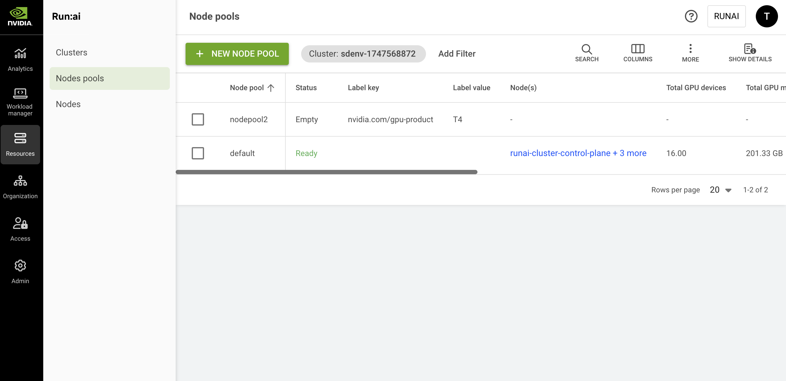

# Node Pools

Node pools assist in managing heterogeneous resources effectively. A node pool is a NVIDIA Run:ai construct representing a set of nodes grouped into a bucket of resources using a predefined node label (e.g. NVIDIA GPU type) or an administrator-defined node label (any key/value pair).

Typically, the grouped nodes share a common feature or property, such as GPU type or other HW capability (such as Infiniband connectivity), or represent a proximity group (i.e. nodes interconnected via a local ultra-fast switch). Researchers and ML Engineers would typically use node pools to run specific workloads on specific resource types.

In the NVIDIA Run:ai Platform a user with the System administrator role can create, view, edit, and delete node pools. Creating a new node pool creates a new instance of the NVIDIA Run:ai [Scheduler](../../runai-scheduler/scheduling/how-the-scheduler-works.md). Workloads submitted to a node pool are scheduled using the node pool’s designated scheduler instance.

Once created, the new node pool is automatically assigned to all [projects](../../aiinitiatives/organization/projects.md) and [departments](../../aiinitiatives/organization/departments.md) with a quota of zero GPU resources, unlimited CPU resources, and over quota enabled (medium weight if over quota weight is enabled). This allows any project and department to use any node pool when over quota is enabled, even if the administrator has not assigned a quota for a specific node pool within that project or department.

When submitting a new [workload](../../../workloads-in-nvidia-run-ai/workloads.md), users can add a prioritized list of node pools. The node pool selector picks one node pool at a time (according to the prioritized list) and the designated node pool scheduler instance handles the submission request and tries to match the requested resources within that node pool. If the scheduler cannot find resources to satisfy the submitted workload, the node pool selector moves the request to the next node pool in the prioritized list, if no node pool satisfies the request, the node pool selector starts from the first node pool again until one of the node pools satisfies the request.

## Node Pools Table

The Node pools table can be found under **Resources** in the NVIDIA Run:ai platform.

The Node pools table lists all the node pools defined in the NVIDIA Run:ai platform and allows you to manage them.

<Note>

**Note**

By default, the NVIDIA Run:ai platform includes a single node pool named ‘default’. When no other node pool is defined, all existing and new nodes are associated with the ‘default’ node pool. When deleting a node pool, if no other node pool matches any of the nodes’ labels, the node will be included in the default node pool.

</Note>

<figure><figcaption></figcaption></figure>

The Node pools table consists of the following columns:

| Column                          | Description                                                                                                                                                                                                                                                                                                                                                                                                                                                                                         |
| ------------------------------- | --------------------------------------------------------------------------------------------------------------------------------------------------------------------------------------------------------------------------------------------------------------------------------------------------------------------------------------------------------------------------------------------------------------------------------------------------------------------------------------------------- |
| Node pool                       | The node pool name, set by the administrator during its creation (the node pool name cannot be changed after its creation).                                                                                                                                                                                                                                                                                                                                                                         |
| Status                          | <p>Node pool status: Creating, Updating, Empty, Ready, Unschedulable, Missing Prerequisites, Deleting, Deleted:</p><ul><li>Empty - No nodes are currently included in that node pool.</li><li>Ready - The Scheduler can use this node pool to schedule workloads.</li><li>Unschedulable - The Scheduler cannot use this node pool to schedule workloads.</li><li>Missing Prerequisites - The node pool has [NUMA-aware scheduling](numa-aware-scheduling.md) enabled, and one or more of its nodes are missing a prerequisite for it: the node's NodeResourceTopology data is missing or invalid, or its Topology Manager policy is set to `none`.</li></ul><p>The status also includes a status message that provides more details.</p>                                                                             |
| <p>Label key<br/>Label value</p> | The node pool controller will use this node-label key-value pair to match nodes into this node pool.                                                                                                                                                                                                                                                                                                                                                                                                |
| Node(s)                         | List of nodes included in this node pool. Click the field to view details (the details are in the [Nodes](nodes.md) article).                                                                                                                                                                                                                                                                                                                                                                       |
| Network topology                | The network topology associated with this node pool                                                                                                                                                                                                                                                                                                                                                                                                                                                 |
| MNNVL                           | Indicates whether the discovery method of Multi-Node NVL nodes is done automatically or manually                                                                                                                                                                                                                                                                                                                                                                                                    |
| MNNVL label key                 | The label key that is used to automatically detect if a node is part of an MNNVL domain. The default MNNVL domain label is `nvidia.com/gpu.clique.`                                                                                                                                                                                                                                                                                                                                                 |
| MNNVL nodes                     | Indicates whether MNNVL nodes are detected - automatically or manually.                                                                                                                                                                                                                                                                                                                                                                                                                             |
| Minimum guaranteed runtime      | The minimum guaranteed runtime that a workload will run before it can be preempted by a higher priority workload.                                                                                                                                                                                                                                                                                                                                                                                   |
| GPU node placement strategy     | Sets the Scheduler node-level strategy for the assignment of pods requesting **both GPU and CPU resources** to nodes, which can be either Bin-pack or Spread. By default, Bin-Pack is used, but can be changed to Spread by editing the node pool. When set to Bin-pack the scheduler will try to fill nodes as much as possible before using empty or sparse nodes, when set to spread the scheduler will try to keep nodes as sparse as possible by spreading workloads across as many nodes as it succeeds. |
| GPU device placement strategy   | Sets the Scheduler device-level strategy for the assignment of pods requesting **both GPU and CPU resources** to GPU devices within a node, which can be either Bin-pack or Spread. By default, Bin-Pack is used, but can be changed to Spread by editing the node pool. When set to Bin-pack the scheduler will try to place as many workloads as possible on each GPU device to minimize the number of GPU devices used, when set to Spread the scheduler will try to spread workloads across GPU devices within each node to maximize the available resources per workload. |
| CPU node placement strategy     | Sets the Scheduler node-level strategy for the assignment of pods requesting **only CPU** **resources** to nodes, which can be either Bin-pack or Spread. By default, Bin-Pack is used, but can be changed to Spread by editing the node pool. When set to Bin-pack the scheduler will try to fill nodes as much as possible before using empty or sparse nodes, when set to spread the scheduler will try to keep nodes as sparse as possible by spreading workloads across as many nodes as it succeeds.     |
| Total GPU devices               | The total number of GPU devices installed into nodes included in this node pool. For example, a node pool that includes 12 nodes each with 8 GPU devices would show a total number of 96 GPU devices.                                                                                                                                                                                                                                                                                               |
| Total GPU memory                | The total amount of GPU memory included in this node pool. The total amount of GPU memory installed in nodes included in this node pool. For example, a node pool that includes 12 nodes, each with 8 GPU devices, and each device with 80 GB of memory would show a total memory amount of 7.68 TB.                                                                                                                                                                                                |
| Allocated GPUs                  | The total allocation of GPU devices in units of GPUs (decimal number). For example, if 3 GPUs are 50% allocated, the field prints out the value 1.50. This value represents the portion of GPU memory consumed by all running pods using this node pool. ‘Allocated GPUs’ can be larger than ‘Projects’ GPU quota’ if over quota is used by workloads, but not larger than GPU devices.                                                                                                             |
| Total CPU (Cores)               | The number of CPU cores installed on nodes included in this node                                                                                                                                                                                                                                                                                                                                                                                                                                    |
| Total CPU memory                | The total amount of CPU memory installed on nodes using this node pool                                                                                                                                                                                                                                                                                                                                                                                                                              |
| Allocated CPU (Cores)           | The total allocation of CPU compute in units of Cores (decimal number). This value represents the amount of CPU cores consumed by all running pods using this node pool. ‘Allocated CPUs’ can be larger than ‘Projects’ GPU quota’ if over quota is used by workloads, but not larger than CPUs (Cores).                                                                                                                                                                                            |
| Allocated CPU memory            | The total allocation of CPU memory in units of TB/GB/MB (decimal number). This value represents the amount of CPU memory consumed by all running pods using this node pool. ‘Allocated CPUs’ can be larger than ‘Projects’ CPU memory quota’ if over quota is used by workloads, but not larger than CPU memory.                                                                                                                                                                                    |
| Last updated                    | The date and time when the node pool was last updated                                                                                                                                                                                                                                                                                                                                                                                                                                               |
| Creation time                   | The date and time when the node pool was created                                                                                                                                                                                                                                                                                                                                                                                                                                                    |
| Workload(s)                     | List of workloads running on nodes included in this node pool, click the field to view details (described below in this article)                                                                                                                                                                                                                                                                                                                                                                    |

### Workloads Associated with the Node Pool

Click one of the values in the Workload(s) column, to view the list of workloads and their parameters.

<Note>

**Note**

This column is only viewable if your role in the NVIDIA Run:ai platform gives you read access to workloads, even if you are allowed to view workloads, you can only view the workloads within your allowed scope. This means, there might be more pods running on this node than appear in the list your are viewing.

</Note>

| Column                        | Description                                                                                                                                                                                |
| ----------------------------- | ------------------------------------------------------------------------------------------------------------------------------------------------------------------------------------------ |
| Workload                      | The name of the workload. If the workloads’ type is one of the recognized types (for example: Pytorch, MPI, Jupyter, Ray, Spark, Kubeflow, and many more), an appropriate icon is printed. |
| Type                          | The NVIDIA Run:ai platform type of the workload - Workspace, Training, or Inference                                                                                                        |
| Status                        | The state of the workload. The Workloads state is described in the NVIDIA Run:ai [workloads](../../../workloads-in-nvidia-run-ai/workloads.md) section                                     |
| Created by                    | The user or service account created this workload                                                                                                                                          |
| Running/requested pods        | The number of running pods out of the number of requested pods within this workload.                                                                                                       |
| Creation time                 | The workload’s creation date and time                                                                                                                                                      |
| Allocated GPU compute         | The total amount of GPU compute allocated by this workload. A workload with 3 Pods, each allocating 0.5 GPU, will show a value of 1.5 GPUs for the workload.                               |
| Allocated GPU memory          | The total amount of GPU memory allocated by this workload. A workload with 3 Pods, each allocating 20GB, will show a value of 60 GB for the workload.                                      |
| Allocated CPU compute (cores) | The total amount of CPU compute allocated by this workload. A workload with 3 Pods, each allocating 0.5 Core, will show a value of 1.5 Cores for the workload.                             |
| Allocated CPU memory          | The total amount of CPU memory allocated by this workload. A workload with 3 Pods, each allocating 5 GB of CPU memory, will show a value of 15 GB of CPU memory for the workload.          |

### Customizing the Table View

* Filter - Click ADD FILTER, select the column to filter by, and enter the filter values
* Search - Click SEARCH and type the value to search by
* Sort - Click each column header to sort by
* Column selection - Click COLUMNS and select the columns to display in the table
* Download table - Click MORE and then Click Download as CSV. Export to CSV is limited to 20,000 rows.
* Show/Hide details - Click to view additional information on the selected row

### Show/Hide Details

Select a row in the Node pools table and then click Show details in the upper-right corner of the action bar. The details window appears, presenting metrics graphs for the whole node pool:

* **Node GPU allocation** - This graph shows an overall sum of the Allocated, Unallocated, and Total number of GPUs for this node pool, over time. From observing this graph, you can learn about the occupancy of GPUs in this node pool, over time.
* **GPU Utilization Distribution** - This graph shows the distribution of GPU utilization in this node pool over time. Observing this graph, you can learn how many GPUs are utilized up to 25%, 25%-50%, 50%-75%, and 75%-100%. This information helps to understand how many available resources you have in this node pool, and how well those resources are utilized by comparing the allocation graph to the utilization graphs, over time.
* **GPU Utilization** - This graph shows the average GPU utilization in this node pool over time. Comparing this graph with the GPU Utilization Distribution helps to understand the actual distribution of GPU occupancy over time.
* **GPU Memory Utilization** - This graph shows the average GPU memory utilization in this node pool over time, for example an average of all nodes’ GPU memory utilization over time.
* **CPU Utilization** - This graph shows the average CPU utilization in this node pool over time, for example, an average of all nodes’ CPU utilization over time.
* **CPU Memory Utilization** - This graph shows the average CPU memory utilization in this node pool over time, for example an average of all nodes’ CPU memory utilization over time.

## Adding a New Node Pool

To create a new node pool:

1. Click **+NEW NODE POOL**
2. Enter a **name** for the node pool.\
   Node pools names must start with a letter and can only contain lowercase Latin letters, numbers or a hyphen ('-’)
3. Enter the **node pool label**:\
   The node pool controller will use this node-label key-value pair to match nodes into this node pool.
   * **Key** is the unique identifier of a node label.
     * The key must fit the following regular expression: `^(([A-Za-z0-9][-A-Za-z0-9_.]*)?[A-Za-z0-9])?/?([A-Za-z0-9][-A-Za-z0-9_.]*)?[A-Za-z0-9]$`
     * The administrator can put an automatically preset label such as the nvidia.com/gpu.product that labels the GPU type or any other key from a node label.
   * **Value** is the value of that label identifier (key). The same key may have different values, in this case, they are\
     considered as different labels.
     * Value must fit the following regular expression: `^(([A-Za-z0-9][-A-Za-z0-9_.]*)?[A-Za-z0-9])?$`
   * A node pool is defined by a single key-value pair. You must not use different labels that are set on the same node by different node pools, this situation may lead to unexpected results.
4. Define **scheduling** configurations:
   * Set the **minimum guaranteed runtime**. The minimum guaranteed runtime is the time that a workload will run before it can be preempted by a higher priority workload. If the workload runs for less than the time you set, it will not be preempted. You can set the value in days, hours, minutes, and seconds. Default is 0.
   *   **Allow time-based fairshare** - When enabled, the Scheduler adjusts fairshare scores based on each project’s weight and historical resource usage. Historical usage data is not persisted by default. When disabled, the Scheduler uses the default fairshare, where scheduling fairness is based on the project’s current weight and resource usage. For more details, see [Time-based fairshare](../../runai-scheduler/scheduling/concepts-and-principles.md#time-based-fairshare). To persist historical usage data across restarts, enable persistent data at the cluster level. For details, see [Advanced cluster configurations](../../../installation-and-configuration/configuration/cluster-config.md#time-based-fairshare).

       * **Historical usage weight** - Sets the weight of historical resource usage in the fairshare calculation. Default is 1.0:
         * **0.0** - Historical usage data is ignored; fairshare is based entirely on current weight.
         * **1.0** - Creates an equilibrium between historical usage and current weight. If historical usage equals the current weight, the fairshare matches exactly the weight portion.
         * **Between 0.0 and 1.0** - Historical usage has a reduced effect on fairshare, compensating for deficient usage or penalizing excess usage to a lesser degree.
         * **Greater than 1.0** - Historical usage has a greater effect on fairshare, making it the dominant factor in the fairshare calculation.
       * **Historical usage window** - Sets the duration of the sliding time window used to calculate historical resource usage. Default is 7 days. Only usage within this window is considered; anything outside the window is no longer counted.

       Administrators can customize additional time-based fairshare configuration parameters at the node pool level using the [Node pools](api:main-api:GET/api/v1/node-pools) API.
   * **NUMA-aware scheduling** - When enabled, the Scheduler places workloads so that GPU, CPU, and CPU memory are allocated within the same NUMA node where possible, minimizing cross-NUMA fragmentation and improving performance. There are cluster prerequisites for enabling this feature. When disabled, the Scheduler places workloads using aggregate node capacity only, without considering NUMA topology. See [Configuring NUMA-Aware Scheduling](../../../platform-management/aiinitiatives/resources/numa-aware-scheduling.md) for more details.
   * Configure the **GPU pods** placement strategy. GPU workloads are workloads that request both GPU and CPU resources.
     * Set the **node placement strategy** - Determines how workloads are distributed across nodes in the node pool:
       * **Bin-pack** - Place as many workloads as possible in each GPU and node to use fewer resources and maximize GPU and node vacancy.
       * **Spread** - Spread workloads across as many GPUs and nodes as possible to minimize the load and maximize the available resources per workload.
     * Set the **device placement strategy** - Determines how workloads are distributed across GPU devices within each node:
       * **Bin-pack** - Place as many workloads as possible on each GPU device to minimize the number of GPU devices used.
       * **Spread** - Spread workloads across GPU devices within each node to maximize the available resources per workload.
   * Configure the **CPU pods** placement strategy. CPU workloads are workloads that request purely CPU resources.
     * Set the **node placement strategy** - Determines how CPU workloads are distributed across nodes in the node pool:
       * **Bin-pack** - Place as many workloads as possible in each CPU and node to use fewer resources and maximize CPU and node vacancy.
       * **Spread** - Spread workloads across as many CPUs and nodes as possible to minimize the load and maximize the available resources per workload.
5. Set the **GPU network acceleration**:
   * Network topologies are defined at the cluster level and must be associated with one or more node pools. Administrators can create and manage network topologies from the [Clusters](../../../installation-and-configuration/operations/clusters.md#managing-network-topologies) page and attach them to node pools, or create a network topology directly while configuring a node pool.
     * Select the **network topology** that represents this node pool’s network. This optimizes placement and accelerates distributed workloads by keeping pods on nodes that are as close to each other as possible in the network.
     *   To add a topology that represents the node pool's network:

         * Click **+ NEW NETWORK TOPOLOGY**
         * Enter a unique **name** for the topology. If the name already exists, you will be requested to enter a different name.
         * Click **+ LABEL** to add the node label keys that represent the network hierarchy
           * Order labels from farthest (first) to closest (last)
           * Ensure the labels match the corresponding keys on the nodes. For example: `cloud.provider.com/topology-block`, `cloud.provider.com/topology-rack`, `kubernetes.io/hostname`
           * Drag labels to adjust their order if needed
         * Click **SAVE NETWORK TOPOLOGY**

         See [Accelerating workloads with network topology-aware scheduling](../../aiinitiatives/resources/topology-aware-scheduling/README.md) for more details.
   * Define whether MNNVL is present on this node pool. For more details, see [Using GB200 NVL72 and Multi-Node NVLink domains](../../aiinitiatives/resources/using-gb200.md):
     * **Auto-detect** - Automatically detect whether the node pool contains any MNNVL nodes. MNNVL nodes that share the same ID are part of the same NVL rack.
     * **MNNVL is present** - Explicitly indicate that the node pool contains MNNVL nodes
     * **MNNVL is not present** - Explicitly indicate that the node pool does not contain MNNVL nodes
   * Set the node’s label used to discover GPU network acceleration (MNNVL) to `nvidia.com/gpu.clique`
6. Click **CREATE NODE POOL**

### Labeling Nodes for Node Pool Grouping

The administrator can use a preset node label, such as the `nvidia.com/gpu.product` that labels the GPU type, or configure any other node label (e.g. `faculty=physics`).

To assign a label to nodes you want to group into a node pool, set a node label on each node:

1.  Obtain the list of nodes and their current labels by copying the following to your terminal:

    ```bash
    kubectl get nodes --show-labels
    ```
2.  Annotate a specific node with a new label by copying the following to your terminal:

    ```bash
    kubectl label node <node-name> <key>=<value>
    ```

### Labeling Nodes via Cloud Providers

Most cloud providers allow you to configure node labels at the node pool level. You can apply labels when creating a cluster, creating a node pool, or by editing an existing node pool.

Ensure that each node is labeled using the Kubernetes label format. This label ensures that workloads are scheduled correctly based on node pool definitions:

```bash
run.ai/type=<TYPE_VALUE>
```

Refer to the provider-specific documentation below for guidance on how to configure node pool labels:

* [Google Kubernetes Engine (GKE)](https://cloud.google.com/kubernetes-engine/docs/concepts/kubernetes-engine-overview)
* [Azure Kubernetes Service (AKS)](https://learn.microsoft.com/en-us/azure/aks/)
* [Amazon Elastic Kubernetes (EKS)](https://docs.aws.amazon.com/eks/)

## Editing a Node Pool

1. Select the node pool you want to edit
2. Click **EDIT**
3. Update the node pool and click **SAVE**

## Deleting a Node Pool

1. Select the node pool you want to delete
2. Click **DELETE**
3. On the dialog, click **DELETE** to confirm the deletion

<Note>

**Note**

The default node pool cannot be deleted. When deleting a node pool, if no other node pool matches any of the nodes’ labels, the node will be included in the default node pool.

</Note>

## Using API

To view the available actions, go to the [Node pools](api:main-api:GET/api/v1/node-pools) API reference.


## Using MCP

The NVIDIA Run:ai MCP server exposes [Cluster and Infrastructure](../../../agents/tools-reference.md#cluster-and-infrastructure) tools to manage node pools via natural language:

* `list_node_pools` - list a cluster's node pools, their default status, lifecycle phase, and network topology
* `manage_node_pool` - create, update, or delete a node pool

See [AI Agents](../../../agents/overview.md) for setup.
