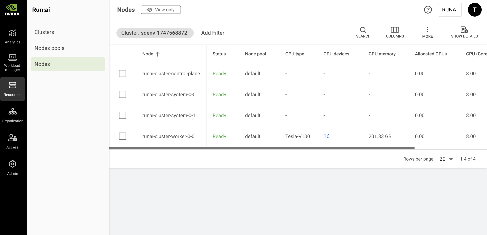

# Nodes

Nodes are Kubernetes elements automatically discovered by the NVIDIA Run:ai platform. Once a node is discovered by the NVIDIA Run:ai platform, an associated instance is created in the Nodes table, administrators can view the Node’s relevant information, and NVIDIA Run:ai scheduler can use the node for [Scheduling](../../runai-scheduler/scheduling/how-the-scheduler-works.md).

## Nodes Table

The Nodes table can be found under **Resources** in the NVIDIA Run:ai platform.

The Nodes table displays a list of predefined nodes available to users in the NVIDIA Run:ai platform.

<Note>

**Note**

* It is not possible to create additional nodes, or edit, or delete existing nodes.
* Only users with relevant permissions can view the table.

</Note>

<figure><figcaption></figcaption></figure>

The Nodes table consists of the following columns:

| Column                    | Description                                                                                                                                                                                                                                            |
| ------------------------- | ------------------------------------------------------------------------------------------------------------------------------------------------------------------------------------------------------------------------------------------------------ |
| Node                      | The Kubernetes name of the node                                                                                                                                                                                                                        |
| Status                    | 
The state of the node: Ready, Not ready, Missing Prerequisites:
<ul><li>Ready - The node is eligible for scheduling.</li><li>Not ready - The main reason appears in parenthesis on the right side of the state field; hovering the state lists the reasons why the node is Not ready.</li><li>Missing Prerequisites - The node is in a node pool with [NUMA-aware scheduling](numa-aware-scheduling.md) enabled, and its NodeResourceTopology data is missing or invalid, or its Topology Manager policy is set to `none`; hovering the state shows the specific reason.</li></ul> |
| Node pool                 | The name of the associated node pool. By default, every node in the NVIDIA Run:ai platform is associated with the default node pool, if no other node pool is associated.                                                                              |
| Cluster                   | The cluster that the node is associated with                                                                                                                                                                                                           |
| NVLink domain UID         | Indicates if the MNNVL domain ID is part of the MNNVL label value. In case the MNNVL label is not the default MNNVL label key (`nvidia.com/gpu.clique`), this field will show the whole label value.                                                   |
| MNNVL domain clique ID    | Indicates if the MNNVL clique ID is part of the MNNVL label value. In case the MNNVL label is not the default MNNVL label key (`nvidia.com/gpu.clique`), this field will show an empty value.                                                          |
| Topology Manager policy   | The Kubernetes Topology Manager policy configured on the node (`none`, `best-effort`, `restricted`, or `single-numa-node`), which controls how NUMA-aligned resource allocation is enforced. Shows `-` if not available.                                |
| NUMA nodes                | Click to view the resource breakdown per NUMA node on this node (described below in this article).                                                                                                                                                    |
| GPU type                  | The GPU model, for example, H100, or V100                                                                                                                                                                                                              |
| Ready / total GPU devices | The number of GPU devices installed on the node. Clicking this field pops up a dialog with details per GPU (described below in this article).                                                                                                          |
| GPU memory                | The total amount of GPU memory installed on this node. For example, if the number is 640GB and the number of GPU devices is 8, then each GPU is installed with 80GB of memory (assuming the node is assembled of homogenous GPU devices).              |
| Allocated GPUs            | The total allocation of GPU devices in units of GPUs (decimal number). For example, if 3 GPUs are 50% allocated, the field prints out the value 1.50. This value represents the portion of GPU memory consumed by all running pods using this node.    |
| Free GPU devices          | The current number of fully vacant GPU devices                                                                                                                                                                                                         |
| CPU (Cores)               | The number of CPU cores installed on this node                                                                                                                                                                                                         |
| CPU memory                | The total amount of CPU memory installed on this node                                                                                                                                                                                                  |
| Allocated CPU (Cores)     | The number of CPU cores allocated by pods running on this node (decimal number, e.g. a pod allocating 350 mili-cores shows an allocation of 0.35 cores).                                                                                               |
| Allocated CPU memory      | The total amount of CPU memory allocated by pods running on this node (in GB or MB)                                                                                                                                                                    |
| Pod(s)                    | List of pods running on this node, click the field to view details (described below in this article)                                                                                                                                                   |

### GPU Devices for Node

Click one of the values in the GPU devices column, to view the list of GPU devices and their parameters.

| Column              | Description                                                                                        |
| ------------------- | -------------------------------------------------------------------------------------------------- |
| Index               | The GPU index, read from the GPU hardware. The same index is used when accessing the GPU directly. |
| Allocated compute   | The total amount of GPU compute allocated                                                          |
| Allocated memory    | The total amount of GPU memory allocated                                                           |
| Used memory         | The amount of memory used by pods and drivers using the GPU (in GB or MB)                          |
| Compute utilization | The portion of time the GPU is being used by applications (percentage)                             |
| Memory utilization  | The portion of the GPU memory that is being used by applications (percentage)                      |
| Idle time           | The elapsed time since the GPU was used (i.e. the GPU is being idle for ‘Idle time’)               |

### NUMA Nodes for a Node

Click the value in the NUMA nodes column to view the resource breakdown per NUMA node on this node.

<Note>

**Note**

The list is empty when the node's NUMA topology data is missing or invalid. See [NUMA-aware scheduling](numa-aware-scheduling.md) for the prerequisites for NUMA-aware scheduling.

</Note>

| Column                | Description                                                                    |
| ---------------------- | -------------------------------------------------------------------------------- |
| Name                   | The identifier of the NUMA node, for example, node-0                             |
| Total GPU devices      | The total number of GPU devices available for allocation on this NUMA node       |
| Allocated GPUs         | The number of GPU devices currently allocated to workloads on this NUMA node     |
| CPU (Cores)            | The total number of CPU cores available for allocation on this NUMA node         |
| CPU memory             | The total amount of CPU memory available for allocation on this NUMA node        |
| Allocated CPU (Cores)  | The number of CPU cores currently allocated to workloads on this NUMA node       |
| Allocated CPU memory   | The amount of CPU memory currently allocated to workloads on this NUMA node      |

### Pods Associated with a Node

Click one of the values in the Pod(s) column, to view the list of pods and their parameters.

<Note>

**Note**

This column is only viewable if your role in the NVIDIA Run:ai platform gives you read access to workloads, even if you are allowed to view workloads, you can only view the workloads within your allowed scope. This means, there might be more pods running on this node then appear in the list you are viewing.

</Note>

| Column                | Description                                                                                                                                                                                                                |
| --------------------- | -------------------------------------------------------------------------------------------------------------------------------------------------------------------------------------------------------------------------- |
| Pod                   | The Kubernetes name of the pod. Usually name of the pod is made of the name of the parent workload if there is one, and an index for unique for that pod instance within the workload.                                     |
| Status                | The state of the pod. In steady state this should be Running and the amount of time the pod is running.                                                                                                                    |
| Project               | The NVIDIA Run:ai project name the pod belongs to. Clicking this field takes you to the Projects table filtered by this project name.                                                                                      |
| Workload              | The workload name the pod belongs to. Clicking this field takes you to the Workloads table filtered by this workload name.                                                                                                 |
| Allocated GPUs        | The total allocation of GPU devices in units of GPUs (decimal number). For example, if 3 GPUs are 50% allocated, the field prints out the value 1.50. This value represents the portion of GPU memory consumed by the pod. |
| Allocated GPU memory  | The total amount of GPU memory allocated by the pod (in GB or MB)                                                                                                                                                          |
| Allocated CPU (Cores) | The number of CPU cores allocated by the pod (decimal number, e.g. a pod allocating 350 mili-cores shows an allocation of 0.35 cores)                                                                                      |
| Allocated CPU memory  | The total amount of CPU memory allocated by the pod (in GB or MB)                                                                                                                                                          |
| Image                 | The full path of the image used by the main container of this pod                                                                                                                                                          |
| IP                    | The unique internal IP address assigned to a pod                                                                                                                                                                           |
| Creation time         | The pod’s creation date and time                                                                                                                                                                                           |

### Customizing the Table View

* Filter - Click ADD FILTER, select the column to filter by, and enter the filter values
* Search - Click SEARCH and type the value to search by
* Sort - Click each column header to sort by
* Column selection - Click COLUMNS and select the columns to display in the table
* Download table - Click MORE and then Click Download as CSV. Export to CSV is limited to 20,000 rows.
* Show/Hide details - Click to view additional information on the selected row

### Show/Hide Details

Click a row in the Nodes table, then click the Show details button at the upper right of the action bar. The Metrics screen appears, containing a dropdown allowing you to switch between **Resource utilization** and **GPU profiling** metrics views:

* **Resource utilization** - Displays general GPU, CPU and network metrics
* **GPU profiling** - Shows additional NVIDIA-specific metrics

<Note>

**Note**

GPU profiling metrics are disabled by default. If unavailable, your administrator must enable it under **General settings** → Analytics → GPU profiling metrics. Before enabling, the administrator must configure GPU profiling through the DCGM Exporter and NVIDIA Run:ai Prometheus integration. For configuration steps, see [GPU profiling metrics](../../monitor-performance/gpu-profiling-metrics.md).

</Note>

#### Resource Utilization

* **GPU utilization**\
  Per GPU graph and an average of all GPUs graph, all on the same chart, along an adjustable period allows you to see the trends of all GPUs compute utilization (percentage of GPU compute) in this node.
* **GPU memory utilization**\
  Per GPU graph and an average of all GPUs graph, all on the same chart, along an adjustable period allows you to see the trends of all GPUs memory usage (percentage of the GPU memory) in this node.
* **CPU compute utilization**\
  The average of all CPUs’ cores compute utilization graph, along an adjustable period allows you to see the trends of CPU compute utilization (percentage of CPU compute) in this node.
* **CPU memory utilization**\
  The utilization of all CPUs memory in a single graph, along an adjustable period allows you to see the trends of CPU memory utilization (percentage of CPU memory) in this node.
* **CPU memory usage**\
  The usage of all CPUs memory in a single graph, along an adjustable period allows you to see the trends of CPU memory usage (in GB or MB of CPU memory) in this node.
* **NVLink bandwidth total**\
  The rate of data transmitted / received over NVLink, not including protocol headers, in bytes per second. The value represents an average over a time interval and is not an instantaneous value. The rate is averaged over the time interval. For example, if 1 GB of data is transferred over 1 second, the rate is 1 GB/s regardless of the data transferred at a constant rate or in bursts. The theoretical maximum NVLink Gen2 bandwidth is 25 GB/s per link per direction.

#### GPU Profiling

Select **GPU profiling** from the dropdown to view extended GPU device-level metrics such as memory bandwidth, SM occupancy, and other data.

* For the full list of supported metrics, see [Metrics and telemetry](../../monitor-performance/metrics.md#gpu-profiling).
* For definitions and technical descriptions, refer to the [NVIDIA documentation](https://docs.nvidia.com/datacenter/dcgm/latest/user-guide/feature-overview.html#profiling-metrics).

#### Navigating the Graphs

* For GPUs charts - Click the GPU legend on the right-hand side of the chart, to activate or deactivate any of the GPU lines.
* You can click the date picker to change the presented period
* You can use your mouse to mark a sub-period in the graph for zooming in, and use the ‘Reset zoom’ button to go back to the preset period
* Changes in the period affect all graphs on this screen.

## Using API

To view the available actions, go to the [Nodes](api:main-api:GET/api/v1/nodes) API reference.

## Using MCP

The NVIDIA Run:ai MCP server exposes the [`get_node_pods`](../../../agents/tools-reference.md#cluster-and-infrastructure) tool to see which pods are running on a specific node, and which workloads they belong to, via natural language. See [AI Agents](../../../agents/overview.md) for setup.
