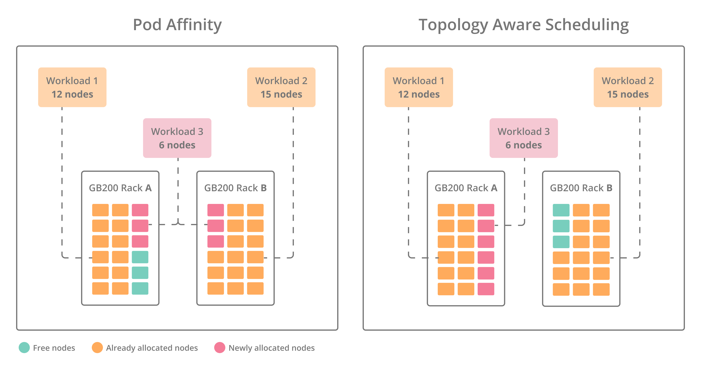

# Accelerating Workloads with Network Topology-Aware Scheduling

Topology-aware scheduling in NVIDIA Run:ai optimizes the placement of workloads across data center nodes by leveraging knowledge of the underlying network topology. In modern AI/ML clusters, communication between the different pods of a distributed workload can be a significant performance bottleneck. By scheduling workload pods on nodes that are “closer” to each other in the network (e.g., same rack, block, NVLink domain), NVIDIA Run:ai reduces communication overhead and improves workload efficiency.

Kubernetes represents hierarchical network structures, such as racks, blocks, or NVLink domains, using node labels. These labels describe where each node resides in the cluster's network topology. The [NVIDIA Run:ai Scheduler](../../runai-scheduler/scheduling/concepts-and-principles.md) uses this topology information to keep workloads on nodes that minimize latency and maximize bandwidth availability.

<Info>

**Note**

For guidance on using topology-aware scheduling with GB200 and Multi-Node NVLink (MNNVL) systems, see [Using GB200 and Multi-Node NVLink Domains](using-gb200.md).

</Info>

## Benefits of Network Topology-Aware Scheduling

* **Improved performance for distributed workloads** - Reduces inter-node communication latency by scheduling pods on nodes closer to each other.
* **Optimized GPU utilization** - Keeps workloads within NVLink/NVL72 domains where possible, leveraging high-bandwidth interconnects.
* **Multi-level topology** - Supports multi-level topology definitions (e.g., rack → block → node), giving administrators fine-grained control. The NVIDIA Run:ai Scheduler considers all levels when placing workloads. If scheduling cannot occur at a lower level, it automatically moves up the hierarchy, attempting placement layer by layer in order.
* **Seamless distributed workload experience** - Topology-aware scheduling for distributed workloads is applied automatically once an administrator has configured the network topology. This ensures performance gains without requiring any additional user configuration.

## Topology Labels in Kubernetes

Topology-aware scheduling relies on Kubernetes node labels that describe each node’s location in the topology. These labels are applied at the Kubernetes level and are managed outside of NVIDIA Run:ai.

How labels are created depends on the environment and user setup. Users may apply labels manually or use topology discovery tools such as [Topograph](https://github.com/NVIDIA/topograph). In cloud environments, labels are often applied automatically by the cloud provider. When NVIDIA NetQ is used in on-prem environments, Topograph can integrate with NetQ to obtain network topology and real-time network telemetry data and derive the appropriate labels based on the physical network layout. See the [NVIDIA NetQ User Guide](https://docs.nvidia.com/networking-ethernet-software/cumulus-netq/) for more details.

Once the labels are in place, administrators only need to specify the **label keys** (as described below) that represent the topology which the NVIDIA Run:ai Scheduler should reference when making placement decisions.

## Configuring Network Topology

When creating or editing a cluster, administrators assign a network topology that represents the connectivity of nodes within the cluster. This topology is defined through Kubernetes node label keys. See [Managing network topologies](../../../installation-and-configuration/operations/clusters.md#managing-network-topologies) for more details.

These labels must match those configured on the cluster nodes and are used by the NVIDIA Run:ai Scheduler to guide workload placement decisions. The order of labels defines the hierarchy:

* The **first label** represents the farthest point in the network (for example, a region).
* The **last label** represents the closest switch or node (for example, a hostname or rack).

Example:

```json
{
  "levels": [
    "topology.kubernetes.io/region",
    "topology.kubernetes.io/zone",
    "cloud.provider.com/topology-block",
    "cloud.provider.com/topology-rack",
    "kubernetes.io/hostname"
  ],
  "name": "default-topology",
  "clusterId": "<CLUSTER_ID>"
}
```

After creating a topology, the administrator must associate it with the relevant [node pool(s)](../../aiinitiatives/resources/node-pools.md#adding-a-new-node-pool).

* If you are using the default node pool (that is, no additional node pools are defined), attach the topology to the default node pool.
* If different node pools have different topologies, each node pool must be linked to its corresponding topology.
* If the entire cluster shares the same topology, link the same topology to all node pools.

## Automatic Topology-Aware Scheduling

When a distributed workload is submitted, the platform automatically applies topology-aware scheduling based on the network topology configured on the target node pool. This behavior ensures that distributed workloads benefit from improved performance without additional user configuration.

By default, topology-aware scheduling in NVIDIA Run:ai is applied at the **workload level**. This means the Scheduler considers the entire distributed workload as a single unit and places all of its pods according to the same topology constraints.

NVIDIA Run:ai automatically applies a **Preferred** topology constraint at the lowest defined topology level. This co-locates pods as close as possible in the network hierarchy, reducing communication overhead. If the Scheduler cannot place pods at this level, it automatically escalates placement by moving up through the topology hierarchy (for example: from node → rack → block → zone), always seeking the closest available level to minimize latency.

This behavior applies to distributed [native workloads](../../../workloads-in-nvidia-run-ai/workload-types/native-workloads.md) and [supported workload types](../../../workloads-in-nvidia-run-ai/workload-types/supported-workload-types.md). To override the default behavior and define your own topology-related annotations when submitting a distributed workload, see [Fine-tuning topology-aware scheduling per workload](topology-aware-scheduling.md#fine-tuning-topology-aware-scheduling-per-workload).

### Segmented PyTorch Workload Behavior

For PyTorch distributed training workloads, you can divide worker pods into topology-aware scheduling segments. Each segment contains the number of workers you specify. The master pod is not included in a segment.

To enable segmented placement in the NVIDIA Run:ai UI, enter a positive integer in **Set the number of workers per segment** under the worker **Compute resources** section. Omit the value to disable segmentation. Set the value to match your application's parallel segment size. If the number of workers is not evenly divisible by this value, the final segment contains fewer workers.

NVIDIA Run:ai applies a Preferred constraint at the lowest defined topology level to both the whole workload and each worker segment. The Scheduler attempts to place the whole workload close together while also keeping workers in the same segment as close as possible.

<Warning>

**Prerequisite**

Segmented topology-aware scheduling requires a cluster running version 2.27 or later. The selected node pools must have a network topology configured.

</Warning>

### LeaderWorkerSet (LWS) Behavior

LeaderWorkerSet (LWS) is a supported distributed workload type, receiving the same automatic topology-aware scheduling behavior described above. For LWS workloads, topology-aware scheduling is applied **per replica**:

* Each replica of a LeaderWorkerSet (as defined by `spec.replicas`) is gang scheduled.
* The same topology constraints are applied to each replica. This ensures that the leader and worker pods that belong to the same replica are placed according to the configured network topology (for example, within the same rack, block, or NVLink domain).

Example:

```yaml
apiVersion: leaderworkerset.x-k8s.io/v1
kind: LeaderWorkerSet
metadata:
  annotations:
    kai.scheduler/topology: "cluster-topology"
    kai.scheduler/topology-required-placement: "cloud.provider.com/topology-block"
    kai.scheduler/topology-preferred-placement: "cloud.provider.com/topology-rack"
  labels:
    runai/queue: test
  namespace: runai-test
  name: vllm
spec:
  replicas: 2
  leaderWorkerTemplate:
    size: 2
```

## Topology-Aware Scheduling for Dynamo over Grove

Dynamo disaggregated inference workloads require per-component topology-aware scheduling, since applying a single topology constraint across all pods can lead to suboptimal placement. NVIDIA Run:ai supports hierarchical, multi-component topology-aware scheduling for Dynamo over Grove workloads, enforcing constraints at both the workload (Deployment) and component (Service) levels.

<Info>

**Note**

Support for multiple topologies in the same cluster requires Dynamo 1.1.0 and Grove v0.1.0-alpha.9 or later. Starting from these versions, administrators can configure matching topologies in both NVIDIA Run:ai and Grove for each node pool, ensuring workloads are scheduled against the correct topology for the node pool where they run.

In earlier versions, only a single cluster-wide topology is supported - using multiple topologies in those versions may result in scheduling mismatches.

</Info>

Grove manages topologies independently and exposes them as the mechanism for requesting topology constraints in the Dynamo workload spec.

* **Administrator setup** - For each topology defined in NVIDIA Run:ai, the administrator creates a matching topology in Grove and references it to its corresponding KAI topology. Once linked, NVIDIA Run:ai surfaces the Grove topology name and levels to users through the [Network Topologies](https://run-ai-docs.nvidia.com/api/2.26/organizations/network-topologies) API, without requiring them to understand the underlying Grove topology configuration.
* **Workload submission** - When submitting a Dynamo workload, the user selects the topology that matches the node pool on which the workload will run. If only a single topology exists in the cluster, it is always used. The Grove topology is surfaced through the [Network Topologies](https://run-ai-docs.nvidia.com/api/2.26/organizations/network-topologies) API, allowing users to identify the correct topology for their target node pool.
* **Scheduling** - The NVIDIA Run:ai Scheduler enforces the topology constraints at both the workload (Deployment) and component (Service) levels.

If there is no matching topology for the required node pool, a mismatch can occur between what the user requests, what the Scheduler places, and what is visible on the workload. See [Topology constraints visibility](topology-aware-scheduling.md#topology-constraints-visibility) for more details.

## Fine-tuning Topology-Aware Scheduling per Workload

You can customize how NVIDIA Run:ai applies topology labels for each distributed workload, allowing you to override the default scheduling behavior when needed.

* For native distributed workloads, define the topology annotations in the workload’s annotations field through the NVIDIA Run:ai UI, API, or CLI.
* For supported workload types submitted via YAML, specify the topology-related annotations directly in the YAML manifest. NVIDIA Run:ai respects the user-defined annotations and does not override them.

Use the following topology-aware scheduling annotations when submitting a distributed workload:

* `kai.scheduler/topology` - Specifies the name of the topology to use.\
  The value must match the name of a topology entity defined for the cluster.
* `kai.scheduler/topology-required` and/or `kai.scheduler/topology-preferred` - Define placement constraints using a topology label key (for example, `"rack"`).
  * Required - Enforces strict placement. All pods must be scheduled within the specified topology level.
  * Preferred - Expresses a soft preference. The Scheduler attempts to place pods within the specified topology level when possible.

You can use Required, Preferred, or both together for the same topology tree. When combining them, keep in mind that network topologies are hierarchical (tree-structured):

* A Preferred constraint defined at the same level as, or higher than, a Required constraint has no effect.
* A Preferred constraint is effective only when it is defined at a lower (more specific) topology level than the Required constraint.
* In this case, the Scheduler enforces the Required constraint while attempting to further group pods according to the Preferred constraint.

## Topology Constraints Visibility

The topology name, applied topology constraints, and actual topology placement, whether applied automatically by NVIDIA Run:ai or defined manually, are exposed through the [Workloads](https://run-ai-docs.nvidia.com/api/2.26/workloads/workloads) API for native and supported workload types. For native workloads, this information is also visible in the workload [Details](../../../workloads-in-nvidia-run-ai/workloads.md#show-hide-details) view in the UI.

* **Topology name** - The name of the topology applied to the workload.
* **Topology levels** - Each configured topology level with its constraint type (Required or Preferred) and the level at which pods were actually placed. When the constraint is met, pods are placed according to the topology, ensuring optimal pod-to-pod communication and performance. When a Preferred constraint is not met, pods may be placed farther apart than preferred, which can impact communication latency and performance.
* **Actual placement** - The topology label level and value where the workload pods were actually placed (for example, `network.topology.nvidia.com/zone (us-central)`). Actual placement is reported even when no topology constraints were applied to the workload, so you can always see where pods landed in the network hierarchy. For multi-component workloads such as Dynamo over Grove, the [Workloads](https://run-ai-docs.nvidia.com/api/2.26/workloads/workloads) API also returns the actual placement per workload element, so you can verify where each element's pods were placed.

## Workloads Submitted via kubectl (Manual)

When submitting distributed workloads via `kubectl`, topology-aware scheduling is not applied automatically by NVIDIA Run:ai. Instead, you can configure the workload with annotations to ensure the Scheduler respects the desired topology.

* Add annotations to the workload manifest by specifying the topology name and constraint type.
* You can use either **Required** or **Preferred** constraints, or combine both for the same topology tree. When using both, note that network topologies are hierarchical (tree-structured). Applying a Preferred constraint at the same level as, or higher than, a Required constraint has no effect. A Preferred constraint is meaningful only when it is defined at a lower (more specific) topology level than the Required constraint. In this case, the topology-aware scheduling logic attempts to further group pods at that lower level, while still enforcing the mandatory Required constraint.

For example:

```yaml
apiVersion: batch/v1
kind: Job
metadata:
  name: topology-aware-job
  annotations:
    kai.scheduler/topology-preferred-placement: "rack"
    kai.scheduler/topology-required-placement: "zone"
    kai.scheduler/topology: "network"
```

## Pod Affinity vs. Topology-Aware Scheduling

The following example demonstrates the difference between pod affinity and topology-aware scheduling when placing distributed workloads across two GB200 racks:

<figure><figcaption></figcaption></figure>

In the example, two workloads (Workload 1 requiring 12 nodes and Workload 2 requiring 15 nodes) are already running. A third workload that requires 6 nodes is submitted:

* With pod affinity, the Scheduler places pods one by one, only checking for “closeness” to existing pods without awareness of the entire workload compared to the available nodes. As a result, the workload is split across Rack A and Rack B, introducing unnecessary cross-rack communication overhead.
* In contrast, topology-aware scheduling evaluates the full node requirement in advance and uses knowledge of the hierarchy (rack, block, NVLink domains) to allocate resources. This ensures all 6 nodes are placed together in Rack A, minimizing latency and maximizing bandwidth efficiency. By avoiding fragmentation and cross-rack placement, topology-aware scheduling improves workload performance and overall cluster utilization compared to pod affinity.

## Using API

To view the available actions, go to the [Network Topologies](https://run-ai-docs.nvidia.com/api/2.26/organizations/network-topologies) API reference.

## Known Limitations

* If a topology is detached from a node pool, workloads that are already running will continue using it, as long as the topology still exists.
* If a topology is completely deleted while workloads are still using it:
  * Running workloads will continue unaffected.
  * Suspended workloads that are later resumed, or workloads not yet bound to a node, will become unschedulable and remain in Pending.
* Submitting a workload to multiple node pools that each have different topologies is not supported. Workloads submitted through NVIDIA Run:ai will fail, while external workloads may either remain pending or run if the topology matches at least one node pool.
