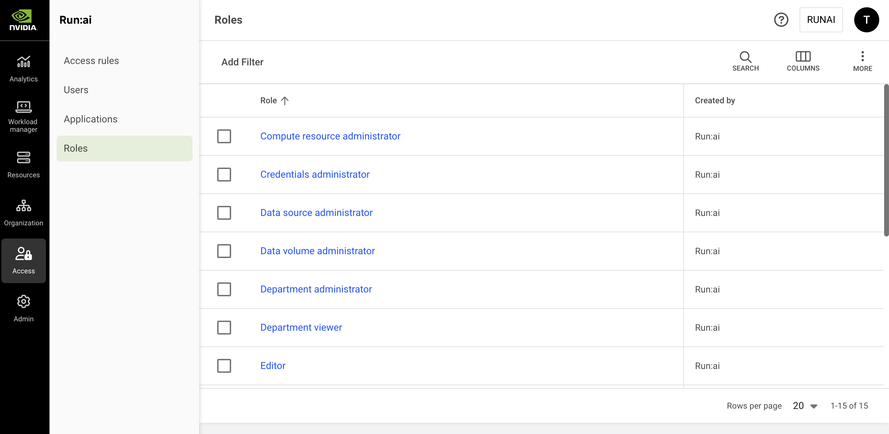

# Roles

A role defines a set of permissions that can be assigned to a [subject in a scope](../../platform-management/aiinitiatives/adapting-ai-initiatives.md#scopes-in-an-organization), determining which actions the subject is allowed to perform on NVIDIA Run:ai entities such as projects, workloads, and users. Each permission represents an allowed action including view, create, edit, and delete on a specific entity.

Related permissions are grouped into permission sets, which bundle actions for a particular functional area (for example, managing workloads). These permission sets act as reusable building blocks that simplify role definition and ensure consistent access control across the platform.

For a reference of all available permissions, including how API permission names map to their user interface display names, see [Permissions](permissions.md).

NVIDIA Run:ai provides [predefined roles](roles.md#roles-in-nvidia-run-ai) for common use cases and allows administrators to create [custom roles](roles.md#custom-roles-api-only) to meet specific organizational requirements.

## Roles Table

The Roles table can be found under **Access** in the NVIDIA Run:ai platform.

The Roles table displays a list of roles available to users in the NVIDIA Run:ai platform. Both predefined and custom roles will be displayed in the table.

<figure><figcaption></figcaption></figure>

The Roles table consists of the following columns:

| Column        | Description                             |
| ------------- | --------------------------------------- |
| Role          | The name of the role                    |
| Created by    | The name of the role creator            |
| Creation time | The timestamp when the role was created |

### Customizing the Table View

* Filter - Click ADD FILTER, select the column to filter by, and enter the filter values
* Search - Click SEARCH and type the value to search by
* Sort - Click each column header to sort by
* Column selection - Click COLUMNS and select the columns to display in the table
* Download table - Click MORE and then Click Download as CSV. Export to CSV is limited to 20,000 rows.

## Reviewing a Role

1. To review a role click the role name on the table
2. In the role form review the following:
   * **Role name**\
     The name of the role
   * **Entity**\
     A system-managed object that can be viewed, edited, created or deleted by a user based on their assigned role and scope
   * **Actions**\
     The actions that the role assignee is authorized to perform for each entity
     * **View** - If checked, an assigned user with this role can view instances of this type of entity within their defined scope
     * **Edit** - If checked, an assigned user with this role can change the settings of an instance of this type of entity within their defined scope
     * **Create** - If checked, an assigned user with this role can create new instances of this type of entity within their defined scope
     * **Delete** - If checked, an assigned user with this role can delete instances of this type of entity within their defined scope

## Roles in NVIDIA Run:ai

NVIDIA Run:ai supports the following roles and their permissions. Under each role is a detailed list of the actions that the role assignee is authorized to perform for each entity.

<Note>

**Note**

Legacy roles are **deprecated** and will be removed in a future release. Review the new predefined roles to determine whether they meet your requirements, or create a [custom role](roles.md#custom-role-management-api-only) using the API.

* L1 researcher, L2 researcher, ML engineer → consider using AI practitioner
* Data source administrator, Data volume administrator → consider using Data & storage administrator
* Research manager → consider using Project administrator

</Note>

<Accordion title="AI practitioner">

**AI practitioner**

| Entity | View | Edit | Create | Delete |
| --- | --- | --- | --- | --- |
| Account | ✓ | ✗ | ✗ | ✗ |
| [AI Applications](../../ai-applications/ai-applications.md) | ✓ | ✓ | ✓ | ✓ |
| [Branding settings](../../settings/general-settings/README.md#branding) | ✗ | ✗ | ✗ | ✗ |
| [Departments](../../platform-management/aiinitiatives/organization/departments.md) | ✓ | ✗ | ✗ | ✗ |
| [Event history](../../installation-and-configuration/operations/observability/event-history.md) | ✗ | ✗ | ✗ | ✗ |
| [Network topologies](../../installation-and-configuration/operations/clusters.md) | ✗ | ✗ | ✗ | ✗ |
| [Policies](../../platform-management/policies/native-workload-policies.md) | ✓ | ✗ | ✗ | ✗ |
| [Projects](../../platform-management/aiinitiatives/organization/projects.md) | ✓ | ✗ | ✗ | ✗ |
| [Security settings](../../settings/general-settings/README.md) | ✗ | ✗ | ✗ | ✗ |
| [Settings](../../settings/general-settings/README.md) | ✓ | ✗ | ✗ | ✗ |
| [Clusters](../../installation-and-configuration/operations/clusters.md) | ✗ | ✗ | ✗ | ✗ |
| Clusters minimal | ✓ | ✗ | ✗ | ✗ |
| [Node pools](../../platform-management/aiinitiatives/resources/node-pools.md) | ✗ | ✗ | ✗ | ✗ |
| Node pools minimal | ✓ | ✗ | ✗ | ✗ |
| [Nodes](../../platform-management/aiinitiatives/resources/nodes.md) | ✗ | ✗ | ✗ | ✗ |
| [Access rules](accessrules.md) | ✗ | ✗ | ✗ | ✗ |
| [Applications](service-accounts.md) | ✗ | ✗ | ✗ | ✗ |
| [Roles](roles.md) | ✗ | ✗ | ✗ | ✗ |
| [Service accounts](service-accounts.md) | ✗ | ✗ | ✗ | ✗ |
| [Users](users.md) | ✗ | ✗ | ✗ | ✗ |
| Users minimal | ✓ | ✗ | ✗ | ✗ |
| [Inferences](../../workloads-in-nvidia-run-ai/using-inference/nvidia-run-ai-inference-overview.md) | ✓ | ✓ | ✓ | ✓ |
| [Trainings](../../workloads-in-nvidia-run-ai/using-training/train-models.md) | ✓ | ✓ | ✓ | ✓ |
| [Workload properties](../../workloads-in-nvidia-run-ai/workloads.md#managing-workload-properties) | ✓ | ✗ | ✗ | ✗ |
| [Workloads](../../workloads-in-nvidia-run-ai/workloads.md) | ✓ | ✓ | ✓ | ✓ |
| [Workspaces](../../workloads-in-nvidia-run-ai/using-workspaces/running-workspace.md) | ✓ | ✓ | ✓ | ✓ |
| [Compute resources](../../workloads-in-nvidia-run-ai/workload-assets/compute-resources.md) | ✓ | ✓ | ✓ | ✓ |
| [Credentials](../../workloads-in-nvidia-run-ai/workload-assets/credentials.md) | ✓ | ✓ | ✓ | ✓ |
| [Data sources](../../workloads-in-nvidia-run-ai/workload-assets/overview.md) | ✓ | ✓ | ✓ | ✓ |
| [Data volumes](../../workloads-in-nvidia-run-ai/workload-assets/data-volumes.md) | ✓ | ✗ | ✗ | ✗ |
| [Environments](../../workloads-in-nvidia-run-ai/workload-assets/environments.md) | ✓ | ✓ | ✓ | ✓ |
| [PVC](../../workloads-in-nvidia-run-ai/workload-assets/data-volumes.md) | ✓ | ✗ | ✗ | ✗ |
| [Registries](../../workloads-in-nvidia-run-ai/workload-assets/environments.md#adding-a-new-environment) | ✓ | ✓ | ✓ | ✓ |
| [Storage class configurations](api:main-api:GET/api/v1/storage-class-configuration) | ✓ | ✗ | ✗ | ✗ |
| [Templates](../../workloads-in-nvidia-run-ai/workload-templates/README.md) | ✓ | ✓ | ✓ | ✓ |

</Accordion>

<Accordion title="Compute resource administrator (Legacy)">

**Compute resource administrator (Legacy)**

| Entity | View | Edit | Create | Delete |
| --- | --- | --- | --- | --- |
| Account | ✓ | ✗ | ✗ | ✗ |
| [AI Applications](../../ai-applications/ai-applications.md) | ✗ | ✗ | ✗ | ✗ |
| [Branding settings](../../settings/general-settings/README.md#branding) | ✓ | ✗ | ✗ | ✗ |
| [Departments](../../platform-management/aiinitiatives/organization/departments.md) | ✓ | ✗ | ✗ | ✗ |
| [Event history](../../installation-and-configuration/operations/observability/event-history.md) | ✗ | ✗ | ✗ | ✗ |
| [Network topologies](../../installation-and-configuration/operations/clusters.md) | ✗ | ✗ | ✗ | ✗ |
| [Policies](../../platform-management/policies/native-workload-policies.md) | ✓ | ✗ | ✗ | ✗ |
| [Projects](../../platform-management/aiinitiatives/organization/projects.md) | ✓ | ✗ | ✗ | ✗ |
| [Security settings](../../settings/general-settings/README.md#security) | ✓ | ✗ | ✗ | ✗ |
| [Settings](../../settings/general-settings/README.md) | ✓ | ✗ | ✗ | ✗ |
| [Clusters](../../installation-and-configuration/operations/clusters.md) | ✓ | ✗ | ✗ | ✗ |
| Clusters minimal | ✓ | ✗ | ✗ | ✗ |
| [Node pools](../../platform-management/aiinitiatives/resources/node-pools.md) | ✗ | ✗ | ✗ | ✗ |
| Node pools minimal | ✓ | ✗ | ✗ | ✗ |
| [Nodes](../../platform-management/aiinitiatives/resources/nodes.md) | ✗ | ✗ | ✗ | ✗ |
| [Access rules](accessrules.md) | ✗ | ✗ | ✗ | ✗ |
| [Applications](service-accounts.md) | ✗ | ✗ | ✗ | ✗ |
| [Roles](roles.md) | ✗ | ✗ | ✗ | ✗ |
| [Service accounts](service-accounts.md) | ✗ | ✗ | ✗ | ✗ |
| [Users](users.md) | ✗ | ✗ | ✗ | ✗ |
| Users minimal | ✓ | ✗ | ✗ | ✗ |
| [Inferences](../../workloads-in-nvidia-run-ai/using-inference/nvidia-run-ai-inference-overview.md) | ✗ | ✗ | ✗ | ✗ |
| [Trainings](../../workloads-in-nvidia-run-ai/using-training/train-models.md) | ✓ | ✗ | ✗ | ✗ |
| [Workload properties](../../workloads-in-nvidia-run-ai/workloads.md#managing-workload-properties) | ✓ | ✗ | ✗ | ✗ |
| [Workloads](../../workloads-in-nvidia-run-ai/workloads.md) | ✓ | ✗ | ✗ | ✗ |
| [Workspaces](../../workloads-in-nvidia-run-ai/using-workspaces/running-workspace.md) | ✓ | ✗ | ✗ | ✗ |
| [Compute resources](../../workloads-in-nvidia-run-ai/workload-assets/compute-resources.md) | ✓ | ✓ | ✓ | ✓ |
| [Credentials](../../workloads-in-nvidia-run-ai/workload-assets/credentials.md) | ✗ | ✗ | ✗ | ✗ |
| [Data sources](../../workloads-in-nvidia-run-ai/workload-assets/overview.md) | ✓ | ✗ | ✗ | ✗ |
| [Data volumes](../../workloads-in-nvidia-run-ai/workload-assets/data-volumes.md) | ✓ | ✗ | ✗ | ✗ |
| [Environments](../../workloads-in-nvidia-run-ai/workload-assets/environments.md) | ✓ | ✗ | ✗ | ✗ |
| [PVC](../../workloads-in-nvidia-run-ai/workload-assets/data-volumes.md) | ✓ | ✗ | ✗ | ✗ |
| [Registries](../../workloads-in-nvidia-run-ai/workload-assets/environments.md#adding-a-new-environment) | ✓ | ✗ | ✗ | ✗ |
| [Storage class configurations](api:main-api:GET/api/v1/storage-class-configuration) | ✗ | ✗ | ✗ | ✗ |
| [Templates](../../workloads-in-nvidia-run-ai/workload-templates/README.md) | ✓ | ✗ | ✗ | ✗ |

</Accordion>

<Accordion title="Credentials administrator (Legacy)">

**Credentials administrator (Legacy)**

| Entity | View | Edit | Create | Delete |
| --- | --- | --- | --- | --- |
| Account | ✓ | ✗ | ✗ | ✗ |
| [AI Applications](../../ai-applications/ai-applications.md) | ✗ | ✗ | ✗ | ✗ |
| [Branding settings](../../settings/general-settings/README.md#branding) | ✓ | ✗ | ✗ | ✗ |
| [Departments](../../platform-management/aiinitiatives/organization/departments.md) | ✓ | ✗ | ✗ | ✗ |
| [Event history](../../installation-and-configuration/operations/observability/event-history.md) | ✗ | ✗ | ✗ | ✗ |
| [Network topologies](../../installation-and-configuration/operations/clusters.md) | ✗ | ✗ | ✗ | ✗ |
| [Policies](../../platform-management/policies/native-workload-policies.md) | ✓ | ✗ | ✗ | ✗ |
| [Projects](../../platform-management/aiinitiatives/organization/projects.md) | ✓ | ✗ | ✗ | ✗ |
| [Security settings](../../settings/general-settings/README.md) | ✓ | ✗ | ✗ | ✗ |
| [Settings](../../settings/general-settings/README.md) | ✓ | ✗ | ✗ | ✗ |
| [Clusters](../../installation-and-configuration/operations/clusters.md) | ✓ | ✗ | ✗ | ✗ |
| Clusters minimal | ✓ | ✗ | ✗ | ✗ |
| [Node pools](../../platform-management/aiinitiatives/resources/node-pools.md) | ✗ | ✗ | ✗ | ✗ |
| Node pools minimal | ✓ | ✗ | ✗ | ✗ |
| [Nodes](../../platform-management/aiinitiatives/resources/nodes.md) | ✗ | ✗ | ✗ | ✗ |
| [Access rules](accessrules.md) | ✗ | ✗ | ✗ | ✗ |
| [Applications](service-accounts.md) | ✗ | ✗ | ✗ | ✗ |
| [Roles](roles.md) | ✗ | ✗ | ✗ | ✗ |
| [Service accounts](service-accounts.md) | ✗ | ✗ | ✗ | ✗ |
| [Users](users.md) | ✗ | ✗ | ✗ | ✗ |
| Users minimal | ✓ | ✗ | ✗ | ✗ |
| [Inferences](../../workloads-in-nvidia-run-ai/using-inference/nvidia-run-ai-inference-overview.md) | ✗ | ✗ | ✗ | ✗ |
| [Trainings](../../workloads-in-nvidia-run-ai/using-training/train-models.md) | ✓ | ✗ | ✗ | ✗ |
| [Workload properties](../../workloads-in-nvidia-run-ai/workloads.md#managing-workload-properties) | ✓ | ✗ | ✗ | ✗ |
| [Workloads](../../workloads-in-nvidia-run-ai/workloads.md) | ✓ | ✗ | ✗ | ✗ |
| [Workspaces](../../workloads-in-nvidia-run-ai/using-workspaces/running-workspace.md) | ✓ | ✗ | ✗ | ✗ |
| [Compute resources](../../workloads-in-nvidia-run-ai/workload-assets/compute-resources.md) | ✓ | ✗ | ✗ | ✗ |
| [Credentials](../../workloads-in-nvidia-run-ai/workload-assets/credentials.md) | ✓ | ✓ | ✓ | ✓ |
| [Data sources](../../workloads-in-nvidia-run-ai/workload-assets/overview.md) | ✓ | ✗ | ✗ | ✗ |
| [Data volumes](../../workloads-in-nvidia-run-ai/workload-assets/data-volumes.md) | ✓ | ✗ | ✗ | ✗ |
| [Environments](../../workloads-in-nvidia-run-ai/workload-assets/environments.md) | ✓ | ✗ | ✗ | ✗ |
| [PVC](../../workloads-in-nvidia-run-ai/workload-assets/data-volumes.md) | ✓ | ✗ | ✗ | ✗ |
| [Registries](../../workloads-in-nvidia-run-ai/workload-assets/environments.md#adding-a-new-environment) | ✓ | ✗ | ✗ | ✗ |
| [Storage class configurations](api:main-api:GET/api/v1/storage-class-configuration) | ✗ | ✗ | ✗ | ✗ |
| [Templates](../../workloads-in-nvidia-run-ai/workload-templates/README.md) | ✓ | ✗ | ✗ | ✗ |

</Accordion>

<Accordion title="Data and storage administrator">

**Data and storage administrator**

| Entity | View | Edit | Create | Delete |
| --- | --- | --- | --- | --- |
| Account | ✓ | ✗ | ✗ | ✗ |
| [AI Applications](../../ai-applications/ai-applications.md) | ✓ | ✗ | ✗ | ✗ |
| [Branding settings](../../settings/general-settings/README.md#branding) | ✗ | ✗ | ✗ | ✗ |
| [Departments](../../platform-management/aiinitiatives/organization/departments.md) | ✓ | ✗ | ✗ | ✗ |
| [Event history](../../installation-and-configuration/operations/observability/event-history.md) | ✗ | ✗ | ✗ | ✗ |
| [Network topologies](../../installation-and-configuration/operations/clusters.md) | ✗ | ✗ | ✗ | ✗ |
| [Policies](../../platform-management/policies/native-workload-policies.md) | ✗ | ✗ | ✗ | ✗ |
| [Projects](../../platform-management/aiinitiatives/organization/projects.md) | ✓ | ✗ | ✗ | ✗ |
| [Security settings](../../settings/general-settings/README.md) | ✗ | ✗ | ✗ | ✗ |
| [Settings](../../settings/general-settings/README.md) | ✓ | ✗ | ✗ | ✗ |
| [Clusters](../../installation-and-configuration/operations/clusters.md) | ✗ | ✗ | ✗ | ✗ |
| Clusters minimal | ✓ | ✗ | ✗ | ✗ |
| [Node pools](../../platform-management/aiinitiatives/resources/node-pools.md) | ✗ | ✗ | ✗ | ✗ |
| Node pools minimal | ✓ | ✗ | ✗ | ✗ |
| [Nodes](../../platform-management/aiinitiatives/resources/nodes.md) | ✗ | ✗ | ✗ | ✗ |
| [Access rules](accessrules.md) | ✗ | ✗ | ✗ | ✗ |
| [Applications](service-accounts.md) | ✗ | ✗ | ✗ | ✗ |
| [Roles](roles.md) | ✗ | ✗ | ✗ | ✗ |
| [Service accounts](service-accounts.md) | ✗ | ✗ | ✗ | ✗ |
| [Users](users.md) | ✗ | ✗ | ✗ | ✗ |
| Users minimal | ✓ | ✗ | ✗ | ✗ |
| [Inferences](../../workloads-in-nvidia-run-ai/using-inference/nvidia-run-ai-inference-overview.md) | ✓ | ✗ | ✗ | ✗ |
| [Trainings](../../workloads-in-nvidia-run-ai/using-training/train-models.md) | ✓ | ✗ | ✗ | ✗ |
| [Workload properties](../../workloads-in-nvidia-run-ai/workloads.md#managing-workload-properties) | ✓ | ✗ | ✗ | ✗ |
| [Workloads](../../workloads-in-nvidia-run-ai/workloads.md) | ✓ | ✗ | ✗ | ✗ |
| [Workspaces](../../workloads-in-nvidia-run-ai/using-workspaces/running-workspace.md) | ✓ | ✗ | ✗ | ✗ |
| [Compute resources](../../workloads-in-nvidia-run-ai/workload-assets/compute-resources.md) | ✓ | ✗ | ✗ | ✗ |
| [Credentials](../../workloads-in-nvidia-run-ai/workload-assets/credentials.md) | ✓ | ✗ | ✗ | ✗ |
| [Data sources](../../workloads-in-nvidia-run-ai/workload-assets/overview.md) | ✓ | ✓ | ✓ | ✓ |
| [Data volumes](../../workloads-in-nvidia-run-ai/workload-assets/data-volumes.md) | ✓ | ✓ | ✓ | ✓ |
| [Environments](../../workloads-in-nvidia-run-ai/workload-assets/environments.md) | ✓ | ✗ | ✗ | ✗ |
| [PVC](../../workloads-in-nvidia-run-ai/workload-assets/data-volumes.md) | ✓ | ✓ | ✓ | ✓ |
| [Registries](../../workloads-in-nvidia-run-ai/workload-assets/environments.md#adding-a-new-environment) | ✓ | ✗ | ✗ | ✗ |
| [Storage class configurations](api:main-api:GET/api/v1/storage-class-configuration) | ✓ | ✓ | ✓ | ✓ |
| [Templates](../../workloads-in-nvidia-run-ai/workload-templates/README.md) | ✓ | ✗ | ✗ | ✗ |

</Accordion>

<Accordion title="Data source administrator (Legacy)">

**Data source administrator (Legacy)**

| Entity | View | Edit | Create | Delete |
| --- | --- | --- | --- | --- |
| Account | ✓ | ✗ | ✗ | ✗ |
| [AI Applications](../../ai-applications/ai-applications.md) | ✗ | ✗ | ✗ | ✗ |
| [Branding settings](../../settings/general-settings/README.md#branding) | ✓ | ✗ | ✗ | ✗ |
| [Departments](../../platform-management/aiinitiatives/organization/departments.md) | ✓ | ✗ | ✗ | ✗ |
| [Event history](../../installation-and-configuration/operations/observability/event-history.md) | ✗ | ✗ | ✗ | ✗ |
| [Network topologies](../../installation-and-configuration/operations/clusters.md) | ✗ | ✗ | ✗ | ✗ |
| [Policies](../../platform-management/policies/native-workload-policies.md) | ✓ | ✗ | ✗ | ✗ |
| [Projects](../../platform-management/aiinitiatives/organization/projects.md) | ✓ | ✗ | ✗ | ✗ |
| [Security settings](../../settings/general-settings/README.md) | ✓ | ✗ | ✗ | ✗ |
| [Settings](../../settings/general-settings/README.md) | ✓ | ✗ | ✗ | ✗ |
| [Clusters](../../installation-and-configuration/operations/clusters.md) | ✓ | ✗ | ✗ | ✗ |
| Clusters minimal | ✓ | ✗ | ✗ | ✗ |
| [Node pools](../../platform-management/aiinitiatives/resources/node-pools.md) | ✗ | ✗ | ✗ | ✗ |
| Node pools minimal | ✓ | ✗ | ✗ | ✗ |
| [Nodes](../../platform-management/aiinitiatives/resources/nodes.md) | ✗ | ✗ | ✗ | ✗ |
| [Access rules](accessrules.md) | ✗ | ✗ | ✗ | ✗ |
| [Applications](service-accounts.md) | ✗ | ✗ | ✗ | ✗ |
| [Roles](roles.md) | ✗ | ✗ | ✗ | ✗ |
| [Service accounts](service-accounts.md) | ✗ | ✗ | ✗ | ✗ |
| [Users](users.md) | ✗ | ✗ | ✗ | ✗ |
| Users minimal | ✓ | ✗ | ✗ | ✗ |
| [Inferences](../../workloads-in-nvidia-run-ai/using-inference/nvidia-run-ai-inference-overview.md) | ✗ | ✗ | ✗ | ✗ |
| [Trainings](../../workloads-in-nvidia-run-ai/using-training/train-models.md) | ✓ | ✗ | ✗ | ✗ |
| [Workload properties](../../workloads-in-nvidia-run-ai/workloads.md#managing-workload-properties) | ✓ | ✗ | ✗ | ✗ |
| [Workloads](../../workloads-in-nvidia-run-ai/workloads.md) | ✓ | ✗ | ✗ | ✗ |
| [Workspaces](../../workloads-in-nvidia-run-ai/using-workspaces/running-workspace.md) | ✓ | ✗ | ✗ | ✗ |
| [Compute resources](../../workloads-in-nvidia-run-ai/workload-assets/compute-resources.md) | ✓ | ✗ | ✗ | ✗ |
| [Credentials](../../workloads-in-nvidia-run-ai/workload-assets/credentials.md) | ✓ | ✗ | ✗ | ✗ |
| [Data sources](../../workloads-in-nvidia-run-ai/workload-assets/overview.md) | ✓ | ✓ | ✓ | ✓ |
| [Data volumes](../../workloads-in-nvidia-run-ai/workload-assets/data-volumes.md) | ✓ | ✗ | ✗ | ✗ |
| [Environments](../../workloads-in-nvidia-run-ai/workload-assets/environments.md) | ✓ | ✗ | ✗ | ✗ |
| [PVC](../../workloads-in-nvidia-run-ai/workload-assets/data-volumes.md) | ✓ | ✓ | ✓ | ✓ |
| [Registries](../../workloads-in-nvidia-run-ai/workload-assets/environments.md#adding-a-new-environment) | ✓ | ✗ | ✗ | ✗ |
| [Storage class configurations](api:main-api:GET/api/v1/storage-class-configuration) | ✓ | ✗ | ✗ | ✗ |
| [Templates](../../workloads-in-nvidia-run-ai/workload-templates/README.md) | ✓ | ✗ | ✗ | ✗ |

</Accordion>

<Accordion title="Data volume administrator (Legacy)">

**Data volume administrator (Legacy)**

| Entity | View | Edit | Create | Delete |
| --- | --- | --- | --- | --- |
| Account | ✓ | ✗ | ✗ | ✗ |
| [AI Applications](../../ai-applications/ai-applications.md) | ✗ | ✗ | ✗ | ✗ |
| [Branding settings](../../settings/general-settings/README.md#branding) | ✓ | ✗ | ✗ | ✗ |
| [Departments](../../platform-management/aiinitiatives/organization/departments.md) | ✓ | ✗ | ✗ | ✗ |
| [Event history](../../installation-and-configuration/operations/observability/event-history.md) | ✗ | ✗ | ✗ | ✗ |
| [Network topologies](../../installation-and-configuration/operations/clusters.md) | ✗ | ✗ | ✗ | ✗ |
| [Policies](../../platform-management/policies/native-workload-policies.md) | ✓ | ✗ | ✗ | ✗ |
| [Projects](../../platform-management/aiinitiatives/organization/projects.md) | ✓ | ✗ | ✗ | ✗ |
| [Security settings](../../settings/general-settings/README.md) | ✓ | ✗ | ✗ | ✗ |
| [Settings](../../settings/general-settings/README.md) | ✓ | ✗ | ✗ | ✗ |
| [Clusters](../../installation-and-configuration/operations/clusters.md) | ✓ | ✗ | ✗ | ✗ |
| Clusters minimal | ✓ | ✗ | ✗ | ✗ |
| [Node pools](../../platform-management/aiinitiatives/resources/node-pools.md) | ✗ | ✗ | ✗ | ✗ |
| Node pools minimal | ✓ | ✗ | ✗ | ✗ |
| [Nodes](../../platform-management/aiinitiatives/resources/nodes.md) | ✗ | ✗ | ✗ | ✗ |
| [Access rules](accessrules.md) | ✗ | ✗ | ✗ | ✗ |
| [Applications](service-accounts.md) | ✗ | ✗ | ✗ | ✗ |
| [Roles](roles.md) | ✗ | ✗ | ✗ | ✗ |
| [Service accounts](service-accounts.md) | ✗ | ✗ | ✗ | ✗ |
| [Users](users.md) | ✗ | ✗ | ✗ | ✗ |
| Users minimal | ✓ | ✗ | ✗ | ✗ |
| [Inferences](../../workloads-in-nvidia-run-ai/using-inference/nvidia-run-ai-inference-overview.md) | ✗ | ✗ | ✗ | ✗ |
| [Trainings](../../workloads-in-nvidia-run-ai/using-training/train-models.md) | ✓ | ✗ | ✗ | ✗ |
| [Workload properties](../../workloads-in-nvidia-run-ai/workloads.md#managing-workload-properties) | ✓ | ✗ | ✗ | ✗ |
| [Workloads](../../workloads-in-nvidia-run-ai/workloads.md) | ✓ | ✗ | ✗ | ✗ |
| [Workspaces](../../workloads-in-nvidia-run-ai/using-workspaces/running-workspace.md) | ✓ | ✗ | ✗ | ✗ |
| [Compute resources](../../workloads-in-nvidia-run-ai/workload-assets/compute-resources.md) | ✓ | ✗ | ✗ | ✗ |
| [Credentials](../../workloads-in-nvidia-run-ai/workload-assets/credentials.md) | ✓ | ✗ | ✗ | ✗ |
| [Data sources](../../workloads-in-nvidia-run-ai/workload-assets/overview.md) | ✓ | ✗ | ✗ | ✗ |
| [Data volumes](../../workloads-in-nvidia-run-ai/workload-assets/data-volumes.md) | ✓ | ✓ | ✓ | ✓ |
| [Environments](../../workloads-in-nvidia-run-ai/workload-assets/environments.md) | ✓ | ✗ | ✗ | ✗ |
| [PVC](../../workloads-in-nvidia-run-ai/workload-assets/data-volumes.md) | ✓ | ✗ | ✗ | ✗ |
| [Registries](../../workloads-in-nvidia-run-ai/workload-assets/environments.md#adding-a-new-environment) | ✓ | ✗ | ✗ | ✗ |
| [Storage class configurations](api:main-api:GET/api/v1/storage-class-configuration) | ✗ | ✗ | ✗ | ✗ |
| [Templates](../../workloads-in-nvidia-run-ai/workload-templates/README.md) | ✓ | ✗ | ✗ | ✗ |

</Accordion>

<Accordion title="Department administrator">

**Department administrator**

| Entity | View | Edit | Create | Delete |
| --- | --- | --- | --- | --- |
| Account | ✓ | ✗ | ✗ | ✗ |
| [AI Applications](../../ai-applications/ai-applications.md) | ✓ | ✓ | ✓ | ✓ |
| [Branding settings](../../settings/general-settings/README.md#branding) | ✓ | ✗ | ✗ | ✗ |
| [Departments](../../platform-management/aiinitiatives/organization/departments.md) | ✓ | ✗ | ✗ | ✗ |
| [Event history](../../installation-and-configuration/operations/observability/event-history.md) | ✗ | ✗ | ✗ | ✗ |
| [Network topologies](../../installation-and-configuration/operations/clusters.md) | ✓ | ✗ | ✗ | ✗ |
| [Policies](../../platform-management/policies/native-workload-policies.md) | ✓ | ✓ | ✓ | ✓ |
| [Projects](../../platform-management/aiinitiatives/organization/projects.md) | ✓ | ✓ | ✓ | ✓ |
| [Security settings](../../settings/general-settings/README.md) | ✓ | ✗ | ✗ | ✗ |
| [Settings](../../settings/general-settings/README.md) | ✓ | ✗ | ✗ | ✗ |
| [Clusters](../../installation-and-configuration/operations/clusters.md) | ✗ | ✗ | ✗ | ✗ |
| Clusters minimal | ✓ | ✗ | ✗ | ✗ |
| [Node pools](../../platform-management/aiinitiatives/resources/node-pools.md) | ✓ | ✗ | ✗ | ✗ |
| Node pools minimal | ✓ | ✗ | ✗ | ✗ |
| [Nodes](../../platform-management/aiinitiatives/resources/nodes.md) | ✓ | ✗ | ✗ | ✗ |
| [Access rules](accessrules.md) | ✓ | ✓ | ✓ | ✓ |
| [Applications](service-accounts.md) | ✓ | ✓ | ✓ | ✓ |
| [Roles](roles.md) | ✓ | ✗ | ✗ | ✗ |
| [Service accounts](service-accounts.md) | ✓ | ✓ | ✓ | ✓ |
| [Users](users.md) | ✓ | ✓ | ✓ | ✓ |
| Users minimal | ✓ | ✗ | ✗ | ✗ |
| [Inferences](../../workloads-in-nvidia-run-ai/using-inference/nvidia-run-ai-inference-overview.md) | ✓ | ✓ | ✓ | ✓ |
| [Trainings](../../workloads-in-nvidia-run-ai/using-training/train-models.md) | ✓ | ✓ | ✓ | ✓ |
| [Workload properties](../../workloads-in-nvidia-run-ai/workloads.md#managing-workload-properties) | ✓ | ✗ | ✗ | ✗ |
| [Workloads](../../workloads-in-nvidia-run-ai/workloads.md) | ✓ | ✓ | ✓ | ✓ |
| [Workspaces](../../workloads-in-nvidia-run-ai/using-workspaces/running-workspace.md) | ✓ | ✓ | ✓ | ✓ |
| [Compute resources](../../workloads-in-nvidia-run-ai/workload-assets/compute-resources.md) | ✓ | ✓ | ✓ | ✓ |
| [Credentials](../../workloads-in-nvidia-run-ai/workload-assets/credentials.md) | ✓ | ✓ | ✓ | ✓ |
| [Data sources](../../workloads-in-nvidia-run-ai/workload-assets/overview.md) | ✓ | ✓ | ✓ | ✓ |
| [Data volumes](../../workloads-in-nvidia-run-ai/workload-assets/data-volumes.md) | ✓ | ✓ | ✓ | ✓ |
| [Environments](../../workloads-in-nvidia-run-ai/workload-assets/environments.md) | ✓ | ✓ | ✓ | ✓ |
| [PVC](../../workloads-in-nvidia-run-ai/workload-assets/data-volumes.md) | ✓ | ✓ | ✓ | ✓ |
| [Registries](../../workloads-in-nvidia-run-ai/workload-assets/environments.md#adding-a-new-environment) | ✓ | ✓ | ✓ | ✓ |
| [Storage class configurations](api:main-api:GET/api/v1/storage-class-configuration) | ✓ | ✓ | ✓ | ✓ |
| [Templates](../../workloads-in-nvidia-run-ai/workload-templates/README.md) | ✓ | ✓ | ✓ | ✓ |

</Accordion>

<Accordion title="Department administrator (Legacy)">

**Department administrator (Legacy)**

| Entity | View | Edit | Create | Delete |
| --- | --- | --- | --- | --- |
| Account | ✓ | ✗ | ✗ | ✗ |
| [AI Applications](../../ai-applications/ai-applications.md) | ✓ | ✓ | ✓ | ✓ |
| [Branding settings](../../settings/general-settings/README.md#branding) | ✓ | ✗ | ✗ | ✗ |
| [Departments](../../platform-management/aiinitiatives/organization/departments.md) | ✓ | ✗ | ✗ | ✗ |
| [Event history](../../installation-and-configuration/operations/observability/event-history.md) | ✗ | ✗ | ✗ | ✗ |
| [Network topologies](../../installation-and-configuration/operations/clusters.md) | ✓ | ✗ | ✗ | ✗ |
| [Policies](../../platform-management/policies/native-workload-policies.md) | ✓ | ✓ | ✓ | ✓ |
| [Projects](../../platform-management/aiinitiatives/organization/projects.md) | ✓ | ✓ | ✓ | ✓ |
| [Security settings](../../settings/general-settings/README.md) | ✓ | ✗ | ✗ | ✗ |
| [Settings](../../settings/general-settings/README.md) | ✓ | ✗ | ✗ | ✗ |
| [Clusters](../../installation-and-configuration/operations/clusters.md) | ✓ | ✗ | ✗ | ✗ |
| Clusters minimal | ✓ | ✗ | ✗ | ✗ |
| [Node pools](../../platform-management/aiinitiatives/resources/node-pools.md) | ✓ | ✗ | ✗ | ✗ |
| Node pools minimal | ✓ | ✗ | ✗ | ✗ |
| [Nodes](../../platform-management/aiinitiatives/resources/nodes.md) | ✓ | ✗ | ✗ | ✗ |
| [Access rules](accessrules.md) | ✓ | ✓ | ✓ | ✓ |
| [Applications](service-accounts.md) | ✓ | ✓ | ✓ | ✓ |
| [Roles](roles.md) | ✓ | ✗ | ✗ | ✗ |
| [Service accounts](service-accounts.md) | ✓ | ✓ | ✓ | ✓ |
| [Users](users.md) | ✓ | ✓ | ✓ | ✓ |
| Users minimal | ✓ | ✗ | ✗ | ✗ |
| [Inferences](../../workloads-in-nvidia-run-ai/using-inference/nvidia-run-ai-inference-overview.md) | ✓ | ✓ | ✓ | ✓ |
| [Trainings](../../workloads-in-nvidia-run-ai/using-training/train-models.md) | ✓ | ✓ | ✓ | ✓ |
| [Workload properties](../../workloads-in-nvidia-run-ai/workloads.md#managing-workload-properties) | ✓ | ✗ | ✗ | ✗ |
| [Workloads](../../workloads-in-nvidia-run-ai/workloads.md) | ✓ | ✓ | ✓ | ✓ |
| [Workspaces](../../workloads-in-nvidia-run-ai/using-workspaces/running-workspace.md) | ✓ | ✓ | ✓ | ✓ |
| [Compute resources](../../workloads-in-nvidia-run-ai/workload-assets/compute-resources.md) | ✓ | ✓ | ✓ | ✓ |
| [Credentials](../../workloads-in-nvidia-run-ai/workload-assets/credentials.md) | ✓ | ✓ | ✓ | ✓ |
| [Data sources](../../workloads-in-nvidia-run-ai/workload-assets/overview.md) | ✓ | ✓ | ✓ | ✓ |
| [Data volumes](../../workloads-in-nvidia-run-ai/workload-assets/data-volumes.md) | ✓ | ✓ | ✓ | ✓ |
| [Environments](../../workloads-in-nvidia-run-ai/workload-assets/environments.md) | ✓ | ✓ | ✓ | ✓ |
| [PVC](../../workloads-in-nvidia-run-ai/workload-assets/data-volumes.md) | ✓ | ✓ | ✓ | ✓ |
| [Registries](../../workloads-in-nvidia-run-ai/workload-assets/environments.md#adding-a-new-environment) | ✓ | ✓ | ✓ | ✓ |
| [Storage class configurations](api:main-api:GET/api/v1/storage-class-configuration) | ✓ | ✓ | ✓ | ✓ |
| [Templates](../../workloads-in-nvidia-run-ai/workload-templates/README.md) | ✓ | ✓ | ✓ | ✓ |

</Accordion>

<Accordion title="Department viewer">

**Department viewer**

| Entity | View | Edit | Create | Delete |
| --- | --- | --- | --- | --- |
| Account | ✓ | ✗ | ✗ | ✗ |
| [AI Applications](../../ai-applications/ai-applications.md) | ✓ | ✗ | ✗ | ✗ |
| [Branding settings](../../settings/general-settings/README.md#branding) | ✓ | ✗ | ✗ | ✗ |
| [Departments](../../platform-management/aiinitiatives/organization/departments.md) | ✓ | ✗ | ✗ | ✗ |
| [Event history](../../installation-and-configuration/operations/observability/event-history.md) | ✗ | ✗ | ✗ | ✗ |
| [Network topologies](../../installation-and-configuration/operations/clusters.md) | ✗ | ✗ | ✗ | ✗ |
| [Policies](../../platform-management/policies/native-workload-policies.md) | ✓ | ✗ | ✗ | ✗ |
| [Projects](../../platform-management/aiinitiatives/organization/projects.md) | ✓ | ✗ | ✗ | ✗ |
| [Security settings](../../settings/general-settings/README.md) | ✓ | ✗ | ✗ | ✗ |
| [Settings](../../settings/general-settings/README.md) | ✓ | ✗ | ✗ | ✗ |
| [Clusters](../../installation-and-configuration/operations/clusters.md) | ✓ | ✗ | ✗ | ✗ |
| Clusters minimal | ✓ | ✗ | ✗ | ✗ |
| [Node pools](../../platform-management/aiinitiatives/resources/node-pools.md) | ✗ | ✗ | ✗ | ✗ |
| Node pools minimal | ✓ | ✗ | ✗ | ✗ |
| [Nodes](../../platform-management/aiinitiatives/resources/nodes.md) | ✗ | ✗ | ✗ | ✗ |
| [Access rules](accessrules.md) | ✗ | ✗ | ✗ | ✗ |
| [Applications](service-accounts.md) | ✗ | ✗ | ✗ | ✗ |
| [Roles](roles.md) | ✗ | ✗ | ✗ | ✗ |
| [Service accounts](service-accounts.md) | ✗ | ✗ | ✗ | ✗ |
| [Users](users.md) | ✗ | ✗ | ✗ | ✗ |
| Users minimal | ✓ | ✗ | ✗ | ✗ |
| [Inferences](../../workloads-in-nvidia-run-ai/using-inference/nvidia-run-ai-inference-overview.md) | ✓ | ✗ | ✗ | ✗ |
| [Trainings](../../workloads-in-nvidia-run-ai/using-training/train-models.md) | ✓ | ✗ | ✗ | ✗ |
| [Workload properties](../../workloads-in-nvidia-run-ai/workloads.md#managing-workload-properties) | ✓ | ✗ | ✗ | ✗ |
| [Workloads](../../workloads-in-nvidia-run-ai/workloads.md) | ✓ | ✗ | ✗ | ✗ |
| [Workspaces](../../workloads-in-nvidia-run-ai/using-workspaces/running-workspace.md) | ✓ | ✗ | ✗ | ✗ |
| [Compute resources](../../workloads-in-nvidia-run-ai/workload-assets/compute-resources.md) | ✓ | ✗ | ✗ | ✗ |
| [Credentials](../../workloads-in-nvidia-run-ai/workload-assets/credentials.md) | ✓ | ✗ | ✗ | ✗ |
| [Data sources](../../workloads-in-nvidia-run-ai/workload-assets/overview.md) | ✓ | ✗ | ✗ | ✗ |
| [Data volumes](../../workloads-in-nvidia-run-ai/workload-assets/data-volumes.md) | ✓ | ✗ | ✗ | ✗ |
| [Environments](../../workloads-in-nvidia-run-ai/workload-assets/environments.md) | ✓ | ✗ | ✗ | ✗ |
| [PVC](../../workloads-in-nvidia-run-ai/workload-assets/data-volumes.md) | ✓ | ✗ | ✗ | ✗ |
| [Registries](../../workloads-in-nvidia-run-ai/workload-assets/environments.md#adding-a-new-environment) | ✓ | ✗ | ✗ | ✗ |
| [Storage class configurations](api:main-api:GET/api/v1/storage-class-configuration) | ✓ | ✗ | ✗ | ✗ |
| [Templates](../../workloads-in-nvidia-run-ai/workload-templates/README.md) | ✓ | ✗ | ✗ | ✗ |

</Accordion>

<Accordion title="Editor">

**Editor**

| Entity | View | Edit | Create | Delete |
| --- | --- | --- | --- | --- |
| Account | ✓ | ✗ | ✗ | ✗ |
| [AI Applications](../../ai-applications/ai-applications.md) | ✓ | ✓ | ✓ | ✓ |
| [Branding settings](../../settings/general-settings/README.md#branding) | ✓ | ✗ | ✗ | ✗ |
| [Departments](../../platform-management/aiinitiatives/organization/departments.md) | ✓ | ✓ | ✓ | ✓ |
| [Event history](../../installation-and-configuration/operations/observability/event-history.md) | ✗ | ✗ | ✗ | ✗ |
| [Network topologies](../../installation-and-configuration/operations/clusters.md) | ✓ | ✗ | ✗ | ✗ |
| [Policies](../../platform-management/policies/native-workload-policies.md) | ✓ | ✓ | ✓ | ✓ |
| [Projects](../../platform-management/aiinitiatives/organization/projects.md) | ✓ | ✓ | ✓ | ✓ |
| [Security settings](../../settings/general-settings/README.md) | ✓ | ✗ | ✗ | ✗ |
| [Settings](../../settings/general-settings/README.md) | ✓ | ✗ | ✗ | ✗ |
| [Clusters](../../installation-and-configuration/operations/clusters.md) | ✓ | ✗ | ✗ | ✗ |
| Clusters minimal | ✓ | ✗ | ✗ | ✗ |
| [Node pools](../../platform-management/aiinitiatives/resources/node-pools.md) | ✓ | ✗ | ✗ | ✗ |
| Node pools minimal | ✓ | ✗ | ✗ | ✗ |
| [Nodes](../../platform-management/aiinitiatives/resources/nodes.md) | ✓ | ✗ | ✗ | ✗ |
| [Access rules](accessrules.md) | ✓ | ✓ | ✓ | ✓ |
| [Applications](service-accounts.md) | ✓ | ✗ | ✗ | ✗ |
| [Roles](roles.md) | ✓ | ✗ | ✗ | ✗ |
| [Service accounts](service-accounts.md) | ✓ | ✗ | ✗ | ✗ |
| [Users](users.md) | ✓ | ✗ | ✗ | ✗ |
| Users minimal | ✓ | ✗ | ✗ | ✗ |
| [Inferences](../../workloads-in-nvidia-run-ai/using-inference/nvidia-run-ai-inference-overview.md) | ✓ | ✓ | ✓ | ✓ |
| [Trainings](../../workloads-in-nvidia-run-ai/using-training/train-models.md) | ✓ | ✓ | ✓ | ✓ |
| [Workload properties](../../workloads-in-nvidia-run-ai/workloads.md#managing-workload-properties) | ✓ | ✗ | ✗ | ✗ |
| [Workloads](../../workloads-in-nvidia-run-ai/workloads.md) | ✓ | ✓ | ✓ | ✓ |
| [Workspaces](../../workloads-in-nvidia-run-ai/using-workspaces/running-workspace.md) | ✓ | ✓ | ✓ | ✓ |
| [Compute resources](../../workloads-in-nvidia-run-ai/workload-assets/compute-resources.md) | ✓ | ✓ | ✓ | ✓ |
| [Credentials](../../workloads-in-nvidia-run-ai/workload-assets/credentials.md) | ✓ | ✓ | ✓ | ✓ |
| [Data sources](../../workloads-in-nvidia-run-ai/workload-assets/overview.md) | ✓ | ✓ | ✓ | ✓ |
| [Data volumes](../../workloads-in-nvidia-run-ai/workload-assets/data-volumes.md) | ✓ | ✓ | ✓ | ✓ |
| [Environments](../../workloads-in-nvidia-run-ai/workload-assets/environments.md) | ✓ | ✓ | ✓ | ✓ |
| [PVC](../../workloads-in-nvidia-run-ai/workload-assets/data-volumes.md) | ✓ | ✓ | ✓ | ✓ |
| [Registries](../../workloads-in-nvidia-run-ai/workload-assets/environments.md#adding-a-new-environment) | ✓ | ✓ | ✓ | ✓ |
| [Storage class configurations](api:main-api:GET/api/v1/storage-class-configuration) | ✓ | ✓ | ✓ | ✓ |
| [Templates](../../workloads-in-nvidia-run-ai/workload-templates/README.md) | ✓ | ✓ | ✓ | ✓ |

</Accordion>

<Accordion title="Environment administrator (Legacy)">

**Environment administrator (Legacy)**

| Entity | View | Edit | Create | Delete |
| --- | --- | --- | --- | --- |
| Account | ✓ | ✗ | ✗ | ✗ |
| [AI Applications](../../ai-applications/ai-applications.md) | ✗ | ✗ | ✗ | ✗ |
| [Branding settings](../../settings/general-settings/README.md#branding) | ✓ | ✗ | ✗ | ✗ |
| [Departments](../../platform-management/aiinitiatives/organization/departments.md) | ✓ | ✗ | ✗ | ✗ |
| [Event history](../../installation-and-configuration/operations/observability/event-history.md) | ✗ | ✗ | ✗ | ✗ |
| [Network topologies](../../installation-and-configuration/operations/clusters.md) | ✗ | ✗ | ✗ | ✗ |
| [Policies](../../platform-management/policies/native-workload-policies.md) | ✓ | ✗ | ✗ | ✗ |
| [Projects](../../platform-management/aiinitiatives/organization/projects.md) | ✓ | ✗ | ✗ | ✗ |
| [Security settings](../../settings/general-settings/README.md) | ✓ | ✗ | ✗ | ✗ |
| [Settings](../../settings/general-settings/README.md) | ✓ | ✗ | ✗ | ✗ |
| [Clusters](../../installation-and-configuration/operations/clusters.md) | ✓ | ✗ | ✗ | ✗ |
| Clusters minimal | ✓ | ✗ | ✗ | ✗ |
| [Node pools](../../platform-management/aiinitiatives/resources/node-pools.md) | ✗ | ✗ | ✗ | ✗ |
| Node pools minimal | ✓ | ✗ | ✗ | ✗ |
| [Nodes](../../platform-management/aiinitiatives/resources/nodes.md) | ✗ | ✗ | ✗ | ✗ |
| [Access rules](accessrules.md) | ✗ | ✗ | ✗ | ✗ |
| [Applications](service-accounts.md) | ✗ | ✗ | ✗ | ✗ |
| [Roles](roles.md) | ✗ | ✗ | ✗ | ✗ |
| [Service accounts](service-accounts.md) | ✗ | ✗ | ✗ | ✗ |
| [Users](users.md) | ✗ | ✗ | ✗ | ✗ |
| Users minimal | ✓ | ✗ | ✗ | ✗ |
| [Inferences](../../workloads-in-nvidia-run-ai/using-inference/nvidia-run-ai-inference-overview.md) | ✗ | ✗ | ✗ | ✗ |
| [Trainings](../../workloads-in-nvidia-run-ai/using-training/train-models.md) | ✓ | ✗ | ✗ | ✗ |
| [Workload properties](../../workloads-in-nvidia-run-ai/workloads.md#managing-workload-properties) | ✓ | ✗ | ✗ | ✗ |
| [Workloads](../../workloads-in-nvidia-run-ai/workloads.md) | ✓ | ✗ | ✗ | ✗ |
| [Workspaces](../../workloads-in-nvidia-run-ai/using-workspaces/running-workspace.md) | ✓ | ✗ | ✗ | ✗ |
| [Compute resources](../../workloads-in-nvidia-run-ai/workload-assets/compute-resources.md) | ✓ | ✗ | ✗ | ✗ |
| [Credentials](../../workloads-in-nvidia-run-ai/workload-assets/credentials.md) | ✗ | ✗ | ✗ | ✗ |
| [Data sources](../../workloads-in-nvidia-run-ai/workload-assets/overview.md) | ✓ | ✗ | ✗ | ✗ |
| [Data volumes](../../workloads-in-nvidia-run-ai/workload-assets/data-volumes.md) | ✓ | ✗ | ✗ | ✗ |
| [Environments](../../workloads-in-nvidia-run-ai/workload-assets/environments.md) | ✓ | ✓ | ✓ | ✓ |
| [PVC](../../workloads-in-nvidia-run-ai/workload-assets/data-volumes.md) | ✓ | ✗ | ✗ | ✗ |
| [Registries](../../workloads-in-nvidia-run-ai/workload-assets/environments.md#adding-a-new-environment) | ✓ | ✗ | ✗ | ✗ |
| [Storage class configurations](api:main-api:GET/api/v1/storage-class-configuration) | ✗ | ✗ | ✗ | ✗ |
| [Templates](../../workloads-in-nvidia-run-ai/workload-templates/README.md) | ✓ | ✗ | ✗ | ✗ |

</Accordion>

<Accordion title="L1 researcher (Legacy)">

**L1 researcher (Legacy)**

| Entity | View | Edit | Create | Delete |
| --- | --- | --- | --- | --- |
| Account | ✓ | ✗ | ✗ | ✗ |
| [AI Applications](../../ai-applications/ai-applications.md) | ✗ | ✗ | ✗ | ✗ |
| [Branding settings](../../settings/general-settings/README.md#branding) | ✓ | ✗ | ✗ | ✗ |
| [Departments](../../platform-management/aiinitiatives/organization/departments.md) | ✗ | ✗ | ✗ | ✗ |
| [Event history](../../installation-and-configuration/operations/observability/event-history.md) | ✗ | ✗ | ✗ | ✗ |
| [Network topologies](../../installation-and-configuration/operations/clusters.md) | ✓ | ✗ | ✗ | ✗ |
| [Policies](../../platform-management/policies/native-workload-policies.md) | ✓ | ✗ | ✗ | ✗ |
| [Projects](../../platform-management/aiinitiatives/organization/projects.md) | ✓ | ✗ | ✗ | ✗ |
| [Security settings](../../settings/general-settings/README.md) | ✓ | ✗ | ✗ | ✗ |
| [Settings](../../settings/general-settings/README.md) | ✓ | ✗ | ✗ | ✗ |
| [Clusters](../../installation-and-configuration/operations/clusters.md) | ✓ | ✗ | ✗ | ✗ |
| Clusters minimal | ✓ | ✗ | ✗ | ✗ |
| [Node pools](../../platform-management/aiinitiatives/resources/node-pools.md) | ✓ | ✗ | ✗ | ✗ |
| Node pools minimal | ✓ | ✗ | ✗ | ✗ |
| [Nodes](../../platform-management/aiinitiatives/resources/nodes.md) | ✗ | ✗ | ✗ | ✗ |
| [Access rules](accessrules.md) | ✗ | ✗ | ✗ | ✗ |
| [Applications](service-accounts.md) | ✗ | ✗ | ✗ | ✗ |
| [Roles](roles.md) | ✗ | ✗ | ✗ | ✗ |
| [Service accounts](service-accounts.md) | ✗ | ✗ | ✗ | ✗ |
| [Users](users.md) | ✗ | ✗ | ✗ | ✗ |
| Users minimal | ✓ | ✗ | ✗ | ✗ |
| [Inferences](../../workloads-in-nvidia-run-ai/using-inference/nvidia-run-ai-inference-overview.md) | ✓ | ✗ | ✗ | ✗ |
| [Trainings](../../workloads-in-nvidia-run-ai/using-training/train-models.md) | ✓ | ✓ | ✓ | ✓ |
| [Workload properties](../../workloads-in-nvidia-run-ai/workloads.md#managing-workload-properties) | ✓ | ✗ | ✗ | ✗ |
| [Workloads](../../workloads-in-nvidia-run-ai/workloads.md) | ✓ | ✓ | ✓ | ✓ |
| [Workspaces](../../workloads-in-nvidia-run-ai/using-workspaces/running-workspace.md) | ✓ | ✓ | ✓ | ✓ |
| [Compute resources](../../workloads-in-nvidia-run-ai/workload-assets/compute-resources.md) | ✓ | ✓ | ✓ | ✓ |
| [Credentials](../../workloads-in-nvidia-run-ai/workload-assets/credentials.md) | ✓ | ✓ | ✓ | ✓ |
| [Data sources](../../workloads-in-nvidia-run-ai/workload-assets/overview.md) | ✓ | ✓ | ✓ | ✓ |
| [Data volumes](../../workloads-in-nvidia-run-ai/workload-assets/data-volumes.md) | ✓ | ✗ | ✗ | ✗ |
| [Environments](../../workloads-in-nvidia-run-ai/workload-assets/environments.md) | ✓ | ✓ | ✓ | ✓ |
| [PVC](../../workloads-in-nvidia-run-ai/workload-assets/data-volumes.md) | ✓ | ✓ | ✓ | ✓ |
| [Registries](../../workloads-in-nvidia-run-ai/workload-assets/environments.md#adding-a-new-environment) | ✓ | ✗ | ✗ | ✗ |
| [Storage class configurations](api:main-api:GET/api/v1/storage-class-configuration) | ✓ | ✗ | ✗ | ✗ |
| [Templates](../../workloads-in-nvidia-run-ai/workload-templates/README.md) | ✓ | ✓ | ✓ | ✓ |

</Accordion>

<Accordion title="L2 researcher (Legacy)">

**L2 researcher (Legacy)**

| Entity | View | Edit | Create | Delete |
| --- | --- | --- | --- | --- |
| Account | ✓ | ✗ | ✗ | ✗ |
| [AI Applications](../../ai-applications/ai-applications.md) | ✗ | ✗ | ✗ | ✗ |
| [Branding settings](../../settings/general-settings/README.md#branding) | ✓ | ✗ | ✗ | ✗ |
| [Departments](../../platform-management/aiinitiatives/organization/departments.md) | ✗ | ✗ | ✗ | ✗ |
| [Event history](../../installation-and-configuration/operations/observability/event-history.md) | ✗ | ✗ | ✗ | ✗ |
| [Network topologies](../../installation-and-configuration/operations/clusters.md) | ✓ | ✗ | ✗ | ✗ |
| [Policies](../../platform-management/policies/native-workload-policies.md) | ✓ | ✗ | ✗ | ✗ |
| [Projects](../../platform-management/aiinitiatives/organization/projects.md) | ✓ | ✗ | ✗ | ✗ |
| [Security settings](../../settings/general-settings/README.md) | ✓ | ✗ | ✗ | ✗ |
| [Settings](../../settings/general-settings/README.md) | ✓ | ✗ | ✗ | ✗ |
| [Clusters](../../installation-and-configuration/operations/clusters.md) | ✓ | ✗ | ✗ | ✗ |
| Clusters minimal | ✓ | ✗ | ✗ | ✗ |
| [Node pools](../../platform-management/aiinitiatives/resources/node-pools.md) | ✓ | ✗ | ✗ | ✗ |
| Node pools minimal | ✓ | ✗ | ✗ | ✗ |
| [Nodes](../../platform-management/aiinitiatives/resources/nodes.md) | ✗ | ✗ | ✗ | ✗ |
| [Access rules](accessrules.md) | ✗ | ✗ | ✗ | ✗ |
| [Applications](service-accounts.md) | ✗ | ✗ | ✗ | ✗ |
| [Roles](roles.md) | ✗ | ✗ | ✗ | ✗ |
| [Service accounts](service-accounts.md) | ✗ | ✗ | ✗ | ✗ |
| [Users](users.md) | ✗ | ✗ | ✗ | ✗ |
| Users minimal | ✓ | ✗ | ✗ | ✗ |
| [Inferences](../../workloads-in-nvidia-run-ai/using-inference/nvidia-run-ai-inference-overview.md) | ✗ | ✗ | ✗ | ✗ |
| [Trainings](../../workloads-in-nvidia-run-ai/using-training/train-models.md) | ✓ | ✓ | ✓ | ✓ |
| [Workload properties](../../workloads-in-nvidia-run-ai/workloads.md#managing-workload-properties) | ✓ | ✗ | ✗ | ✗ |
| [Workloads](../../workloads-in-nvidia-run-ai/workloads.md) | ✓ | ✓ | ✓ | ✓ |
| [Workspaces](../../workloads-in-nvidia-run-ai/using-workspaces/running-workspace.md) | ✓ | ✓ | ✓ | ✓ |
| [Compute resources](../../workloads-in-nvidia-run-ai/workload-assets/compute-resources.md) | ✓ | ✗ | ✗ | ✗ |
| [Credentials](../../workloads-in-nvidia-run-ai/workload-assets/credentials.md) | ✓ | ✗ | ✗ | ✗ |
| [Data sources](../../workloads-in-nvidia-run-ai/workload-assets/overview.md) | ✓ | ✗ | ✗ | ✗ |
| [Data volumes](../../workloads-in-nvidia-run-ai/workload-assets/data-volumes.md) | ✓ | ✗ | ✗ | ✗ |
| [Environments](../../workloads-in-nvidia-run-ai/workload-assets/environments.md) | ✓ | ✗ | ✗ | ✗ |
| [PVC](../../workloads-in-nvidia-run-ai/workload-assets/data-volumes.md) | ✓ | ✗ | ✗ | ✗ |
| [Registries](../../workloads-in-nvidia-run-ai/workload-assets/environments.md#adding-a-new-environment) | ✓ | ✗ | ✗ | ✗ |
| [Storage class configurations](api:main-api:GET/api/v1/storage-class-configuration) | ✓ | ✗ | ✗ | ✗ |
| [Templates](../../workloads-in-nvidia-run-ai/workload-templates/README.md) | ✓ | ✗ | ✗ | ✗ |

</Accordion>

<Accordion title="ML engineer (Legacy)">

**ML engineer (Legacy)**

| Entity | View | Edit | Create | Delete |
| --- | --- | --- | --- | --- |
| Account | ✓ | ✗ | ✗ | ✗ |
| [AI Applications](../../ai-applications/ai-applications.md) | ✗ | ✗ | ✗ | ✗ |
| [Branding settings](../../settings/general-settings/README.md#branding) | ✓ | ✗ | ✗ | ✗ |
| [Departments](../../platform-management/aiinitiatives/organization/departments.md) | ✓ | ✗ | ✗ | ✗ |
| [Event history](../../installation-and-configuration/operations/observability/event-history.md) | ✗ | ✗ | ✗ | ✗ |
| [Network topologies](../../installation-and-configuration/operations/clusters.md) | ✓ | ✗ | ✗ | ✗ |
| [Policies](../../platform-management/policies/native-workload-policies.md) | ✓ | ✗ | ✗ | ✗ |
| [Projects](../../platform-management/aiinitiatives/organization/projects.md) | ✓ | ✗ | ✗ | ✗ |
| [Security settings](../../settings/general-settings/README.md) | ✓ | ✗ | ✗ | ✗ |
| [Settings](../../settings/general-settings/README.md) | ✓ | ✗ | ✗ | ✗ |
| [Clusters](../../installation-and-configuration/operations/clusters.md) | ✓ | ✗ | ✗ | ✗ |
| Clusters minimal | ✓ | ✗ | ✗ | ✗ |
| [Node pools](../../platform-management/aiinitiatives/resources/node-pools.md) | ✓ | ✗ | ✗ | ✗ |
| Node pools minimal | ✓ | ✗ | ✗ | ✗ |
| [Nodes](../../platform-management/aiinitiatives/resources/nodes.md) | ✓ | ✗ | ✗ | ✗ |
| [Access rules](accessrules.md) | ✗ | ✗ | ✗ | ✗ |
| [Applications](service-accounts.md) | ✗ | ✗ | ✗ | ✗ |
| [Roles](roles.md) | ✗ | ✗ | ✗ | ✗ |
| [Service accounts](service-accounts.md) | ✗ | ✗ | ✗ | ✗ |
| [Users](users.md) | ✗ | ✗ | ✗ | ✗ |
| Users minimal | ✓ | ✗ | ✗ | ✗ |
| [Inferences](../../workloads-in-nvidia-run-ai/using-inference/nvidia-run-ai-inference-overview.md) | ✓ | ✓ | ✓ | ✓ |
| [Trainings](../../workloads-in-nvidia-run-ai/using-training/train-models.md) | ✗ | ✗ | ✗ | ✗ |
| [Workload properties](../../workloads-in-nvidia-run-ai/workloads.md#managing-workload-properties) | ✓ | ✗ | ✗ | ✗ |
| [Workloads](../../workloads-in-nvidia-run-ai/workloads.md) | ✓ | ✓ | ✓ | ✓ |
| [Workspaces](../../workloads-in-nvidia-run-ai/using-workspaces/running-workspace.md) | ✓ | ✗ | ✗ | ✗ |
| [Compute resources](../../workloads-in-nvidia-run-ai/workload-assets/compute-resources.md) | ✓ | ✗ | ✗ | ✗ |
| [Credentials](../../workloads-in-nvidia-run-ai/workload-assets/credentials.md) | ✓ | ✓ | ✓ | ✓ |
| [Data sources](../../workloads-in-nvidia-run-ai/workload-assets/overview.md) | ✓ | ✗ | ✗ | ✗ |
| [Data volumes](../../workloads-in-nvidia-run-ai/workload-assets/data-volumes.md) | ✓ | ✗ | ✗ | ✗ |
| [Environments](../../workloads-in-nvidia-run-ai/workload-assets/environments.md) | ✓ | ✗ | ✗ | ✗ |
| [PVC](../../workloads-in-nvidia-run-ai/workload-assets/data-volumes.md) | ✓ | ✗ | ✗ | ✗ |
| [Registries](../../workloads-in-nvidia-run-ai/workload-assets/environments.md#adding-a-new-environment) | ✓ | ✗ | ✗ | ✗ |
| [Storage class configurations](api:main-api:GET/api/v1/storage-class-configuration) | ✓ | ✗ | ✗ | ✗ |
| [Templates](../../workloads-in-nvidia-run-ai/workload-templates/README.md) | ✓ | ✗ | ✗ | ✗ |

</Accordion>

<Accordion title="Project administrator">

**Project administrator**

| Entity | View | Edit | Create | Delete |
| --- | --- | --- | --- | --- |
| Account | ✓ | ✗ | ✗ | ✗ |
| [AI Applications](../../ai-applications/ai-applications.md) | ✓ | ✓ | ✓ | ✓ |
| [Branding settings](../../settings/general-settings/README.md#branding) | ✗ | ✗ | ✗ | ✗ |
| [Departments](../../platform-management/aiinitiatives/organization/departments.md) | ✓ | ✗ | ✗ | ✗ |
| [Event history](../../installation-and-configuration/operations/observability/event-history.md) | ✗ | ✗ | ✗ | ✗ |
| [Network topologies](../../installation-and-configuration/operations/clusters.md) | ✗ | ✗ | ✗ | ✗ |
| [Policies](../../platform-management/policies/native-workload-policies.md) | ✓ | ✓ | ✓ | ✓ |
| [Projects](../../platform-management/aiinitiatives/organization/projects.md) | ✓ | ✗ | ✗ | ✗ |
| [Security settings](../../settings/general-settings/README.md) | ✓ | ✗ | ✗ | ✗ |
| [Settings](../../settings/general-settings/README.md) | ✓ | ✗ | ✗ | ✗ |
| [Clusters](../../installation-and-configuration/operations/clusters.md) | ✗ | ✗ | ✗ | ✗ |
| Clusters minimal | ✓ | ✗ | ✗ | ✗ |
| [Node pools](../../platform-management/aiinitiatives/resources/node-pools.md) | ✗ | ✗ | ✗ | ✗ |
| Node pools minimal | ✓ | ✗ | ✗ | ✗ |
| [Nodes](../../platform-management/aiinitiatives/resources/nodes.md) | ✗ | ✗ | ✗ | ✗ |
| [Access rules](accessrules.md) | ✓ | ✓ | ✓ | ✓ |
| [Applications](service-accounts.md) | ✓ | ✗ | ✗ | ✗ |
| [Roles](roles.md) | ✓ | ✗ | ✗ | ✗ |
| [Service accounts](service-accounts.md) | ✓ | ✗ | ✗ | ✗ |
| [Users](users.md) | ✗ | ✗ | ✗ | ✗ |
| Users minimal | ✓ | ✗ | ✗ | ✗ |
| [Inferences](../../workloads-in-nvidia-run-ai/using-inference/nvidia-run-ai-inference-overview.md) | ✓ | ✓ | ✓ | ✓ |
| [Trainings](../../workloads-in-nvidia-run-ai/using-training/train-models.md) | ✓ | ✓ | ✓ | ✓ |
| [Workload properties](../../workloads-in-nvidia-run-ai/workloads.md#managing-workload-properties) | ✓ | ✗ | ✗ | ✗ |
| [Workloads](../../workloads-in-nvidia-run-ai/workloads.md) | ✓ | ✓ | ✓ | ✓ |
| [Workspaces](../../workloads-in-nvidia-run-ai/using-workspaces/running-workspace.md) | ✓ | ✓ | ✓ | ✓ |
| [Compute resources](../../workloads-in-nvidia-run-ai/workload-assets/compute-resources.md) | ✓ | ✓ | ✓ | ✓ |
| [Credentials](../../workloads-in-nvidia-run-ai/workload-assets/credentials.md) | ✓ | ✓ | ✓ | ✓ |
| [Data sources](../../workloads-in-nvidia-run-ai/workload-assets/overview.md) | ✓ | ✓ | ✓ | ✓ |
| [Data volumes](../../workloads-in-nvidia-run-ai/workload-assets/data-volumes.md) | ✓ | ✓ | ✓ | ✓ |
| [Environments](../../workloads-in-nvidia-run-ai/workload-assets/environments.md) | ✓ | ✓ | ✓ | ✓ |
| [PVC](../../workloads-in-nvidia-run-ai/workload-assets/data-volumes.md) | ✓ | ✓ | ✓ | ✓ |
| [Registries](../../workloads-in-nvidia-run-ai/workload-assets/environments.md#adding-a-new-environment) | ✓ | ✓ | ✓ | ✓ |
| [Storage class configurations](api:main-api:GET/api/v1/storage-class-configuration) | ✓ | ✓ | ✓ | ✓ |
| [Templates](../../workloads-in-nvidia-run-ai/workload-templates/README.md) | ✓ | ✓ | ✓ | ✓ |

</Accordion>

<Accordion title="Research manager (Legacy)">

**Research manager (Legacy)**

| Entity | View | Edit | Create | Delete |
| --- | --- | --- | --- | --- |
| Account | ✓ | ✗ | ✗ | ✗ |
| [AI Applications](../../ai-applications/ai-applications.md) | ✗ | ✗ | ✗ | ✗ |
| [Branding settings](../../settings/general-settings/README.md#branding) | ✓ | ✗ | ✗ | ✗ |
| [Departments](../../platform-management/aiinitiatives/organization/departments.md) | ✓ | ✗ | ✗ | ✗ |
| [Event history](../../installation-and-configuration/operations/observability/event-history.md) | ✗ | ✗ | ✗ | ✗ |
| [Network topologies](../../installation-and-configuration/operations/clusters.md) | ✗ | ✗ | ✗ | ✗ |
| [Policies](../../platform-management/policies/native-workload-policies.md) | ✓ | ✗ | ✗ | ✗ |
| [Projects](../../platform-management/aiinitiatives/organization/projects.md) | ✓ | ✓ | ✓ | ✓ |
| [Security settings](../../settings/general-settings/README.md) | ✓ | ✗ | ✗ | ✗ |
| [Settings](../../settings/general-settings/README.md) | ✓ | ✗ | ✗ | ✗ |
| [Clusters](../../installation-and-configuration/operations/clusters.md) | ✓ | ✗ | ✗ | ✗ |
| Clusters minimal | ✓ | ✗ | ✗ | ✗ |
| [Node pools](../../platform-management/aiinitiatives/resources/node-pools.md) | ✓ | ✗ | ✗ | ✗ |
| Node pools minimal | ✓ | ✗ | ✗ | ✗ |
| [Nodes](../../platform-management/aiinitiatives/resources/nodes.md) | ✗ | ✗ | ✗ | ✗ |
| [Access rules](accessrules.md) | ✓ | ✓ | ✓ | ✓ |
| [Applications](service-accounts.md) | ✗ | ✗ | ✗ | ✗ |
| [Roles](roles.md) | ✓ | ✗ | ✗ | ✗ |
| [Service accounts](service-accounts.md) | ✗ | ✗ | ✗ | ✗ |
| [Users](users.md) | ✗ | ✗ | ✗ | ✗ |
| Users minimal | ✓ | ✗ | ✗ | ✗ |
| [Inferences](../../workloads-in-nvidia-run-ai/using-inference/nvidia-run-ai-inference-overview.md) | ✓ | ✗ | ✗ | ✗ |
| [Trainings](../../workloads-in-nvidia-run-ai/using-training/train-models.md) | ✓ | ✓ | ✓ | ✓ |
| [Workload properties](../../workloads-in-nvidia-run-ai/workloads.md#managing-workload-properties) | ✓ | ✗ | ✗ | ✗ |
| [Workloads](../../workloads-in-nvidia-run-ai/workloads.md) | ✓ | ✗ | ✗ | ✗ |
| [Workspaces](../../workloads-in-nvidia-run-ai/using-workspaces/running-workspace.md) | ✓ | ✓ | ✓ | ✓ |
| [Compute resources](../../workloads-in-nvidia-run-ai/workload-assets/compute-resources.md) | ✓ | ✓ | ✓ | ✓ |
| [Credentials](../../workloads-in-nvidia-run-ai/workload-assets/credentials.md) | ✓ | ✗ | ✗ | ✗ |
| [Data sources](../../workloads-in-nvidia-run-ai/workload-assets/overview.md) | ✓ | ✓ | ✓ | ✓ |
| [Data volumes](../../workloads-in-nvidia-run-ai/workload-assets/data-volumes.md) | ✓ | ✓ | ✓ | ✓ |
| [Environments](../../workloads-in-nvidia-run-ai/workload-assets/environments.md) | ✓ | ✓ | ✓ | ✓ |
| [PVC](../../workloads-in-nvidia-run-ai/workload-assets/data-volumes.md) | ✓ | ✓ | ✓ | ✓ |
| [Registries](../../workloads-in-nvidia-run-ai/workload-assets/environments.md#adding-a-new-environment) | ✓ | ✗ | ✗ | ✗ |
| [Storage class configurations](api:main-api:GET/api/v1/storage-class-configuration) | ✓ | ✗ | ✗ | ✗ |
| [Templates](../../workloads-in-nvidia-run-ai/workload-templates/README.md) | ✓ | ✓ | ✓ | ✓ |

</Accordion>

<Accordion title="System administrator">

**System administrator**

| Entity | View | Edit | Create | Delete |
| --- | --- | --- | --- | --- |
| Account | ✓ | ✗ | ✗ | ✗ |
| [AI Applications](../../ai-applications/ai-applications.md) | ✓ | ✓ | ✓ | ✓ |
| [Branding settings](../../settings/general-settings/README.md#branding) | ✓ | ✓ | ✓ | ✓ |
| [Departments](../../platform-management/aiinitiatives/organization/departments.md) | ✓ | ✓ | ✓ | ✓ |
| [Event history](../../installation-and-configuration/operations/observability/event-history.md) | ✓ | ✗ | ✗ | ✗ |
| [Network topologies](../../installation-and-configuration/operations/clusters.md) | ✓ | ✓ | ✓ | ✓ |
| [Policies](../../platform-management/policies/native-workload-policies.md) | ✓ | ✓ | ✓ | ✓ |
| [Projects](../../platform-management/aiinitiatives/organization/projects.md) | ✓ | ✓ | ✓ | ✓ |
| [Security settings](../../settings/general-settings/README.md) | ✓ | ✓ | ✓ | ✓ |
| [Settings](../../settings/general-settings/README.md) | ✓ | ✓ | ✓ | ✓ |
| [Clusters](../../installation-and-configuration/operations/clusters.md) | ✓ | ✓ | ✓ | ✓ |
| Clusters minimal | ✓ | ✗ | ✗ | ✗ |
| [Node pools](../../platform-management/aiinitiatives/resources/node-pools.md) | ✓ | ✓ | ✓ | ✓ |
| Node pools minimal | ✓ | ✗ | ✗ | ✗ |
| [Nodes](../../platform-management/aiinitiatives/resources/nodes.md) | ✓ | ✗ | ✗ | ✗ |
| [Access rules](accessrules.md) | ✓ | ✓ | ✓ | ✓ |
| [Applications](service-accounts.md) | ✓ | ✓ | ✓ | ✓ |
| [Roles](roles.md) | ✓ | ✓ | ✓ | ✓ |
| [Service accounts](service-accounts.md) | ✓ | ✓ | ✓ | ✓ |
| [Users](users.md) | ✓ | ✓ | ✓ | ✓ |
| Users minimal | ✓ | ✗ | ✗ | ✗ |
| [Inferences](../../workloads-in-nvidia-run-ai/using-inference/nvidia-run-ai-inference-overview.md) | ✓ | ✓ | ✓ | ✓ |
| [Trainings](../../workloads-in-nvidia-run-ai/using-training/train-models.md) | ✓ | ✓ | ✓ | ✓ |
| [Workload properties](../../workloads-in-nvidia-run-ai/workloads.md#managing-workload-properties) | ✓ | ✓ | ✓ | ✓ |
| [Workloads](../../workloads-in-nvidia-run-ai/workloads.md) | ✓ | ✓ | ✓ | ✓ |
| [Workspaces](../../workloads-in-nvidia-run-ai/using-workspaces/running-workspace.md) | ✓ | ✓ | ✓ | ✓ |
| [Compute resources](../../workloads-in-nvidia-run-ai/workload-assets/compute-resources.md) | ✓ | ✓ | ✓ | ✓ |
| [Credentials](../../workloads-in-nvidia-run-ai/workload-assets/credentials.md) | ✓ | ✓ | ✓ | ✓ |
| [Data sources](../../workloads-in-nvidia-run-ai/workload-assets/overview.md) | ✓ | ✓ | ✓ | ✓ |
| [Data volumes](../../workloads-in-nvidia-run-ai/workload-assets/data-volumes.md) | ✓ | ✓ | ✓ | ✓ |
| [Environments](../../workloads-in-nvidia-run-ai/workload-assets/environments.md) | ✓ | ✓ | ✓ | ✓ |
| [PVC](../../workloads-in-nvidia-run-ai/workload-assets/data-volumes.md) | ✓ | ✓ | ✓ | ✓ |
| [Registries](../../workloads-in-nvidia-run-ai/workload-assets/environments.md#adding-a-new-environment) | ✓ | ✓ | ✓ | ✓ |
| [Storage class configurations](api:main-api:GET/api/v1/storage-class-configuration) | ✓ | ✓ | ✓ | ✓ |
| [Templates](../../workloads-in-nvidia-run-ai/workload-templates/README.md) | ✓ | ✓ | ✓ | ✓ |

</Accordion>

<Accordion title="Template administrator (Legacy)">

**Template administrator (Legacy)**

| Entity | View | Edit | Create | Delete |
| --- | --- | --- | --- | --- |
| Account | ✓ | ✗ | ✗ | ✗ |
| [AI Applications](../../ai-applications/ai-applications.md) | ✗ | ✗ | ✗ | ✗ |
| [Branding settings](../../settings/general-settings/README.md#branding) | ✓ | ✗ | ✗ | ✗ |
| [Departments](../../platform-management/aiinitiatives/organization/departments.md) | ✓ | ✗ | ✗ | ✗ |
| [Event history](../../installation-and-configuration/operations/observability/event-history.md) | ✗ | ✗ | ✗ | ✗ |
| [Network topologies](../../installation-and-configuration/operations/clusters.md) | ✗ | ✗ | ✗ | ✗ |
| [Policies](../../platform-management/policies/native-workload-policies.md) | ✓ | ✗ | ✗ | ✗ |
| [Projects](../../platform-management/aiinitiatives/organization/projects.md) | ✓ | ✗ | ✗ | ✗ |
| [Security settings](../../settings/general-settings/README.md) | ✓ | ✗ | ✗ | ✗ |
| [Settings](../../settings/general-settings/README.md) | ✓ | ✗ | ✗ | ✗ |
| [Clusters](../../installation-and-configuration/operations/clusters.md) | ✓ | ✗ | ✗ | ✗ |
| Clusters minimal | ✓ | ✗ | ✗ | ✗ |
| [Node pools](../../platform-management/aiinitiatives/resources/node-pools.md) | ✗ | ✗ | ✗ | ✗ |
| Node pools minimal | ✓ | ✗ | ✗ | ✗ |
| [Nodes](../../platform-management/aiinitiatives/resources/nodes.md) | ✗ | ✗ | ✗ | ✗ |
| [Access rules](accessrules.md) | ✗ | ✗ | ✗ | ✗ |
| [Applications](service-accounts.md) | ✗ | ✗ | ✗ | ✗ |
| [Roles](roles.md) | ✗ | ✗ | ✗ | ✗ |
| [Service accounts](service-accounts.md) | ✗ | ✗ | ✗ | ✗ |
| [Users](users.md) | ✗ | ✗ | ✗ | ✗ |
| Users minimal | ✓ | ✗ | ✗ | ✗ |
| [Inferences](../../workloads-in-nvidia-run-ai/using-inference/nvidia-run-ai-inference-overview.md) | ✗ | ✗ | ✗ | ✗ |
| [Trainings](../../workloads-in-nvidia-run-ai/using-training/train-models.md) | ✓ | ✗ | ✗ | ✗ |
| [Workload properties](../../workloads-in-nvidia-run-ai/workloads.md#managing-workload-properties) | ✓ | ✗ | ✗ | ✗ |
| [Workloads](../../workloads-in-nvidia-run-ai/workloads.md) | ✓ | ✗ | ✗ | ✗ |
| [Workspaces](../../workloads-in-nvidia-run-ai/using-workspaces/running-workspace.md) | ✓ | ✗ | ✗ | ✗ |
| [Compute resources](../../workloads-in-nvidia-run-ai/workload-assets/compute-resources.md) | ✓ | ✗ | ✗ | ✗ |
| [Credentials](../../workloads-in-nvidia-run-ai/workload-assets/credentials.md) | ✗ | ✗ | ✗ | ✗ |
| [Data sources](../../workloads-in-nvidia-run-ai/workload-assets/overview.md) | ✓ | ✗ | ✗ | ✗ |
| [Data volumes](../../workloads-in-nvidia-run-ai/workload-assets/data-volumes.md) | ✓ | ✗ | ✗ | ✗ |
| [Environments](../../workloads-in-nvidia-run-ai/workload-assets/environments.md) | ✓ | ✗ | ✗ | ✗ |
| [PVC](../../workloads-in-nvidia-run-ai/workload-assets/data-volumes.md) | ✓ | ✗ | ✗ | ✗ |
| [Registries](../../workloads-in-nvidia-run-ai/workload-assets/environments.md#adding-a-new-environment) | ✓ | ✗ | ✗ | ✗ |
| [Storage class configurations](api:main-api:GET/api/v1/storage-class-configuration) | ✓ | ✗ | ✗ | ✗ |
| [Templates](../../workloads-in-nvidia-run-ai/workload-templates/README.md) | ✓ | ✓ | ✓ | ✓ |

</Accordion>

<Accordion title="Viewer">

**Viewer**

| Entity | View | Edit | Create | Delete |
| --- | --- | --- | --- | --- |
| Account | ✓ | ✗ | ✗ | ✗ |
| [AI Applications](../../ai-applications/ai-applications.md) | ✓ | ✗ | ✗ | ✗ |
| [Branding settings](../../settings/general-settings/README.md#branding) | ✓ | ✗ | ✗ | ✗ |
| [Departments](../../platform-management/aiinitiatives/organization/departments.md) | ✓ | ✗ | ✗ | ✗ |
| [Event history](../../installation-and-configuration/operations/observability/event-history.md) | ✗ | ✗ | ✗ | ✗ |
| [Network topologies](../../installation-and-configuration/operations/clusters.md) | ✓ | ✗ | ✗ | ✗ |
| [Policies](../../platform-management/policies/native-workload-policies.md) | ✓ | ✗ | ✗ | ✗ |
| [Projects](../../platform-management/aiinitiatives/organization/projects.md) | ✓ | ✗ | ✗ | ✗ |
| [Security settings](../../settings/general-settings/README.md) | ✓ | ✗ | ✗ | ✗ |
| [Settings](../../settings/general-settings/README.md) | ✓ | ✗ | ✗ | ✗ |
| [Clusters](../../installation-and-configuration/operations/clusters.md) | ✓ | ✗ | ✗ | ✗ |
| Clusters minimal | ✓ | ✗ | ✗ | ✗ |
| [Node pools](../../platform-management/aiinitiatives/resources/node-pools.md) | ✓ | ✗ | ✗ | ✗ |
| Node pools minimal | ✓ | ✗ | ✗ | ✗ |
| [Nodes](../../platform-management/aiinitiatives/resources/nodes.md) | ✓ | ✗ | ✗ | ✗ |
| [Access rules](accessrules.md) | ✗ | ✗ | ✗ | ✗ |
| [Applications](service-accounts.md) | ✗ | ✗ | ✗ | ✗ |
| [Roles](roles.md) | ✗ | ✗ | ✗ | ✗ |
| [Service accounts](service-accounts.md) | ✗ | ✗ | ✗ | ✗ |
| [Users](users.md) | ✗ | ✗ | ✗ | ✗ |
| Users minimal | ✓ | ✗ | ✗ | ✗ |
| [Inferences](../../workloads-in-nvidia-run-ai/using-inference/nvidia-run-ai-inference-overview.md) | ✓ | ✗ | ✗ | ✗ |
| [Trainings](../../workloads-in-nvidia-run-ai/using-training/train-models.md) | ✓ | ✗ | ✗ | ✗ |
| [Workload properties](../../workloads-in-nvidia-run-ai/workloads.md#managing-workload-properties) | ✓ | ✗ | ✗ | ✗ |
| [Workloads](../../workloads-in-nvidia-run-ai/workloads.md) | ✓ | ✗ | ✗ | ✗ |
| [Workspaces](../../workloads-in-nvidia-run-ai/using-workspaces/running-workspace.md) | ✓ | ✗ | ✗ | ✗ |
| [Compute resources](../../workloads-in-nvidia-run-ai/workload-assets/compute-resources.md) | ✓ | ✗ | ✗ | ✗ |
| [Credentials](../../workloads-in-nvidia-run-ai/workload-assets/credentials.md) | ✓ | ✗ | ✗ | ✗ |
| [Data sources](../../workloads-in-nvidia-run-ai/workload-assets/overview.md) | ✓ | ✗ | ✗ | ✗ |
| [Data volumes](../../workloads-in-nvidia-run-ai/workload-assets/data-volumes.md) | ✓ | ✗ | ✗ | ✗ |
| [Environments](../../workloads-in-nvidia-run-ai/workload-assets/environments.md) | ✓ | ✗ | ✗ | ✗ |
| [PVC](../../workloads-in-nvidia-run-ai/workload-assets/data-volumes.md) | ✓ | ✗ | ✗ | ✗ |
| [Registries](../../workloads-in-nvidia-run-ai/workload-assets/environments.md#adding-a-new-environment) | ✓ | ✗ | ✗ | ✗ |
| [Storage class configurations](api:main-api:GET/api/v1/storage-class-configuration) | ✓ | ✗ | ✗ | ✗ |
| [Templates](../../workloads-in-nvidia-run-ai/workload-templates/README.md) | ✓ | ✗ | ✗ | ✗ |

</Accordion>

## Kubernetes ClusterRoles

Each predefined role is mapped to Kubernetes ClusterRoles. Users who [authenticate to the cluster](../../installation-and-configuration/configuration/cluster-authentication.md) with their NVIDIA Run:ai identity receive these permissions when they use `kubectl`. For the ClusterRole names and the permissions that each one grants, refer to [Role to ClusterRole Mapping](role-clusterrole-mapping.md).

## Custom Roles (API Only)

Administrators can create and manage custom roles to meet specific organizational access requirements using the [Roles](api:main-api:POST/api/v2/authorization/roles) API.

A custom role defines access by combining one or more **permission sets**, which together determine the actions that can be performed across NVIDIA Run:ai resources. By selecting the appropriate permission sets, administrators can tailor roles to match their organization’s access model while maintaining consistent and controlled authorization across the platform.

<Note>

**Note**

Custom roles can be created and managed via API only. Once created, they are available for viewing in the Roles grid and can be selected when assigning access rules in the UI and API.

</Note>

### Permission Sets

Permission sets are the building blocks of both predefined and custom roles. They represent the complete set of privileges required for a role to perform specific operations across NVIDIA Run:ai resources.

A permission set is constructed from a collection of permissions. Each permission within a permission set defines:

* a **resource type**, and
* the allowed **actions** on that resource: `create`, `read`, `update`, or `delete`

The Permission sets API provides a catalog of all available permission sets in the NVIDIA Run:ai platform. Permission sets may overlap in the resource types or actions they include. For more details, see the [Permissions](api:main-api:GET/api/v1/authorization/permissions) API.

#### Permission Set Naming and Scope

Permission sets are designed to group actions logically, following a clear pattern to define scope. To view the complete list of permission sets and understand how each is defined, see the [Permissions](api:main-api:GET/api/v1/authorization/permissions) API:

* Edit Access (`EditAccess`) - These sets grant full CRUD (Create, Read, Update, Delete) permissions over the specified resource type, along with Read access to any associated data or dependencies required for management. For example, **workspaceEditAccess** grants full permissions to `create`, `read`, `update`, and `delete` workspaces, and `read` access all related data and resources required for their management, such as:
  * `workloads`
  * `workload-properties`
  * `nodepools-minimal`
  * `clusters-minimal`
  * `users-minimal`
  * `projects`
  * `templates`
  * `environments`
  * `compute-resources`
  * `pvc-assets`
* Read Access (`ReadAccess`) - These sets grant only view permissions for the specific resource and its related components. For example, **workloadReadAccess** grants permissions to `read` workloads, and `read` access all related data and resources associated with them, such as:
  * `workspaces`
  * `trainings`
  * `inferences`
  * `workload-properties`
  * `nodepools-minimal`
  * `clusters-minimal`
  * `projects`

### Creating a Custom Role

#### Requirements for Custom Roles

Custom roles must meet the following requirements:

* **UI access permissions** - To allow a custom role to access the NVIDIA Run:ai user interface, include the following permission sets:
  * `settingsReadAccess`
  * `accountReadAccess`
  * `brandingSettingsReadAccess`
  * `securitySettingsReadAccess`
  * `notificationSettingsReadAccess`
* **Kubernetes (cluster) permissions** - Kubernetes permissions are **required only** if the role needs direct access to the Kubernetes cluster. If cluster access is required, the custom role must include a `kubernetesPermissions` object. This ensures the role inherits Kubernetes cluster-level permissions from an existing predefined NVIDIA Run:ai role.

#### Steps for Creating a Custom Role

1. Identify the required permission sets:
   * Determine the capabilities the new role needs (e.g., managing training jobs, viewing clusters, etc.).
   * Retrieve the full catalog of available permission set identifiers (`name` and `id`) using the `GET /v1/api/permission-sets` endpoint. This provides the list of all valid IDs (e.g., `inferenceEditAccess`, `workloadReadAccess`) to populate the `permissionSets` array in your request body.
   * Include `settingsReadAccess`, `accountReadAccess`, `brandingSettingsReadAccess`, `securitySettingsReadAccess` and `notificationSettingsReadAccess` to allow the custom role access the NVIDIA Run:ai user interface.
2. (Optional) Identify the Kubernetes predefined role ID. The custom role must inherit its underlying Kubernetes cluster permissions from an existing NVIDIA Run:ai predefined role if the role needs to access the Kubernetes cluster directly:
   * Retrieve the list of all available predefined roles using the `GET /v2/authorization/roles` endpoint.
   * Select the unique ID (a string identifier, e.g., "12") of the predefined role that grants the appropriate level of cluster access for your custom role.
   * This ID will populate the `predefinedRole` field under the `kubernetesPermissions` object.
3. Construct and send the API request. Use the `POST /v2/authorization/roles` endpoint to create the role.

**Example: MLOps Role**

This example demonstrates a role that can fully manage inference workloads and access related monitoring information.

```json
{
  "name": "MLOps",
  "description": "Fully manage inference workloads, and access other relevant information for monitoring",
  "permissionSets": [
    { "name": "inferenceEditAccess", "id": "<permissionSetId>" },
    { "name": "templatesEditAccess", "id": "<permissionSetId>" },
    { "name": "dataAndStorageReadAccess", "id": "<permissionSetId>" },
    { "name": "nodesReadAccess", "id": "<permissionSetId>" },
    { "name": "clustersReadAccess", "id": "<permissionSetId>" },
    { "name": "settingsReadAccess", "id": "<permissionSetId>" },
    { "name": "accountReadAccess", "id": "<permissionSetId>" }
  ],
  "kubernetesPermissions": {
    "predefinedRole": "12" 
  }
}
```

### Enabling / Disabling Custom Roles

Administrators can control whether it is available for use by enabling or disabling it:

* **Enabled** - Can be assigned to users and used in access rules.
* **Disabled** - Remain defined in the system but cannot be assigned to users or used in access rules.

### Troubleshooting Common Issues

<Accordion title="Can't delete role">

**Can't delete role**

**Description:** The role cannot be deleted.

**Mitigation:**

1. Verify that the role is not assigned to any users.
2. If the role is currently in use, disable the role first, and then delete it.

</Accordion>

<Accordion title="Permissions not taking effect">

**Permissions not taking effect**

**Description:** The selected permission sets are not taking effect.

**Mitigation:**

1. Ensure that the role is **enabled**.
2. Verify that the user has been **assigned the role**.
3. Check for **conflicting permissions** granted by other roles assigned to the user.

</Accordion>

<Accordion title="Cluster permissions not working">

**Cluster permissions not working**

**Description:** Cluster-level permissions are not taking effect.

**Mitigation:**

1. Verify that the required ClusterRole exists in all relevant clusters.
2. Confirm that the cluster version is 2.21 or later.
3. Ensure that the cluster is properly connected to the tenant.

</Accordion>
