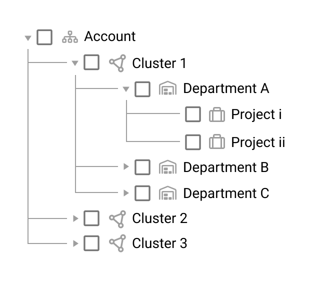
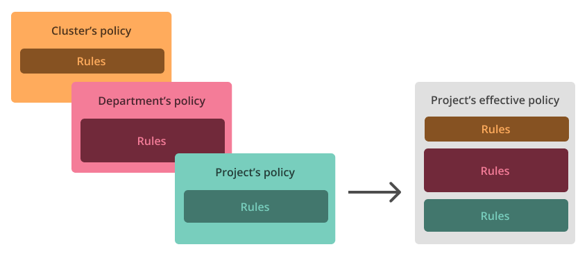

# Policies and Rules

At NVIDIA Run:ai, administrators can access a suite of tools designed to facilitate efficient account management. This article focuses on two key features: workload policies and workload scheduling rules. These features empower admins to establish default values and implement restrictions allowing enhanced control, assuring compatibility with organizational policies, and optimizing resource usage and utilization.

## Workload Policies

A workload policy is an end-to-end solution for AI managers and administrators to control and simplify how workloads are submitted. This solution allows them to set best practices, enforce limitations, and standardize processes for the submission of workloads for AI projects within their organization. It acts as a key guideline for data scientists, researchers, ML & MLOps engineers by standardizing submission practices and simplifying the workload submission process.

### Why Use a Workload Policy?

Implementing workload policies is essential when managing complex AI projects within an enterprise for several reasons:

1. **Resource control and management** - Defining or limiting the use of costly resources across the enterprise via a centralized management system to ensure efficient allocation and prevent overuse.
2. **Setting best practices** - Provide managers with the ability to establish guidelines and standards to follow, reducing errors amongst AI practitioners within the organization.
3. **Security and compliance** - Define and enforce permitted and restricted actions to uphold organizational security and meet compliance requirements.
4. **Simplified setup** - Conveniently allow setting defaults and streamline the workload submission process for AI practitioners.
5. **Scalability and diversity**
   1. Multi-purpose clusters with various workload types that may have different requirements and characteristics for resource usage.
   2. The organization has multiple hierarchies, each with distinct goals, objectives, and degrees of flexibility.
   3. Manage multiple users and projects with distinct requirements and methods, ensuring appropriate utilization of resources.

### Understanding the Mechanism

The following sections provide details of how the workload policy mechanism works.

#### Cross-Interface Enforcement

The policy enforces the workloads regardless of whether they were submitted via UI, CLI, Rest APIs, or Kubernetes YAMLs.

#### Policy Types

NVIDIA Run:ai policies can target any workload type in the platform -- both NVIDIA Run:ai [native workloads](../../workloads-in-nvidia-run-ai/workload-types/native-workloads.md) and [supported workload types](../../workloads-in-nvidia-run-ai/workload-types/supported-workload-types.md).

* NVIDIA Run:ai native workloads are fully integrated into the platform. Policies for these workloads are configured using the policy YAML editor.
* Supported workload types include any other workload type registered in the platform (such as PyTorchJob, RayJob, and others). Policies for these types can be configured interactively using the Rule builder or written as YAML.

<Info>

**Note**

To apply policies to a new [workload type](../../workloads-in-nvidia-run-ai/workload-types/extending-workload-support/README.md) your organization has registered, you must first map it to the policy engine using the mapping APIs. See [Workload types policy mapping](workload-type-policy-mapping.md).

</Info>

### Policy Structure

The structure of a policy depends on the workload type it targets.

*   Policies for NVIDIA Run:ai native workloads use three separate constructs:

    * **Rules** - Hard constraints on workload fields. Rules are enforced at submission time and cannot be overridden by users. For example, a rule can cap the maximum number of GPUs a workload may request, or prevent a field from being edited at all.
    * **Defaults** - Suggested values that are pre-filled when a user submits a workload. Defaults can be modified by the user before submission. For example, a default can set an initial CPU request that users are free to adjust.
    * **Imposed assets** - Assets (such as a PVC data source) that are automatically attached to any workload submitted under the policy's scope, regardless of what the user specifies.

    See [NVIDIA Run:ai native workload policies](native-workload-policies.md) for more details.
* Supported workload type policies use a single rules construct. Each rule identifies a specific field and spec location within the workload, then applies one or more enforcements that control how that field behaves during submission. See [Supported workload type policies](supported-workload-type-policies.md) for more details.

## Scope of Effectiveness

<Info>

**Note**

Scope availability depends on the policy type:

* Policies for NVIDIA Run:ai native workloads support all scopes: system, cluster, department, and project.
* Policies for supported workload types support cluster, department, and project scope. System scope is not available for these policies.

</Info>

Numerous teams working on various projects require the use of different tools, requirements, and safeguards. One policy may not suit all teams and their requirements. Hence, administrators can select the scope to cover the effectiveness of the policy. When a scope is selected, all of its subordinate units are also affected. As a result, all workloads submitted within the selected scope are controlled by the policy.

For example, if a policy is set for Department A, all workloads submitted by any of the projects within this department are controlled.

A scope for a policy can be:

<Info>

**Note**

The policy submission to the entire account scope is supported via API only.

</Info>

The different scoping of policies also allows the breakdown of the responsibility between different administrators. This allows delegation of ownership between different levels within the organization. The policies, containing rules and defaults, propagate\* down the organizational tree, forming an “effective” policy that enforces any workload submitted by users within the project.

If a field is used by multiple policies at different scopes, the platform applies a reconciliation mechanism to determine which policy takes effect. Defaults of the same field can still be submitted by different organizational policies, as they are considered “soft” rules. In this case, the closest scope to the workload becomes the effective default (project default “wins” vs. department default, department default “wins” vs. cluster default, etc.). For rules, precedence depends on their type: simple rules on non-security and non-compute fields follow the same order as defaults (project > department > cluster), while strict rules on security and compute fields apply in reverse order (cluster > department > project).

Supported workload type policies use a different reconciliation mechanism: each rule declares, at the scope where it is created, whether a narrower scope is allowed to override it. See [Overriding rules across scopes](supported-workload-type-policies.md#overriding-rules-across-scopes) for details.

<Accordion title="NVIDIA Run:ai policies vs. Kyverno policies">

**NVIDIA Run:ai policies vs. Kyverno policies**

Kyverno runs as a dynamic admission controller in a Kubernetes cluster. Kyverno receives validating and mutating admission webhook HTTP callbacks from the Kubernetes API server and applies matching policies to return results that enforce admission policies or reject requests. Kyverno policies can match resources using the resource kind, name, label selectors, and much more. For more information, see [How Kyverno Works](https://kyverno.io/docs/introduction/#how-kyverno-works).

</Accordion>

### System Policies

<Info>

**Note**

System policies apply to NVIDIA Run:ai native workloads only. They do not apply to policies for supported workload types.

</Info>

By default, every account in NVIDIA Run:ai is governed by system policies that establish foundational security controls across all workloads, scopes, and interfaces (UI, CLI, API). These policies ensure consistent workload behavior and prevent unauthorized escalation. They can also be viewed as part of the effective policy for every scope**.**

Administrators can create new policies to modify these defaults at any scope, including the project scope. A cluster- or department-scoped policy is not required to override a system policy default. This flexibility allows easing certain API restrictions that were previously enforced more strictly, while ensuring all changes are explicit and audited. Any update requires direct administrative action, adding an additional security layer.

* **Privileged parameter** - By default, the privileged parameter is set to `false` and is not editable (`canEdit: False`). This means containers are prevented from running with full host access, bypassing almost all container isolation, unless an administrator explicitly enables it.
* **Grace period** - Grace period defines how long a workload is allowed to continue running after a preemption request before it is terminated. The default grace period is 30 seconds, which may not always be sufficient for checkpointing or saving state. To support longer checkpointing operations, a maximum grace period of 5 minutes enforced by the system policy, which applies across API, CLI, and UI submissions. This period can be updated at any scope within the policy hierarchy.

## Scheduling Rules

[Scheduling rules](scheduling-rules.md) limit a researcher's access to resources and provides a way for the admin to control resource allocation and prevent the waste of resources. Admins should use the rules to prevent GPU idleness, prevent GPU hogging and allocate specific types of resources to different types of workloads.

Admin can limit the duration of a workload, the duration of the idle time, or the type of nodes the workload can use. Rules are defined for and apply to all workloads in the project or department. In addition, rules can be applied to a specific type of workload in a project or department (workspace, standard training, or inference). When a workload reaches the limitation of the rule, it is stopped if the rule is time-limited. The rule type prevents the workload from being scheduled on nodes that violate the rule limitation.
