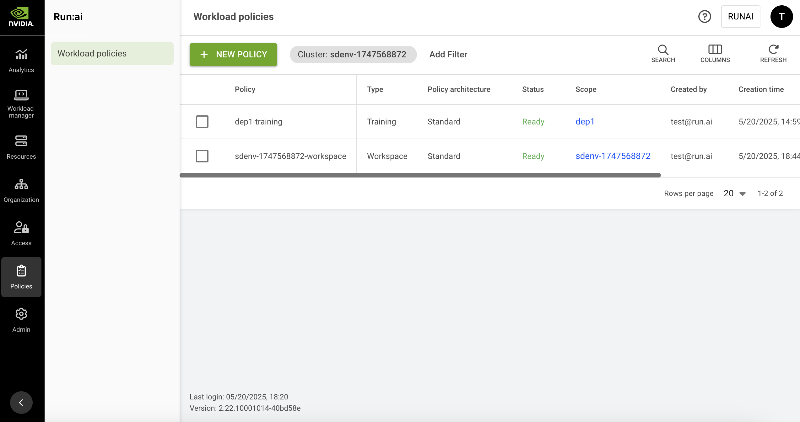

# Supported Workload Types Policies

NVIDIA Run:ai workload policies can target any supported workload type registered in the platform (such as PyTorchJob, Deployment, and others). When you create a policy for a supported workload type, you can define its rules using the **Rule builder**, an interactive interface that maps the fields of the selected workload type, or by writing the policy YAML directly. For the list of workload types you can target, see [Supported workload types](../../workloads-in-nvidia-run-ai/workload-types/supported-workload-types.md).

<Note>

**Note**

* Workload policies are enabled by default. If you do not see it in the menu, contact your administrator to enable it under **General settings** → Workloads → Policies.
* Supported workload type policies can be scoped to a tenant, cluster, department, or project. System scope is not available for these policies. Tenant scope is available via API only.
* For policies targeting native workload types (Workspace, Training, and Inference), see [NVIDIA Run:ai native workload policies](native-workload-policies.md).
* To apply policies to a new [workload type](../../workloads-in-nvidia-run-ai/workload-types/extending-workload-support/README.md) your organization has registered, you must first map it to the policy engine using the mapping APIs. See [Workload types policy mapping](workload-type-policy-mapping.md).

</Note>

## Workload Policies Table

The Workload policies table can be found under **Policies** in the NVIDIA Run:ai platform.

The Workload policies table provides a list of all the policies defined in the platform, and allows you to manage them.

<figure><figcaption></figcaption></figure>

The Workload policies table consists of the following columns:

| Column              | Description                                                                                                                                                                                                                                                                                                                                                                                                                                                                     |
| ------------------- | ------------------------------------------------------------------------------------------------------------------------------------------------------------------------------------------------------------------------------------------------------------------------------------------------------------------------------------------------------------------------------------------------------------------------------------------------------------------------------- |
| Policy              | The policy name which is a combination of the policy scope and the policy type                                                                                                                                                                                                                                                                                                                                                                                                  |
| Type                | The policy type is per NVIDIA Run:ai workload type. This allows administrators to set different policies for each [workload type](../../workloads-in-nvidia-run-ai/workload-types/supported-workload-types.md).                                                                                                                                                                                                                                                                                          |
| Policy architecture | Indicates whether the policy targets a **Standard** workload or a **Distributed** workload.                                                                                                                                                                                                                                                                                                                                                                                     |
| Status              | <p>The current state of the policy. Possible values: </p><ul><li><strong>Ready</strong> - the policy is active and enforcing workloads.</li><li><strong>Degraded</strong> - one or more elements referenced in the policy no longer exist in the workload type mapping (for example, because the mapping was changed after the policy was created). The policy remains in place but may not enforce correctly until the mapping is restored or the policy is updated.</li></ul> |
| Scope               | The scope the policy affects. Click the name of the scope to view the organizational tree diagram. You can only view the parts of the organizational tree for which you have permission to view.                                                                                                                                                                                                                                                                                |
| Created by          | The user who created the policy                                                                                                                                                                                                                                                                                                                                                                                                                                                 |
| Creation time       | The timestamp for when the policy was created                                                                                                                                                                                                                                                                                                                                                                                                                                   |
| Last updated        | The last time the policy was updated                                                                                                                                                                                                                                                                                                                                                                                                                                            |

### Customizing the Table View

* Filter - Click ADD FILTER, select the column to filter by, and enter the filter values
* Search - Click SEARCH and type the value to search by
* Sort - Click each column header to sort by
* Column selection - Click COLUMNS and select the columns to display in the table
* Refresh - Click REFRESH to update the table with the latest data

## Policy Structure

A rule has two parts: **target** (which field, spec selector, and item selector it applies to) and **behavior** (what enforcements it applies). The Rule builder walks you through these in sequence.

**Target:**

* **Field** - The configuration attribute you want to control, such as CPU limit, privilege escalation, or environment variables. NVIDIA Run:ai pre-maps all policy-controllable fields for each registered workload type, so the available fields depend on the workload type selected for the policy.
* **Spec selector** - Identifies which part or parts of the workload spec the rule applies to. Many workload types have more than one spec subtree; for example, a workload may have multiple containers, each with its own configuration. The spec selector narrows the rule to the relevant subtrees, such as "all containers" or "a specific container by name." Some selectors require additional input - once selected, the form shows the fields you need to fill in (for example, choosing `appContainerByName` reveals a `containerName` field). The available spec selectors depend on the field you selected.
* **Item selector** - Applies only to fields that hold a list of items, such as a list of environment variables or network ports. The item selector identifies which item within the list the rule targets, for example "all environment variables sourced from a ConfigMap" or "a port with a specific port number." Some selectors require additional input - once selected, the form shows the fields you need to fill in. The item selector step only appears when the chosen field is a list-type field.

**Behavior:**

* **Enforcement** - Defines how the rule constrains the field during workload submission. You can add multiple enforcements to a single rule. See [Enforcement types](supported-workload-type-policies.md#enforcement-types) for the full list.

### Enforcement Types

Each enforcement defines how the selected field is controlled during workload submission. The available enforcement types depend on the data type of the selected field - not all enforcement types are valid for all fields. The following enforcement types are available:

| Enforcement type | Description                                                                                                                                                                                                                        |
| ---------------- | ---------------------------------------------------------------------------------------------------------------------------------------------------------------------------------------------------------------------------------- |
| Set              | Automatically applies a specific value to the field (supports multiple values for object fields).                                                                                                                                  |
| Default          | Sets an initial value that users can modify.                                                                                                                                                                                       |
| Required         | Mandates user input before saving or proceeding.                                                                                                                                                                                   |
| Blocked          | Disables the field to prevent data entry.                                                                                                                                                                                          |
| Options          | Limits input to a predefined choice list.                                                                                                                                                                                          |
| Range            | Restricts numeric values by minimum, maximum, and step increment.                                                                                                                                                                  |
| Quantity         | Enforces a Kubernetes resource quantity to fall within the inclusive range \[min, max], optionally restricted to increments of step starting from min. All bounds must be valid Kubernetes quantities such as 100m, 1Gi, or 500Mi. |

## Adding a Policy

To create a new supported workload type policy:

1. Click **+NEW POLICY**
2. In the **Scope** section, select a **cluster**, **department**, or **project**
3. In the **Workload type** section, select a [supported workload type](../../workloads-in-nvidia-run-ai/workload-types/supported-workload-types.md)
4. Under **Set how the policy should be configured**, select:
   * **Rule builder** - Configure rules interactively using an interface that maps the fields of the selected workload type. See [Adding rules](supported-workload-type-policies.md#adding-rules).
   * **YAML editor** - Write or paste the policy YAML directly. See [Using the YAML editor](supported-workload-type-policies.md#using-the-yaml-editor).
5. Click **SAVE POLICY**

### Adding Rules

The **Rule builder** lets you add rules that set the limits and suggested defaults shown during workload submission.

To add a rule:

1. In the **Rules** section, click **+ RULE**
2. Under **Select a field from the spec**, choose a **Field**. The available fields are mapped from the spec of the selected workload type.
3. Under **Set the spec selector and its parameters**, choose a **Spec selector**. If the selector requires additional input, fill in the fields that appear below it.
4. When applicable, under **Set the item selector and its parameters**, choose an **Item selector**. If the selector requires additional input, fill in the fields that appear below it. The item selector step only appears for fields that require it.
5. Under **Add enforcements and set their values**, click **+ ENFORCEMENT**, select an **Enforcement type**, and set its values. You can add multiple enforcements. The enforcement section becomes available once the required fields, spec selector, and item selector (if applicable) are configured. See [Enforcement types](supported-workload-type-policies.md#enforcement-types) for more details.
6. When applicable, under **Override by descendant scope**, select **Not allowed** or **Allowed**. The setting only appears for cluster- and department-scoped policies. See [Overriding Rules Across Scopes](supported-workload-type-policies.md#overriding-rules-across-scopes) for more details.
7. Click **SAVE RULE**
8. Repeat for additional rules, then click **SAVE POLICY**

<Note>

**Note**

All fields in a rule are mandatory. If a rule has unresolved issues when you save it, the form prompts you to review and fix them, and the rule cannot be saved until they are resolved.

</Note>

### Overriding Rules Across Scopes

When a policy is scoped to a tenant, cluster, or department, each rule can specify whether a policy at a narrower scope is allowed to override it. See [Scope of Effectiveness](policies-and-rules.md#scope-of-effectiveness) for how the scope hierarchy is structured. For cluster- and department-scoped policies, the override setting is exposed in the Rule builder as an **Override by descendant scope** setting:

* **Descendant scopes cannot override this rule** (default) - the rule from this scope always applies, regardless of any rule for the same field defined at a narrower scope.
* **Any descendant scope can define a policy that overrides this rule** - a policy at a narrower scope can define a rule for the same field, and that rule takes effect instead.

For tenant-scoped policies, the same behavior is controlled directly by the `allowOverride` field in the rule YAML. See [Using the YAML Editor](supported-workload-type-policies.md#using-the-yaml-editor).

This setting is not available for project-scoped policies, since a project has no narrower scope.

If you create a rule for a field that is already locked by a non-overridable rule at an ancestor scope, the rule is saved but remains inactive until the ancestor rule is removed or changed to allow override.

When viewing a policy's effective rules, each rule shows its **Source** - the scope at which the rule was defined (cluster, department, or project) - so you can trace which policy in the hierarchy is currently in effect for a given field. See [Viewing a policy](supported-workload-type-policies.md#viewing-a-policy).

### Using the YAML Editor

The YAML editor accepts a `rules` array that defines the same constraints available in the Rule builder. Each rule targets a field using the same four components described in [Policy structure](supported-workload-type-policies.md#policy-structure): Field, Spec selector, optional Item selector, and Enforcement.

Rule structure:

```yaml
rules:
  - field: <field-name>
    specSelector: <spec-selector>
    itemSelector: <item-selector>    # optional; only for list-type fields
    selectorParams:                   # optional; required by some selectors
      <param>: <value>
    allowOverride: <boolean>          # optional; tenant/cluster/department scope only, defaults to false
    enforcements:
      - <enforcement-type>: <value>
```

`allowOverride` controls whether a policy at a narrower scope can override this rule. It applies to rules in tenant-, cluster-, or department-scoped policies; it has no effect for project-scoped policies, since a project has no narrower scope. See [Overriding rules across scopes](supported-workload-type-policies.md#overriding-rules-across-scopes).

To discover the fields and spec selectors available for a specific workload type, use the following APIs:

* [`POST /api/v1/policies/mappings/minimal`](api:main-api:POST/api/v1/policies/mappings/minimal) - returns minimal information about the mapping for the workload type, including the list of fields and the spec selectors for each field
* [`POST /api/v1/policies/mappings/field-info`](api:main-api:POST/api/v1/policies/mappings/field-info) - returns detailed field information including item selectors and formatter information

See [Enforcement types](supported-workload-type-policies.md#enforcement-types) for the full list of enforcement types and their value formats. For worked examples, see [Policy YAML examples](policy-yaml-examples-supported.md).

## Editing a Policy

1. Select the policy you want to edit
2. Click **EDIT**
3. Update the policy and click **APPLY**
4. Click **SAVE POLICY**

## Viewing a Policy

To view a policy:

1. Select the policy you want to view.
2. Click **VIEW POLICY**
3. In the **Rules** section, view the rules defined for the policy. Each rule shows:
   * **Field**\
     The configuration attribute the rule targets
   * **Spec selector**\
     The part of the workload spec the rule applies to
   * **Item selector**\
     The specific item within a list-type field the rule targets. Shown only when the field is a list-type field.
   * **Rule**\
     The enforcements applied to the field
   * **Source**\
     The scope at which the rule was defined (tenant, cluster, department, or project). Rules inherited from a broader scope are shown alongside rules defined at the policy's own scope.

## Deleting a Policy

1. Select the policy you want to delete
2. Click **DELETE**
3. On the dialog, click **DELETE** to confirm the deletion

## Using API

Go to the [Policies](api:main-api:GET/api/v2/policy) API reference to view the available actions.
