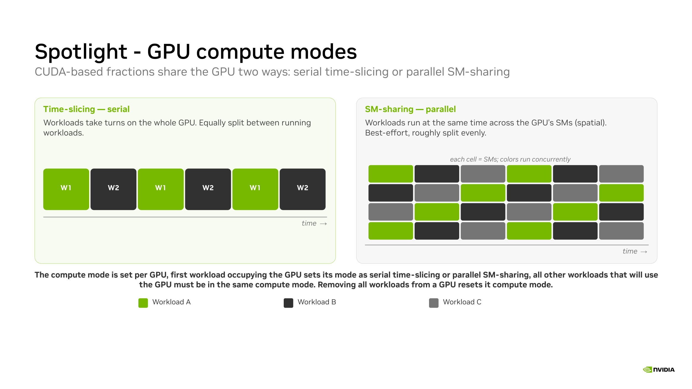

# GPU Compute Modes

[GPU memory fractions](memory-fractions.md) and [dynamic GPU memory fractions](dynamic-memory-fractions.md) determine how much GPU memory each workload receives. GPU compute modes determine how the workloads sharing a GPU divide the GPU compute between them, and are set in addition to a memory fraction, whether static or dynamic. GPU compute modes are part of the CUDA-based GPU fractions implementation.

NVIDIA Run:ai offers two compute modes - time-slicing and SM-sharing. Both are set per workload, both work with every workload type, and both are available on any GPU that meets the [prerequisites](#prerequisites). Time-slicing is the default; SM-sharing must be set explicitly.

A GPU runs one compute mode at a time. The first workload placed on a GPU sets the compute mode of that GPU, workloads requesting the other mode are not placed on it, and the mode resets when the GPU empties.

## How the Modes Differ

Under full contention, both modes give each workload roughly an equal share of the GPU compute. The difference is whether the workloads **take turns** on the GPU or **run at the same time**.

Both modes also redistribute compute that nobody is using. Consider three workloads sharing one GPU:

* While all three are busy, each receives roughly 33% of the GPU compute.
* If one workload goes idle, its share is split evenly among the other two, and each receives roughly 50%.
* When the idle workload becomes active again, all three return to roughly 33%.

A single active workload on the GPU can therefore use the whole GPU compute. Compute is not held back from workloads that can use it.

| | Time-slicing | SM-sharing |
|---|---|---|
| Execution | Serial - workloads take turns | Concurrent - workloads run at the same time |
| Compute unit divided | GPU time | GPU streaming multiprocessors |
| Share under full contention | Roughly equal share of GPU time | Roughly equal share of the SMs |
| Unused compute | Time left unused is split evenly between the other active workloads, up to the whole GPU for a single active workload | SMs left idle are used by the other active workloads, up to the whole GPU for a single active workload |
| Error isolation | Full - each workload is its own error domain | Shared - workloads share a context, so a fatal fault affects all of them |
| NVLink and peer-to-peer | Not restricted | Not restricted |
| Set as | The default; can be set explicitly or omitted | Must be set explicitly |

As a rule of thumb, use time-slicing for work that arrives in bursts and can wait for its turn. Use SM-sharing when a workload needs the GPU steadily, or when something downstream is waiting on its output.

| Choose | When the workload is |
|---|---|
| Time-slicing | Bursty and interactive - notebooks, model development, and inference that is not delay-sensitive. A workload with nothing to do gives up its turn, and the next workload gets the whole GPU for its turn. |
| SM-sharing | Latency-sensitive inference, highly interactive applications, and real-time applications. With time-slicing, a request arriving during another workload's turn waits for that turn to end. With SM-sharing there is no turn to wait for, so response times stay steadier. |
| SM-sharing | Distributed training or inference across GPUs or pods. These workloads exchange results constantly, so one GPU pausing to wait its turn holds up every peer it is synchronizing with, and the whole job runs at the pace of its slowest participant. |

## How GPU Compute Modes Work

### Time-Slicing

Time-slicing is serial. Workloads take turns on the whole GPU, and each turn gives one workload exclusive use of the GPU compute engines. When every workload uses its full turn, each receives roughly an equal share of the GPU time. Time left unused by one workload goes to the others, up to the whole GPU for a single active workload.

Only one workload runs at a time, so each workload is its own error domain. A fatal fault in one workload does not affect the others sharing the GPU.

Time-slicing is the default compute mode.

### SM-Sharing

SM-sharing is parallel. The GPU streaming multiprocessors (SMs) are divided between the workloads and all of the workloads run at the same time. At any instant an SM serves one workload and no other.

Nothing is carved out in advance. SMs left idle by one workload are used by the others, up to the whole GPU for a single active workload.

SM-sharing runs the workloads through a shared context, so the workloads sharing a GPU also share an error domain. A fault that is attributed to the GPU context cannot be traced back to the process that caused it, so a fatal fault affects every workload sharing that GPU.

## Prerequisites

<Note>

**Note**

NVIDIA Run:ai installs and operates normally without these prerequisites in place, and workloads not using GPU fractions are unaffected. GPU compute modes apply only to workloads using GPU fractions, and those are not scheduled onto a node until that node meets every prerequisite. If you are upgrading from a release that used the proprietary GPU sharing implementation, refer to [Migrate GPU Fractions](../../../installation-and-configuration/upgrade/migrate-gpu-fractions.md) for per-node verification steps.

</Note>

GPU compute modes require the following on every GPU node in the cluster. GPU nodes must also run Linux with cgroup v2 mounted at `/sys/fs/cgroup`, and since [GPU Operator](https://docs.nvidia.com/datacenter/cloud-native/gpu-operator/latest/index.html) 26.7.1 does not default to CUDA driver r615, set the driver version explicitly rather than relying on the default.

| Component | Required version |
|---|---|
| CUDA | 13.4 or later |
| CUDA driver | r615 or later |
| NVIDIA GPU Operator | 26.7.1 or later |

## Using GPU Compute Modes in Workloads

When you submit a workload, you can set its GPU compute mode with an annotation. If you do not set it, the workload uses time-slicing. For the annotation reference and an example, refer to [Configure GPU compute mode](../optimize-workload-scheduling-and-placement/gpu-sharing/configure-gpu-compute-mode.md).

<Note>

**Note**

Clusters upgraded from the proprietary GPU sharing implementation keep running workloads using GPU fractions on time-slicing behavior after the upgrade, with no annotation required. See [Migrate GPU Fractions](../../../installation-and-configuration/upgrade/migrate-gpu-fractions.md) for upgrade details.

</Note>

## Enforcing a Compute Mode with a Policy

Administrators can also control the compute mode centrally with a [workload policy](../../policies/policies-and-rules.md). A policy can supply a default compute mode for workloads that do not set one, or enforce a specific mode so that users cannot change it. This is available for both [native workloads](../../policies/native-workload-policies.md) and [supported workload types](../../policies/supported-workload-type-policies.md).

<Note>

**Note**

Policy enforcement is not supported for [externally submitted workloads](../../../workloads-in-nvidia-run-ai/workload-types/supported-features.md#externally-submitted-kubernetes-workloads).

</Note>

## Deployment Considerations

* The compute mode is exclusive per GPU. A GPU running time-slicing cannot also run SM-sharing, and the reverse. The first workload placed on a GPU fixes the compute mode of that GPU. Every workload that joins afterwards must request the same mode, and the mode resets when the GPU empties.
* Mixing compute modes reduces the GPUs available to each mode. While a GPU is running one compute mode, workloads requesting the other mode cannot be placed on it. On a cluster where both modes are in regular use, a workload can wait for a GPU even though GPU memory is free elsewhere in the node pool. A workload policy that sets a default compute mode per project or department keeps a team's workloads consistent with each other.
* Per-container compute metrics are not available under SM-sharing. Workloads using SM-sharing share a context, and compute utilization cannot be attributed to an individual container. GPU memory metrics are reported per container in both modes.

## Using CLI

To view the available actions, go to the [CLI v2 reference](../../../reference/cli/runai/runai.md) and run according to your workload.

## Using API

To view the available actions, go to the [API reference](../../../rest-api/about-the-rest-api.md) and run according to your workload.
