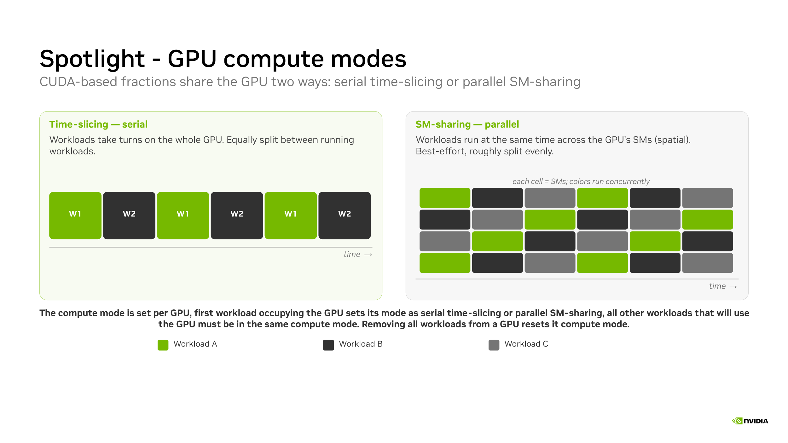

# GPU Compute Modes

[GPU memory fractions](memory-fractions.md) determine how much GPU memory each workload receives. GPU compute modes determine how the workloads sharing a GPU divide the GPU compute between them.

NVIDIA Run:ai v3.0 offers two compute modes — time-slicing and SM-sharing. Both are set per workload, and both are available on any GPU that meets the [prerequisites](memory-fractions.md#prerequisites).

## Why There Is a Choice

Under full contention, both modes give each workload roughly an equal share of the GPU compute. The difference is whether the workloads **take turns** on the GPU or **run at the same time**.

Both modes also redistribute compute that nobody is using. Consider three workloads sharing one GPU:

* While all three are busy, each receives roughly 33% of the GPU compute.
* If one workload goes idle, its share is split evenly among the other two, and each receives roughly 50%.
* When the idle workload becomes active again, all three return to roughly 33%.

A single active workload on the GPU can therefore use the whole GPU compute. Compute is not held back from workloads that can use it.

## How GPU Compute Modes Work



### Time-Slicing

Time-slicing is serial. Workloads take turns on the whole GPU, and each turn gives one workload exclusive use of the GPU compute engines. When every workload uses its full turn, each receives roughly an equal share of the GPU time. Time left unused by one workload goes to the others.

Because only one workload runs at a time, each workload is its own error domain. A fatal fault in one workload does not affect the others sharing the GPU.

Time-slicing is the default compute mode and works with every workload type.

### SM-Sharing

SM-sharing is parallel. The GPU streaming multiprocessors (SMs) are divided between the workloads and all of the workloads run at the same time. At any instant an SM serves one workload and no other.

Nothing is carved out in advance. SMs left idle by one workload are used by the others, up to the whole GPU for a single active workload.

SM-sharing runs the workloads through a shared context, so the workloads sharing a GPU also share an error domain. A fatal fault affects all workloads on that GPU.

## Choosing a Compute Mode

As a rule of thumb, use time-slicing for work that arrives in bursts and can wait for its turn. Use SM-sharing when a workload needs the GPU steadily, or when something downstream is waiting on its output.

| Choose | When the workload is |
|---|---|
| Time-slicing | Bursty and interactive — notebooks, model development, and inference that is not delay-sensitive. A workload with nothing to do gives up its turn, and the next workload gets the whole GPU for its turn. |
| SM-sharing | Latency-sensitive inference, highly interactive applications, and real-time applications. With time-slicing, a request arriving during another workload's turn waits for that turn to end. With SM-sharing there is no turn to wait for, so response times stay steadier. |
| SM-sharing | Distributed training or inference across GPUs or pods. These workloads exchange results constantly, so one GPU pausing to wait its turn holds up every peer it is synchronizing with, and the whole job runs at the pace of its slowest participant. |

### Comparison

| | Time-slicing | SM-sharing |
|---|---|---|
| Execution | Serial — workloads take turns | Concurrent — workloads run at the same time |
| Compute unit divided | GPU time | GPU streaming multiprocessors |
| Share under full contention | Roughly equal share of GPU time | Roughly equal share of the SMs |
| Unused compute | Time left unused is split evenly between the other active workloads | SMs left idle are used by the other active workloads, up to the whole GPU for a single active workload |
| Error isolation | Full — each workload is its own error domain | Shared — workloads share a context, so a fatal fault affects all of them |
| NVLink and peer-to-peer | Not restricted | Not restricted |
| Set as | The default; can be set explicitly or omitted | Must be set explicitly |

## Setting the GPU Compute Mode

The compute mode is set per workload with the `nvidia.com/container.<container-name>.gpu-compute.mode` annotation.

Substitute `<container-name>` with the name of the container receiving the GPU memory fraction. A GPU fraction is always allocated to a single container, and NVIDIA Run:ai currently supports one fractional container per pod. This is the same container named by `gpu-fraction-container-name`, or the first container in the pod when that annotation is omitted. If both are used, the container names must be identical or the request is rejected.

| Value | Behavior |
|---|---|
| `time-slicing` | Workloads take sequential turns on the GPU compute engines. This is the default and can be omitted. |
| `sm-sharing` | Workloads run concurrently on separate streaming multiprocessors. |

If the annotation is omitted, time-slicing applies. Workloads migrated from earlier versions therefore keep their previous compute-sharing behavior without any change, and adopting SM-sharing is an explicit decision.

You can set the annotation through the UI, the CLI, or the API. After the workload is submitted, the compute mode is visible in the workload YAML.

<Tabs>

<Tab title="UI">

During workload submission, open the **General** section and locate **Set annotation(s)**:

1. Click **+ANNOTATION**
2. In **Name**, enter `nvidia.com/container.<container-name>.gpu-compute.mode`
3. In **Value**, enter `"sm-sharing"`, including the quotation marks

</Tab>

<Tab title="CLI v2">

```sh
runai workspace submit "workload-name" --image gcr.io/run-ai-demo/quickstart-cuda \
--gpu-memory-request 20G \
--annotation nvidia.com/container.app.gpu-compute.mode=sm-sharing
```

</Tab>

<Tab title="YAML">

```yaml
metadata:
  annotations:
    gpu-memory: "20000"   # MiB
    # "time-slicing" (the default, may be omitted) or "sm-sharing"
    nvidia.com/container.app.gpu-compute.mode: "sm-sharing"
spec:
  containers:
    - name: app          # the <container-name> used in the mode annotation
```

</Tab>

</Tabs>

## Deployment Considerations

* **The compute mode is exclusive per GPU.** A GPU running time-slicing cannot also run SM-sharing, and the reverse. The first workload placed on a GPU fixes the compute mode of that GPU. Every workload that joins afterwards must request the same mode, and the mode resets when the GPU empties.
* **Plan node pools around mode exclusivity.** Because each GPU is held to one mode at a time, mixing compute modes across a node pool divides it into groups of GPUs per mode. Where both modes are in regular use, consider separate node pools so that each mode has GPUs available to it.
* **Per-container compute metrics are not available under SM-sharing.** Workloads using SM-sharing share a context, and compute utilization cannot be attributed to an individual container. GPU memory metrics are reported per container in both modes.

## Using CLI

To view the available actions, go to the [CLI v2 reference](../../../reference/cli/runai/) and run according to your workload.

## Using API

To view the available actions, go to the [API reference](https://run-ai-docs.nvidia.com/api/2.26/) and run according to your workload.
