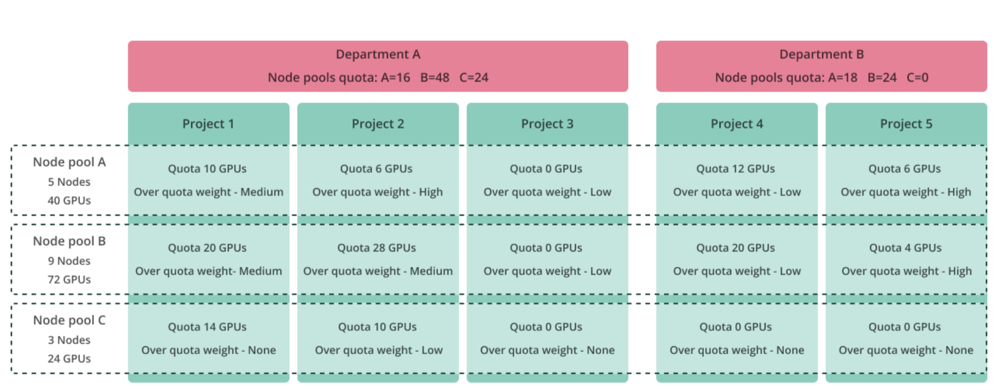
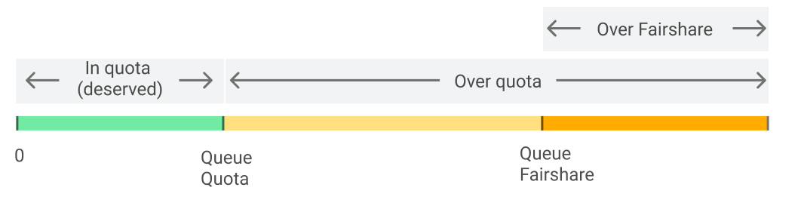

# How the Scheduler Works

Efficient resource allocation is critical for managing AI and compute-intensive workloads in Kubernetes clusters. The NVIDIA Run:ai Scheduler enhances Kubernetes’ native capabilities by introducing advanced scheduling principles such as fairness, quota management, dynamic resource balancing, multi-level pod grouping, and topology-aware scheduling. It ensures that workloads, ranging from simple single-pod workloads to distributed multi-pod workloads and disaggregated workloads composed of multiple cooperating components, are allocated resources effectively while adhering to organizational policies and priorities.

This guide explores the NVIDIA Run:ai Scheduler’s allocation process, preemption mechanisms, and resource management. Through examples and detailed explanations, you'll gain insights into how the Scheduler dynamically balances workloads to optimize cluster utilization and maintain fairness across [projects and departments](../../aiinitiatives/adapting-ai-initiatives.md#mapping-your-organization).

## Allocation Process

Resource allocation follows a hierarchical order. Workloads submitted to higher-ranked projects (and departments) are served before workloads submitted to lower-ranked projects (and departments). As a result, a lower-priority workload submitted to a higher-ranked project may be served before a higher-priority workload submitted to a lower-ranked project.

The NVIDIA Run:ai Scheduler first allocates resources to the highest-ranked departments and their projects. It prioritizes allocating all possible workload resource requests within deserved quota. Only after all in-quota allocations are satisfied does the Scheduler allocate over-quota resources, which are resources not used by any in-quota projects or departments.

Over-quota resources are also assigned according to department and project ranks. The amount of over-quota resources each project or department receives is determined by its rank and its weight within that rank, relative to other departments and projects.

### Pod Creation and Grouping

When a workload is submitted, the submitting workload controller creates a single pod or multiple pods (for distributed training workloads or deployment based inference). When the Scheduler gets a submit request with the first pod, it creates a [pod group](concepts-and-principles.md#workloads-and-pod-groups) and a [sub group](concepts-and-principles.md#sub-groups), and allocates all the relevant building blocks of that workload. The next pods of the same workload are attached to the same pod group, either to the same sub-group or to another sub-group within the top pod-group.

### Queue Management

A workload, together with its associated pod group and sub-groups, is placed in the appropriate  [scheduling queue](concepts-and-principles.md#scheduling-queue). In each scheduling cycle, the Scheduler determines the order in which queues are served by calculating their scheduling precedence. Projects and departments each have a separate queue per node pool.

For each workload considered for scheduling, the Scheduler evaluates the state of the project queue and then the state of the department queue to determine whether the workload is eligible for scheduling, based on available resources within the context of the project, department, and node pool.

If the sum of all project quotas exceeds the quota of their parent department, the Scheduler does not allow non-preemptible workloads to consume resources beyond the department’s quota.

### Resource Binding

The next step in the scheduling process is resource binding. During this step, the Scheduler selects nodes for the pods, assigns each pod to a node (the bind operation), and binds additional pod resources such as storage, ingress, and other required components.

If the pod group has a [gang scheduling](concepts-and-principles.md#gang-scheduling) or [multi-level gang scheduling rule](concepts-and-principles.md#multi-level-gang-scheduling) applied, the Scheduler either allocates and binds all pods together or places all of them in a pending state. If the latter occurs, the Scheduler retries scheduling the entire pod group together in the next scheduling cycle.

During this process, the Scheduler updates the status of the pods and their associated pod group and sub-groups. Users can track the workload submission and scheduling process using either the CLI or the NVIDIA Run:ai UI. For more details on submitting and managing workloads, see [Workloads](../../../workloads-in-nvidia-run-ai/workloads.md).

## Preemption

If the Scheduler cannot find sufficient resources to schedule a workload (including all of its associated pods), and the workload is entitled to resources, either because it is within its deserved quota or within its [fairshare](concepts-and-principles.md#fairshare-and-fairshare-balancing), the Scheduler attempts the following actions, in order:

1. **Consolidation (bin packing)** - The Scheduler first tries to consolidate workloads into smaller number of nodes to make room for the currently scheduled workload.
2. **Resource rebalancing across queues** - If consolidation does not succeed, the Scheduler attempts to [reclaim resources](concepts-and-principles.md#reclaim-of-resources-between-projects-and-departments) from other queues (projects) that are either over their deserved quota or over their calculated fairshare.
3. **Preemption within the same queue** - If resources are still unavailable, the Scheduler tries to  preempt [lower priority preemptible workloads](concepts-and-principles.md#preemption-of-lower-priority-workloads-within-a-project) within the same queue (project).

### When a Queue Receives Additional Resources

A [scheduling queue](concepts-and-principles.md#scheduling-queue) deserves more resources from the pool of unused resources or from other queues if the following conditions are met:

1. The queue has workloads that request resources.
2. The queue has not reached its deserved quota, or, it is already over its deserved quota but below its fairshare (= deserved quota + over quota share of the free resources).

In this situation, the Scheduler attempts to rebalance resources across queues to provide the entitled queue with its deserved resources. If rebalancing does not resolve the resource shortage, the Scheduler tries to preempt [lower priority preemptible workloads](concepts-and-principles.md#preemption-of-lower-priority-workloads-within-a-project) within the same queue (project).

### Scheduling Above Fairshare

In certain scenarios, queues that are above their calculated fairshare may still receive additional resources. This can occur when:

* Other queues in the node pool are not fully using their deserved quota or fairshare, leaving unused over-quota resources.
* The combination of resources requests by workloads cannot be fulfilled simultaneously and the Scheduler has to tie break and decide which queue and which workload will be scheduled first.

For example, a cluster with 10 GPUs and two projects each with quota of 5 GPUs and over-quota allowed, both try to submit a 10 GPU workload. In this case both are over their deserved quota and fairshare and the Scheduler cannot fulfill both requests simultaneously because their total request is 20 GPUs while the total GPUs in the cluster is 10. Therefore, the Scheduler will give precedence the project (queue) that submitted the workload first.

### Consolidation Action

A consolidation action is applied when the Scheduler fails to find sufficient resources (nodes) for the workload currently being scheduled. Consolidation is a process in which the Scheduler evaluates whether re-scheduling other preemptible workloads can free enough resources to allow the current workload to be scheduled successfully.

During consolidation, the Scheduler may preempt workloads from other queues (projects or departments). However, consolidation is performed only if all preempted workloads can be immediately re-scheduled and continue running. To ensure this, the Scheduler simulates different consolidation options in memory. Only if a simulation succeeds, meaning that all workloads, including the currently scheduled workload, can be successfully re-scheduled, does the Scheduler perform the actual consolidation operation.

Administrators can control the number of consolidation evaluations the Scheduler performs when searching for a viable re-scheduling combination, or they can disable consolidation entirely. Note that disabling consolidation may increase cluster resource fragmentation and reduce overall cluster utilization.

### Reclaim Preemption Between Projects and Departments

Reclaim is an inter-project and inter-department resource balancing action that takes back resources from one project or department that has used them as an over quota. It returns the resources back to a project (or department) that deserves those resources as part of its deserved quota, or to re-balance fairshare between projects (or departments), this ensures a project (or department) does not exceed its fairshare.

This mode of operation means that a lower priority workload submitted in one project (e.g. training) can reclaim resources from a project that runs a higher priority workload (e.g. preemptive workspace) if fairness re-balancing is required.

<Note>

**Note**

Only preemptible workloads can consume over-quota resources, as these workloads are subject to resource reclamation through preemption across projects and departments. The amount of over-quota resources that a project or department can receive depends on its over quota weight, or on its quota when the Over quota weight setting is disabled.

When the Over quota weight setting is disabled, the weight of each project or department is derived directly from its assigned quota. In both cases, over-quota resources are distributed proportionally across scheduling queues based on their relative queue [weight](concepts-and-principles.md#over-quota-weight).

_A scheduling queue is defined per project/node pool or department/node pool._

</Note>

### Priority Preemption Within a Project

[Higher priority workloads](concepts-and-principles.md#priority-and-preemption) may preempt lower priority preemptible workloads within the same project/node pool queue. For example, in a project that runs a training workload that uses the project within quota (for a certain node pool), a newly submitted workspace within the same project/node pool may stop (preempt) the training workload if there are not enough over quota resources for the project within that node pool to run both workloads (i.e. workspace using in-quota resources and training using over quota resources).

<Note>

**Note**

Workload priority applies only within the same project and does not influence workloads across different projects, where fairness determines precedence.

</Note>

## Quota, Over Quota, and Fairshare

The NVIDIA Run:ai Scheduler is designed to ensure fairness between projects and between departments. Each department and project is always allocated its deserved quota first, and only then may receive over-quota resources.

The Scheduler splits unused resources between projects and departments according to defined fairness rules. It first fulfills the deserved quota of departments and projects, giving precedence to higher-ranked departments and then to higher-ranked projects. If additional resources beyond the deserved quota are required, unused resources are split as over-quota resources according to fairness rules: queues with higher rank are served first, and fairshare is calculated per queue based on its rank and weight (where a higher weight results in a larger share of unused resources compared to other queues). Between queues with the same rank, queues that are more resource-starved are prioritized.

If a project requires resources beyond its calculated fairshare and the Scheduler finds unused resources that no other project requires, the project may consume resources beyond its fairshare. For example, consider two queues with equal rank and weight, each with a quota of 5 GPUs and over-quota enabled, in a cluster with 20 GPUs. In this case, the theoretical fairshare for each queue is 10 GPUs (5 deserved quota plus 5 over-quota). However, if queue #2 requests only 5 GPUs, its effective fairshare becomes 5 GPUs, while queue #1 requests 15 GPUs and its fairshare becomes 15 GPUs for the current scheduling cycle. In the next scheduling cycle, this distribution may change.

Some scenarios can prevent the Scheduler from fully providing deserved quota and fairness:

* Fragmentation or other scheduling constraints such affinities, taints, topology constraints etc.
* Some requested resources, for example as GPUs and CPU memory, are potentially available for allocation, while others, like CPU cores, are insufficient to meet the request. As a result, the Scheduler will place the workload in a pending state until all required resource becomes available for allocation.

### Fairshare Calculations Methods

The NVIDIA Run:ai Scheduler’s point-in-time fairshare calculation method allocates over-quota resources to a scheduling queue based on its weight relative to other queues at the same rank. The fairshare score is recalculated during every scheduling cycle and can therefore change frequently, potentially triggering scheduling adjustments.

For example, a workload whose queue is entitled to a certain amount of over-quota resources in one scheduling cycle may find that its queue has a lower fairshare score in the next cycle, causing the Scheduler to preempt the workload.

This method represents a short-term fairshare scoring approach. It enables departments and projects to receive a fast response when over-quota resources are required, but it may also result in frequent changes to the state of running over-quota workloads.

Administrators can control the frequency of such changes by configuring a guaranteed min-runtime per node pool. This setting ensures that once a preemptible workload starts running, it effectively behaves as non-preemptible for the duration of the guaranteed min-runtime.

<Note>

**Note**

Setting a guaranteed min-runtime on a node pool that also serves high-priority or interactive/real-time workloads may introduce significant delays for those workloads when they need to run. As a result, such workloads may effectively lose their interactive or real-time characteristics and break their SLA.

</Note>

Below you can find a numerical example of how point-in-time fairshare scoring actually works.

### Example of Splitting Quota

The example below illustrates a split of quota between different projects and departments using several node pools:

The example below illustrates how fairshare scoring is calculated per project/node pool for the above example:

*   For each Project:

    * The **over quota (OQ)** portion of each project (per node pool) is calculated as:

    \[(OQ-Weight) / (Σ Projects OQ-Weights)] x (Unused Resource per node pool)

    * **Fairshare** is calculated as the sum of quota + over quota.
* In Project 2, we assume that out of the 36 available GPUs in node pool A, 20 GPUs are currently unused. This means either these GPUs are not part of any project’s quota, or they are part of a project’s quota but not used by any workloads of that project:
  *   Project 2 **over quota share**:

      \[(Project 2 OQ-Weight) / (Σ all Projects OQ-Weights)] x (Unused Resource within node pool A)

      \[(3) / (2 + 3 + 1)] x (20) = (3/6) x 20 = 10 GPUs
  * **Fairshare** = deserved quota + over quota = 6 +10 = 16 GPUs. Similarly, fairshare is also calculated for CPU and CPU memory. The Scheduler can grant a project more resources than its fairshare if the Scheduler finds resources not required by other projects that may deserve those resources.
* In Project 3, **fairshare** = deserved quota + over quota = 0 +3 = 3 GPUs. Project 3 has no guaranteed quota, but it still has a share of the excess resources in node pool A. The NVIDIA Run:ai Scheduler ensures that Project 3 receives its part of the unused resources for over quota, even if this results in reclaiming resources from other projects and preempting preemptible workloads.

## Fairshare Balancing

The Scheduler constantly re-calculates the fairshare of each project and department per node pool, represented in the scheduler as queues, resulting in the re-balancing of resources between projects and between departments. This means that a preemptible workload that was granted resources to run in one scheduling cycle, can find itself preempted and go back to pending state while waiting for resources in the next cycle.

A queue, representing a scheduler-managed object for each project or department per node pool, can be in one of 3 states:

* **In-quota**: The queue’s allocated resources ≤ queue deserved quota. The Scheduler’s first priority is to ensure each queue receives its deserved quota.
* **Over quota but below fairshare**: The queue’s deserved quota < queue’s allocated resources &lt;= queue’s fairshare. The Scheduler tries to find and allocate more resources to queues that need resources beyond their deserved quota and up to their fairshare.
* **Over-fairshare and over quota**: The queue’s fairshare < queue’s allocated resources. The Scheduler tries to allocate resources to queues that need even more resources beyond their fairshare.

When re-balancing resources between queues of different projects and departments, the Scheduler goes in the opposite direction, i.e. first take resources from over-fairshare queues, then from over quota queues, and finally, in some scenarios, even from queues that are below their deserved quota (for example, if a workload is partially in-quota and partially over-quota, in this case it is considered over-quota and may be preempted and its resources reclaimed).

## Time-Based Fairshare

Time-based fairshare is a fairshare scoring mode in which fairshare is calculated based on historical resource usage over time, rather than solely on point-in-time scheduling demand within a single scheduling cycle.

When time-based fairshare is enabled in a node pool, the Scheduler continuously collects real-time resource usage data and uses this data to calculate the fairshare of each queue. This approach enables fairshare to reflect actual resource consumption over time, allowing resources to be distributed more evenly and reducing long-term imbalances caused by short-term demand fluctuations and optimizing resource allocation dynamically.

Resource usage data in the cluster is collected and persisted by default using Prometheus. This data is then used by the Scheduler to perform fairshare calculations. Queues that consume more resources over time relative to their fairshare receive fewer over-quota resources compared to other queues, while queues that consume less than their fairshare over time are rewarded. Over time, this will result in the queues' over-quota resources being reclaimed by more starved queues, thus achieving a more fair allocation of resources over time.

To avoid scenarios in which one queue consistently consumes its fairshare steadily while another queue attempts to consume a large amount of resources over a short period, the Scheduler regulates historical usage data by optionally applying time-based decay. This ensures that queues consuming resources regularly in line with their fairshare are not penalized by queues that attempt to consume a large amount of resources in a short time window.

The NVIDIA Run:ai platform administrator can configure how historical usage data is evaluated, including the time window over which usage is calculated, the exponential decay applied to historical data, and the influence of historical usage on the current fairshare calculation (also referred to as the **K-value**). These settings control how much weight is given to recent usage versus past usage. For more details, see [Node pools](../../aiinitiatives/resources/node-pools.md).

## Next Steps

Now that you have gained insights into how the Scheduler dynamically balances workloads to optimize cluster utilization and maintain fairness across projects and departments, you can [submit workloads](../../../workloads-in-nvidia-run-ai/workloads.md). Before submitting your workloads, it’s important to familiarize yourself with the following key topics:

* [Introduction to workloads](../../../workloads-in-nvidia-run-ai/introduction-to-workloads.md) - Learn what workloads are and what is supported for both NVIDIA Run:ai and third-party workloads.
* [NVIDIA Run:ai workload types](../../../workloads-in-nvidia-run-ai/workload-types/supported-workload-types.md) - Explore the various NVIDIA Run:ai workload types available and understand their specific purposes to enable you to choose the most appropriate workload type for your needs.
