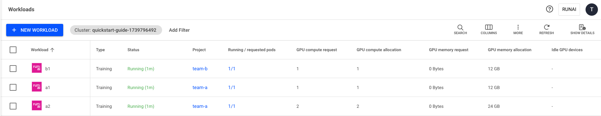

# Over Quota, Fairness and Preemption

This quick start provides a step-by-step walkthrough of the core scheduling concepts - [over quota](../concepts-and-principles.md#over-quota), [fairness](../concepts-and-principles.md#fairness-fair-resource-distribution), and [preemption](../concepts-and-principles.md#priority-and-preemption). It demonstrates the simplicity of resource provisioning and how the system eliminates bottlenecks by allowing users or teams to exceed their resource quota when free GPUs are available.

* **Over quota** - In this scenario, team-a runs two training workloads and team-b runs one. Team-a has a quota of 3 GPUs and is over quota by 1 GPU, while team-b has a quota of 1 GPU. The system allows this over quota usage as long as there are available GPUs in the cluster.
* **Fairness and preemption** - Since the cluster is already at full capacity, when team-b launches a new b2 workload requiring 1 GPU , team-a can no longer remain over quota. To maintain fairness, the [NVIDIA Run:ai Scheduler](../how-the-scheduler-works.md) preempts workload a1 (1 GPU), freeing up resources for team-b.

## Prerequisites

* You have created two [projects](../../../aiinitiatives/organization/projects.md) - team-a and team-b - or have them created for you.
* Each project has an assigned quota of 2 GPUs. In this example, we have 4 GPUs on 2 machines with 2 GPUs each.

<Note>

**Note**

Flexible workload submission is enabled by default. If unavailable, contact your administrator to enable it under **General settings** → Workloads → Flexible workload submission.

</Note>

## Step 1: Logging In

<Tabs>

<Tab title="UI">

Browse to the provided NVIDIA Run:ai user interface and log in with your credentials.

</Tab>

<Tab title="CLI v2">

Run the below --help command to obtain the login options and log in according to your setup:

```sh
runai login --help
```

</Tab>

<Tab title="API">

To use the API, you will need to obtain a token as shown in [API authentication](../../../../rest-api/how-to-authenticate-to-the-api.md).

</Tab>

</Tabs>

## Step 2: Submitting the First Training Workload (team-a)
<Tabs>

<Tab title="UI - Flexible">

1. Go to Workload manager → Workloads
2. Click **+NEW WORKLOAD** and select **Training**
3. Select under which **cluster** to create the workload
4. Select the **project** named team-a
5. Under **Workload architecture**, select **Standard**
6. Select **Start from scratch** to launch a new training quickly
7. Enter **a1** as the workload **name**
8.  Click **CONTINUE**

    In the next step:
9. Under **Environment**, enter the **Image URL** - `runai.jfrog.io/demo/quickstart`
10. Under **Compute resources**, click the **load** icon. A side pane appears, displaying a list of available compute resources. Select the **‘one-gpu’** compute resource for your workload.
    * If ‘one-gpu’ is not displayed, follow the below steps to create a one-time compute resource configuration:
      * Set **GPU devices** per pod - 1
      * Optional: set the **CPU compute** per pod - 0.1 cores (default)
      * Optional: set the **CPU memory** per pod - 100 MB (default)
11. Click **CREATE TRAINING**

</Tab>

<Tab title="UI - Original">

1. Go to the Workload Manager → Workloads
2. Click **+NEW WORKLOAD** and select **Training**
3. Select under which **cluster** to create the workload
4. Select the **project** named team-a
5. Under **Workload architecture**, select **Standard**
6. Select **Start from scratch** to launch a new training quickly
7. Enter **a1** as the workload **name**
8. Click **CONTINUE**\
   In the next step:
9.  Create a new environment:

    * Click **+NEW ENVIRONMENT**
    * Enter quick-start as the **name** for the environment. The name must be unique.
    * Enter the **Image URL** - `runai.jfrog.io/demo/quickstart`
    * Click **CREATE ENVIRONMENT**

    The newly created environment will be selected automatically
10. Select the **‘one-gpu’** compute resource for your workload

    * If ‘one-gpu’ is not displayed in the gallery, follow the below steps:
      * Click **+NEW COMPUTE RESOURCE**
      * Enter one-gpu as the **name** for the compute resource. The name must be unique.
      * Set **GPU devices** per pod - 1
      * Optional: set the **CPU compute** per pod - 0.1 cores (default)
      * Optional: set the **CPU memory** per pod - 100 MB (default)
      * Click **CREATE COMPUTE RESOURCE**

    The newly created compute resource will be selected automatically
11. Click **CREATE TRAINING**

</Tab>

<Tab title="CLI v2">

Copy the following command to your terminal. For more details, see [CLI reference](../../../../reference/cli/runai/runai_training_submit.md):

```sh
runai training submit a1 -i runai.jfrog.io/demo/quickstart -g 1 -p team-a
```

</Tab>

<Tab title="API">

Copy the following command to your terminal. Make sure to update the following parameters. For more details, see [Trainings](api:main-api:POST/api/v1/workloads/trainings) API.

```bash
curl --location 'https://<COMPANY-URL>/api/v1/workloads/trainings' \
--header 'Content-Type: application/json' \
--header 'Authorization: Bearer <TOKEN>' \
--data '{
  "name": "a1",
  "projectId": "<PROJECT-ID>", 
  "clusterId": "<CLUSTER-UUID>",
  "spec": {
    "image":"runai.jfrog.io/demo/quickstart",
    "compute": {
      "gpuDevicesRequest": 1
    }
  }
}'
```

* `<COMPANY-URL>` - The link to the NVIDIA Run:ai user interface
* `<TOKEN>` - The API access token obtained in [Step 1](over-quota.md#a13adq7eth7w)
* `<PROJECT-ID>` - The ID of the Project the workload is running on. You can get the Project ID via the [Get Projects](api:main-api:GET/api/v1/org-unit/projects) API.
* `<CLUSTER-UUID>` - The unique identifier of the Cluster. You can get the Cluster UUID via the [Get Clusters](api:main-api:GET/api/v1/clusters) API.

<Note>

**Note**

The above API snippet runs with NVIDIA Run:ai clusters of 2.18 and above only.

</Note>

</Tab>

</Tabs>

## Step 3: Submitting the Second Training Workload (team-a)
<Tabs>

<Tab title="UI - Flexible">

1. Go to the Workload Manager → Workloads
2. Click **+NEW WORKLOAD** and select **Training**
3. Select the **cluster** where the previous training workload was created
4. Select the **project** named team-a
5. Under **Workload architecture**, select **Standard**
6. Select **Start from scratch** to launch a new training quickly
7. Enter **a2** as the workload **name**
8. Click **CONTINUE**\
   In the next step:
9. Under **Environment**, enter the **Image URL** - `runai.jfrog.io/demo/quickstart`
10. Under **Compute resources**, click the **load** icon. A side pane appears, displaying a list of available compute resources. Select the **‘two-gpus’** compute resource for your workload.
    * If ‘two-gpus’ is not displayed, follow the below steps to create a one-time compute resource configuration:
      * Set **GPU devices** per pod - 2
      * Optional: set the **CPU compute** per pod - 0.1 cores (default)
      * Optional: set the **CPU memory** per pod - 100 MB (default)
11. Click **CREATE TRAINING**

</Tab>

<Tab title="UI - Original">

1. Go to the Workload Manager → Workloads
2. Click **+NEW WORKLOAD** and select **Training**
3. Select the **cluster** where the previous training workload was created
4. Select the **project** named team-a
5. Under **Workload architecture**, select **Standard**
6. Select **Start from scratch** to launch a new training quickly
7. Enter **a2** as the workload **name**
8. Click **CONTINUE**\
   In the next step:
9. Select the environment created in [Step 2](over-quota.md#i3c9jpfzerlq)
10. Select the **‘two-gpus’** compute resource for your workload

    * If ‘two-gpus’ is not displayed in the gallery, follow the below steps:
      * Click **+NEW COMPUTE RESOURCE**
      * Enter two-gpus as the **name** for the compute resource. The name must be unique.
      * Set **GPU devices** per pod - 2
      * Optional: set the **CPU compute per pod** - 0.1 cores (default)
      * Optional: set the **CPU memory per pod** - 100 MB (default)
      * Click **CREATE COMPUTE RESOURCE**

    The newly created compute resource will be selected automatically
11. Click **CREATE TRAINING**

</Tab>

<Tab title="CLI v2">

Copy the following command to your terminal. For more details, see [CLI reference](../../../../reference/cli/runai/runai_training_submit.md):

```sh
runai training submit a2 -i runai.jfrog.io/demo/quickstart -g 2 -p team-a
```

</Tab>

<Tab title="API">

Copy the following command to your terminal. Make sure to update the following parameters. For more details, see [Trainings](api:main-api:POST/api/v1/workloads/trainings) API.

```bash
curl --location 'https://<COMPANY-URL>/api/v1/workloads/trainings' \
--header 'Content-Type: application/json' \
--header 'Authorization: Bearer <TOKEN>' \
--data '{
  "name": "a2",
  "projectId": "<PROJECT-ID>", 
  "clusterId": "<CLUSTER-UUID>",
  "spec": {
    "image":"runai.jfrog.io/demo/quickstart",
    "compute": {
      "gpuDevicesRequest": 2
    }
  }
}'
```

* `<COMPANY-URL>` - The link to the NVIDIA Run:ai user interface
* `<TOKEN>` - The API access token obtained in [Step 1](over-quota.md#a13adq7eth7w)
* `<PROJECT-ID>` - The ID of the Project the workload is running on. You can get the Project ID via the [Get Projects](api:main-api:GET/api/v1/org-unit/projects) API.
* `<CLUSTER-UUID>` - The unique identifier of the Cluster. You can get the Cluster UUID via the [Get Clusters](api:main-api:GET/api/v1/clusters) API.

<Note>

**Note**

The above API snippet runs with NVIDIA Run:ai clusters of 2.18 and above only.

</Note>

</Tab>

</Tabs>

## Step 4: Submitting the First Training Workload (team-b)
<Tabs>

<Tab title="UI - Flexible">

1. Go to the Workload Manager → Workloads
2. Click **+NEW WORKLOAD** and select **Training**
3. Select the **cluster** where the previous training was created
4. Select the **project** named team-b
5. Under **Workload architecture**, select **Standard**
6. Select **Start from scratch** to launch a new training quickly
7. Enter **b1** as the workload **name**
8.  Click **CONTINUE**

    In the next step:
9. Under **Environment**, enter the **Image URL** - `runai.jfrog.io/demo/quickstart`
10. Under **Compute resources**, click the **load** icon. A side pane appears, displaying a list of available compute resources. Select the **‘one-gpu’** compute resource for your workload.
    * If ‘one-gpu’ is not displayed, follow the below steps to create a one-time compute resource configuration:
      * Set **GPU devices** per pod - 1
      * Optional: set the **CPU compute** per pod - 0.1 cores (default)
      * Optional: set the **CPU memory** per pod - 100 MB (default)
11. Click **CREATE TRAINING**

</Tab>

<Tab title="UI - Original">

1. Go to the Workload Manager → Workloads
2. Click **+NEW WORKLOAD** and select **Training**
3. Select the **cluster** where the previous training was created
4. Select the **project** named team-b
5. Under **Workload architecture**, select **Standard**
6. Select **Start from scratch** to launch a new training quickly
7. Enter **b1** as the workload **name**
8. Click **CONTINUE**\
   In the next step:
9.  Create a new environment:

    * Click **+NEW ENVIRONMENT**
    * Enter quick-start as the **name** for the environment. The name must be unique.
    * Enter the **Image URL** - `runai.jfrog.io/demo/quickstart`
    * Click **CREATE ENVIRONMENT**

    The newly created environment will be selected automatically
10. Select the **‘one-gpu’** compute resource for your workload

    * If ‘one-gpu’ is not displayed in the gallery, follow the below steps:
      * Click **+NEW COMPUTE RESOURCE**
      * Enter one-gpu as the **name** for the compute resource. The name must be unique.
      * Set **GPU devices** per pod - 1
      * Optional: set the **CPU compute** per pod - 0.1 cores (default)
      * Optional: set the **CPU memory** per pod - 100 MB (default)
      * Click **CREATE COMPUTE RESOURCE**

    The newly created compute resource will be selected automatically
11. Click **CREATE TRAINING**

</Tab>

<Tab title="CLI v2">

Copy the following command to your terminal. For more details, see [CLI reference](../../../../reference/cli/runai/runai_training_submit.md):

```sh
runai training submit b1 -i runai.jfrog.io/demo/quickstart -g 1 -p team-b
```

</Tab>

<Tab title="API">

Copy the following command to your terminal. Make sure to update the following parameters. For more details, see [Trainings](api:main-api:POST/api/v1/workloads/trainings) API.

```bash
curl --location 'https://<COMPANY-URL>/api/v1/workloads/trainings' \
--header 'Content-Type: application/json' \
--header 'Authorization: Bearer <TOKEN>' \
--data '{
  "name": "b1",
  "projectId": "<PROJECT-ID>", 
  "clusterId": "<CLUSTER-UUID>",
  "spec": {
    "image":"runai.jfrog.io/demo/quickstart",
    "compute": {
      "gpuDevicesRequest": 1
    }
  }
}'
```

* `<COMPANY-URL>` - The link to the NVIDIA Run:ai user interface
* `<TOKEN>` - The API access token obtained in [Step 1](over-quota.md#a13adq7eth7w)
* `<PROJECT-ID>` - The ID of the Project the workload is running on. You can get the Project ID via the [Get Projects](api:main-api:GET/api/v1/org-unit/projects) API.
* `<CLUSTER-UUID>` - The unique identifier of the Cluster. You can get the Cluster UUID via the [Get Clusters](api:main-api:GET/api/v1/clusters) API.

<Note>

**Note**

The above API snippet runs with NVIDIA Run:ai clusters of 2.18 and above only.

</Note>

</Tab>

</Tabs>

### Over Quota Status

<Tabs>

<Tab title="UI">

System status after run:



</Tab>

<Tab title="CLI v2">

System status after run:

```sh
~ runai workload list -A
Workload  Type      Status   Project  Running/Req.Pods  GPU Alloc.
────────────────────────────────────────────────────────────────────────────
a2       Training   Running   team-a        1/1           2.00
b1       Training   Running   team-b        1/1           1.00
a1       Training.  Running   team-a        0/1           1.00
```

</Tab>

<Tab title="API">

System status after run:

```
curl --location 'https://<COMPANY-URL>/api/v1/workloads' \
--header 'Content-Type: application/json' \
--header 'Authorization: Bearer <TOKEN>' \ #<TOKEN> is the API access token obtained in Step 1.
--data ''
```

</Tab>

</Tabs>

## Step 5: Submitting the Second Training Workload (team-b)
<Tabs>

<Tab title="UI - Flexible">

1. Go to the Workload Manager → Workloads
2. Click **+NEW WORKLOAD** and select **Training**
3. Select the **cluster** where the previous training was created
4. Select the **project** named team-b
5. Under **Workload architecture**, select **Standard**
6. Select **Start from scratch** to launch a new training quickly
7. Enter **b2** as the workload **name**
8.  Click **CONTINUE**

    In the next step:
9. Under **Environment**, enter the **Image URL** - `runai.jfrog.io/demo/quickstart`
10. Under **Compute resources**, click the **load** icon. A side pane appears, displaying a list of available compute resources. Select the **‘one-gpu’** compute resource for your workload.
    * If ‘one-gpu’ is not displayed, follow the below steps to create a one-time compute resource configuration:
      * Set **GPU devices** per pod - 1
      * Optional: set the **CPU compute** per pod - 0.1 cores (default)
      * Optional: set the **CPU memory** per pod - 100 MB (default)
11. Click **CREATE TRAINING**

</Tab>

<Tab title="UI - Original">

1. Go to the Workload Manager → Workloads
2. Click **+NEW WORKLOAD** and select **Training**
3. Select the **cluster** where the previous training was created
4. Select the **project** named team-b
5. Under **Workload architecture**, select **Standard**
6. Select **Start from scratch** to launch a new training quickly
7. Enter **b2** as the workload **name**
8. Click **CONTINUE**\
   In the next step:
9. Select the environment created in [Step 4](over-quota.md#i3c9jpfzerlq-2)
10. Select the compute resource created in [Step 4](over-quota.md#i3c9jpfzerlq-2)
11. Click **CREATE TRAINING**

</Tab>

<Tab title="CLI v2">

Copy the following command to your terminal. For more details, see [CLI reference](../../../../reference/cli/runai/runai_training_submit.md):

```sh
runai training submit b2 -i runai.jfrog.io/demo/quickstart -g 1 -p team-b
```

</Tab>

<Tab title="API">

Copy the following command to your terminal. Make sure to update the following parameters. For more details, see [Trainings](api:main-api:POST/api/v1/workloads/trainings) API.

```bash
curl --location 'https://<COMPANY-URL>/api/v1/workloads/trainings' \
--header 'Content-Type: application/json' \
--header 'Authorization: Bearer <TOKEN>' \
--data '{
  "name": "b2",
  "projectId": "<PROJECT-ID>", 
  "clusterId": "<CLUSTER-UUID>",
  "spec": {
    "image":"runai.jfrog.io/demo/quickstart",
    "compute": {
      "gpuDevicesRequest": 1
    }
  }
}'
```

* `<COMPANY-URL>` - The link to the NVIDIA Run:ai user interface
* `<TOKEN>` - The API access token obtained in [Step 1](over-quota.md#a13adq7eth7w)
* `<PROJECT-ID>` - The ID of the Project the workload is running on. You can get the Project ID via the [Get Projects](api:main-api:GET/api/v1/org-unit/projects) API.
* `<CLUSTER-UUID>` - The unique identifier of the Cluster. You can get the Cluster UUID via the [Get Clusters](api:main-api:GET/api/v1/clusters) API.

<Note>

**Note**

The above API snippet runs with NVIDIA Run:ai clusters of 2.18 and above only.

</Note>

</Tab>

</Tabs>

### Basic Fairness and Preemption Status

<Tabs>

<Tab title="UI">

Workloads status after run:


</Tab>

<Tab title="CLI v2">

Workloads status after run:

```sh
~ runai workload list -A
Workload  Type      Status   Project  Running/Req.Pods  GPU Alloc.
────────────────────────────────────────────────────────────────────────────
a2       Training   Running   team-a        1/1           2.00
b1       Training   Running   team-b        1/1           1.00
b2       Training   Running   team-b        1/1           1.00
a1       Training.  Pending   team-a        0/1           1.00
```

</Tab>

<Tab title="API">

Workloads status after run:

```bash
curl --location 'https://<COMPANY-URL>/api/v1/workloads' \
--header 'Content-Type: application/json' \
--header 'Authorization: Bearer <TOKEN>' \ #<TOKEN> is the API access token obtained in Step 1.
--data ''
```

</Tab>

</Tabs>

## Next Steps

Manage and monitor your newly created workload using the [Workloads](../../../../workloads-in-nvidia-run-ai/workloads.md) table.
