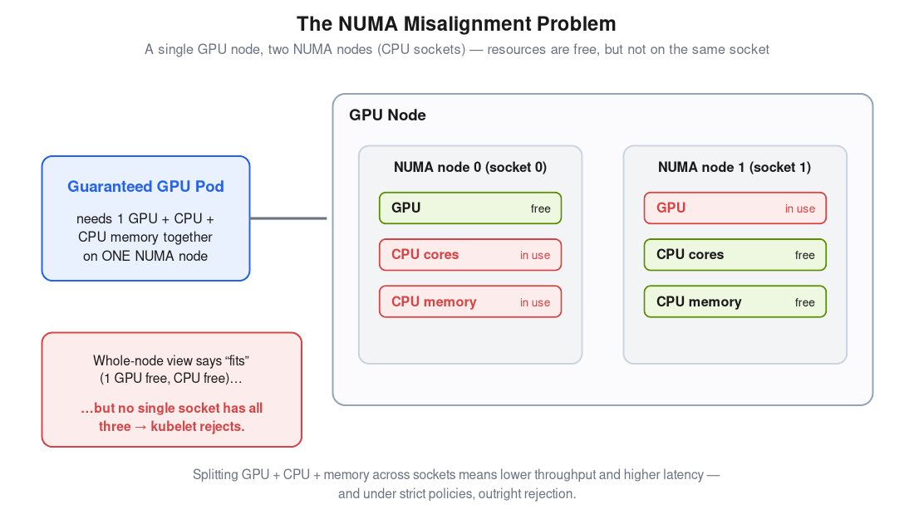
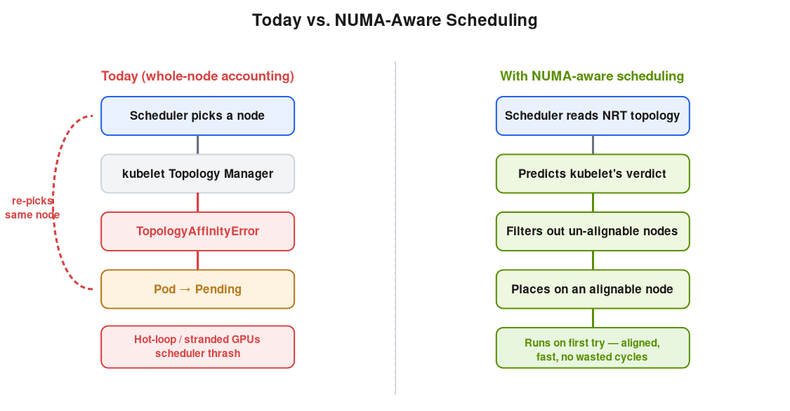
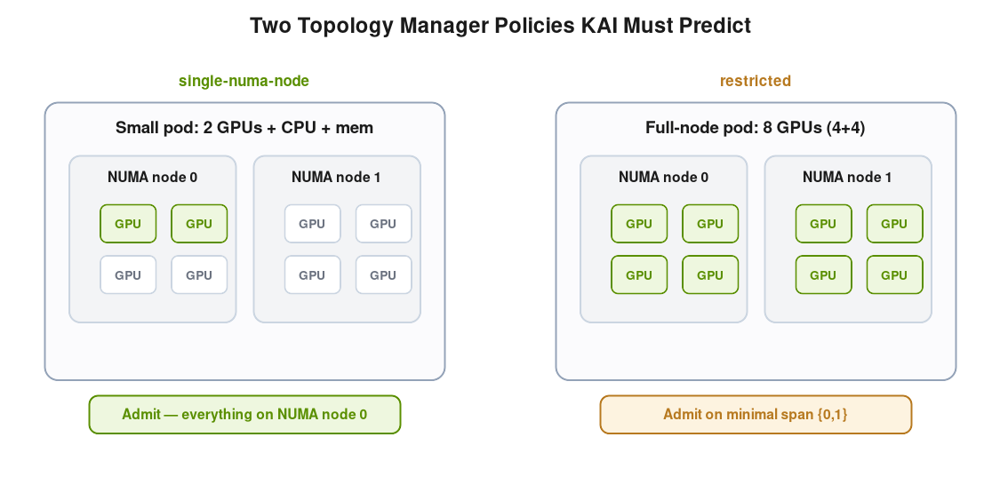

# Numa-Aware Scheduling in NVIDIA Run:ai

_Why where a workload runs inside a GPU node matters, and how Run:ai gets it right_

Modern GPU servers are not flat machines. A typical AI node has two or more CPU sockets, and the CPU cores, system memory, and devices attached to each socket form a NUMA node (Non-Uniform Memory Access node). When a workload's GPU, CPU cores, and memory all live on the same NUMA node, it runs at the hardware's rated performance. When they are split across sockets, every transfer crosses the slow inter-socket interconnect, and throughput and latency suffer.

This matters most for inference. Tokenization, detokenization, and staging of model weights and KV cache into the GPU all happen CPU-side and stream across the CPU-to-GPU link, so GPU/CPU/memory locality sits directly on the latency-critical path. This post explains where Kubernetes falls short on its own, and how Run:ai's NUMA-aware scheduling closes the gap end-to-end.

### The NUMA Misalignment Problem

At a high level: a node can look like it has free GPUs and free CPU on paper, while in reality the free GPU sits on one socket and the free CPU and memory sit on the other. Nothing on that node can serve a workload that needs all of its resources together.

Kubernetes coordinates NUMA alignment through a kubelet component called the Topology Manager. It can be set to one of four policies: none, best-effort, restricted, or single-numa-node. The policy determines how strictly CPU, memory, and devices must align on a single NUMA node at the moment a pod is admitted.

### Policy "none": The Silent Performance Tax

Out of the box, Kubernetes does nothing to keep a workload's resources together on one socket. On a busy GPU node, fragmentation builds up, and an inference pod often ends up with its CPU threads on socket 0, its GPU on socket 1, and its memory drifting between both. Nothing fails. Dashboards stay green. The only signal is that tokens-per-second is lower than the model card promised and tail latency is wider than the SLO budget can absorb. For latency-sensitive inference, this is real money quietly leaking out of the cluster.

### Strict Policies Without a NUMA-Aware Scheduler: Stuck Pods

At a high level: turning on strict NUMA policies looks like the obvious fix, but if the scheduler is not NUMA-aware too, the result is worse than silent slowdowns: inference deployments get stuck in admission failures and GPUs become stranded.

An administrator who notices the cross-socket tax will reach for one of the two rejecting policies. single-numa-node requires the entire pod to fit on one NUMA node; restricted admits a pod only on the minimal NUMA-node span that satisfies its needs. Both policies do what they advertise inside one node. The problem is the layer above: the scheduler is not NUMA-aware. It places pods using whole-node accounting (total free GPUs, total free CPU, total free memory) with no idea how those resources are distributed across the sockets.

The failure pattern is predictable. The scheduler sees a node with a free GPU and enough free CPU in total, and binds the pod there. The kubelet then tries to admit it, discovers the free GPU is on the opposite socket from the free CPU and memory, and rejects the pod with a TopologyAffinityError. The pod goes back to Pending. The scheduler, still looking at whole-node free counts, often re-picks the same node, wasting scheduling cycles, leaving capacity that looks free but cannot accept work, and stranding GPUs that should be earning their keep. Inference deployments end up bouncing between Pending and admission errors. On-call engineers chase the symptom across hosts before realizing the scheduler and the kubelet disagree about what the cluster can actually run.

### How Run:ai Solves It

At a high level: Run:ai makes the scheduler itself NUMA-aware, so it predicts what the kubelet would decide before binding a pod. Workloads land only on nodes that can actually accept them, with full compliance for both restricted and single-numa-node policies. A Run:ai on-node placement agent then reads ground-truth NUMA placement back from the kernel to keep the scheduler's view aligned with reality.

#### Predicting the Kubelet's Verdict From Per-Node Topology

The Run:ai Scheduler (built on KAI Scheduler) consumes the per-node NodeResourceTopology (NRT) custom resource, an open Kubernetes standard that describes each node's per-socket resources and its Topology Manager policy. NRT is produced on each node by a standard exporter (Node Feature Discovery's topology-updater or the resource-topology-exporter), so the same plumbing works on stock Kubernetes, OpenShift, and NVIDIA Mission Control-managed clusters.

With NRT in hand, the Scheduler predicts each candidate node's admission verdict. For a single-numa-node policy, it places the workload only where all its resources fit on one NUMA node. For restricted, it admits a multi-NUMA workload only on the minimal NUMA-node span the kubelet would accept (for example, a 6-GPU pod on a node with a 4+2 split). For best-effort and none nodes, it passes through and lets the kubelet decide. The Scheduler reads each node's policy from that node's NRT object and self-configures, engaging only on nodes that actually run a strict policy.

The kubelet remains the backstop. Even if the Scheduler ever mispredicts, the kubelet enforces real alignment at admission, so no workload is ever mis-pinned. The worst case is a wasted reschedule, not an incorrect placement.

#### The Placement Agent: Trust, but Read the Node

Predicting the kubelet's verdict is the right primary mechanism, but prediction and reality can drift. Foreign pods that Run:ai did not place, concurrent binds, and kubelet restarts can all cause small divergences. There is also a more subtle case: when more than one NUMA node would satisfy a workload's request, the kubelet's local CPU Manager is free to pick either, and the Scheduler cannot know in advance which one it chose.

Run:ai closes this gap with a proprietary on-node placement agent: a DaemonSet that reads observed NUMA placement directly from the kubelet's podresources API. For every aligned pod, it reports the NUMA node where CPU and memory were actually pinned and which devices were assigned. The Scheduler uses this ground truth to keep its per-socket accounting matched to the kubelet's, so reclaim and preemption decisions are accurate and the Scheduler self-heals after any divergence.

## Visibility and Per-Node-Pool Control

#### Diagnosability

When a workload cannot be NUMA-placed, the AI practitioner submitting it sees a clear NUMA decision reason on the workload itself, not a generic Pending status. "No node where this workload's GPU, CPU, and memory all fit on a single NUMA node" is a different problem from "no free GPUs", and Run:ai now says which one is happening.

#### Per Node-Pool Control

Different workloads need different NUMA policies. Latency-bound inference services want single-numa-node so every microsecond of cross-socket traffic is squeezed out. Long-running training jobs often want a relaxed policy: bin-pack however you like, because a few percent of bandwidth does not move the needle against shorter queue times. Forcing one policy onto the whole cluster means choosing whose performance to sacrifice.

Run:ai supports NUMA-aware scheduling as an opt-in, scoped to specific node pools. Unless there is a specific reason to reach for a stricter policy, best-effort is the right default: it prefers NUMA alignment when the topology allows it, but never rejects a pod on topology grounds, so no workload gets stuck on an admission error and no GPU sits stranded behind one, maximizing both scheduling success and GPU fleet utilization. It is the natural fit for pools with a mix of workloads and for teams that are not strict about service latency.

For latency-critical inference pools, restricted is often worth the trade-off: production inference frequently spans multiple GPUs that exceed a single NUMA node's capacity (for example, an 8-GPU model on a B300 node or a 4-GPU model on a GB300 node), and restricted gives those workloads tight alignment on the minimal NUMA-node span the kubelet will admit. single-numa-node is the strictest option, and should be reserved for pools where the administrator knows the largest workload's resources fit within a single NUMA node's capacity, otherwise legitimate workloads will be rejected. Each pool runs the policy that matches its workload profile, and the Run:ai Scheduler engages on the pools where it adds value.

## The Bottom Line

Without NUMA-aware scheduling, admins who turn on a strict Topology Manager policy can hit a persistent failure mode: the scheduler keeps binding pods to nodes that look fine at the whole-node level but the kubelet cannot align, and legitimate workloads bounce between Pending and admission errors. Run:ai's NUMA-aware scheduling closes this gap: the scheduler places workloads on nodes that can actually align them, so the persistent bounce loop goes away, and for managers the result is more throughput per GPU dollar: the same hardware delivers higher inference performance, GPUs previously stranded by NUMA fragmentation come back into play, and the long tail of stuck-pod incidents goes away. For engineers, the cluster behaves the way the documentation promised: inference deployments either run on aligned resources or stay pending with a clear, actionable reason. For platform operators, strict Topology Manager policies become a practical option in production, with per-node-pool control so inference and training can share the same cluster without one type forcing compromises on the other.

NUMA-aware scheduling is one of those topics where the absence of failures is the point. With Run:ai's end-to-end approach (NRT-based prediction, full compliance with restricted and single-numa-node, the Run:ai on-node placement agent, clear visibility, and per-node-pool control), the layer that decides where your inference workload runs inside the box stops being the silent tax on your AI infrastructure.
